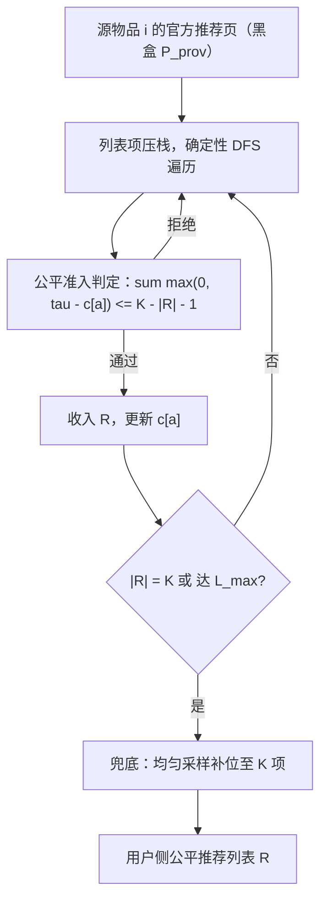

# Towards Principled User-side Recommender Systems (面向有理论根基的用户侧推荐系统)

- **会议/期刊**: CIKM 2022
- **作者与机构**: Ryoma Sato（京都大学 / RIKEN AIP，单作者）
- **推荐链路定位**: 重排（用户侧后处理，作用于官方 item-to-item 推荐列表）
- **研究方向**: 去偏公平、可信隐私与工业架构 / 图神经网络与知识图谱推荐
- **论文原文**: [https://arxiv.org/abs/2208.09864v1](https://arxiv.org/abs/2208.09864v1)
- **开源代码**: [https://github.com/joisino/consul](https://github.com/joisino/consul)（基线 BPR 使用 `implicit` 库）

## TL;DR (1分钟核心速览)

官方推荐系统是黑盒且可能不公平，用户只想要"我自己定义的公平"。本文先用 k-NN 图度量恢复理论证明：仅凭网页上可见的 top-$K$ 推荐列表构成的**无权 k-NN 图**，就能把隐藏物品嵌入恢复到相似变换意义下，因此"用户侧推荐"是**良定义**的；但该精确恢复方案（ETP）需下载全图，不可行。作者据此提出一致性、可靠性、局部性三公理，并给出免训练的确定性 DFS 算法 Consul，可证同时满足三公理。在 Full-Ranking 协议下，Consul 的 nDCG/Recall 与 Oracle 持平（如 MovieLens-oldness nDCG 0.0321 vs. 0.0321），而查询次数仅为 PrivateWalk 的 1/8–1/19、PrivateRank 的 1/86–1/1136。

## Background & Motivation (背景与核心矛盾)

- **主流范式**: P-fairness 公平推荐几乎全部由**服务提供方**实现（后处理、正则、重排），用户只能通过点赞/点踩被动反馈；否则只能等平台上线公平引擎。
- **前人局限**: (i) Sato 的 PrivateRank / PrivateWalk 是纯启发式——PrivateRank 非局部（需全图），PrivateWalk 虽局部但**破坏一致性**（$\tau=0$ 时 nDCG 也会低于官方）；(ii) "无日志数据能否构造推荐系统"在信息论上是否良定义，此前无答案。
- **核心洞察 (Key Insight)**: 把用户可爬取的推荐结果视为图 $G=(V,E)$，$E=\{(i,j)\mid \exists k\in[K],\mathcal{P}_{\text{prov}}(i)_k=j\}$，则$G$恰是隐藏嵌入$\{\boldsymbol{x}_i\}$的 **无权 k-NN 图**。由 Hashimoto 等与 Terada–von Luxburg 的度量恢复结论，LOE 可从无权 k-NN 图恢复$\hat{\boldsymbol{x}}_i=Q\boldsymbol{x}_i+\boldsymbol{b}$（$Q$ 正交），即**原始推荐结果已含足够信息**——用户侧推荐在原则上可行。
- **本文切入点**: 既然"精确恢复 + 后处理"(ETP) 需下载全部 $n$ 个物品页（且作者实测 LOE 在 MovieLens-100k 上一周未收敛），就绕开逆向工程，用**公理化设计**直接造一个只访问常数个页面的算法。

## Method (核心方法设计)

### 1. 整体框架 (Overall Architecture)

用户在源物品 $i$的页面上拿到官方 top-$K$列表，把列表项压栈，沿推荐网络做**确定性深度优先遍历**；每访问一个页面，就对返回的$K$个候选逐一做"公平准入判定"，安全则收入结果集$R$并累加组计数$c[a]$；栈回溯直到凑满$K$项或触达访问上限$L_{\max}$；若仍不足$K$，用全库均匀采样补位（保证输出长度）。整个过程**无训练、无参数学习、无需离线建图**，单次推荐仅需$L_{\text{ave}}$ 次页面访问，可在线实时完成。

### 2. 关键设计拆解 (Key Designs)

1. **三公理体系（Consistency / Soundness / Locality）**：把模糊的"用户侧推荐好不好"变成可证伪的判据。*一致性*：$\tau=0$时输出必须严格等于官方列表$\mathcal{P}_{\text{prov}}(i)$（不因公平机制白付精度代价）；*可靠性*：$0\le\tau\le K/|\mathcal{A}|$时每组物品数$\ge\tau$ 有硬保证；*局部性*：生成推荐时不得加载整个推荐网络。表 2 表明 Post-processing、PrivateRank、PrivateWalk、ETP **各自至少缺一条**，这正是本文的问题定位。

2. **不变式驱动的准入判定（Soundness 的构造性证明）**：核心是把"还要补多少件"写成标量不变式 $\sum_{a\in\mathcal{A}}\max(0,\tau-c[a])\le K-|R|$，并维护$s=\sum_a\max(0,\tau-c[a])$使判定$O(1)$。候选$j$ 的准入条件为

$$\sum_{a\neq a_j}\max(0,\tau-c[a])\le K-|R|-1,$$

即"放进 $j$之后剩余名额仍够补齐其他所有组"。直觉上这是把公平约束前移成**可行性剪枝**：任何时刻都保留一条能走到合法终态的路径，故最终必满足$\forall a, c[a]\ge\tau$，且不会像 PrivateWalk 那样靠随机游走碰运气。

3. **DFS 取代随机游走（一致性与效率的双重收益）**：PrivateWalk 每取一个物品就重启游走，深距受保护物品需反复长途跋涉；Consul 改为**栈式连续搜索**（继续走而非重启）+ **一次用满整页 $K$个候选**（而非只取 1 个）+ **确定性顺序**（消除方差）。这三点使其在$\tau=0$时自然退化为直接返回官方列表（一致性），并把通信复杂度从$O(KL_{\text{ave}})$压到$L_{\text{ave}}$，时间复杂度$O(K(|\mathcal{A}|+L_{\text{ave}}))$，**与物品总数$n$ 无关**。方法免训练、免负采样、免损失函数，工程上只需一个爬虫 + 计数器。

## Experimental Setup & Evaluation Protocol (实验设置与评估协议)

- **数据集与预处理**:

| 数据集 | #Users | #Items | #Interactions | 稀疏度/密度 | 特征/场景说明 |
| :--- | :---: | :---: | :---: | :---: | :--- |
| Adult | — | 32,561 | — | — | 人口统计特征做 kNN 推荐；敏感属性 = 性别；标签 = 收入 >50K |
| MovieLens-100k | 943 | 1,682 | 100,000 | 6.31% | 敏感组①老片（<1990）②冷门片（<50 评价） |
| MovieLens-1M | 6,040 | 3,706 | 1,000,209 | 4.47% | 仅用于众包用户研究（$K=6,\tau=3$） |
| Amazon H&K | — | — | — | — | 原文未报告规模；`10-core` 迭代过滤 |
| LastFM | — | — | — | — | 原文未报告规模；`10-core` 迭代过滤 |

- **数据划分与防穿越**: **无 train/test 划分**——任务是对**全部物品**逐一生成 item-to-item 列表，评估在全体物品上取平均，因此不存在时间穿越问题；公平约束在生成时即硬性注入（$K=10,\tau=5$，即 5 件受保护 + 5 件非受保护，实测全部方法均完全平衡，故只报性能不报公平分）。
- **排名评测协议**: **Full-Ranking（全库未交互物品排序）**，作者明确拒绝负采样以避免有偏评估；指标 nDCG@10、Recall@10，Adult 用 Accuracy（同标签比例）。访问次数 `Access` 作为通信成本指标单独报告。
- **对比基线与超参**: Oracle（用隐藏真实相似度 + 同样公平后处理，理想上界）、PrivateRank、PrivateWalk（均取原文默认超参，作者称其对超参不敏感）、ETP（因 LOE 一周未收敛而放弃）。Provider 端：Adult 用人口特征 kNN，其余用 BPR（`implicit` 默认参数）。

## Key Experimental Results (实验关键数据)

### 1. 主实验对比 (Main Results)

| 数据集 / 指标 | Oracle | PrivateRank | PrivateWalk | **Consul** | Access 降幅 |
| :--- | :---: | :---: | :---: | :---: | :---: |
| Adult · Accuracy↑ | 0.788 | 0.781 | 0.762 | **0.765** | 39190 → **34.5**（↓1136×） |
| ML-old · nDCG@10↑ | 0.0321 | 0.0314 | 0.0273 | **0.0321** | 1682 → **19.6**（↓86×） |
| ML-old · Recall@10↑ | 0.057 | 0.055 | 0.049 | **0.057** | 同上 |
| ML-pop · nDCG@10↑ | 0.034 | 0.034 | 0.029 | **0.033** | 1682 → **4.6**（↓366×） |
| ML-pop · Recall@10↑ | 0.064 | 0.062 | 0.054 | **0.060** | 同上 |
| Amazon · nDCG@10↑ | 0.0326 | 0.0325 | 0.0217 | **0.0310** | 1171 → **7.3**（↓160×） |
| LastFM · nDCG@10↑ | 0.0652 | 0.0641 | 0.0424 | **0.0639** | 1507 → **6.5**（↓232×） |
| LastFM · Recall@10↑ | 0.111 | 0.107 | 0.080 | **0.107** | 同上 |

### 2. 消融实验 (Ablation Study)

原文未做常规"去模块"消融，而是给出**设计选择 × 公理满足性**的等价消融（表 2），并辅以用户研究与线上实证：

| 设计选择 | Consistent | Sound | Local | 缺失后果 |
| :--- | :---: | :---: | :---: | :--- |
| Post-processing（直接截断官方列表） | ✓ | ✗ | ✓ | 列表内无受保护组时无法补足 |
| PrivateRank | ✓ | ✓ | ✗ | 需全图，Adult 上 39,190 次访问 |
| PrivateWalk | ✗ | ✓ | ✓ | $\tau=0$ 仍偏离官方（存在反例） |
| ETP（LOE 恢复 + 后处理） | ✓ | ✓ | ✗ | 需下载全部 $n$ 页；实测 1 周未收敛 |
| **Consul** | ✓ | ✓ | ✓ | — |

| 用户研究（100 次盲测比较） | Provider 胜 | Consul 胜 |
| :--- | :---: | :---: |
| 相关性（Relevance） | 52 | 48 |
| 多样性（Diversity） | 39 | **61** |

### 3. 关键实验发现 (Key Findings)

1. **本地性换来的精度损失几乎为零**：Consul 在 ML-old 上 nDCG 0.0321 **完全等于** Oracle 上界、且高于 PrivateRank 的 0.0314；在 LastFM 上 Recall 0.107 与 PrivateRank 持平，而访问次数从 1507 降到 6.5（↓232×）——说明"精确恢复整张图"对公平重排是**信息冗余**的。
2. **效率提升不是常数级而是量级级**：PrivateWalk 在 Adult 上需 270.5 次访问，Consul 仅 34.5；在 Amazon/LastFM 上 Consul 只需 6–7 次访问，这使**在线实时推理**成为可能（无需离线维护推荐图），而 PrivateWalk 近 100 次访问只能离线预计算。
3. **用户侧系统能挖出官方系统结构性看不见的信息**：众包在多样性上以 61:39 显著偏好 Consul，而相关性仅 52:48 微差；案例中 "Terminator 2" 的官方列表全是 1990s  contemporaneous 科幻片，Consul 却能召回 Alien(1979)、Star Wars(1977) 等经典；真实 Twitter 上 "Hugh Jackman" 的官方推荐 6 人全为男性，Consul 仅 5 次访问即给出 3 男 3 女的完全平衡且全为演员的列表（PrivateWalk 需 23 次）。

## Highlights & Limitations (亮点、对比与审稿批判)

- **与代表作对比 (vs. Prior Work)**: 与 PrivateRank 的本质区别是**放弃全图、改为路径局部搜索**，用可行性剪枝替代全局公平后处理；与 PrivateWalk 的区别是**确定性 DFS + 整页复用 + 连续搜索**，从而把"局部但不可证一致"变成"局部且三公理齐备"；与 ETP 的区别是**跳过嵌入恢复**，只求解用户真正需要的公平列表。相较 steerable/scrutable 推荐，本文的系统由**用户而非平台**实现，平台不配合也能用。
- **可迁移亮点**: (i) "把约束写成剩余容量不变式 + 准入剪枝"这一模式可直接迁移到任何**流式/在线约束重排**（如曝光配额、多样性配额、生态扶持比）；(ii) 用无权 k-NN 图做度量恢复，为**推荐结果隐私审计**提供了可操作工具——推荐列表本身就是特征泄漏面。
- **审稿级局限批判**: (i) 敏感属性 $a_i$被假设为**可观测**，真实场景需先训练属性分类器，误差会直接击穿 soundness 的硬保证；(ii) 只处理 item-to-item、单保护属性、等比例目标，多属性交叉公平与个性化配额未验证；(iii) 实验规模偏小（100k 级、$K=10$），未报告$L_{\max}$与$\tau$的敏感度曲线，也未与近年基于 GNN 的公平重排基线对比；(iv) 一致性定义绑定 nDCG 与"$\tau=0$ 严格等于官方"，若官方本身质量差，该公理的价值有限。

## Rating (四维评分)

- **方法创新性 (Novelty)**: ⭐⭐⭐⭐ （首次把无权 k-NN 度量恢复理论接到用户侧推荐与隐私审计上，三公理体系干净且互不冗余）
- **评估协议与实验扎实度 (Protocol & Experiments)**: ⭐⭐⭐ （Full-Ranking 拒绝负采样值得肯定，并有众包与 Twitter 实证，但数据集小、缺超参敏感度与统计显著性检验）
- **写作与数学规范度 (Clarity & Rigor)**: ⭐⭐⭐⭐ （一致性/可靠性/局部性三定理证明完整，归纳法构造清晰，复杂度分析到位；符号表与反例构造规范）
- **工业落地与复现价值 (Industrial & Practical Value)**: ⭐⭐⭐⭐ （免训练、$O(1)$ 判定、6–7 次请求即可实时出结果，代码开源，作为浏览器插件/客户端代理的落地门槛极低）

