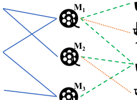
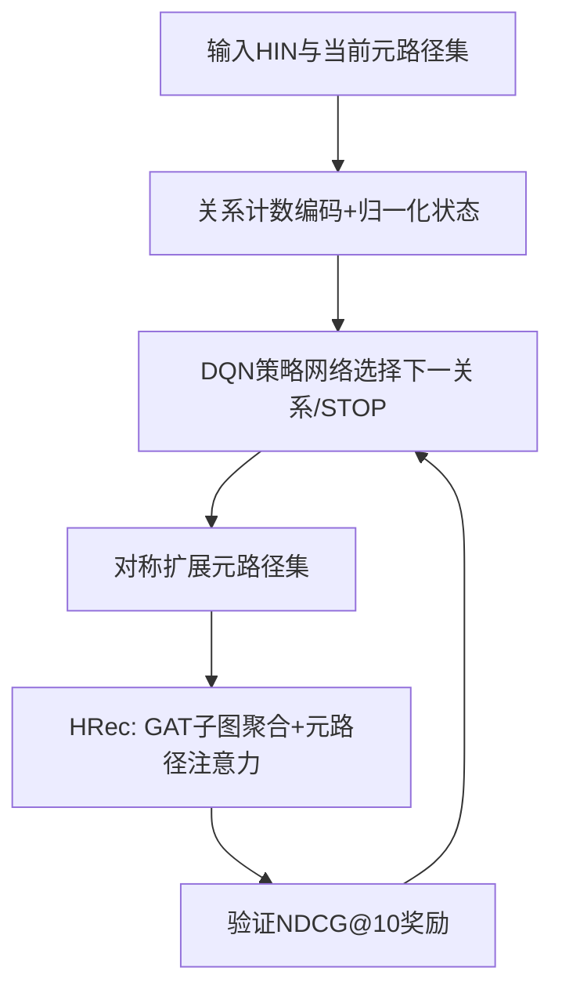
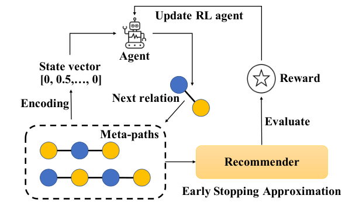

# Automatic Meta-Path Discovery for Effective Graph-Based Recommendation (面向图推荐的有效元路径自动发现)

- **会议/期刊**: CIKM 2022
- **作者与机构**: Wentao Ning, Reynold Cheng, Jiajun Shen 等；香港大学、南方科技大学、TCL Research、西澳大学
- **推荐链路定位**: 召回/表征学习（基于异质信息网络的元路径推荐）
- **研究方向**: 图神经网络与知识图谱推荐
- **论文原文**: [https://arxiv.org/abs/2112.12845v5](https://arxiv.org/abs/2112.12845v5)
- **开源代码**: [https://github.com/Stevenn9981/RMS-HRec](https://github.com/Stevenn9981/RMS-HRec)

## TL;DR (1分钟核心速览)

元路径推荐器（MPR）的性能高度依赖人工挑选的元路径，且不同MPR、不同数据所需集合不同。本文提出模型无关的RMS框架：用DQN根据元路径集合编码逐步扩展关系，以下游推荐NDCG@10增益为奖励，并用轻训练早停近似将搜索加速逾100倍；进一步提出HRec，以GAT聚合各元路径同质子图并用元路径级注意力融合。在Yelp/Douban/TCL的Leave-One-Out、1正+499负采样排序协议下，RMS-HRec的HR@3较最佳基线分别提升约12.7%/8.7%/3.0%，平均HR提升约7%。

## Background & Motivation (背景与核心矛盾)

- **主流范式**: HERec、MCRec等MPR依赖人工给定元路径，在HIN上抽取高阶语义并提升可解释性。
- **前人局限**: 元路径搜索空间随节点类型数$n$、长度$l$、路径数$m$呈$O(n^{l}m)$指数膨胀；且不同MPR要求不同首尾类型，最佳集合随模型与数据变化。Yelp上仅换元路径集，HR@1即可差17.7%。
- **核心洞察 (Key Insight)**: 元路径集合质量是MPR性能的关键变量，可通过下游推荐反馈直接指导元路径组合搜索，而非依赖领域专家。
- **本文切入点**: 将元路径集合扩展建模为RL序列决策，提出可与任意MPR插拔的RMS，并配套HRec验证。

<figure class="paper-figure" markdown="span">
  <figcaption>图1：一个电影HIN示例。包含四种节点类型（即用户、电影、演员和导演）以及节点间的三种关系类型（即观看、出演、执导）。</figcaption>
</figure>
图1：电影HIN示例，含用户、电影、演员、导演四类节点与观看/出演/执导三类关系。

## Method (核心方法设计)

### 1. 整体框架 (Overall Architecture)

RMS先按关系类型ID构造元路径集合的定长计数向量，作为DQN状态；策略网络从“所有关系+STOP”中选择动作扩展当前集合，并自动补对称关系以满足MPR首尾类型约束。新集合送入下游MPR轻训练若干轮，以验证集NDCG@10相对上一集合的增益为奖励更新策略网络。训练完成后用搜索到的元路径集训练HRec：每条元路径生成同质子图，GAT聚合邻居，元路径级注意力融合，内积打分并用BPR优化。早停近似、邻居采样与子图密度阈值共同控制搜索和GNN训练开销。

<figure class="paper-figure" markdown="span">
  <figcaption>图2：RMS框架概览。RMS使用一个智能体（策略网络）根据当前元路径集合的编码生成新的元路径集合。然后，下游推荐器以新生成的元路径集合为输入，并用其性能增益更新智能体。推荐器可以是任意基于元路径的模型。我们还提出一种早停近似技术以加速训练过程。</figcaption>
</figure>
图2：RMS框架概览，策略网络扩展元路径集，下游推荐器反馈NDCG奖励，早停近似加速训练。

### 2. 关键设计拆解 (Key Designs)

1. **元路径集合状态编码与约束扩展**：痛点是人造元路径不可扩展且MPR输入格式各异。RMS为每个关系类型计数并L2归一化：$s_i=\mathrm{Normalize}(\sum_{\phi\in\Phi_i}E_\phi)$。动作选关系后自动补反向关系，例如预测$M\!-\!A$则补$A\!-\!M$，保证扩展路径仍以用户/物品开头结尾；若扩展不改变集合则奖励-1。该编码固定维度、反映关系权重，故可适配HERec/MCRec等不同MPR。
2. **下游奖励与早停近似**：若每个候选集合都训练到收敛，RL搜索不可行。奖励定义为$R(s_i,a_i)=N(s_i,a_i)-N(s_{i-1},a_{i-1})$，$N$取NDCG@10；仅轻训练推荐器1至数轮即评估。轻训练排序与收敛排序高度相关，使搜索时间降低100倍以上，代价是可能选到次优集合。
3. **HRec的元路径子图GAT与路径级注意力**：每条元路径先生成同质子图，GAT区分邻居重要性；再用注意力学习路径权重：$w_{\phi_x}=\frac{1}{|V_x|}\sum_{i\in V_x}q_{\phi_x}^{\top}\sigma(\mathrm{MLP}(h_i^{\phi_x}))$，$\beta_{\phi_x}=\frac{\exp(w_{\phi_x})}{\sum_{x=1}^{X}\exp(w_{\phi_x})}$，$H=\sum_{x=1}^{X}\beta_{\phi_x}H_x$。最终$\hat{y}(u,i)=h_u^{\top}h_i$。训练用BPR损失$\mathcal{L}_{rec}=\sum_{(u,i,j)\in O}-\ln\sigma(\hat{y}(u,i)-\hat{y}(u,j))$；RMS侧用DQN Huber损失，$\delta=Q(s,a)-(r+\gamma\max_{a'}Q(s',a'))$。推理无负采样，但需多子图GAT前向；NS与密度阈值$t$过滤低判别力元路径以控内存。

## Experimental Setup & Evaluation Protocol (实验设置与评估协议)

- **数据集与预处理**: 原文未报告用户-物品交互数与密度，仅给HIN规模；未说明5-core等过滤。

| 数据集 | #Nodes | #Edges | #Relations | #Interactions/密度 | 特征/场景说明 |
| :--- | :---: | :---: | :---: | :---: | :--- |
| Yelp | 31,092 | 976,276 | 10 | 未报告 | 用户-商户-城市-类别- Compliment |
| Douban Movie | 37,595 | 3,429,882 | 12 | 未报告 | 用户-电影-类型-演员-组-导演 |
| TCL | 122,284 | 1,084,154 | 16 | 未报告 | 用户-电影-标签-演员-导演-版权-地区-年代-语言 |

- **数据划分与防穿越**: `Leave-One-Out`，每用户最后交互作测试正样本。
- **排名评测协议**: `Sampled Ranking`，每正样本随机采499负样本，在500候选内排序；指标HR@1/HR@3/NDCG@10。训练负采样为BPR随机未交互负样本，具体比例未报告。
- **对比基线与超参**: 基线含BPR、NCF、CFKG、CKE、HERec、MCRec、GEMS、KGAT；Embedding $d=64$，hidden 32，batch 90000；RMS用3层MLP(32,64,32)，lr=1e-3，memory 10000，最大步长HRec/HERec/MCRec为4/3/5。未报告显著性检验。

## Key Experimental Results (实验关键数据)

### 1. 主实验对比 (Main Results)

| 方法 | Yelp HR@3 | Yelp NDCG@10 | Douban HR@3 | Douban NDCG@10 | TCL HR@3 | TCL NDCG@10 |
| :--- | :---: | :---: | :---: | :---: | :---: | :---: |
| BPR | 0.1025 | 0.1301 | 0.1421 | 0.1768 | 0.2704 | 0.2886 |
| NCF | 0.1251 | 0.1522 | 0.1605 | 0.1974 | 0.2513 | 0.2673 |
| CFKG | 0.1246 | 0.1477 | 0.1650 | 0.2033 | 0.2984 | 0.3145 |
| CKE | 0.1092 | 0.1360 | 0.1581 | 0.1947 | 0.2818 | 0.3023 |
| HERec | 0.1317 | 0.1540 | 0.1961 | 0.2236 | 0.2860 | 0.3055 |
| MCRec | 0.0979 | 0.1215 | 0.1613 | 0.1984 | 0.1708 | 0.2056 |
| GEMS | 0.0294 | 0.0408 | 0.0591 | 0.0740 | 0.0701 | 0.0923 |
| KGAT | 0.1151 | 0.1388 | 0.1669 | 0.2042 | 0.2990 | 0.3162 |
| **RMS-HRec** | **0.1484** | **0.1740** | **0.2131** | **0.2400** | **0.3079** | **0.3230** |
| **Improv. vs 最佳基线** | **+12.7%** | **+13.0%** | **+8.7%** | **+7.3%** | **+3.0%** | **+2.2%** |

### 2. 消融实验 (Ablation Study)

| 变体 | Yelp HR@3/NDCG@10 | Douban HR@3/NDCG@10 | TCL HR@3/NDCG@10 |
| :--- | :---: | :---: | :---: |
| **RMS-HRec 完整** | **0.1484/0.1740** | **0.2131/0.2400** | **0.3079/0.3230** |
| w/o RMS → Greedy | 0.1381/0.1633 | 0.1800/0.2076 | 0.2895/0.3058 |
| w/o RMS → Random | 0.1181/0.1449 | 0.1946/0.2221 | 0.2875/0.3035 |
| w/o RMS → MPDRL | 0.1344/0.1589 | 0.1757/0.2041 | 0.2815/0.2993 |
| w/o 关键元路径* | 0.1441/0.1696 | 0.2127/0.2381 | 0.3057/0.3211 |

*注：三个数据集分别移除Yelp-UBU、Douban-MAM、TCL-UMU。

### 3. 关键实验发现 (Key Findings)

1. RMS在HRec上全面优于Greedy/Random/MPDRL：Yelp HR@3由0.1381/0.1181/0.1344提升至0.1484，说明下游NDCG奖励能筛出高判别力关系；但对MCRec增益较小，归因于其对元路径敏感度较低。
2. 元路径并非越多越好：在RMS集合中添加任一额外元路径均掉点，如Yelp加BUBCaB后NDCG@10由0.1740降至0.1636；移除关键元路径同样下降，验证集合选择而非简单堆叠是核心。
3. RMS-HRec在Yelp/Douban显著超过KGAT等GNN基线，但在TCL对KGAT仅+3.0% HR@3，说明工业异质图关系冗余时元路径增益收窄；早停近似虽可能牺牲最优性，但将搜索时间降低100倍以上。

## Highlights & Limitations (亮点、对比与审稿批判)

- **与代表作对比 (vs. Prior Work)**: HERec/MCRec仍需人工元路径；GEMS搜索meta-structure但不能直接供MPR使用；MPDRL/RL-HGNN面向图挖掘或节点嵌入，难以生成符合MPR格式约束的元路径集合。RMS的模型无关与格式约束是其本质区别。
- **可迁移亮点**: 用“轻训练下游验证指标”作为组合搜索奖励，可迁移到特征交叉、图增广策略选择；子图密度阈值+邻居采样是控制多子图GNN内存的实用技巧。
- **审稿级局限批判**: 早停近似仅基于轻训练排序，可能选出次优元路径；评估仅500候选采样排序，未报告全库排序与显著性检验，且TCL为私有数据、交互数未披露，复现与泛化结论需谨慎；推理需对多条元路径分别跑GAT，路径数多时延迟与内存仍偏高。

## Rating (四维评分)

- **方法创新性 (Novelty)**: ⭐⭐⭐⭐ （首次将RL元路径集合搜索做成模型无关插件，状态编码与格式约束设计较扎实）
- **评估协议与实验扎实度 (Protocol & Experiments)**: ⭐⭐⭐ （三数据集与多基线较完整，但仅采样排序、无显著性检验且交互统计缺失）
- **写作与数学规范度 (Clarity & Rigor)**: ⭐⭐⭐⭐ （核心公式与RMS/HRec流程清晰，奖励与早停近似的理论说明偏经验）
- **工业落地与复现价值 (Industrial & Practical Value)**: ⭐⭐⭐⭐ （代码开源、可插拔MPR且搜索开销可控，但多子图推理成本仍需工程优化）

