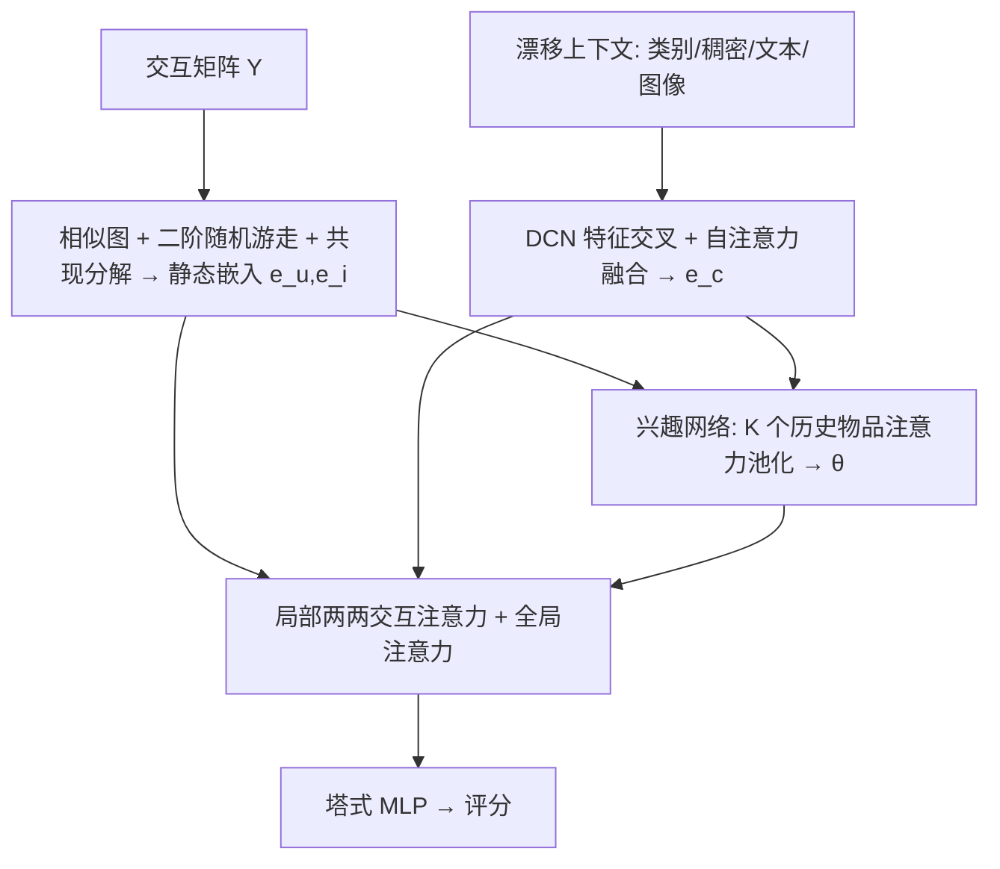
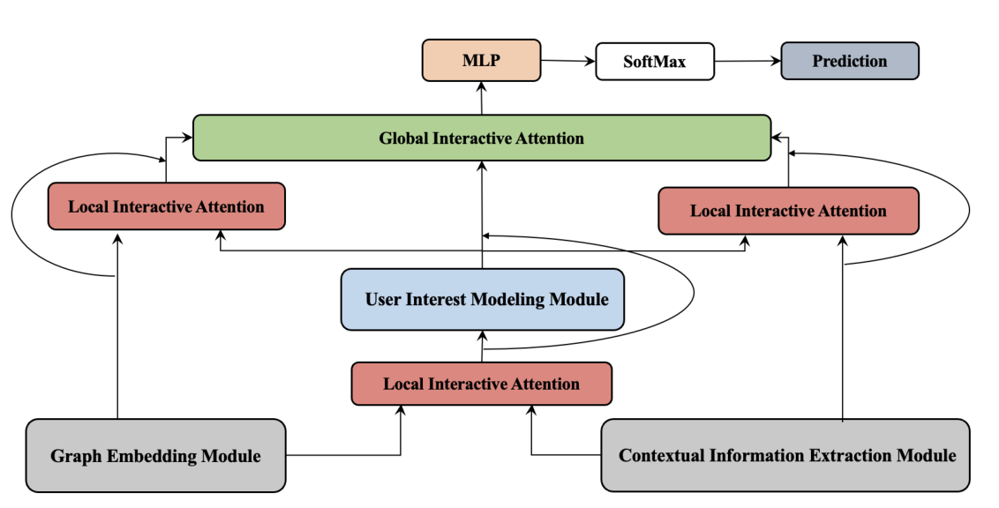

# HySAGE: A Hybrid Static and Adaptive Graph Embedding Network for Context-Drifting Recommendations (面向上下文漂移推荐的静动混合图嵌入网络)

- **会议/期刊**: CIKM 2022
- **作者与机构**: Sichun Luo, Xinyi Zhang, Yuanzhang Xiao, Linqi Song（香港城市大学、首都经济贸易大学、夏威夷大学马诺阿分校）
- **推荐链路定位**: 精排（评分预测）
- **研究方向**: 图神经网络与知识图谱推荐 / 多模态推荐
- **论文原文**: [https://arxiv.org/abs/2208.09586v1](https://arxiv.org/abs/2208.09586v1)
- **开源代码**: 暂未开源

## TL;DR (1分钟核心速览)

针对 AIoT/移动场景中"电池、位置、存储等上下文高频漂移而用户-物品交互相对静态"的推荐痛点，本文提出 HySAGE：用共现+二阶随机游走矩阵分解学习**静态**图嵌入（不需随上下文重训图），再用 Sentence-BERT/ResNet+DCN 特征交叉学习**自适应**上下文嵌入，经用户兴趣注意力与多层交互注意力融合后送入 MLP。在 Yelp/Kindle/ML-100K/Kaggle 四个数据集上以 Leave-One-Out + HR/NDCG@10 评测，相对最优基线平均提升 24.7%(HR) 与 71.5%(NDCG)。

## Background & Motivation (背景与核心矛盾)

- **主流范式**: 图协同过滤（NGCF、PinSage、LightGCN）把用户-物品二部图做多跳消息传递，特征交叉/兴趣网络（DCN、DIN）则单独建模上下文与兴趣。
- **前人局限**: ①图模型默认特征是**静态**的，上下文一漂移就需整图重训，且若把 user/item-context 拼接对作为新节点，节点规模会爆炸（$O(N\cdot M\cdot|\mathcal{C}|)$）；②传统上下文方法（FM/DeepFM/DIN）把上下文与交互同等对待，学到的表征被高频漂移特征"稀释"，稀疏交互下更易过拟合。
- **核心洞察 (Key Insight)**: 交互矩阵 $\mathbf{Y}$的时间尺度慢、上下文$\mathbf{a}_u(t),\mathbf{a}_i(t),\mathbf{c}_{ui}(t)$ 的时间尺度快，二者的**表征更新频率本应不同**，强行耦合是低效与失效的根源。
- **本文切入点**: 把推荐打分函数显式拆成四元组 $R_t=\mathcal{F}(\mathbf{e}_u,\mathbf{e}_i,\mathbf{a}_u(t),\mathbf{a}_i(t),\mathbf{c}_{ui}[1:t],\theta_{ui}(t))$，使图嵌入部分一次训练、线上只跑轻量的上下文/兴趣分支。

## Method (核心方法设计)

### 1. 整体框架 (Overall Architecture)

模型四步闭环：①由交互矩阵构造用户/物品相似图，用带返回参数 $p,q$的二阶随机游走采样序列，并通过**共现矩阵分解**得到静态嵌入$\mathbf{e}_u,\mathbf{e}_i$；②对类别/稠密/文本/图像特征分别做 one-hot、min-max、Sentence-BERT、ResNet 编码后拼接为$\mathbf{x}_0$，经 DCN 交叉与注意力融合得上下文向量$\mathbf{e}_c$；③随机采$K$个历史物品对目标物品做注意力池化得兴趣向量$\theta_{ui}$；④对"兴趣-上下文-协同"三源向量先做两两局部交互注意力、再做全局注意力加权，最后塔式 MLP + softmax 输出评分。图嵌入只在离线更新，线上推理仅计算 ②③④ 三个浅层分支。

<figure class="paper-figure" markdown="span">
  <figcaption>图 1：所提模型的整体架构。我们首先通过共现和基于随机游走的技术学习用户和物品的图嵌入。基于学习到的图嵌入，我们引入注意力机制来学习用户兴趣。此外，我们通过预训练模型从上下文信息中提取特征，并使用特征交叉网络和注意力层学习上下文信息的隐藏表示。将所有这些拼接后，经过全局交互注意力层，并输入 MLP 以得到最终推荐。</figcaption>
</figure>

### 2. 关键设计拆解 (Key Designs)

1. **静态图嵌入：共现矩阵分解代替 GNN 堆叠**：痛点是不想为漂移上下文重训图。本文先算 $\mathbf{S}_U=\mathbf{Y}\mathbf{Y}^{\top}$、$\mathbf{S}_I=\mathbf{Y}^{\top}\mathbf{Y}$，在相似图上按$\mathbf{S}$加权做 node2vec 式二阶游走（$P(u_{k+1}|u_k)\propto s_{u_k u_{k+1}}/p$等三档），再最小化$\sum_{(u_n,u_l)}(\mathbf{e}_{u_n}^{\top}\tilde{\mathbf{e}}_{u_l}+b_{u_n}+\tilde{b}_{u_l}-\log O_{nl})^2$，即用双嵌入内积拟合共现频次对数。这样一次性把全局统计与局部游走结构压进**冻结**的$\mathbf{e}$，上下文变化时无需触碰图。
2. **上下文自适应分支：DCN 交叉 + 双源注意力融合**：先把多模态特征拼成 $\mathbf{x}_0$，用$\mathbf{x}_{l+1}=\mathbf{x}_0\mathbf{x}_l^{\top}\mathbf{w}_l+\mathbf{b}_l+\mathbf{x}_l$做$L$阶显式交叉，再用注意力对$\{\mathbf{x}_0,\mathbf{x}_L\}$加权求和$\mathbf{e}_c=\sum_{i\in\{0,L\}}\alpha_i\mathbf{x}_i$，避免简单 concat 让冗余稠密特征淹没稀疏文本/图像信号。
3. **用户兴趣建模与多源交互学习**：对每个 $(u,i)$采$K$个历史物品，用$v_k=\mathrm{MLP}(\mathbf{e}_{i_k},\mathbf{e}_{i_m},\mathbf{e}_{i_k}-\mathbf{e}_{i_m})$度量相对目标物品的"估值"，注意力池化得$\theta_{ui}=\sum_k \mathrm{softmax}(v)_k\,\mathbf{e}_{i_k}$；随后对$(\theta,e_c)$、$(\theta,\mathbf{e}_u)$ 各做一次局部注意力交互，再全局注意力汇总。直觉是"三源表征描述用户的不同侧面，两两交互能显式刻画出条件偏好"。
4. **训练目标与开销**：逐点评分 + softmax 输出，每正样本采 4 个未交互负样本；Adam，学习率 0.001–0.01，$L_2=10^{-7}$，batch 256，嵌入维度 64（消融显示 32 更优）；无 BPR 式 pairwise 损失。图嵌入离线训练（游走长度 20、每节点 100 条游走）是主要成本，线上仅前向三个浅层网络。

## Experimental Setup & Evaluation Protocol (实验设置与评估协议)

- **数据集与预处理**:

| 数据集 | #Users | #Items | #Interactions | 稀疏度 | 场景/过滤 |
| :--- | :---: | :---: | :---: | :---: | :--- |
| Yelp | 21,284 | 16,771 | 984,000 | 99.72% | 点评；用户与商家各 ≥5 条 |
| Amazon-Kindle | 14,355 | 15,884 | 367,478 | 99.84% | 电子书；`10-core` 过滤，极稀疏 |
| MovieLens-100K | 943 | 1,682 | 100,000 | 94.12% | 电影；含海报/简介多模态 |
| Kaggle-Movie | 670 | 5,977 | 96,761 | 98.55% | 电影扩展集；电影 ≥2 条记录 |

- **数据划分与防穿越 (Splitting Strategy)**: `Leave-One-Out`——每位用户**最后**一个交互物品作测试项，其余作训练；未见全局时间戳切分，也无独立验证集说明（文中称按验证集网格调参）。
- **排名评测协议 (Ranking Protocol)**: 论文仅表述为"生成候选列表并按预测分排序"，未明确说明是 `Full-Ranking` 还是"1 正 + 若干采样负"的 `Sampled Ranking`；训练侧为每用户 4 个负样本。该协议缺失是本篇最大的评估瑕疵（见 Rating 部分）。指标为 HR@10 与 NDCG@10，五次运行取均值。
- **对比基线与超参设置**: ItemPop、MF+NS、BPR、JRL、NCF、NeuMF、GEM-RS、PinSage、NGCF 共 9 个基线；所有深度方法嵌入维度 $d=64$（NCF/NeuMF/GEM-RS 逐层减半至 8）；未报告显著性检验（$p$ 值）。

## Key Experimental Results (实验关键数据)

### 1. 主实验对比 (Main Results)

| Model | Yelp HR@10 | Yelp NDCG@10 | Kindle HR@10 | Kindle NDCG@10 | ML-100K HR@10 | ML-100K NDCG@10 | Kaggle HR@10 | Kaggle NDCG@10 |
| :--- | :---: | :---: | :---: | :---: | :---: | :---: | :---: | :---: |
| ItemPop | 0.2940 | 0.1611 | 0.2755 | 0.1466 | 0.4189 | 0.2337 | 0.4829 | 0.2713 |
| BPR | 0.7239 | 0.4212 | 0.6925 | 0.4176 | 0.5762 | 0.3021 | 0.5887 | 0.3753 |
| NCF | 0.7245 | 0.4316 | 0.7134 | 0.4372 | 0.6525 | 0.3789 | 0.6617 | 0.3973 |
| NeuMF | 0.7688 | 0.4734 | 0.7194 | 0.4469 | 0.6522 | 0.3918 | 0.6647 | 0.4036 |
| PinSage | 0.7625 | 0.4371 | 0.7184 | 0.4424 | 0.6660 | 0.4010 | 0.6706 | 0.3986 |
| NGCF | 0.7833 | 0.4616 | 0.7207 | 0.4544 | 0.6706 | 0.4229 | 0.6734 | 0.4031 |
| GEM-RS | 0.7886 | 0.4920 | 0.7637 | 0.4911 | 0.6681 | 0.3950 | 0.6885 | 0.4280 |
| **HySAGE** | **0.9527** | **0.8571** | **0.9529** | **0.8095** | **0.8348** | **0.6832** | **0.8841** | **0.7443** |
| Improv.% (vs. best baseline) | +20.81% | +74.21% | +24.77% | +64.83% | +24.95% | +72.96% | +28.41% | +73.90% |

### 2. 消融实验 (Ablation Study)

| 变体 | ML HR@10 | ML NDCG@10 | Kaggle HR@10 | Kaggle NDCG@10 |
| :--- | :---: | :---: | :---: | :---: |
| HySAGE (full) | **0.8838** | **0.7572** | **0.9038** | **0.7694** |
| w/o multimodal 特征 | 0.8332 | 0.6619 | 0.8991 | 0.7697 |
| w/o side information | 0.8348 | 0.6832 | 0.8841 | 0.7443 |
| w/o user interest 模块 | 0.6702 | 0.4076 | 0.6792 | 0.4256 |
| w/o multi-interactive 模块 | 0.8255 | 0.6611 | 0.8763 | 0.7328 |

（另：嵌入维度 32 优于 64/96/128；随机游走长度 5→20 时 ML-100K HR@10 由 0.6550 单调升至 0.8147；兴趣采样数 $K$ 增大持续增益。）

### 3. 关键实验发现 (Key Findings)

1. **兴趣模块是绝对主力**：删去兴趣网络后 ML-100K HR@10 从 0.8838 跌至 0.6702（−21.4 个点）、NDCG@10 跌近一半，降幅远超其他变体，说明增益主要来自"相对目标物品的 $K$ 物品注意力池化"而非图嵌入本身——这也与 HySAGE 仅比 GEM-RS（同一图嵌入骨架）高 3.6 个百分点 HR@10 的事实互相印证。
2. **多源交互注意力 > 原始多模态特征**：w/o multi-interactive 在 ML-100K 上损失 5.8 个点 HR@10，而 w/o 多模态特征损失 5.1 个点，且后者在 Kaggle 上 NDCG@10 反而微升（0.7697 vs 0.7694），说明"如何融合"比"是否引入图像/文本"更关键，上下文模块更像残差式补充。
3. **NDCG 增益（+65%~+74%）远高于 HR 增益（+20%~+28%）**，即模型几乎总能把唯一正样本顶到列表首位；这种量级在 `Leave-One-Out` + 训练时只有 4 个负样本的设定下高度可疑（正样本信息可能通过目标物品嵌入与兴趣网络的直接点积泄漏），提示绝对数值需审慎解读。

## Highlights & Limitations (亮点、对比与审稿批判)

- **与代表作对比 (vs. Prior Work)**: 与 GEM-RS 共享共现随机游走骨架，但额外引入兴趣与上下文分支；与 NGCF/LightGCN 逐层传播相比，本文用"共现矩阵分解"替代多跳聚合，天然避免为漂移上下文重建图；与 DIN/DIEN 相比，兴趣池化显式以目标物品为条件（$e_{i_k}-e_{i_m}$ 项）并额外叠加图协同信号。
- **可迁移亮点**: ①"慢变量走图嵌入、快变量走浅层网络"的**双时钟解耦**范式可直接套用到 POI/新闻/短视频等强漂移场景，线上只跑轻分支；②把 $(\theta,e_c)$、$(\theta,e_u)$ 两两做局部注意力再全局汇总的三源融合结构，可低成本移植到多模态精排。
- **审稿级局限批判**: ①**评估协议不透明**——未说明候选集规模（Full 还是 1+100 采样）、无显著性检验、无全局时间切分，Leave-Last-Out 与"随机采 $K$ 个历史物品"共同放大了信息泄漏风险；②**"无需重训图"的核心卖点缺乏实证**——文中没有"上下文漂移后重训成本/性能衰减"实验，也未与 LightGCN 类方法在漂移窗口上做对比；③训练用 softmax 配 4 负样本的点式损失偏弱，与 NDCG 排序目标不对齐；④随机游走 + 共现分解的构图/训练开销未量化，与"面向资源受限边缘设备"的动机存在张力。

## Rating (四维评分)

- **方法创新性 (Novelty)**: ⭐⭐⭐ （静/动表征双时钟解耦的思路清楚且切中 AIoT 场景，但图嵌入与注意力融合均为已有模块的组合，算子上无本质新式）
- **评估协议与实验扎实度 (Protocol & Experiments)**: ⭐⭐ （四数据集+9 基线齐全，但候选集与打分协议未交代、无显著性检验、无漂移时效实验，NDCG 异常暴涨削弱结论可信度）
- **写作与数学规范度 (Clarity & Rigor)**: ⭐⭐⭐ （四模块公式链条完整、符号统一，但式 (10)(11) 中 $u_k$与$v_k$ 符号不一致，评分公式 (1) 与最终 softmax 输出未对齐，复杂度分析缺失）
- **工业落地与复现价值 (Industrial & Practical Value)**: ⭐⭐⭐ （"图离线冻结 + 上下文在线轻算"的架构对时变场景工程友好，但未开源、构图与游走开销未报告，直接复现需自行补齐大量预处理细节）

