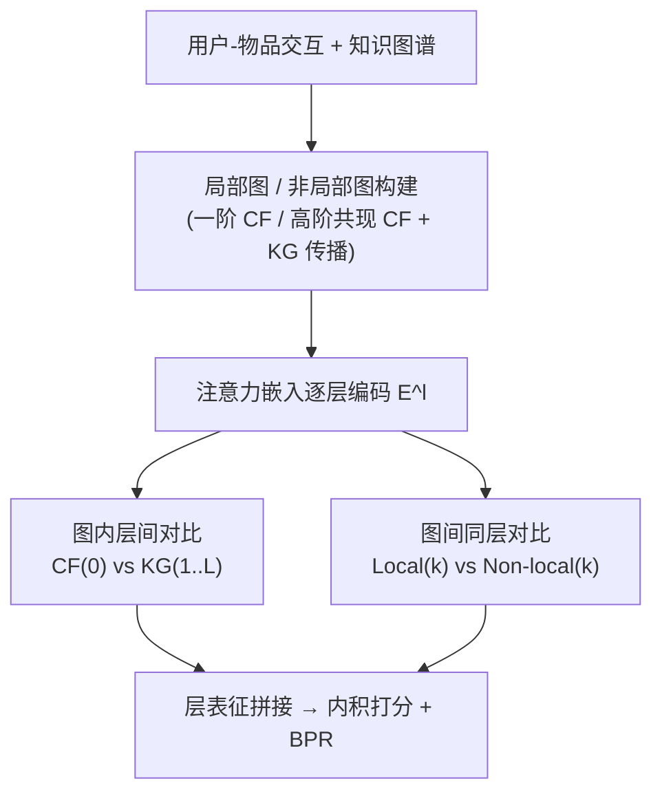
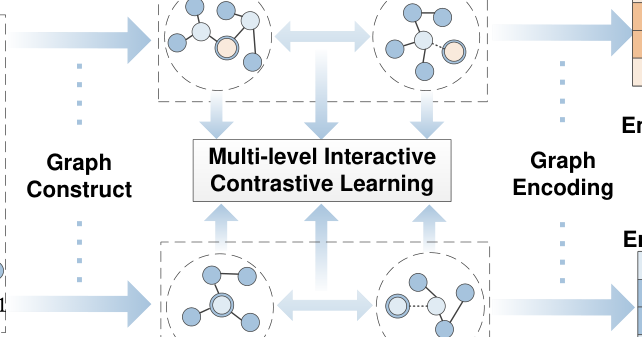

# Improving Knowledge-aware Recommendation with Multi-level Interactive Contrastive Learning (多级交互对比学习改进知识感知推荐)

- **会议/期刊**: CIKM 2022
- **作者与机构**: Ding Zou, Wei Wei, Ziyang Wang, Xian-Ling Mao, Feida Zhu, Fang Rui, Dangyang Chen（华中科技大学 CCIIP 实验室、北京理工大学、新加坡管理大学、平安产险）
- **推荐链路定位**: 精排（CTR 预估 + Top-K 排序）
- **研究方向**: 图神经网络与知识图谱推荐 / 自监督对比学习与交互去噪
- **论文原文**: [https://arxiv.org/abs/2208.10061v1](https://arxiv.org/abs/2208.10061v1)
- **开源代码**: [https://github.com/CCIIPLab/KGIC](https://github.com/CCIIPLab/KGIC)

## TL;DR (1分钟核心速览)

知识感知推荐（KGR）受限于交互极稀疏、CF 与冗余 KG 的信息利用失衡、以及 GNN 局部聚合忽略非局部知识三大痛点。KGIC 不再对两个增广视图做节点级对比，而是把 **GNN 的层** 当作对比对象：图内对比 CF 层与 KG 层以平衡二者贡献，图间对比局部图与非局部图同层表征以提取并去噪非局部知识。在 Book-Crossing / MovieLens-1M / Last.FM 上，AUC 分别相对最强基线提升 3.35% / 0.67% / 1.25%，Recall@K 全面领先。

## Background & Motivation (背景与核心矛盾)

- **主流范式**: 将 user-item 交互图与 item-entity 知识图谱统一为异构图，用 GNN 递归聚合邻居（KGCN、KGAT、CKAN、KGIN、CG-KGR），以监督式 BPR 损失端到端训练。
- **前人局限一（监督信号稀疏）**: 真实交互极稀疏，单靠观测交互监督易触发表征退化（embedding 挤进窄锥），节点表征趋于不可分辨。
- **前人局限二（信息利用失衡）**: 稀疏 CF 叠加冗余 KG 形成不平衡异质结构，最终建模中噪声 KG 反而被强调，决定用户偏好的 CF 信号被稀释。
- **前人局限三（知识抽取不足）**: GNN 只聚合物品自身局部邻域，忽略"相似物品邻域"的非局部 KG 事实；而简单堆叠非局部又引入更多无关噪声。
- **核心洞察 (Key Insight)**: 传统图对比学习（SGL/HeCo）只在两个增广视图间对比**同一部件**（CF-CF、KG-KG），CF 与 KG 的表征学习彼此孤立，仍无法缓解失衡；把"层"作为视图、在同一张图内部**跨部件**对比，可同时获得一致性与平衡。
- **本文切入点**: 构造局部/非局部两种子图，用"图内层间 + 图间同层"的两级交互对比替代数据增广式对比。

## Method (核心方法设计)

### 1. 整体框架 (Overall Architecture)

对每个 user/item 先构建局部图（一阶 CF 对齐实体后沿 KG 逐层传播）与非局部图（item–user–item 高阶共现物品对齐实体后传播），两图各用**注意力嵌入**逐层编码；随后在每张图内部做 CF 层（第 0 层）与 KG 层（1..L 层）的交互对比，再在两图之间做同层锚定、异层排斥的交互对比；最终把局部与非局部所有层表征拼接为 2(L+1) 段向量做内积打分，与 BPR 损失多任务联合训练。

<figure class="paper-figure" markdown="span">
  <figcaption>图2：所提出的 KGIC 模型示意图。左侧子图展示 KGIC 的模型框架；右侧子图展示多级交互对比学习的细节。建议以彩色查看。</figcaption>
</figure>

### 2. 关键设计拆解 (Key Designs)

1. **非局部图构建（补足 non-local KG 事实）**：痛点是不足的知识抽取源于只聚合物品自身邻域。做法是先沿 CF 传播一跳得到高阶物品 $V_p=\{v_p \mid \exists u\in U_{sim}, y_{uv_p}=1\}$与相似用户$U_{sim}$，再经 item-entity 对齐得到初始实体集$\mathcal{E}^0_{u,N}$，随后沿 KG 传播$\mathcal{S}^l_{o,N}=\{(h,r,t)\mid (h,r,t)\in\mathcal{G}, h\in\mathcal{E}^{l-1}_{o,N}\}$。直觉：与目标物品共现的物品天然语义相近，其 KG 邻域即为"可用的外部常识"，为稀疏交互补充信号。

2. **图内层间交互对比（平衡 CF 与 KG）**：以第 0 层 CF 实体表征 $\mathbf{E}^{(0)}_{u,L}$为锚，参与聚合的 1..L 层 KG 表征为正样本，未被使用的更远层（$k'>L$）为隐式负样本：

$\mathcal{L}^{U}_{Intra}=\sum_{u\in\mathcal{U}}-\log\frac{\sum_{k\in L}\exp(\mathbf{E}^{(0)}_{u,L}\cdot\mathbf{E}^{(k)}_{u,L}/\tau)}{\sum_{k\in L}\exp(\mathbf{E}^{(0)}_{u,L}\cdot\mathbf{E}^{(k)}_{u,L}/\tau)+\sum_{k'>L}\exp(\mathbf{E}^{(0)}_{u,L}\cdot\mathbf{E}^{(k')}_{u,L}/\tau)}$

因为锚点固定在 CF 侧，KG 聚合必须"向 CF 靠拢"才能得分，从而把决定偏好的 CF 信号重新拉回主导地位，避免 KG 噪声淹没协同信号。

3. **图间交互对比与训练目标**：非局部图表征更噪，故以局部图第 $k$层为锚、非局部图同层为正、非局部异层$k'\neq k$为负：$\mathcal{L}^{U}_{Inter}=\sum_{u}\sum_{k\in L}-\log\frac{\exp(\mathbf{E}^{(k)}_{u,L}\cdot\mathbf{E}^{(k)}_{u,N}/\tau)}{\sum_{k'\neq k}\exp(\mathbf{E}^{(k)}_{u,L}\cdot\mathbf{E}^{(k')}_{u,N}/\tau)}$。层号对齐意味着"只保留与局部知识同层同语义的非局部事实"，异层排斥天然起到去噪作用。总损失$\mathcal{L}_{KGIC}=\mathcal{L}_{BPR}+\lambda_1(\alpha\mathcal{L}_{Intra}+\mathcal{L}_{Inter})+\lambda_2\|\Theta\|_2^2$，其中$\alpha$平衡两级对比。训练仅用标准 BPR 均匀负采样（每用户等量未观测物品），对比的负样本来自层/图本身，**无需额外增广或难负采样**；推理时拼接全部层表征内积，$d=64,\ L\in\{1,2\}$，开销主要来自每 batch 动态抽取三元组（局部 ≤40、非局部 ≤128）。

## Experimental Setup & Evaluation Protocol (实验设置与评估协议)

- **数据集与预处理**: 遵循 RippleNet/KGCN 设定，将显示反馈转为隐式（评分即正样本），子图由 Microsoft Satori 置信度 >0.9 的三元组匹配得到：

| 数据集 | #Users | #Items | #Interactions | #KG Entities / Relations / Triplets | 场景说明 |
| :--- | :---: | :---: | :---: | :---: | :--- |
| Book-Crossing | 17,860 | 14,967 | 139,746 | 77,903 / 25 / 151,500 | 图书，最稀疏 |
| MovieLens-1M | 6,036 | 2,445 | 753,772 | 182,011 / 12 / 1,241,996 | 电影，最稠密 |
| Last.FM | 1,872 | 3,846 | 42,346 | 9,366 / 60 / 15,518 | 音乐收听 |

- **数据划分与防穿越**: 沿用 RippleNet 的比例划分设定，为每个用户随机采样与正样本**等量**的未观测物品构成测试集（未采用 Leave-One-Out，也未做全局时间戳切分，存在一定信息泄漏风险）。
- **排名评测协议**: 双场景：(1) CTR 预估用 `AUC` / `F1`；(2) Top-K 用 `Recall@5/10/20/50/100`。属于 **Sampled Ranking（负样本 1:1 采样）**，而非无偏 Full-Ranking，故绝对数值偏高、可比性依赖统一负采样。
- **对比基线与超参设置**: 覆盖 BPRMF（CF）、CKE / RippleNet（embedding）、PER（path）、KGCN / KGNN-LS / KGAT / CKAN / KGIN / CG-KGR（GNN）；Embedding 维度统一 $d=64$，Adam，batch 2048，学习率$4\times10^{-3}$，$\lambda_1\in[10^{-7},10^{-6}]$，$\lambda_2\in[10^{-5},10^{-4}]$；显著性采用 unpaired two-sample$t$-test，$p<0.001$。

## Key Experimental Results (实验关键数据)

### 1. 主实验对比 (Main Results)

| Model | Book AUC | Book F1 | ML-1M AUC | ML-1M F1 | Last.FM AUC | Last.FM F1 |
| :--- | :---: | :---: | :---: | :---: | :---: | :---: |
| BPRMF | 0.6583 | 0.6117 | 0.8920 | 0.7921 | 0.7563 | 0.7010 |
| RippleNet | 0.7211 | 0.6472 | 0.9190 | 0.8422 | 0.7762 | 0.7025 |
| PER | 0.6048 | 0.5726 | 0.7124 | 0.6670 | 0.6414 | 0.6033 |
| KGCN | 0.6841 | 0.6313 | 0.9090 | 0.8366 | 0.8027 | 0.7086 |
| KGAT | 0.7314 | 0.6544 | 0.9140 | 0.8440 | 0.8293 | 0.7424 |
| CKAN | 0.7420 | 0.6671 | 0.9082 | 0.8410 | 0.8418 | 0.7592 |
| KGIN | 0.7273 | 0.6614 | 0.9190 | 0.8441 | 0.8486 | 0.7602 |
| CG-KGR | 0.7498 | 0.6689 | 0.9110 | 0.8359 | 0.8336 | 0.7433 |
| **KGIC (Ours)** | **0.7749** | **0.6812** | **0.9252** | **0.8559** | **0.8592** | **0.7753** |
| **Improv. vs 最强基线** | **+3.35%** | **+2.01%** | **+0.67%** | **+1.40%** | **+1.25%** | **+1.99%** |

### 2. 消融实验 (Ablation Study)

原文消融以图 4 柱状图呈现（未给具体数值），结合表 3 的深度消融可整理如下：

| 变体 | 关键变化 | Book AUC | ML-1M AUC | Last.FM AUC |
| :--- | :--- | :---: | :---: | :---: |
| KGIC（完整） | Intra + Inter + 非局部图 | **0.7749** | **0.9252** | **0.8592** |
| w/o Intra | 去掉图内 CF-KG 层间对比 | 下降（图 4） | 下降 | 下降 |
| w/o Inter | 去掉局部-非局部图间对比 | 下降 | 下降 | 下降 |
| w/o Non-local | 去非局部图（两级对比同时失效） | 下降最大 | 下降最大 | 下降最大 |
| 深度 $L=1$ | 仅单层聚合 | **0.7749** | 0.9241 | 0.8482 |
| 深度 $L=3$ | 三层聚合 | 0.7513 | 0.9203 | 0.8511 |

### 3. 关键实验发现 (Key Findings)

1. **稀疏度越高、收益越大**：最稀疏的 Book-Crossing 上 AUC 相对 CG-KGR 提升 3.35%，而最稠密的 MovieLens-1M 仅 +0.67%。这直接说明交互越稀疏、监督信号缺口越大，层间自监督的补位价值越显著，验证了"稀疏监督信号"这一动机。
2. **"层数"就是对比粒度，1–2 层最优**：Book 上 $L=1$（0.7749）优于$L=2$（0.7689）与$L=3$（0.7513）；Movie/Music 上$L=2$最优（0.9252 / 0.8592），$L=3$ 全面回落。说明局部 1–2 跳足以覆盖有效 KG 事实，继续堆层只会把噪声层拖入正样本、稀释对比判别力。
3. **超参鲁棒但需对齐两级权重**：$\alpha=1$时最佳（Intra 与 Inter 等权），温度$\tau$在$[0.1,0.2]$ 区间表现最好、过大则显著掉点，与 SGL 的结论一致；同时去掉非局部图的退化幅度大于单独去掉任一对比损失，说明"非局部 KG 事实"是主要增益源，而 inter 对比是其必要去噪器。

## Highlights & Limitations (亮点、对比与审稿批判)

- **与代表作对比 (vs. Prior Work)**: KGAT 将 CF 与 KG 拼成统一异构图聚合，容易过度强调 KG 并带来偏置；CKAN 虽分离传播 CF/KG 但完全依赖监督信号，稀疏下退化；CG-KGR 用协同信号引导 KG 聚合，仍无层内交互。KGIC 的核心差异是**不做图增广、不做 meta-path，而是把 GNN 层本身当作对比视图**，在图内部跨部件对比，天然兼顾平衡与一致性。
- **可迁移亮点**: (1) "层即视图"的对比范式可零成本迁移到 LightGCN/序列推荐，替代 SGL 的边丢弃增广，省去采样子图的开销设计；(2) 高阶共现物品的 KG 邻域构建（非局部图）可直接用于冷启动物品的知识补全与长尾曝光。
- **审稿级局限批判**: (1) 评测全部基于 1:1 负采样的 Sampled Ranking，未做 Full-Ranking 或时间切分，AUC 0.92+ 的绝对水平存在高估，工业排序场景的可信度打折；(2) 每 batch 需在线抽取并编码 2(L+1) 张子图、每图注意力作用于最多 40/128 条三元组，训练与在线预估开销远高于 KGIN/CKAN，论文未给复杂度与延迟分析，也未做线上 A/B。

## Rating (四维评分)

- **方法创新性 (Novelty)**: ⭐⭐⭐⭐ （把"层"而非"视图"作为对比对象，图内跨部件 + 图间同层锚定两级设计，绕开图增广与 meta-path，思路干净但仍是 InfoNCE 的组合式创新）
- **评估协议与实验扎实度 (Protocol & Experiments)**: ⭐⭐⭐ （三数据集 + CTR/Top-K 双场景 + 显著性检验 + 深度/α/τ 敏感性齐全，但仅采样排序、消融只给柱状图无数值、无 Full-Ranking 与时间切分）
- **写作与数学规范度 (Clarity & Rigor)**: ⭐⭐⭐⭐ （构图与两级对比的符号区分清晰，$\mathcal{E}/\mathcal{S}$ 局部-非局部标记统一，对比损失推导直观；按时序与复杂度的形式化分析略欠）
- **工业落地与复现价值 (Industrial & Practical Value)**: ⭐⭐⭐⭐ （代码已开源、PyTorch 实现、无需额外标注即可加装自监督模块；但子图在线抽取与多层编码的工程开销需裁剪，落地需做子图缓存与负样本池化优化）

