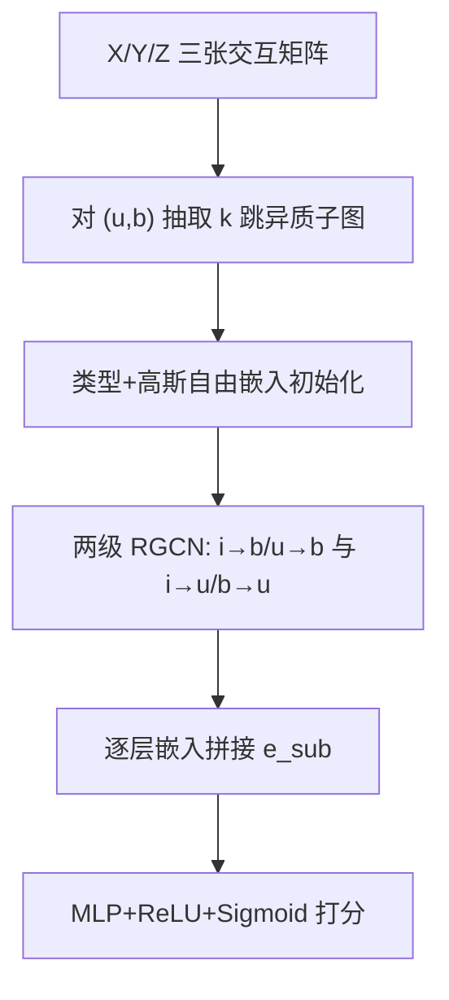
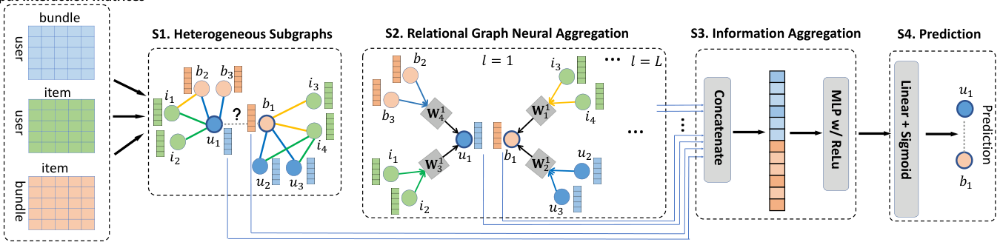
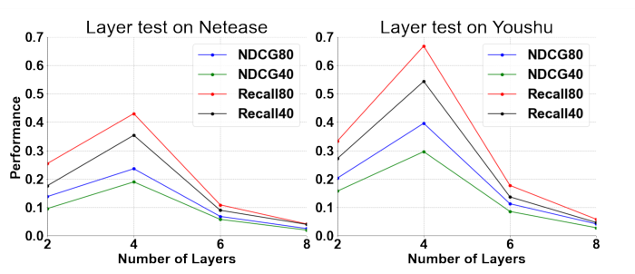

# SUGER: A Subgraph-based Graph Convolutional Network Method for Bundle Recommendation (基于子图的图卷积捆绑包推荐)

- **会议/期刊**: CIKM 2022
- **作者与机构**: Zhenning Zhang, Boxin Du, Hanghang Tong (University of Illinois at Urbana-Champaign)
- **推荐链路定位**: 召回（候选捆绑包打分）
- **研究方向**: 图神经网络与知识图谱推荐 / 跨域与多场景推荐
- **论文原文**: [https://arxiv.org/abs/2205.11231v1](https://arxiv.org/abs/2205.11231v1)
- **开源代码**: 暂未开源

## TL;DR (1分钟核心速览)

捆绑包推荐长期被"节点级 GNN + 全局嵌入"范式主导（如 BGCN），既无法捕捉用户-捆绑包这一具体对的局部购买逻辑，也难以迁移到标签稀缺的新平台。本文借 IGMC 思路提出 SUGER：围绕每个 (user, bundle) 对抽取 k 跳异质有向子图，用两级 RGCN 做图级编码并映射为偏好分，同时删除中心边以消除标签泄漏。在 Youshu/Netease 全库 top-K 评测下，Recall@20 相对最强基线 BGCN 分别提升 39.4% 与 89.8%，并首次定义"迁移捆绑包推荐"设定。

## Background & Motivation (背景与核心矛盾)

- **主流范式**: 捆绑包推荐需融合三类交互（user-item 偏好、user-bundle 偏好、bundle-item membership），现有方法（DAM、BGCN）把它们塞进二部/三部图，用节点级 GNN 学用户与捆绑包的全局嵌入再做内积。
- **前人局限 ①**: 节点级范式只能学到"平台全局统计"，对某次具体决策的局部证据链（如该用户买过该包内哪几件单品）缺乏建模能力；IGMC 已证明图级 GNN 能自动学习启发式规则，但在捆绑包场景如何构图、如何传播尚属空白。
- **前人局限 ②**: 当预测边同时参与消息传递时会产生**标签泄漏**与自映射 $f_\theta(q,\dots)=q$，使目标两端嵌入互相平滑、迅速过拟合；捆绑包场景下中心边正是唯一监督目标，泄漏更致命。
- **核心洞察 (Key Insight)**: 用户的购买逻辑（例如"包里只要有一件熟悉单品就会买"）是平台无关的局部图模式，而子图编码器恰好只依赖局部结构、不依赖用户画像等域相关侧信息。
- **本文切入点**: 将 (u,b) 对编码为异质子图上的图级表征，并把"删中心边"作为去泄漏的硬性约束，从而同时获得精度与跨域迁移性。

## Method (核心方法设计)

### 1. 整体框架 (Overall Architecture)

输入三张交互矩阵 $\mathbf{X}$（user-bundle）、$\mathbf{Y}$（user-item）、$\mathbf{Z}$（bundle-item），对训练集中每个观测 (u,b) 对抽取 k 跳异质有向子图；节点按"中心用户=0、中心捆绑包=1、第 k 跳的 bundle/user/item 分别占 3k−1/3k/3k+1"分配类型 ID，边按六种语义（u→b、b→u、u→i、i→u、b→i、i→b）分关系。子图经 L=4 层两级 RGCN 传播，逐层嵌入拼接成图级向量$\mathbf{e}_{sub}$，再经两层 MLP+Sigmoid 输出偏好分。训练时删除中心用户与中心捆绑包之间的边；推理时同一编码器可直接用于未见域的子图。

<figure class="paper-figure" markdown="span">
  <figcaption>图1：SUGER 模型的整体流程。整个过程可分为4个阶段。这里以中心用户-捆绑包对 (u1, b1) 为例，且仅展示1跳异质子图。具体图示见第3节。</figcaption>
</figure>

### 2. 关键设计拆解 (Key Designs)

1. **两级关系图传播（Two-level Propagation）**：痛点是把"单品组合语义"和"用户偏好"混在一条边上传播会互相污染，故将 RGCN 的更新拆成两支：
$\mathbf{e}^{(\ell+1)}_{b,1}=\frac{1}{|N_{i,b}|}\sigma\big(\mathbf{W}^{(\ell)}_1(\mathbf{e}^{(\ell)}_b+\tau(\{\mathbf{e}^{(\ell)}_i\}))+\mathbf{c}^{(\ell)}_1\big)$，$\mathbf{e}^{(\ell+1)}_{b,2}$由用户侧同构得到，最终$\mathbf{e}_b=\frac{1}{2}(\mathbf{e}_{b,1}+\mathbf{e}_{b,2})$。直觉：item→bundle 支路刻画"包内搭配是否合理"，user→bundle 支路刻画"谁在买这个包"，两条语义通道分离后捆绑包嵌入才同时具备内容与协同信号。
2. **捆绑包相似度加权 $\delta_b$**：仅靠一跳邻居无法区分"哪个候选包最贴近用户口味"，作者先由$\mathbf{e}_b$与$\mathbf{e}_u$拼接口算出基准包$b_t$，再令$\eta_b=|I_b\cap I_{b_t}|/|I_{b_t}|$、$\delta_b=1+\eta_b$乘入 user 侧聚合项$\sum_{b\in N_{b,u}}\delta_b\mathbf{e}^{(\ell)}_b$。这相当于在消息传递中注入"包间 Jaccard 相似度"先验，使与基准包高度重合的包获得更大权重，缓解稀疏子图下邻居信号过弱的问题。
3. **标签泄漏的硬删除 + 训练目标**：训练阶段直接删除中心 (u,b) 边而非随机 DropEdge——因 Youshu/Netease 子图本就稀疏，随机丢边会破坏结构；删除可保证中心信息不回流。损失为标准 BPR：$\mathcal{L}=\sum_{(u,b^+)\in\mathcal{D}}\sum_{b^-\notin\mathcal{D}}-\log\sigma(\hat{r}_{u,b^+}-\hat{r}_{u,b^-})+\lambda\|\Theta\|_2^2$，负样本按 1:1 均匀随机采样；由于编码器输入是局部子图，推理需为每个候选对现场构图，代价显著高于 BGCN 的内积检索。

## Experimental Setup & Evaluation Protocol (实验设置与评估协议)

- **数据集与预处理**: 未使用 5-core 过滤，直接沿用公开划分版本：

| 数据集 | #Users | #Bundles | #Items | #U-B | #U-I | 稀疏度(U-B) | 场景 |
| :--- | :---: | :---: | :---: | :---: | :---: | :---: | :--- |
| Youshu | 8,039 | 4,771 | 32,770 | 51,377 | 138,515 | 0.134% | 中文书评书单 |
| Netease | 18,528 | 22,684 | 123,628 | 302,303 | 1,128,065 | 0.072% | 网易云音乐歌单 |

- **数据划分与防穿越 (Splitting Strategy)**: 正样本 user-bundle 交互按比例划分为训练/测试（约 60% 训练），测试正样本在训练中被完全屏蔽；属**比例划分 + 正样本隔离**，非时间戳切分，故存在轻微未来信息泄漏风险。
- **排名评测协议 (Ranking Protocol)**: 采用 Recall@K 与 NDCG@K，$K\in\{20,40,80\}$，与 BGCN 保持一致；原文未显式声明候选池构造，按指标定义应为**全库未交互候选排序 (Full-Ranking)**，但缺少对采样排序的明确说明。
- **对比基线与超参设置**: 基线含通用 GNN（GCN-BG、NGCF-BG，均取 user-bundle 二部图实现）与捆绑包专用模型（DAM、BGCN）；嵌入维度 $d$在文中未明确给出，Adam 学习率$3\times10^{-5}$、weight decay$2\times10^{-7}$、L2 系数$10^{-5}$，层数$L=4$。

## Key Experimental Results (实验关键数据)

### 1. 主实验对比 (Main Results)

| Model | Youshu R@20 | R@40 | R@80 | N@20 | N@80 | Netease R@20 | R@40 | R@80 | N@20 | N@80 |
| :--- | :---: | :---: | :---: | :---: | :---: | :---: | :---: | :---: | :---: | :---: |
| NGCF-BG | 0.1343 | 0.2076 | 0.2447 | 0.0618 | 0.1420 | 0.0551 | 0.0927 | 0.1356 | 0.0265 | 0.0768 |
| GCN-BG | 0.1431 | 0.2191 | 0.2432 | 0.0739 | 0.1652 | 0.0567 | 0.0982 | 0.1439 | 0.0292 | 0.0799 |
| DAM | 0.1670 | 0.2086 | 0.2918 | 0.0757 | 0.1532 | 0.0747 | 0.1290 | 0.1695 | 0.0351 | 0.0840 |
| BGCN | 0.2531 | 0.3674 | 0.4755 | 0.1623 | 0.2432 | 0.1494 | 0.1825 | 0.2421 | 0.0786 | 0.1428 |
| **SUGER** | **0.3529** | **0.5438** | **0.6682** | **0.2041** | **0.3960** | **0.2835** | **0.3539** | **0.4301** | **0.1361** | **0.2359** |
| Improv.% | +39.4 | +48.0 | +40.5 | +25.8 | +62.8 | +89.8 | +93.9 | +77.7 | +73.2 | +65.2 |

迁移设定（源域训练、目标域测试）下 SUGER 在 Youshu 上 R@20 达 0.3107（BGCN 0.1801、GCN-BG 0.0611），在 Netease 上 R@20 为 0.0955（低于 BGCN 的 0.1061），但 R@40/80 与 NDCG@80 反超，说明从大而稀疏域迁移到小而稠密域更有效、反向迁移在 top-20 头部位置略吃亏。

### 2. 消融实验 (Ablation Study)

| Variant | Youshu R@20 | R@40 | R@80 | N@20 | Netease R@20 | R@40 | R@80 | N@20 |
| :--- | :---: | :---: | :---: | :---: | :---: | :---: | :---: | :---: |
| Base-transfer | 0.3107 | 0.3926 | 0.4255 | 0.1537 | 0.0955 | 0.1706 | 0.2302 | 0.0408 |
| w/o subgraph-transfer | 0.0303 | 0.0348 | 0.0472 | 0.0149 | 0.0271 | 0.0369 | 0.0457 | 0.0112 |
| w/ leakage-transfer | 0.0714 | 0.1049 | 0.1725 | 0.0301 | 0.0593 | 0.1104 | 0.1349 | 0.0312 |
| w/o subgraph | 0.0301 | 0.0353 | 0.0469 | 0.0141 | 0.0315 | 0.0349 | 0.0392 | 0.0157 |
| w/ leakage | 0.1301 | 0.2041 | 0.2886 | 0.0637 | 0.0692 | 0.1345 | 0.1688 | 0.0349 |

<figure class="paper-figure" markdown="span">
  <figcaption>图2：两个数据集上的层测试结果</figcaption>
</figure>

### 3. 关键实验发现 (Key Findings)

1. **子图输入是命门而非锦上添花**：移除异质子图（仅保留节点嵌入）后 Youshu R@20 从 0.3107 崩塌至 0.0301（约 10 倍衰减），甚至低于所有节点级基线——说明图级编码的全部收益都来自"局部结构"这一信息源，模型本身几乎不含独立参数化记忆。
2. **标签泄漏的破坏力随域规模放大**：保留中心边后 Youshu R@20 由 0.3529 级降至 0.1301、Netease 由 0.2835 级降至 0.0692，降幅达 60%–76%，验证了自映射 $f_\theta(q)=q$ 会让中心两端嵌入互相平滑，是比过拟合更严重的结构性缺陷。
3. **层数存在明确的甜点**：层数测试显示 $L=4$ 最优、继续加深性能下滑；这与"局部购买逻辑只需 4 跳即可覆盖用户—包—单品—邻居包"的假设一致，更深的传播会引入平台全局统计而损害迁移性。

## Highlights & Limitations (亮点、对比与审稿批判)

- **与代表作对比 (vs. Prior Work)**: 相比 BGCN 学全局节点嵌入再做内积，SUGER 改为逐对条件化的子图编码，天然适配"同一用户对不同包有不同证据链"；相比 IGMC（单关系 user-item 子图），其增量在于六类关系的异质构图、两级传播解耦与相似度因子 $\delta_b$；相比 DAM 的注意力聚合单品，SUGER 显式建模包间相似性而非仅包内组合。
- **可迁移亮点**: ① "删中心边"以消除图级链路预测标签泄漏，可低成本移植到任何基于 enclosing subgraph 的推荐/链路预测任务；② 用类型 one-hot 拼接高斯自由嵌入完成初始化、且不引入人口统计侧信息，是提升跨域迁移性的通用技巧。
- **审稿级局限批判**: ① 推理需为每个候选对现场构图与 4 层传播，复杂度与候选规模线性相关，与 BGCN 的向量检索相比在线成本高得多，文中未给出任何延迟或复杂度分析；② 评测缺项较多——未说明候选池是否为全库排序、仅单一随机种子、无显著性检验，且划分非时间切分、{1:1} 均匀负采样使结果对采样比例较敏感；③ 迁移实验在 Netease 的 R@20 上实际输给 BGCN，作者对此未做深入讨论。

## Rating (四维评分)

- **方法创新性 (Novelty)**: ⭐⭐⭐⭐ （把图级子图范式首次系统性移植到捆绑包推荐，异质两级传播与包相似度因子 $1+\eta_b$ 具有清晰物理直觉，但整体属 IGMC 的结构性扩展而非全新理论）
- **评估协议与实验扎实度 (Protocol & Experiments)**: ⭐⭐⭐ （覆盖基础与迁移两种设定且提升幅度巨大，但候选池构造、随机种子、显著性检验均缺失，迁移结论在大域上并不一致）
- **写作与数学规范度 (Clarity & Rigor)**: ⭐⭐⭐ （公式与四阶段流程清晰，但 $\delta_b$中基准包$b_t$的选取规则、聚合函数的平均/求和混用、嵌入维度$d$ 等关键细节交代不足）
- **工业落地与复现价值 (Industrial & Practical Value)**: ⭐⭐⭐ （无需侧信息、可跨平台冷启动迁移是真实工业价值，但逐对构图推理开销大且无开源代码，短期难以在大候选池召回中直接部署）

