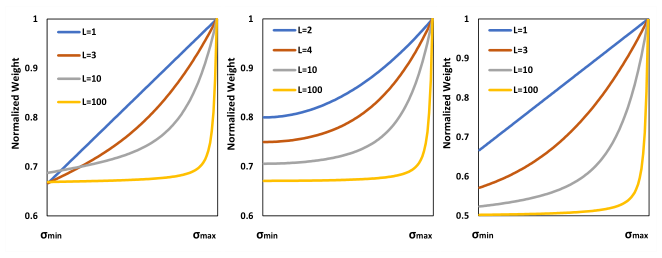
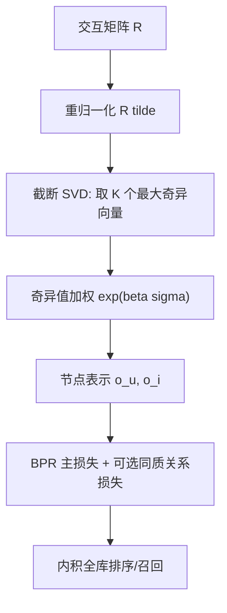
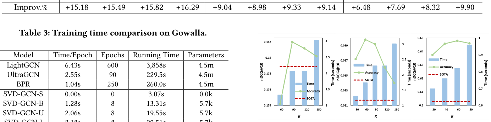

# SVD-GCN: A Simplified Graph Convolution Paradigm for Recommendation（面向推荐的简化图卷积范式）

- **会议/期刊**: CIKM 2022
- **作者与机构**: Shaowen Peng, Kazunari Sugiyama, Tsunenori Mine；Kyoto University / Kyushu University
- **推荐链路定位**: 召回（全库排序）
- **研究方向**: 图神经网络与知识图谱推荐 / 协同过滤与双塔召回
- **论文原文**: [https://arxiv.org/abs/2208.12689v2](https://arxiv.org/abs/2208.12689v2)
- **开源代码**: [https://github.com/tanatosuu/svd_gcn](https://github.com/tanatosuu/svd_gcn)

## TL;DR (1分钟核心速览)

针对 GCN 推荐中邻域聚合开销大、深层过平滑与收敛慢的痛点，本文揭示 LightGCN 等价于按奇异值加权低秩表示，提出 SVD-GCN：仅用 $K$ 个最大奇异向量并以重归一化调节奇异值间隙。在 20% 训练、Full-Ranking 协议下，nDCG@10 较 SGL-ED 提升 6.5%–15.2%，较 LightGCN 加速超 100 倍。

## Background & Motivation (背景与核心矛盾)

- **主流范式**: GCN 类 CF 以 $\tilde{\mathbf{A}}^{l}\mathbf{E}$ 反复传播用户/物品嵌入，LightGCN 进一步去掉非线性与特征变换，仅保留邻域聚合。
- **前人局限**: 邻域聚合需反复乘邻接矩阵，扩展性差；层数加深时用户/物品表示趋同，产生过平滑；且高阶邻域使 LightGCN 常需数百轮收敛。
- **核心洞察 (Key Insight)**: 将 LightGCN 写成 $\mathbf{O}=\frac{1}{L+1}\sum_{l=0}^{L}\tilde{\mathbf{A}}^{l}\mathbf{E}$后，谱分解显示堆叠层数等价于用$\sum_{l=0}^{L}\sigma_k^{l}/(L+1)$ 加权奇异向量：大奇异值被放大、小奇异值被抑制，且实测仅极少数最大奇异向量贡献有效信号，95% 以上信息可视为噪声。
- **本文切入点**: 不再显式聚合邻域，而用截断 SVD 直接学习低秩表示，并用重归一化调整奇异值间隙以缓解过平滑。

图 2 展示奇异向量归一化权重：层数增大时大奇异值权重更集中、小奇异值被抑制，即 Observation 1 的低秩/过平滑机理。

<figure class="paper-figure" markdown="span">
  <figcaption>图2：奇异向量的归一化权重。</figcaption>
</figure>

## Method (核心方法设计)

### 1. 整体框架 (Overall Architecture)

输入二值交互矩阵 $\mathbf{R}$，先构造重归一化矩阵$\tilde{\mathbf{R}}=(\mathbf{D}_U+\alpha\mathbf{I})^{-1/2}\mathbf{R}(\mathbf{D}_I+\alpha\mathbf{I})^{-1/2}$，对其做截断 SVD 并仅保留$K$个最大奇异向量；再用指数核$e^{\beta\tilde{\sigma}_k}$加权奇异向量、经可选特征变换$\mathbf{W}$ 得到用户/物品表示；最后以 BPR 主损失训练，并可选加入 user-user、item-item 同质关系损失；推理时预计算表示后做内积全库排序。

### 2. 关键设计拆解 (Key Designs)

1. **截断 SVD 替代邻域聚合**：前人把 GCN 功效归因于邻域聚合，本文证明其核心是低秩谱加权。将 $\mathbf{P}^{\top}\mathbf{E}_U$、$\mathbf{Q}^{\top}\mathbf{E}_I$视为可替换的公共项后，节点表示可写为$\mathbf{o}_u=\tilde{\mathbf{p}}_u^{\top}\odot e^{\beta\tilde{\boldsymbol{\sigma}}}\mathbf{W}$、$\mathbf{o}_i=\tilde{\mathbf{q}}_i^{\top}\odot e^{\beta\tilde{\boldsymbol{\sigma}}}\mathbf{W}$。仅保留$K$个最大奇异向量即可保留主要协同信号，参数量从$O((|\mathcal{U}|+|\mathcal{I}|)d)$降至$O(Kd)$。

图 3 显示在 Gowalla 上 $K=90$、预处理约 3.07s 即达到/超过 SOTA，继续增大$K$ 的精度收益很小。

<figure class="paper-figure" markdown="span">
  <figcaption>图3：在 SVD-GCN-B 上，预处理时间和准确率（nDCG@10）随 𝐾 的变化情况。</figcaption>
</figure>

2. **重归一化调节奇异值间隙**：过平滑的根因是层数增大时最大奇异值 $\sigma_{\max}=1$与其他奇异值的差距被放大。定义$\tilde{\mathbf{R}}$后，定理给出$\tilde{\sigma}_{\max}\leq d_{\max}/(d_{\max}+\alpha)$，$\alpha$越大间隙越小；但过小间隙又会削弱重要性差异，故需按数据集调$\alpha$。该操作使重要信息集中在更少奇异向量中，既提精度又减少所需$K$。

3. **训练目标、负采样与推理效率**：主损失为 BPR 式 $\mathcal{L}_{main}=\sum_{u}\sum_{(u,i^+)\in\mathcal{R}^+,(u,i^-)\notin\mathcal{R}^+}\ln \mathrm{sigmoid}(\mathbf{o}_u^{\top}\mathbf{o}_{i^+}-\mathbf{o}_u^{\top}\mathbf{o}_{i^-})$，负样本为未交互物品；可选$\mathcal{L}_{user}$、$\mathcal{L}_{item}$在 user-user/item-item 图上做同质关系 BPR。总损失为$\mathcal{L}_{main}+\gamma\mathcal{L}_{user}+\zeta\mathcal{L}_{item}+\lambda\|\Theta\|_2^2$。训练复杂度$O(c|\mathcal{R}^+|(K+1)d)$，推理只需预计算表示和内积。

## Experimental Setup & Evaluation Protocol (实验设置与评估协议)

- **数据集与预处理**: 仅保留 user/item ID，将显式反馈二值化为隐式反馈：

| 数据集 | #Users | #Items | #Interactions | 密度% | 说明 |
| :--- | :---: | :---: | :---: | :---: | :--- |
| CiteULike | 5,551 | 16,981 | 210,537 | 0.223 | 稀疏 |
| ML-100K | 943 | 1,682 | 100,000 | 6.305 | 稠密 |
| ML-1M | 6,040 | 3,952 | 1,000,209 | 4.190 | 主实验 |
| Yelp | 25,677 | 25,815 | 731,672 | 0.109 | 主实验 |
| Gowalla | 29,858 | 40,981 | 1,027,370 | 0.084 | 主实验，最稀疏 |

- **数据划分与防穿越 (Splitting Strategy)**: 随机比例划分：仅 20% 交互训练，其余测试；训练集内再随机取 5% 作验证。未采用全局时间戳切分或冷启动切分。
- **排名评测协议 (Ranking Protocol)**: 无偏 Full-Ranking，对全部未交互物品排序并截断，报告 Recall@10/20 与 nDCG@10/20。
- **对比基线与超参设置**: 对比 BPR、EASE、LCFN、UltraGCN、LightGCN、SGL-ED；$d=64$、$\lambda=0.01$、SGD、batch size 256，学习率网格搜索；最佳$K$为 Yelp 60、ML-1M 60、Gowalla 90，$\alpha$、$\beta$ 按数据集调。原文未报告显著性检验，仅报告均值。

## Key Experimental Results (实验关键数据)

### 1. 主实验对比 (Main Results)

| 模型 | Yelp nDCG@10 | Yelp Recall@10 | ML-1M nDCG@10 | ML-1M Recall@10 | Gowalla nDCG@10 | Gowalla Recall@10 |
| :--- | ---: | ---: | ---: | ---: | ---: | ---: |
| BPR | 0.0388 | 0.0371 | 0.5521 | 0.5491 | 0.1086 | 0.0917 |
| EASE | 0.0360 | 0.0346 | 0.3773 | 0.3682 | 0.0722 | 0.0680 |
| LCFN | 0.0617 | 0.0613 | 0.5927 | 0.5887 | 0.1305 | 0.1144 |
| UltraGCN | 0.0417 | 0.0404 | 0.5326 | 0.5302 | 0.0977 | 0.0841 |
| LightGCN | 0.0679 | 0.0669 | 0.5917 | 0.5941 | 0.1477 | 0.1368 |
| SGL-ED | 0.0817 | 0.0784 | 0.6029 | 0.6010 | 0.1789 | 0.1563 |
| SVD-GCN-S | 0.0919 | 0.0894 | 0.6458 | 0.6466 | 0.1900 | 0.1690 |
| SVD-GCN (best) | **0.0941** | **0.0908** | **0.6574** | **0.6571** | **0.1905** | **0.1693** |
| Improv.% vs SGL-ED | +15.18 | +15.82 | +9.04 | +9.33 | +6.48 | +8.32 |

注：SVD-GCN (best) 每列取最佳变体；ML-1M 的 nDCG 最佳来自 SVD-GCN-I，Recall 最佳来自 SVD-GCN-U。

### 2. 消融实验 (Ablation Study)

| 变体 | 说明 | Yelp nDCG@10 | ML-1M nDCG@10 | Gowalla nDCG@10 |
| :--- | :--- | ---: | ---: | ---: |
| SVD-GCN-S | 去掉特征变换 $\mathbf{W}$ | 0.0919 | 0.6458 | 0.1900 |
| SVD-GCN-B | 仅主损失，无同质关系 | 0.0898 | 0.6480 | 0.1820 |
| SVD-GCN-U | + user-user | 0.0923 | **0.6571** | 0.1875 |
| SVD-GCN-I | + item-item | **0.0930** | **0.6574** | 0.1857 |
| SVD-GCN-M | + user-user + item-item | **0.0941** | 0.6521 | **0.1905** |

### 3. 关键实验发现 (Key Findings)

1. **截断 SVD 足够且极快**：Gowalla/Yelp 只需不到 0.5%、ML-1M 约 1% 的奇异向量即达最佳；SVD-GCN-S 在 Gowalla 仅 3.07s，而 LightGCN 为 3858s，呈约千倍级加速，SVD-GCN-B 参数量仅 5.7k。
2. **稀疏场景收益更大**：相对 SGL-ED，Yelp nDCG@10 提升 15.18%、ML-1M 提升 9.04%、Gowalla 提升 6.48%；相对 LightGCN，Yelp/ ML-1M/ Gowalla 分别约提升 53.6%/11.7%/29.0%，说明谱截断在高稀疏下更稳。
3. **同质关系并非总是叠加更好**：Yelp 上 M 比 B 高 4.8%、Gowalla 高 4.7%；但 ML-1M 上 U/I 分别达 0.6571/0.6574，混合 M 反降至 0.6521，表明数据越稠密，额外同质关系的边际收益越小。

## Highlights & Limitations (亮点、对比与审稿批判)

- **与代表作对比 (vs. Prior Work)**: LightGCN 仍靠邻域聚合，本文将其替换为截断 SVD；UltraGCN 只从单层 LightGCN 导出一阶加权 MF，本文从任意层乃至无限层推导，保留高阶谱信息；SGL-ED 依赖对比增广，本文结构更轻、收敛更快。
- **可迁移亮点**: 用谱分解解释 GCN 层数相当于奇异值加权，可指导其他图推荐做低秩截断；重归一化调节奇异值间隙是低成本抗过平滑技巧，SVD-GCN-S 的无参数版本适合冷启动/超稀疏召回。
- **审稿级局限批判**: SVD 预处理为静态全图分解，动态增量图需频繁重算，$O(K|\mathcal{R}^+|+K^2(|\mathcal{U}|+|\mathcal{I}|))$在大图仍有成本；评估为随机 20% 划分，缺少时间切分/冷启动与显著性检验，$\alpha,\beta,K$ 对数据集较敏感。

## Rating (四维评分)

- **方法创新性 (Novelty)**: ⭐⭐⭐⭐ （用谱分解打通 GCN 与 SVD/MF，重归一化调奇异值间隙有理论支撑，但主要针对线性 LightGCN。）
- **评估协议与实验扎实度 (Protocol & Experiments)**: ⭐⭐⭐⭐ （5 个数据集、3 个主实验、Full-Ranking 与充分消融；但无显著性检验、时间切分和冷启动评估。）
- **写作与数学规范度 (Clarity & Rigor)**: ⭐⭐⭐⭐ （定理、证明与复杂度分析清晰，公式链完整；部分设计如动态权重与 $\alpha$ 现象仍偏经验。）
- **工业落地与复现价值 (Industrial & Practical Value)**: ⭐⭐⭐⭐⭐ （代码开源，SVD-GCN-S 免训练且千倍级加速，参数量极低，适合大规模召回与稀疏场景快速部署。）

