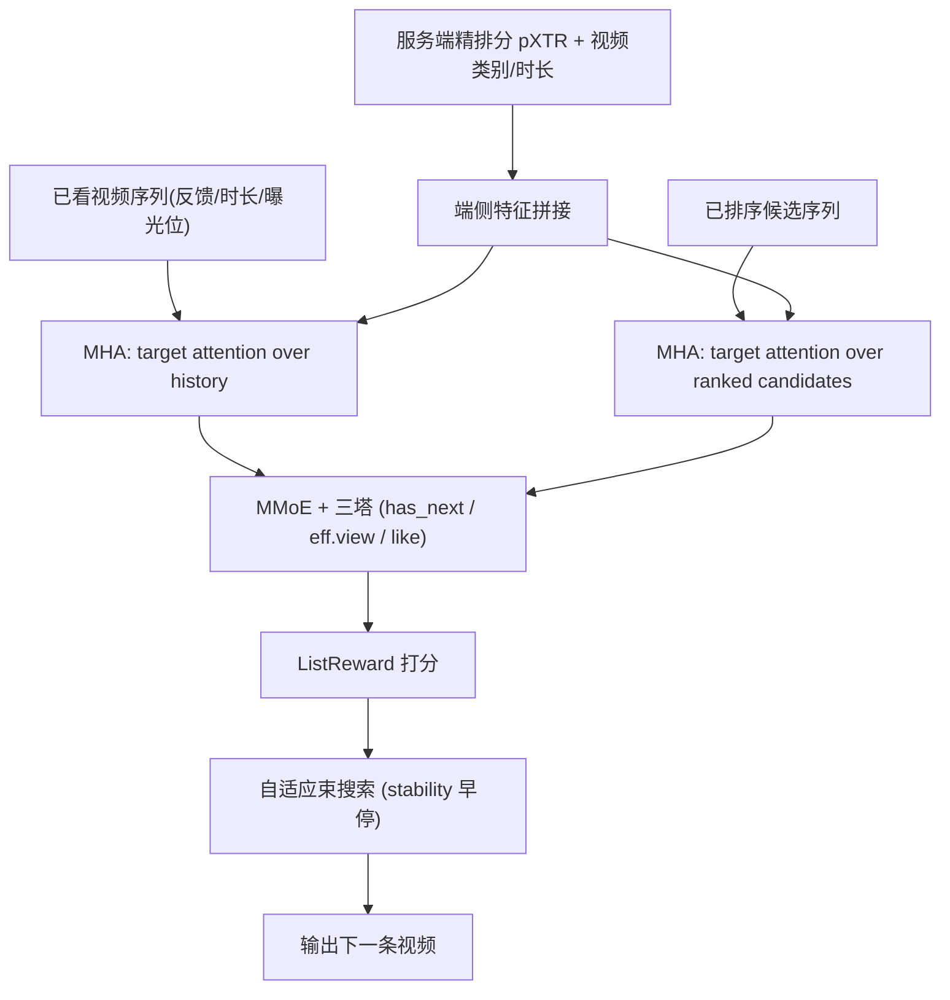
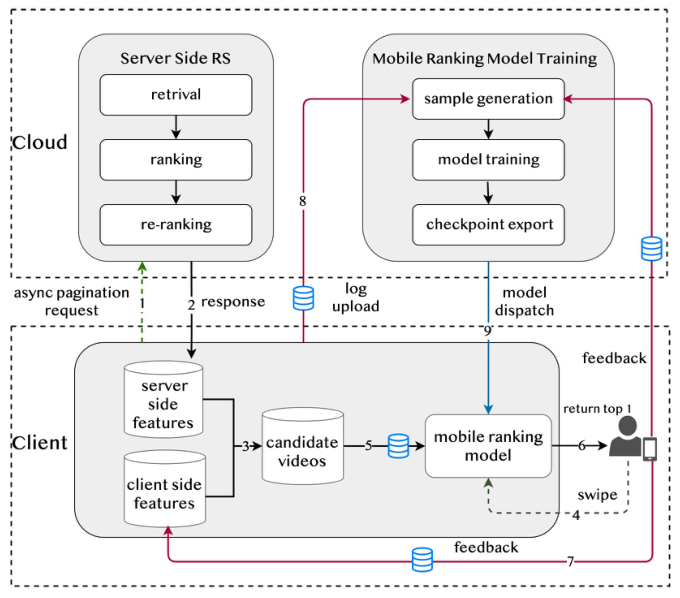
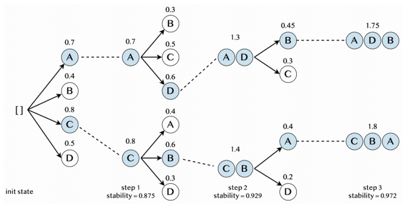

# Real-time Short Video Recommendation on Mobile Devices (移动端实时短视频推荐)

- **会议/期刊**: CIKM 2022
- **作者与机构**: Xudong Gong, Qinlin Feng, Yuan Zhang, Jiangling Qin, Weijie Ding, Biao Li, Peng Jiang (快手), Kun Gai (Unaffiliated)
- **推荐链路定位**: 重排（端侧重排，消费服务端精排结果）
- **研究方向**: 多任务学习与列表级重排 / 去偏公平、可信隐私与工业架构
- **论文原文**: [论文原文链接](https://arxiv.org/abs/2208.09577v2)
- **开源代码**: 暂未开源

## TL;DR (1分钟核心速览)

服务端分页式推荐在两个环节失效：用户两次请求之间的实时反馈无法回灌云端，且云端拿不到曝光位、网络状况等端侧专属特征。本文把 1.32M 参数（<6MB TFLite）的微型多任务排序模型整体下沉到手机端，用"服务端预测分数 + 端侧实时反馈交叉特征"做即时重估，并在此基础上以 **ListReward 折扣奖励** 配合 **自适应束搜索** 完成上下文感知重排；线上（快手十亿级用户）一周 A/B 中有效播放 / 点赞 / 关注分别提升 1.28% / 8.22% / 13.6%，端侧推理在 iOS 仅 49.39ms。

## Background & Motivation (背景与核心矛盾)

- **主流范式**: 检索→粗排→精排→重排全部部署在云端，客户端按页（本系统每 6 条一页）拉取，页内顺序在用户观看前即被冻结。
- **前人局限**: 其一，分页机制使重排对"页内已消费视频产生的反馈"完全盲视，而短视频兴趣漂移以秒计；其二，反馈上传链路耗时数十秒至数分钟，且曝光位置、缓冲长度、当前网络等端侧特征在云端**永远缺失**（以往只能作为训练期 bias / privileged feature 使用）。
- **核心洞察 (Key Insight)**: 沉浸式场景一次仅展示 1 条视频，端侧只需决定"下一条"，无需为整个列表求解——这把 $O(m!)$的列表寻优降格为"前$n$ 步即可收敛"的部分搜索问题；同时消融显示（表 4）大模型 + ID 特征几乎无增益，因为信息已被服务端打分压缩，端侧应专注**互补的实时信号**。
- **本文切入点**: 用"小而全 (self-contained) 的端侧模型 + 端侧特征工程 + 早停式束搜索"替换"端云拆分大模型 + 贪心排序"。

## Method (核心方法设计)

### 1. 整体框架 (Overall Architecture)

服务端完成检索/精排后，除返回本页 $m$条外，额外多给$n$ 条候选以扩大端侧搜索空间；端侧常驻一个长度受限的"已看视频列表"（含视频属性与点赞/分享等反馈），当用户上滑触发重排时，客户端拼接"服务端预测分 + 视频静态属性 + 端侧实时特征"输入微型模型，模型经双路 target-attention 与 MMoE 三塔输出 has_next / effective_view / like 三类概率，再由自适应束搜索在候选集上生成最大化 ListReward 的序列，截取首条置入下一位展示；模型以增量训练产出 checkpoint，转 TFLite 后经 MD5 校验通过 CDN 灰度更新。

<figure class="paper-figure" markdown="span">
  <figcaption>图 2：所提出的移动端短视频推荐系统架构。</figcaption>
</figure>

### 2. 关键设计拆解 (Key Designs)

1. **端侧实时交叉特征 (Realtime Crossing Features)**：痛点是服务端分数是静态标量，无法表达"当下偏好漂移"。作者定义分数差 $p^{\text{diff}}=p_{XTR}-p^{h}_{XTR}$（$h$为历史已看视频），以及"距上次曝光时长"$v_t-v^h_t$、"曝光位差"$v_{pos}-v^h_{pos}$，并将三者与视频类别、用户反馈再交叉。直觉：若同类高$p_{XTR}$ 视频用户连续不买账，则该类剩余候选应降权（负 diff），即以**近期已看视频为自适应锚点**替代静态均值锚点，实时捕捉类目级兴趣反转。
2. **排序上下文感知的双 MHA + MMoE**：将上下文定义为 $c(i)=c(\mathcal{H}; v_1,\dots,v_{i-1};\mathcal{O})$——目标视频的偏好同时受历史序列与前序已排候选影响。模型用两路 target attention 分别编码历史$\mathcal{H}$与已排序候选（$Q$来自候选特征，$K,V$ 分别来自历史/已排候选），输出拼接后送入 12 专家 MMoE 与三任务塔。此设计使"改变顺序→改变上下文→改变打分"闭环成立，为束搜索提供可微的上下文反馈。
3. **ListReward 与自适应束搜索**：贪心逐点排序仅局部最优，故定义带未来折扣的列表奖励
$LR(P)=\sum_{i=1}^{|P|} s_i\big(\alpha\, p(\text{ev}_i\mid c(i))+\beta\, p(\text{like}_i\mid c(i))\big),\quad s_i=\prod_{j=1}^{i-1}p(\text{has\_next}_j\mid c(j))$其中$s_i$（$s_1=1$）为继续观看概率的累积乘积，充当"后续位置未必被看到"的折扣因子。为避免$O(km^2)$的完整束搜索，用稳定性度量$\text{stability}=\min(\text{score\_list})/\max(\text{score\_list})$在第$i\ge n$步超过阈值$t$时提前终止，复杂度降为$O(klm)$。

<figure class="paper-figure" markdown="span">
  <figcaption>图 4：候选数 𝑛= 4、束宽 𝑘= 2、稳定性阈值 𝑡= 0.95 的自适应束搜索过程示意图。每个候选或候选列表上方的数字为相应奖励。</figcaption>
</figure>

- **训练目标、负采样与推理效率**：三目标加权 BCE，$\mathcal{L}=-\frac{1}{N}\sum_{i=1}^{N}\sum_{j=1}^{3}w_j\big[y_{ij}\log\hat{y}_{ij}+(1-y_{ij})\log(1-\hat{y}_{ij})\big]$，$w_j$人工调定且全程固定；点式样本天然来自曝光日志，无需显式负采样。端侧推理 Android 平均 120.80ms、iOS 49.39ms，beam size=4、阈值$t=0.95$（平均搜索步 <3）。

## Experimental Setup & Evaluation Protocol (实验设置与评估协议)

- **数据集与预处理**: 工业连续 8 天日志，前 7 天训练、第 8 天测试（**全局时间戳切分**，无随机泄漏）：

| 数据集 | #Users | #Videos | #Records | 稀疏度/密度 | 特征/场景说明 |
| :--- | :---: | :---: | :---: | :---: | :--- |
| Train | 2,421,196 | 4,030,717 | 60,142,557 | 极稀疏（~6.2e-6） | 含服务端预测分、反馈、曝光位、网络 |
| Test | 1,098,351 | 1,614,608 | 18,538,868 | 极稀疏 | 次日全量真实流量 |

- **数据划分与防穿越 (Splitting Strategy)**: 按天切分（前 7 天 / 第 8 天），测试用户与物品均可与训练重叠，非冷启动设定。
- **排名评测协议 (Ranking Protocol)**: 离线为**逐目标 AUC**（point-wise 判别指标，非全库 Full-Ranking 排序指标）；排序效果主要由**线上 A/B**（一周）以 effective view / like / follow 相对提升衡量。
- **对比基线与超参设置**: `ServerScore`（服务端日志预测分）、`SimpleDNN`（同特征但无本文特征工程）、`EdgeRec`（改造为 MMoE+三塔以适配多任务）。Embedding 8 维（时长/类别 16 维），MHA 8 头×16 维，MMoE 12 专家×64，塔为 [128,64,32,1] MLP，Adam，batch 1024，lr 0.001；显著性未给 $p$ 值，工业 A/B 以量级经验判定。

## Key Experimental Results (实验关键数据)

### 1. 主实验对比 (Main Results)

| Model | AUC has_next | AUC effective_view | AUC like |
| :--- | :---: | :---: | :---: |
| ServerScore | — | 0.7728 | 0.9483 |
| SimpleDNN | 0.7090 | 0.7660 | 0.9185 |
| EdgeRec (MMoE 版) | 0.7190 | 0.7812 | 0.9432 |
| **Ours** | **0.7293** | **0.7884** | **0.9496** |
| Improv. vs EdgeRec | +1.43% | +0.92% | +0.68% |

线上 A/B（vs. 无端侧重排基线）：

| Strategy | Effective View | Like | Follow |
| :--- | :---: | :---: | :---: |
| 端侧模型 + 贪心重排 | +0.907% | +5.956% | +11.795% |
| **端侧模型 + 上下文感知重排** | **+1.277%** | **+8.218%** | **+13.598%** |

### 2. 消融实验 (Ablation Study)

| 变体 | has_next | effective_view | like |
| :--- | :---: | :---: | :---: |
| Full Model | **0.7293** | **0.7884** | **0.9496** |
| w/o 端侧专属特征 (CSF) | 0.7040 | 0.7864 | 0.9495 |
| w/o 特征工程 (FE) | 0.7105 | 0.7800 | 0.9213 |
| w/o 实时序列 (RTS) | 0.7221 | 0.7846 | 0.9492 |

| 搜索步数 | Stability | 相对时延 |
| :---: | :---: | :---: |
| 1 | 0.6715 | 1.00× |
| 2 | 0.9421 | 1.85× |
| 3 | 0.9915 | 2.77× |
| 5 | 0.9954 | 4.89× |

### 3. 关键实验发现 (Key Findings)

1. **端侧特征的价值极不均衡**：移除 CSF 使 has_next AUC 掉 0.0253（0.7293→0.7040），远超 effective_view（-0.002）与 like（-0.0001），印证"退出概率强绑定曝光深度与网络状况"；而移除特征工程对 like 打击最大（0.9496→0.9213，-0.0283），说明**交叉算子而非原始特征**才是端侧小模型的增益来源。
2. **小模型 > 端云拆分大模型**：SimpleDNN 在 effective_view / like 上甚至低于仅用服务端打分的 ServerScore（0.7660/0.9185 vs. 0.7728/0.9483），说明把 ID 类特征搬到端侧徒增开销而信息已冗余；本文 1.32M 参数模型反超，证明"互补信号 + 轻量结构"优于"参数堆叠"。
3. **列表级上下文收益可量化**：在完全相同的端侧模型上，仅把贪心换为自适应束搜索即再贡献 +0.37% effective view、+2.26% like、+1.80% follow；且稳定性在第 3 步后达 0.9915（阈值 0.95 对应平均步数 <3），证明**后续搜索步边际收益迅速衰减**，早停几乎无精度损失却省下约 2/3 计算。

## Highlights & Limitations (亮点、对比与审稿批判)

- **与代表作对比 (vs. Prior Work)**: 相较 EdgeRec（GRU 按初始顺序编码候选，重排后上下文即失效），本文将"已排序候选"显式作为 attention 的 $K/V$ 输入，使上下文随排列动态更新；相较端云协同/联邦式工作（[22]、[12]、[2,18]），本文放弃拆分大模型与上传嵌入，转而强调"端侧互补信号 + 特征工程"这一更工程化的路径；相较经典 list-wise 重排（LambdaMART 类），本文不优化 NDCG 而优化含 has_next 折扣的期望奖励，更贴合沉浸式流式消费。
- **可迁移亮点**: ①"以近期已看样本预测值作为自适应锚点做 diff 交叉"可直接迁移至任何有上游打分的级联重排场景；②用 `min/max` 比值做束搜索早停准则，实现简单且无需额外训练，适合低延迟约束的端侧/在线服务。
- **审稿级局限批判**: ①离线评估仅用逐目标 AUC，缺少 NDCG/列表级排序指标与置信区间/显著性检验，且训练测试用户重叠，冷启动与长尾表现未验证；②端侧推理时延（Android 120.80ms）与端侧 6MB 存储、电量开销在多机型低端设备上的分布未报告，束搜索阈值 $t$、$\alpha/\beta$与三任务权重$w_j$ 的敏感性分析缺失，可复现性受限于无开源代码与数据。

## Rating (四维评分)

- **方法创新性 (Novelty)**: ⭐⭐⭐⭐ （端侧重排 + 折扣式 ListReward + 稳定性早停束搜索的组合在工业场景有新意，但单点技术（MMoE/MHA/beam search）均为已有组件的巧妙拼装）
- **评估协议与实验扎实度 (Protocol & Experiments)**: ⭐⭐⭐⭐ （十亿级工业数据 + 一周线上 A/B 极具说服力，消融与稳定性曲线完整；但离线仅报 AUC、缺少排序指标与显著性检验）
- **写作与数学规范度 (Clarity & Rigor)**: ⭐⭐⭐⭐ （系统设计与工程取舍交代清楚、ListReward 与稳定性定义简洁；部分符号沿用前作未重定义，复杂度分析略简）
- **工业落地与复现价值 (Industrial & Practical Value)**: ⭐⭐⭐⭐⭐ （1.32M 参数 / <6MB、iOS 49ms、MD5 灰度更新的完整部署链路，直接可参照；遗憾无开源代码与公开数据）

