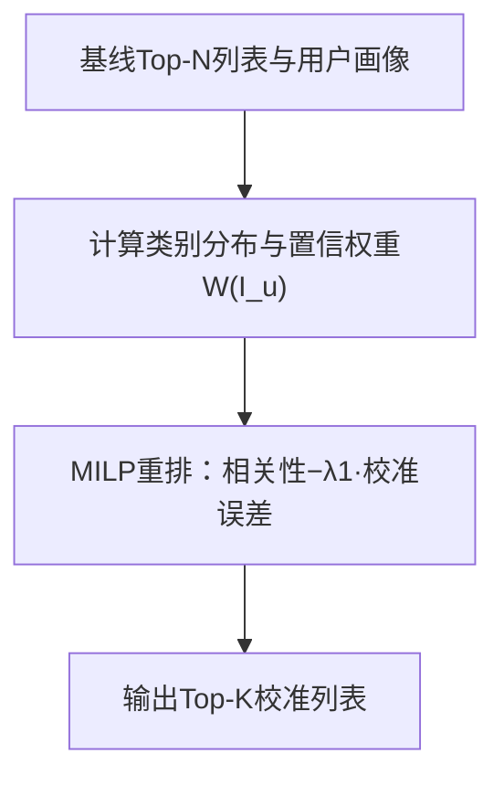

# Towards Confidence-aware Calibrated Recommendation (迈向置信度感知的校准推荐)

- **会议/期刊**: CIKM 2022
- **作者与机构**: Mohammadmehdi Naghiaei (USC), Hossein A. Rahmani (UCL), Mohammad Aliannejadi (UvA), Nasim Sonboli (Tufts)
- **推荐链路定位**: 重排
- **研究方向**: 多任务学习与列表级重排 / 去偏公平、可信隐私与工业架构
- **论文原文**: [https://arxiv.org/abs/2208.10192v1](https://arxiv.org/abs/2208.10192v1)
- **开源代码**: [https://github.com/rahmanidashti/CalibrationFair](https://github.com/rahmanidashti/CalibrationFair)

## TL;DR (1分钟核心速览)

针对校准重排忽略用户画像规模置信度、易牺牲多样性的问题，本文提出置信度感知CCL：以画像大小加权的MILP联合优化相关性、类别校准误差与目录覆盖，在MovieLens两数据集、4个基线上做Top-20重排，nDCG较基线/完全校准分别约+5%/+2.5%，并显著提升覆盖率。

## Background & Motivation (背景与核心矛盾)

- **主流范式**: Steck 用贪心迭代加入最相关item直至满足类别校准；Seymen等改用优化式重排，认为贪心短视且次优。
- **前人局限**: ①对所有用户施加同等校准强度，忽略“画像越大，类别分布越可信”；②完全校准会把列表拉向用户历史分布，压缩目录覆盖并加剧filter bubble。
- **核心洞察 (Key Insight)**: Beta后验示例中，画像100的A与画像10的B同为9:1，A看喜剧概率高0.67；原文图1b进一步显示inactive用户oracle预测的JS/H反而更大，说明小画像校准置信度低。
- **本文切入点**: 把“校准预算”按画像规模加权，提出置信度感知的多目标MILP重排CCL。

## Method (核心方法设计)

### 1. 整体框架 (Overall Architecture)

输入任一基线模型产生的Top-N列表与用户画像类别分布。CCL先按画像大小计算置信权重$W(I_u)$，决定该用户需校准的item数$\mathrm{int}(W(I_u)K)$，再以二元变量$Z$选出Top-K；目标同时最大化排序相关性并最小化加权校准误差，用Total Variation将非线性JS/H线性化为MILP，最后由Gurobi分支定界求解。输出重排列表，不训练新召回/精排模型。

### 2. 关键设计拆解 (Key Designs)

1. **置信度加权校准预算**：画像越小，类别分布后验越不确定，若仍完全校准会把推荐拉向噪声分布。CCL定义$W(I_u)=\min\left(\frac{|I_u|}{\frac{1}{|U|}\sum_{u\in U}|I_u|},1\right)$，并把校准约束设为$\sum_{i=1}^{N}Z^1_{ui}=\mathrm{int}(W(I_u)K)$；低活跃用户只校准部分列表，保留基线预测能力。
2. **多目标MILP重排**：目标为$\max_{Z}\sum_{u\in U}\sum_{i=1}^{N}S_{ui}Z_{ui}-\lambda_1\mathrm{MC}(Z^1,U)$，约束$\sum_{i=1}^{N}Z_{ui}=K$、$Z^1_{ui}+Z^2_{ui}=Z_{ui}$、$Z^1_{ui},Z^2_{ui},Z_{ui}\in\{0,1\}$。$Z^1$负责校准、$Z^2$保留相关性；以$\ell_1$总变差替代JS/H使目标线性可解。
3. **训练目标、负采样与推理效率**：无需训练新模型，也无负采样；$\lambda_1$权衡相关性与校准，$W=1$退化为完全校准CL，$\lambda_1=0$退化为基线N。推理为每用户求解MILP，K=20时可行，但Gurobi开销随N和类别数增长。

## Experimental Setup & Evaluation Protocol (实验设置与评估协议)

- **数据集与预处理**:

| 数据集 | #Users | #Items | #Interactions | 稀疏度/密度 | 特征/场景说明 |
| :--- | :---: | :---: | :---: | :---: | :--- |
| MovieLensSmall | 670 | 8,974 | 原文未报告 | — | 18 genres，显式评分1–5 |
| MovieLens1M | 6,040 | 3,260 | 原文未报告 | — | 18 genres，显式评分1–5 |

- **数据划分与防穿越 (Splitting Strategy)**: 按评分时间做80%/20% `全局时间戳切分`，避免未来交互穿越；原文未说明5-core等过滤。
- **排名评测协议 (Ranking Protocol)**: Top-20列表评测Precision/Recall/nDCG；MC按全用户平均JS/H计算。原文未报告采样负例比例或Full-Ranking细节，不能据此断定为全库排序。
- **对比基线与超参设置**: BPR、WMF、NeuMF、VAECF（Cornac默认超参）；CL为$W=1$的完全校准，近似Seymen等SOTA；CCL为本文。$\lambda_1$以nDCG/MC最大化选取，显著性用$p<0.05$ t-test；embedding维度原文未单列。

## Key Experimental Results (实验关键数据)

### 1. 主实验对比 (Main Results)

MovieLens1M，Top-20；JS/H越低越好，其余越高越好。CCL相对N的CatCov提升约+12%～+15%，MLSmall上P/Recall/nDCG平均+5.0%/+6.1%/+5.0%，相对CL约+2.5%/+3.7%/+2.7%。

| 模型 | Precision↑ | nDCG↑ | CatCov↑ | JS↓ | H↓ |
| :--- | :---: | :---: | :---: | :---: | :---: |
| BPR-N | 0.0769 | 0.0813 | 11.221 | 0.338 | 0.377 |
| BPR-CCL | 0.0797 | 0.0853 | 12.637 | 0.228 | 0.261 |
| WMF-N | 0.0629 | 0.0682 | 11.238 | 0.376 | 0.420 |
| WMF-CCL | 0.0649 | 0.0684 | 12.604 | 0.243 | 0.278 |
| NeuMF-N | 0.1006 | 0.1071 | 11.797 | 0.337 | 0.375 |
| NeuMF-CCL | **0.1010** | **0.1074** | **13.485** | **0.225** | **0.258** |
| VAECF-N | 0.0960 | 0.1019 | 11.543 | 0.334 | 0.372 |
| VAECF-CCL | 0.0966 | 0.1032 | 13.272 | 0.226 | 0.259 |

### 2. 消融实验 (Ablation Study)

CL=去掉置信度加权（$W=1$，完全校准）；N=去掉校准（$\lambda_1=0$）。CL的JS/H更优，但CatCov与nDCG常回落。

| 配置(ML1M) | nDCG↑ | CatCov↑ | JS↓ | H↓ |
| :--- | :---: | :---: | :---: | :---: |
| BPR-N | 0.0813 | 11.221 | 0.338 | 0.377 |
| BPR-CL | 0.0841 | 10.306 | 0.213 | 0.246 |
| BPR-CCL | 0.0853 | 12.637 | 0.228 | 0.261 |
| NeuMF-N | 0.1071 | 11.797 | 0.337 | 0.375 |
| NeuMF-CL | 0.1057 | 10.940 | **0.199** | **0.227** |
| NeuMF-CCL | **0.1074** | **13.485** | 0.225 | 0.258 |

### 3. 关键实验发现 (Key Findings)

1. **置信度加权是关键消融**：去掉$W$后CL的JS/H更低，但ML1M的BPR CatCov从12.637降至10.306、NeuMF从13.485降至10.940，nDCG也回落；说明全量校准会牺牲覆盖与相关性。
2. **CCL并非牺牲精度换公平**：ML1M NeuMF的P/nDCG为0.1010/0.1074，高于N的0.1006/0.1071和CL的0.0999/0.1057；BPR P为0.0797 vs 0.0769/0.0787，且多数提升显著（$p<0.05$）。
3. **低活跃用户受益最大**：原文图2/图4显示inactive组BPR CatCov为19.0 vs CL 13.1，semi-active为17.4 vs 14.2；active基本持平（15.4 vs 14.5），符合$W$随画像大小截断到1的设计。

## Highlights & Limitations (亮点、对比与审稿批判)

- **与代表作对比 (vs. Prior Work)**: Steck贪心校准易短视；Seymen优化式完全校准未区分用户画像可信度；CCL把画像规模作为校准置信度，并在MILP中同时保留相关性、覆盖与校准。
- **可迁移亮点**: 画像大小/活跃度加权置信预算可移植到任何列表重排约束；按active/semi/inactive分组评测beyond-accuracy指标的做法值得复用。
- **审稿级局限批判**: 每用户求解MILP依赖Gurobi，N或类别数增大时在线开销高；置信度仅由画像大小定义，未建模时间衰减与兴趣不确定性；仅两个MovieLens离线实验，无线上A/B，且CCL的JS/H仍逊于完全校准CL。

## Rating (四维评分)

- **方法创新性 (Novelty)**: ⭐⭐⭐⭐ （置信度感知校准重排思路清晰，P1–P3性质与加权MILP有增量，但核心仍是约束优化重排）
- **评估协议与实验扎实度 (Protocol & Experiments)**: ⭐⭐⭐ （时间切分、4个基线、t-test和用户分组分析较完整；但仅2个数据集，Top-20/采样协议说明不足）
- **写作与数学规范度 (Clarity & Rigor)**: ⭐⭐⭐⭐ （MILP目标、约束与$W(I_u)$定义清楚；Gurobi设置、$\lambda_1$敏感度和复杂度分析偏简）
- **工业落地与复现价值 (Industrial & Practical Value)**: ⭐⭐⭐ （代码开源、可直接重排；但MILP求解成本与Gurobi依赖限制大规模在线部署）

