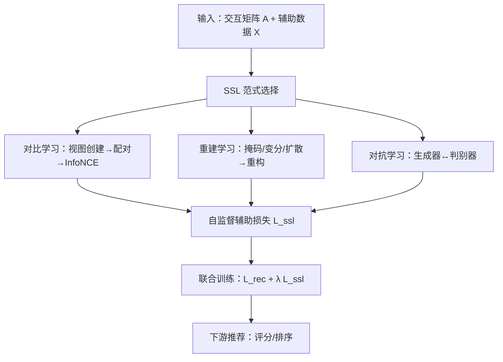
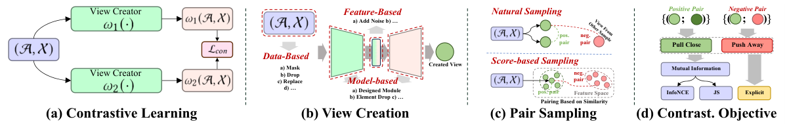

# A Comprehensive Survey on Self-Supervised Learning for Recommendation (推荐系统自监督学习综合综述)

- **会议/期刊**: ACM Computing Surveys (CSUR)；arXiv 2024
- **作者与机构**: Xubin Ren, Wei Wei, Lianghao Xia, Chao Huang（香港大学 HKU）
- **推荐链路定位**: 召回与表征学习（覆盖协同过滤、序列、社交、知识图谱等多场景）
- **研究方向**: 自监督对比学习与交互去噪 / 协同过滤
- **论文原文**: [https://arxiv.org/abs/2404.03354v3](https://arxiv.org/abs/2404.03354v3)
- **开源代码**: [https://github.com/HKUDS/Awesome-SSLRec-Papers](https://github.com/HKUDS/Awesome-SSLRec-Papers)

## TL;DR (1分钟核心速览)

推荐系统普遍受交互稀疏与标签匮乏困扰，监督学习难以充分表征用户偏好。本文系统综述 170+ 篇自监督推荐（SSL4Rec）工作，提出**对比、重建、对抗**三范式及“视图创建—配对采样—对比目标”的视图中心分类，覆盖协同过滤、序列、社交、知识图谱等九大场景。评估协议以 Amazon/Yelp/Gowalla 等 `5-core` 数据、`Leave-One-Out` 与 `Full-Ranking` 为主。综述本身不报告统一性能提升，但通过开源库 SSLRec 与趋势分析为后续方法设计提供基准。

## Background & Motivation (背景与核心矛盾)

- **主流范式**: GNN、RNN、Transformer 等深度模型依赖用户-物品交互标签进行监督训练，通过拟合历史点击/购买学习表征。
- **前人局限**: 真实推荐数据高度稀疏，监督信号不足导致表征泛化差；隐式反馈中的假阳性与分布偏移进一步削弱模型鲁棒性。
- **核心洞察 (Key Insight)**: 交互图与行为序列本身蕴含丰富结构信号——节点局部一致性、序列顺序约束、图边可重构性——可作为无需人工标签的自监督监督源。
- **本文切入点**: 以统一三范式视角梳理 170+ 工作，将“如何构造自监督信号”拆解为可比较的设计维度，并逐场景总结挑战与代表方法。

## Method (核心方法设计)

### 1. 整体框架 (Overall Architecture)

综述将每个 SSL4Rec 方法拆为三部分：输入交互矩阵 $\mathbf{A}$与辅助数据$\mathbf{X}$、自监督信号构造、辅助损失注入。对比学习通过数据/特征/模型级视图创建与正负配对最大化互信息；重建学习用掩码自编码、变分自编码或扩散模型重构被破坏的边、物品或评分；对抗学习用生成器-判别器提升样本保真度。三者最终以$\mathcal{L}_{\text{rec}}+\lambda\mathcal{L}_{\text{ssl}}$ 形式联合训练推荐主模型。

### 2. 关键设计拆解 (Key Designs)

1. **视图中心对比学习分类（View-Centric Taxonomy）**：针对 CL 方法分散、难以诊断瓶颈的问题，将对比学习解耦为视图创建（数据级/特征级/模型级）、配对采样（自然采样/分数采样）与对比目标（InfoNCE/JS/显式）三个正交维度。核心 InfoNCE 为：
   $\mathcal{L}_{\text{InfoNCE}}=-\log\frac{\exp(f(\boldsymbol{z}_i,\boldsymbol{z}_i^+)/\tau)}{\sum_{j}\exp(f(\boldsymbol{z}_i,\boldsymbol{z}_j)/\tau)}$。
   直觉上，视图质量决定正样本语义一致性，配对策略决定负样本硬度，目标函数决定拉近/推远的力度；解耦后便于定位“增益来自增广还是来自负采样”。

2. **重建学习三 paradigm（MAE / VAE / Diffusion）**：针对稀疏交互下监督信号不足，重建范式通过重构被掩码或加噪的数据迫使模型捕获数据流形。通用目标为：
   $\min_{\theta}\ \mathbb{E}_{x\sim\mathcal{D}}\left[\ell\left(g_\theta(\omega(x)),x\right)\right]$，
   其中 $\omega(\cdot)$ 为掩码/加噪算子。序列场景掩码物品，图场景掩码边或节点，CF 场景重构用户评分向量。掩码与扩散噪声天然适配稀疏数据，因为模型必须利用上下文补全缺失信号。

3. **对抗学习按可微性分类与训练目标**：针对生成离散物品导致梯度不可回传的问题，将 AL 分为可微（连续特征经判别器回传）与非可微（离散 item 用策略梯度/Gumbel-Softmax）。通用极小极大目标为：
   $\min_G\max_D\ \mathbb{E}_{x\sim p_{\text{data}}}[\log D(x)]+\mathbb{E}_{\tilde{x}\sim p_G}[\log(1-D(\tilde{x}))]$。
   判别器充当动态 reward，促使生成器输出更接近真实分布；但离散采样是训练不稳定的主要根源。

<figure class="paper-figure" markdown="span">
  <figcaption>图 2. 推荐系统中对比学习的分类体系。学习。原始数据的增强方法因推荐场景而异。</figcaption>
</figure>
图 1. 推荐系统中对比学习的视图中心分类体系（视图创建、配对采样与对比目标）。

## Experimental Setup & Evaluation Protocol (实验设置与评估协议)

- **数据集与预处理**: 综述未提供统一统计表；下表汇总各场景常用数据集与协议。主流过滤为 `5-core`，即保留交互数不少于 5 的用户与物品。

| 场景 | 常用数据集 | 过滤 | 划分 | 评测协议 |
| :--- | :--- | :---: | :---: | :---: |
| General CF | Amazon-Beauty/Book, Yelp2018, Gowalla | 5-core | LOO / 比例 | Full-Ranking |
| Sequential | Amazon, LastFM, Yelp | 5-core | LOO (next-item) | Full-Ranking |
| Social | LastFM, Ciao, Epinions | 5-core | LOO | Full-Ranking |
| Knowledge-aware | Amazon-Book, LastFM, MIND | 5-core | LOO | Full-Ranking |
| Cross-domain | Amazon, Douban | 比例 | 比例 | Full-Ranking |
| Group / Bundle | Mafengwo, Yelp, Steam | 比例 | LOO / 比例 | Full-Ranking |
| Multi-behavior | Tmall, IJCAI | 比例 | 比例 | Full-Ranking |
| Multi-modal | Amazon, TikTok | 5-core | LOO | Full-Ranking |

- **数据划分与防穿越 (Splitting Strategy)**: 协同过滤与序列推荐多采用 `Leave-One-Out`（最后一条交互为测试，倒数第二条为验证）；跨域与群组场景常用 `比例划分`（如 8:1:1）。序列任务严格按时间戳排序，避免未来交互穿越。
- **排名评测协议 (Ranking Protocol)**: 主流为无偏 `Full-Ranking`（对全库未交互物品排序），部分早期工作用 `Sampled Ranking`（1 正 vs 99 负）。指标以 Recall@K、NDCG@K、Hit@K、MRR 为主。
- **对比基线与超参设置**: 综述汇总的方法覆盖 BPR、LightGCN、SGL、SimGCL、BERT4Rec、CL4SRec 等；Embedding 维度 $d$常取 32–64，对比温度$\tau$常取 0.1–0.5；显著性检验多采用配对 t-test，$p<0.05$。

## Key Experimental Results (实验关键数据)

### 1. 主实验对比 (Main Results)

作为综述，原文无统一主实验表；下表按“场景—范式—代表方法”归纳 8 个高影响力基线，便于横向定位。

| 代表方法 | 年份 | 场景 | 范式 | 核心机制 |
| :--- | :---: | :---: | :---: | :--- |
| SGL | 2021 | CF | 对比 | 图边/节点 dropout 双视图 + InfoNCE |
| SimGCL | 2022 | CF | 对比 | 特征空间加噪视图，免图增广 |
| LightGCL | 2023 | CF | 对比 | SVD 全局图视图 + InfoNCE |
| HCCF | 2022 | CF | 对比 | 超图全局视图跨层对比 |
| BERT4Rec | 2019 | Seq | 重建 | 双向 Transformer 掩码物品重构 |
| CL4SRec | 2022 | Seq | 对比 | Crop/Mask/Reorder 序列增广 |
| DiffRec | 2023 | CF | 重建 | 扩散去噪用户评分向量 |
| KGCL | 2022 | KG | 对比 | KG 边 dropout 双视图 + InfoNCE |
| IRGAN | 2017 | CF | 对抗 | 策略梯度生成离散 item |
| RSGAN | 2019 | Social | 对抗 | Gumbel 可微采样 + 社会关系 |

### 2. 消融实验 (Ablation Study)

综述无统一消融，下表以“范式对比”替代，总结各范式辅助信号与代价。

| 范式 | 辅助信号 | 代表损失 | 优势 | 局限 |
| :--- | :--- | :---: | :--- | :--- |
| 对比学习 | 视图一致性 | InfoNCE / JS | 即插即用、抗噪、易与 GNN/Transformer 结合 | 视图质量敏感、负采样开销大 |
| 重建学习 | 数据重构 | MSE / CE / KL | 捕获数据分布、可生成增强 | 训练成本高、可能过平滑 |
| 对抗学习 | 真伪判别 | Minimax | 提升鲁棒性与多样性 | 离散采样不稳定、调参困难 |

### 3. 关键实验发现 (Key Findings)

1. **对比学习是绝对主流**：General CF 表 48 篇代表性工作中 CL 占 28 篇（约 58%），序列推荐表约 54 篇中 CL 约 30 篇；因其无需解码器、可直接复用现有 GNN/Transformer 编码器，工程性价比最高。
2. **重建范式从 VAE 迁移到 MAE 与扩散**：CF 场景 VAE 类方法集中在 2017–2022（9 篇），2023 年后 AutoCF/GFormer 转向掩码边重构，DiffRec 引入扩散去噪；序列场景 BERT4Rec 式掩码重构成为标配，DiffuASR/Diff4Rec 用扩散做数据增强。
3. **对抗范式明显式微**：CF 仅 8 篇、序列仅 7 篇，且多集中在 2017–2021；离散 item 采样依赖策略梯度或 Gumbel 近似，训练成本与不稳定性高，近年新增工作显著少于 CL 与重建。

<figure class="paper-figure" markdown="span">
  ![图 4. 推荐系统中对抗学习的分类体系。掩码物品特征 \[121\]。对于图数据，掩码发生在边级或节点级。在 GraphMAE \[40\] 中，节点](../../../../assets/papers/2404.03354v3/figure_4.png)<figcaption>图 4. 推荐系统中对抗学习的分类体系。掩码物品特征 [121]。对于图数据，掩码发生在边级或节点级。在 GraphMAE [40] 中，节点</figcaption>
</figure>
图 2. 推荐系统中对抗学习的分类体系（可微/不可微范式与判别目标）。

## Highlights & Limitations (亮点、对比与审稿批判)

- **与代表作对比 (vs. Prior Work)**: 相比仅覆盖约 80 篇、且只聚焦对比学习的早期综述，本文覆盖 170+ 篇，首次将重建（MAE/VAE/扩散）与对抗学习纳入统一框架；相比不区分场景的综述，本文逐场景分析九类推荐任务的数据形式与挑战，分类粒度更细。
- **可迁移亮点**: “视图创建—配对采样—目标函数”的三段式分解可直接用于设计新的对比推荐方法；按可微性划分对抗学习的思路也可迁移到生成式推荐与离散 semantic ID 训练。
- **审稿级局限批判**: 其一，综述未提供跨方法的统一实验复现，表中方法性能不可直接横向比较，读者难以判断各范式真实增益；其二，对 2024 年后 LLM4Rec、生成式检索中的自监督信号覆盖不足，且工业级训练/推理开销讨论较少。

## Rating (四维评分)

- **方法创新性 (Novelty)**: ⭐⭐⭐⭐ （视图中心分类与三范式体系具有整理创新，但综述本身不提出新算法）
- **评估协议与实验扎实度 (Protocol & Experiments)**: ⭐⭐⭐ （系统汇总了数据集、划分与 Full-Ranking 协议，但缺乏统一复现实验与显著性对比）
- **写作与数学规范度 (Clarity & Rigor)**: ⭐⭐⭐⭐⭐ （分类清晰、公式定义简洁，InfoNCE/重建/对抗目标表述规范）
- **工业落地与复现价值 (Industrial & Practical Value)**: ⭐⭐⭐⭐ （开源库 SSLRec 与持续维护的论文列表对复现和选型价值高，但部署开销分析偏少）

