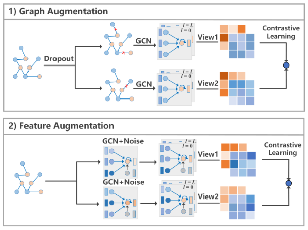
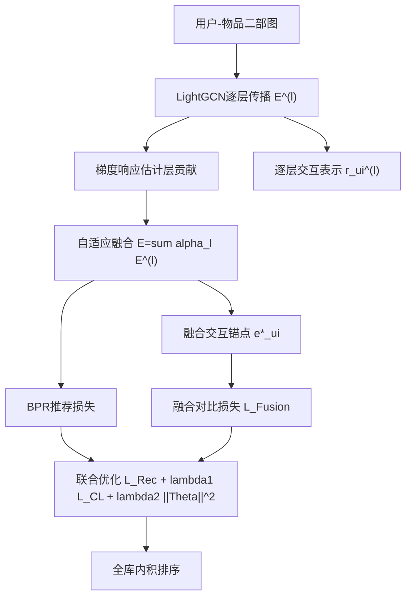
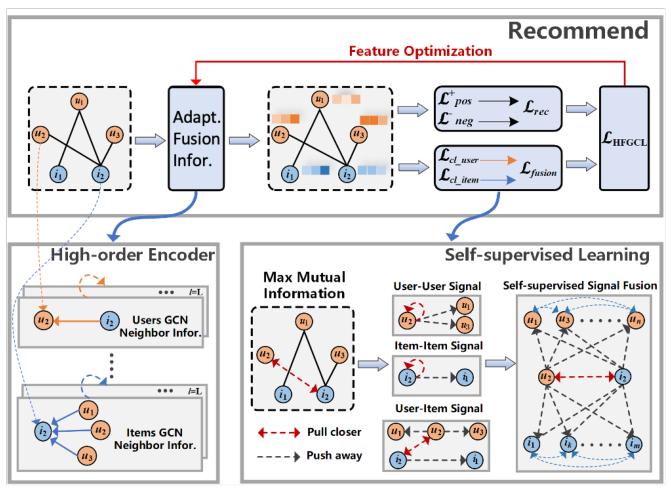

# Adaptive Fusion Graph Contrastive Learning for Recommendation (自适应融合图对比学习推荐)

- **会议/期刊**: CIKM（目标目录标识；arXiv v5 公开于 2024）
- **作者与机构**: Yu Zhang, Yiwen Zhang, Lei Sang, Yi Zhang, Yun Yang；安徽大学、斯威本科技大学
- **推荐链路定位**: 召回 / 图协同过滤表征学习
- **研究方向**: 自监督对比学习与交互去噪 / 图神经网络与知识图谱推荐
- **论文原文**: [论文原文链接](https://arxiv.org/abs/2407.19692v5)
- **开源代码**: 暂未开源

## TL;DR (1分钟核心速览)

本文针对图对比推荐中“数据增强需额外 GCN/建模、破坏图结构”，以及“多路自监督信号难以有效融合”的痛点，提出 AFGCL：用图传播各层表示作为天然对比视图，以推荐损失梯度响应初始化并学习层融合权重；再构造用户—物品交互表示作为共享锚点，统一用户侧与物品侧对比监督。在 Amazon-book/Yelp2018/Tmall 全库排序下，NDCG@20 较最强基线 MixRec 提升 5.30%/1.96%/1.60%，且总训练成本最低。

## Background & Motivation (背景与核心矛盾)

- **主流范式**: LightGCN 图传播 + SGL/SimGCL 式图或特征增强构造双视图，再用 InfoNCE 对齐。
- **前人局限**: 图增强随机丢边/点破坏二部图内在结构，特征增强对全体节点加噪却忽视个体差异；生成增强视图还需额外 GCN/建模，每 epoch 成本约为 LightGCN 的 1.5–3.2 倍。更关键的是，增加对比视图数量并不稳定增益，NCL/CGCL/VGCL 的 4–6 视图在部分数据上仍未超过 SimGCL，说明“多信号”不等于“可融合的好信号”。
- **核心洞察 (Key Insight)**: 不同传播深度编码不同结构范围的协同信息，对推荐任务贡献不均；用户与物品互为邻居，逐层传播后语义逐渐对齐，层表示本身可充当高质量对比视图；观测交互还蕴含用户端与物品端之外的联合语义。
- **本文切入点**: 放弃显式数据增强，自适应融合传播层，并以交互表示为共享锚点设计融合对比目标。

<figure class="paper-figure" markdown="span">
  <figcaption>图1：使用数据增强的基于GCL的方法。上：图增强；下：特征增强。</figcaption>
</figure>
图1：传统 GCL 的两类数据增强：图增强随机丢边/点，特征增强对全体节点加噪。

## Method (核心方法设计)

### 1. 整体框架 (Overall Architecture)

AFGCL 以 LightGCN 为编码器，先获得各层表示 $\mathbf{E}^{(l)}$。它通过短 warm-up 估计每层对 BPR 推荐损失的下降响应，将响应转成熵正则权重并初始化为可学习 logits；训练中 softmax 得到层权重$\alpha_l$，融合出节点表示$\mathbf{E}$与逐层交互表示$\mathbf{r}_{ui}^{(l)}$，再加权成交互锚点$\mathbf{e}_{ui}^{*}$。推荐目标用 BPR，融合对比目标以$\mathbf{e}_{ui}^{*}$ 为锚、对应用户和物品为正样本、批内用户+物品为候选负样本。推理仅用融合后的节点表示做内积/ANN 全库检索。

<figure class="paper-figure" markdown="span">
  <figcaption>图2：AFGCL的优化过程。推荐目标引导传播信号融合，融合对比目标围绕每个观测交互组织用户侧与物品侧监督。</figcaption>
</figure>
图2：AFGCL 优化流程：推荐目标引导传播信号融合，融合对比目标围绕观测交互组织用户侧与物品侧监督。

### 2. 关键设计拆解 (Key Designs)

1. **自适应传播层融合**：不同层对推荐损失贡献不等，均匀聚合会引入次优信号。先均匀加权，累计 warm-up 梯度响应 $\vartheta_l=-\frac{1}{T}\sum_{t=1}^{T}\frac{\partial\mathcal{L}_{rec}^{(t)}}{\partial\beta_l}$，再以熵正则解初始化$w_l^{(0)}=\vartheta_l/\tau_g$，并令$\alpha_l=\mathrm{softmax}(w)_l$、$\mathbf{E}=\sum_{l\in\mathcal{S}}\alpha_l\mathbf{E}^{(l)}$。这样既保留推荐目标偏好的结构范围，又允许端到端调整层权重。

2. **交互表示与融合对比目标**：传统对比目标分别优化用户侧和物品侧，忽略观测交互的联合语义。对每层构造 $\mathbf{r}_{ui}^{(l)}=\mathbf{W}_s(\mathbf{e}_u^{(l)}+\mathbf{e}_i^{(l)})+\mathbf{W}_r[\mathbf{e}_u^{(l)}\|\mathbf{e}_i^{(l)}\|(\mathbf{e}_u^{(l)}\odot\mathbf{e}_i^{(l)})]+\mathbf{b}$，并融合为$\mathbf{e}_{ui}^{*}=\sum_{l\in\mathcal{S}}\alpha_l\mathbf{r}_{ui}^{(l)}$。再以$\mathbf{e}_{ui}^{*}$ 为共享锚：
$$
\mathcal{L}_{Fusion}=-\sum_{\langle u,i\rangle\in\mathcal{B}}\left(\log\frac{\exp(\mathrm{sim}(\mathbf{e}_{ui}^{*},\mathbf{e}_u)/\tau)}{\sum_{\mathbf{x}\in\mathcal{B}_{ui}}\exp(\mathrm{sim}(\mathbf{e}_{ui}^{*},\mathbf{x})/\tau)}+\log\frac{\exp(\mathrm{sim}(\mathbf{e}_{ui}^{*},\mathbf{e}_i)/\tau)}{\sum_{\mathbf{x}\in\mathcal{B}_{ui}}\exp(\mathrm{sim}(\mathbf{e}_{ui}^{*},\mathbf{x})/\tau)}\right)
$$
其中 $\mathcal{B}_{ui}=\mathcal{B}_u\cup\mathcal{B}_i$ 为联合候选空间。其梯度会同时拉近交互锚点与对应用户/物品，并把相似度高的批内候选作为更强负样本推开，从而兼顾对齐性与均匀性。

3. **训练目标、负采样与推理效率**：总损失为 $\mathcal{L}_{AFGCL}=\mathcal{L}_{Rec}+\lambda_1\mathcal{L}_{CL}+\lambda_2\|\Theta\|_2^2$，$\mathcal{L}_{CL}=\mathcal{L}_{Fusion}$。BPR 对每个正样本采 1 个均匀负样本；对比损失使用批内用户+物品联合候选，无额外图增强或负采样器。编码复杂度$\mathcal{O}(2Ld|\mathcal{E}|)$，对比损失约$\mathcal{O}(Bd(|\mathcal{S}|+4B))$；相比 SGL-ED/SimGCL 少一次增强图卷积，训练更快收敛。

## Experimental Setup & Evaluation Protocol (实验设置与评估协议)

- **数据集与预处理**: 采用 Amazon-book、Yelp2018、Tmall；评分 $>3$ 视为交互，过滤交互数少于 10 的用户。

| 数据集 | #Users | #Items | #Interactions | 稀疏度/密度 | 特征/场景说明 |
| :--- | :---: | :---: | :---: | :---: | :--- |
| Amazon-book | 52.6k | 91.6k | 2984.1k | 0.06% | 图书隐式反馈，极稀疏 |
| Yelp2018 | 31.7k | 38.0k | 1561.4k | 0.13% | 本地商户多类目交互 |
| Tmall | 47.9k | 41.4k | 2619.4k | 0.13% | 电商匿名用户行为 |

- **数据划分与防穿越 (Splitting Strategy)**: 沿用 LightGCN/NGCF 系常用 8:1:1 随机划分；原文对划分细节描述较简略。训练只用训练集交互构图，验证集调参，测试集评估。
- **排名评测协议 (Ranking Protocol)**: 采用无偏 **Full-Ranking**，对测试用户全部未交互物品排序；报告 Recall@10/20 与 NDCG@10/20。训练阶段 BPR 采用均匀负采样；对比目标使用批内联合候选，而非全库负采样。
- **对比基线与超参设置**: 基线覆盖 BPR-MF、NGCF、LightGCN、SGL-ED、SimGCL、NCL、CGCL、VGCL、LightGCL、RecDCL、BIGCF、SCCF、MixRec、SGCL、DimCL、SimGCF。嵌入维度 $d=64$（RecDCL 为 2048），Adam 优化，batch 分别为 4096/2048/4096；GCN 层数$L\in\{1,2,3,4\}$，AFGCL 取$L\in\{3,4\}$，$\tau\in[0.20,0.30]$，$\lambda_1\in\{0.1,0.5,1.0,2.5\}$，$\lambda_2=1\mathrm{e}{-6}$；显著性用双尾配对$t$检验，$p<0.05$。

## Key Experimental Results (实验关键数据)

### 1. 主实验对比 (Main Results)

| 方法 | Amazon R@20 | Amazon N@20 | Yelp R@20 | Yelp N@20 | Tmall R@20 | Tmall N@20 |
| :--- | ---: | ---: | ---: | ---: | ---: | ---: |
| LightGCN | 0.0411 | 0.0315 | 0.0639 | 0.0525 | 0.0711 | 0.0530 |
| SGL-ED | 0.0478 | 0.0379 | 0.0675 | 0.0555 | 0.0738 | 0.0556 |
| SimGCL | 0.0515 | 0.0414 | 0.0721 | 0.0601 | 0.0884 | 0.0674 |
| NCL | 0.0481 | 0.0373 | 0.0685 | 0.0577 | 0.0750 | 0.0553 |
| VGCL | 0.0515 | 0.0410 | 0.0715 | 0.0587 | 0.0880 | 0.0670 |
| MixRec | 0.0539 | 0.0434 | 0.0740 | 0.0612 | 0.0900 | 0.0686 |
| SGCL | 0.0479 | 0.0377 | 0.0715 | 0.0589 | 0.0872 | 0.0656 |
| DimCL | 0.0452 | 0.0367 | 0.0678 | 0.0569 | 0.0792 | 0.0600 |
| **AFGCL** | **0.0566** | **0.0458** | **0.0752** | **0.0624** | **0.0911** | **0.0697** |
| Improv.% vs 最强基线 | +5.01% | +5.30% | +1.62% | +1.96% | +1.22% | +1.60% |

### 2. 消融实验 (Ablation Study)

| 变体 | Amazon R@20 | Amazon N@20 | Yelp R@20 | Yelp N@20 | Tmall R@20 | Tmall N@20 |
| :--- | ---: | ---: | ---: | ---: | ---: | ---: |
| LightGCN | 0.0411 | 0.0315 | 0.0639 | 0.0525 | 0.0711 | 0.0530 |
| w/o AF | 0.0545 | 0.0432 | 0.0704 | 0.0581 | 0.0782 | 0.0590 |
| w/o GCN | 0.0539 | 0.0422 | 0.0722 | 0.0595 | 0.0870 | 0.0666 |
| w/o CL | 0.0372 | 0.0289 | 0.0570 | 0.0457 | 0.0580 | 0.0426 |
| w/o IR | 0.0555 | 0.0452 | 0.0734 | 0.0612 | 0.0888 | 0.0680 |
| w/o FCL | 0.0380 | 0.0304 | 0.0569 | 0.0471 | 0.0663 | 0.0497 |
| **AFGCL** | **0.0566** | **0.0458** | **0.0752** | **0.0624** | **0.0911** | **0.0697** |

### 3. 关键实验发现 (Key Findings)

- **自监督信号是主要增益来源**：移除 CL 后 Amazon/Tmall 的 R@20 从 0.0566/0.0911 跌至 0.0372/0.0580，甚至低于 LightGCN，说明仅靠自适应融合层无法弥补对比监督的缺失。
- **融合目标比显式交互表示更关键**：`w/o FCL` 在 Amazon R@20 仅 0.0380，接近 `w/o CL`；而 `w/o IR` 为 0.0555，降幅较小。以交互为共享锚、双边正样本进联合候选空间的设计，是 AFGCL 优于端点式对比的核心。
- **层贡献不均与效率优势同时成立**：`w/o AF` 在 Tmall R@20 从 0.0911 降至 0.0782（-14.2%），说明自适应层权重对稀疏/多类目场景尤其重要；同时 AFGCL 在 Fig.3/Fig.4 中收敛更快、总训练成本最低，并在稀疏用户组与 10–30% 噪声注入下保持最佳曲线。

## Highlights & Limitations (亮点、对比与审稿批判)

- **与代表作对比 (vs. Prior Work)**: 相比 SGL-ED/SimGCL，AFGCL 不构造增强视图，省去额外 GCN，避免随机丢边/全节点加噪；相比 MixRec，它不做意图/混合视图建模，训练成本更低；相比 SCCF/RecDCL，它以交互锚点统一双边监督，损失更轻且保留图传播。
- **可迁移亮点**: 用 warm-up 梯度响应初始化层融合权重，可迁移到任意多层 GNN 推荐；把交互表示作为对比共享锚点，可用于双边图/跨域对齐任务。
- **审稿级局限批判**: 第一，$\tau$ 较敏感，最佳区间约 0.20–0.30，且对比负样本为批内候选，受 batch size 影响；第二，验证仅限 LightGCN 式二部图与三个稀疏数据集，未覆盖序列、社交、多模态场景，且划分/全库排序协议原文描述偏简，复现需确认细节；此外无线上 A/B 与开源代码。

## Rating (四维评分)

- **方法创新性 (Novelty)**: ⭐⭐⭐⭐ （免增强 + 梯度响应层融合 + 交互锚点融合对比，机制有增量新意，但整体仍在 GCL 框架内演进）
- **评估协议与实验扎实度 (Protocol & Experiments)**: ⭐⭐⭐⭐ （三个稀疏数据集、主实验/消融/稀疏/噪声/效率分析较完整，但划分与采样协议描述略简，缺更多场景验证）
- **写作与数学规范度 (Clarity & Rigor)**: ⭐⭐⭐⭐ （核心公式与梯度直觉清楚，符号较多，部分实验细节与复杂度推导偏略）
- **工业落地与复现价值 (Industrial & Practical Value)**: ⭐⭐⭐⭐ （无额外增强、训练成本低、可直接替换 LightGCN 编码器，但需调 $\tau/\lambda_1$ 且暂未开源）

