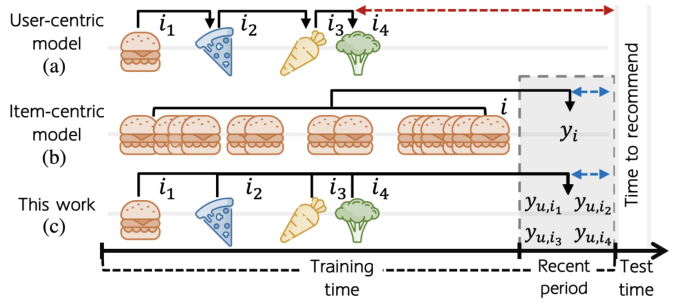
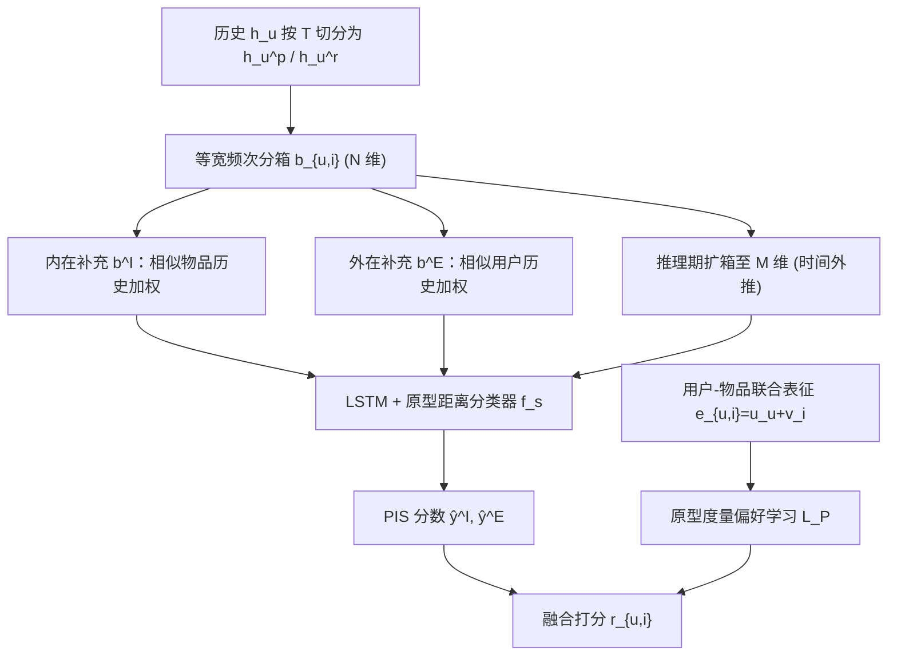

# Beyond Learning from Next Item: Sequential Recommendation via Personalized Interest Sustainability (超越下一项预测：基于个性化兴趣持续性的序列推荐)

- **会议/期刊**: CIKM 2022
- **作者与机构**: Dongmin Hyun, Junsu Cho, Hwanjo Yu (POSTECH)；Chanyoung Park (KAIST)
- **推荐链路定位**: 精排（Top-K 排序打分）
- **研究方向**: 序列与会话推荐 / 冷启动与长尾推荐
- **论文原文**: [https://arxiv.org/abs/2209.06644v1](https://arxiv.org/abs/2209.06644v1)
- **开源代码**: [https://github.com/dmhyun/PERIS](https://github.com/dmhyun/PERIS)

## TL;DR (1分钟核心速览)

序列推荐长期困于两难：user-centric 模型只看"下一项"，用户表征只覆盖到最后一次消费时刻，长期空白后严重失准；item-centric（如 CRIS）虽显式建模"兴趣持续性"，但持续性在物品上是**非个性化**的（给咖啡过敏者也推咖啡）。本文提出 PERIS：把训练期最后一段（时间戳 $T$之后）当作"未来"，要求模型仅凭用户在$T$之前的历史预测其在$T$ 之后的消费集合，从而学到**个性化兴趣持续性 (PIS)**；并针对用户-物品交互极稀疏（Yelp 平均 2.6 次/物品）设计内在（相似物品历史加权）与外在（相似用户历史加权）两种补充方案。在 11 个真实数据集上，按"最后 30 天为测试、1 正 100 负采样排序"的协议，H@10/N@10 一致超越 10 个基线，相对最优序列模型最高提升 **+30.6% (Digital Music H@10)**。

## Background & Motivation (背景与核心矛盾)

- **主流范式**: user-centric 序列模型（Caser/SASRec/TiSASRec/LSAN）用自注意力或 CNN 编码用户消费顺序；item-centric 模型（CRIS）对每个物品汇总全体用户历史，预测其在训练期末段是否仍被消费。
- **前人局限一**: user-centric 依赖 next-item 监督，用户表征的时间止点固定在其最后一次消费，若该时刻距测试期久远（长空缺），兴趣漂移无法被捕获。
- **前人局限二**: item-centric 的"兴趣持续性"是全局的、非个性化的，无法区分素食者与普通用户，且 CRIS 采用"先训 NIS、再冻结训推荐"的两阶段流程，持续性对推荐目标而言是次优的，且新消费需全量重训。
- **核心洞察 (Key Insight)**: 用户对某物品的"时间消费模式"具有强判别性——近期消费越密集，未来越可能复购（正类）；而负类缺乏清晰模式。因此可以用**绝对日历时间上的频次分箱序列**而非相对位置序列来刻画兴趣是否延续。
- **本文切入点**: 把"预测用户个体在训练期末段的消费"作为辅助任务，与经典偏好学习多任务联合优化，并用两种相似度加权补充稀疏分箱特征。

<figure class="paper-figure" markdown="span">
  <figcaption>图1：捕获兴趣漂移的模型比较。实线箭头表示基于物品的预测。标签 𝑦𝑖 和 𝑦𝑢,𝑖：是否有任何用户消费物品 𝑖，以及用户 𝑢 是否</figcaption>
</figure>

## Method (核心方法设计)

### 1. 整体框架 (Overall Architecture)

输入用户 $u$的消费历史$h_u=\{(i,t)\}$，按预设时间$T$切成$h_u^p$（$t<T$）与$h_u^r$（$t\ge T$）。对每个$(u,i)$把$h_u^p$中的消费时刻离散化为等宽$w$的$N$个时间区间，得到频次分箱向量$\mathbf{b}_{u,i}\in\mathbb{R}^N$；该向量分别经内在（同用户相似物品历史加权）与外在（同物品相似用户历史加权）补充后送入 LSTM+原型距离分类器$f_s$预测 PIS 标签。推理时把分箱区间从$N$扩展至覆盖整个训练期的$M\ge N$ 个箱（"时间外推"），使模型在测试期仍能输出延续性判断。同时并行一路原型度量偏好学习提供真标签信号，最终按系数加权融合三路打分。

### 2. 关键设计拆解 (Key Designs)

1. **个性化兴趣持续性 (PIS) 预测任务与频次分箱特征**：痛点是用"下一项"监督学不到训练期之后的兴趣；本文把训练期末段当"未来"，标签为 $y_{u,i}=\mathbb{I}[i\in h_u^r]$，特征为$\mathbf{b}^n_{u,i}=\sum_{t\in C_{u,i}}\mathbb{I}[t\in V_n]$，并以$\hat{y}_{u,i}=1-d(\mathbf{C},\mathrm{LSTM}(\mathbf{b}_{u,i}))$做原型距离分类。其物理直觉是：模型被迫学习"该兴趣在未来一段时间内是否仍在"的绝对时间规律，而非仅仅"下一步买什么"，从而缩短了兴趣捕获时刻与测试时刻之间的间隔。损失只在用户消费过的物品$\{i|i\in h_u\}$上计算（$\sum (y_{u,i}-\hat{y}_{u,i})^2$），避免全物品穷举。

2. **内在 / 外在双路稀疏补充方案**：痛点是多数 $(u,i)$对只有 1–2 次交互，分箱几乎全零，PIS 任务无法训练。内在方案假设"近期消费了相似物品（卡布奇诺）则对目标物品（浓缩）兴趣仍在"，用$\mathbf{b}^I_{u,i}=\mathbf{b}_{u,i}+\sum_{j\in h_u^p\setminus\{i\}}\alpha_{i,j}\mathbf{b}_{u,j}$，$\alpha_{i,j}=\mathrm{sim}(\mathbf{v}_i,\mathbf{v}_j)$，并额外注入$e_{u,i}=u_u+v_i$，即$\hat{y}^I_{u,i}=f_s(\mathbf{b}^I_{u,i}+e_{u,i})$。外在方案则是"用同类人（其他素食者）的兴趣推断目标用户（素食者）的兴趣"，聚合$\mathbf{b}^E_{u,i}=\sum_{\mathbf{b}_{u',i}\in B_{u,i}}\beta_{u,u'}\mathbf{b}_{u',i}$，$\beta_{u,u'}=\mathrm{sim}(u_u,u_{u'})$，标签取软 OR：$y^E_{u,i}=\mathbb{I}[\sum_{u'}\beta_{u,u'}y_{u',i}\ge 1]$。二者互补：内在覆盖"多品类活跃用户"，外在覆盖"单品类浅度用户"。

3. **训练目标、负采样与推理效率**：总损失为 $\mathcal{L}_F=\lambda[\mu\mathcal{L}_I+(1-\mu)\mathcal{L}_E]+(1-\lambda)\mathcal{L}_P$，其中$\mathcal{L}_P=\sum_{u}\sum_{i^+\in h_u,i^-\notin h_u}[d(P,e_{u,i^+})-d(P,e_{u,i^-})+m]_+$为原型度量学习（以补 PIS 伪标签噪声），负样本$i^-$自未交互物品随机采样，即"Uniform + 训练集内采样"。前 5 个 epoch 仅用$\mathcal{L}_P$warm-up 以稳定相似度所需的 embedding；推理打分为$r_{u,i}=\lambda[\mu\hat{y}^I_{u,i}+(1-\mu)\hat{y}^E_{u,i}]+(1-\lambda)\hat{y}^P_{u,i}$，$\hat{y}^P=-d(P,e_{u,i})$。由于只用最近一半分箱计算，在线增量只需追加新消费即可更新 PIS，无需像 CRIS 那样全量重训。

## Experimental Setup & Evaluation Protocol (实验设置与评估协议)

- **数据集与预处理**: 11 个真实数据集（Amazon 9 类 + Yelp + Google）；过滤消费 <10 个物品的用户；剔除训练期不出现的冷启动用户/物品；Yelp 原始数据被官方高密度过滤（28.1 次/物品），作者按 Amazon/Google 统计量随机丢弃交互以还原稀疏性。

| 数据集 | #Users | #Items | #Interactions | Int./item | 特征/场景说明 |
| :--- | :---: | :---: | :---: | :---: | :--- |
| Cell Phones | 8,192 | 47,671 | 118,323 | 2.48 | Amazon 电子产品 |
| Digital Music | 6,062 | 65,094 | 127,484 | 1.96 | 最稀疏，下载类 |
| Tools | 8,971 | 61,271 | 150,780 | 2.46 | 工具类 |
| Toys | 12,636 | 99,051 | 230,473 | 2.33 | 玩具 |
| Clothing | 35,824 | 315,818 | 578,135 | 1.83 | 服饰，物品极稀疏 |
| Yelp | 18,284 | 83,871 | 384,330 | 4.58 | LBS 服务/餐饮 |
| Google | 125,341 | 1,552,812 | 3,066,438 | 1.97 | Maps 商户，最大规模 |

- **数据划分与防穿越 (Splitting Strategy)**: **全局时间戳切分**——最后 30 天为测试集，剩余数据的最后 30 天为验证集，其余为训练集（沿用 CRIS 设定），严格保证训练期在测试期之前。
- **排名评测协议 (Ranking Protocol)**: **Sampled Ranking**，每个正样本对比 100 个随机采样的未交互物品（1:100），报告 HR@5/10 与 nDCG@5/10，5 次运行取均值。
- **对比基线与超参设置**: 8 类基线覆盖 general（BPR/CML/SML/SimpleX）、user-centric（Caser/SASRec/TiSASRec/HGN/LSAN）与 item-centric（CRIS）；统一 PyTorch 框架、Xavier 初始化、embedding 维度 $k\in\{16,32,64,128\}$、Adam 学习率$\{0.01,0.005,0.001\}$网格搜索；PERIS 额外调$\lambda,\mu\in\{0.1,\dots,1\}$、箱宽$w\in\{4,8,12\}$周、$\tau\in\{0,0.3,0.5,0.7\}$、近期段长度$\{16,32,64\}$周；最优结果相对最佳基线通过$t$-test，$p<0.001$ 显著。

## Key Experimental Results (实验关键数据)

### 1. 主实验对比 (Main Results)

单元格为 `H@10 / N@10`（%）；**加粗**为该数据集最优，`Improv.` 为相对最佳序列模型（含 CRIS）的相对提升。

| 数据集 | BPR | CML | SimpleX | SASRec | TiSASRec | LSAN | CRIS | **PERIS** | Improv. |
| :--- | :---: | :---: | :---: | :---: | :---: | :---: | :---: | :---: | :---: |
| Cell Phones | 59.61/39.06 | 60.68/40.32 | 63.84/43.09 | 59.32/36.84 | 63.31/40.62 | 65.55/44.47 | 68.38/47.20 | **76.28/52.84** | +11.6%/+11.9% |
| Digital Music | 44.53/28.73 | 44.49/28.53 | 46.54/30.98 | 31.97/19.06 | 36.37/20.52 | 44.79/28.70 | 37.78/22.62 | **58.50/38.93** | +30.6%/+35.6% |
| Tools | 48.89/29.66 | 47.86/29.46 | 52.69/32.30 | 48.03/27.78 | 47.45/27.31 | 48.93/29.94 | 49.77/28.75 | **57.15/35.73** | +14.8%/+19.3% |
| Toys | 57.08/37.61 | 57.28/37.35 | 61.74/39.75 | 48.73/26.97 | 52.02/29.11 | 61.46/40.31 | 62.63/40.92 | **66.61/43.99** | +6.4%/+7.5% |
| Clothing | 48.21/32.95 | 50.14/33.24 | 58.45/38.90 | 51.25/31.74 | 57.18/35.92 | 50.23/32.10 | 57.07/37.22 | **64.70/40.90** | +13.2%/+9.9% |
| Yelp | 84.53/53.66 | 82.74/52.20 | 84.11/52.65 | 61.75/34.55 | 63.75/37.58 | 85.63/56.06 | 84.38/52.84 | **87.29/59.45** | +1.9%/+6.0% |
| Google | 68.69/52.12 | 81.08/65.44 | 78.62/63.33 | 44.54/26.93 | 48.01/31.35 | 72.76/50.81 | 81.94/64.47 | **86.83/72.23** | +6.0%/+12.0% |

### 2. 消融实验 (Ablation Study)

验证集上 H@10 / N@10；Int./Ext. 为内在/外在补充，PIS 为持续性任务开关。

| 配置 | Tools | Toys | Yelp |
| :--- | :---: | :---: | :---: |
| 完整 PERIS (Int.+Ext.+PIS) | **60.34/39.16** | **71.73/51.36** | **89.85/59.53** |
| w/o Int. | 59.39/38.24 | 69.55/49.57 | 87.79/58.94 |
| w/o Ext. | 46.60/25.03 | 64.62/44.12 | 86.77/53.96 |
| w/o Int. & Ext. | 46.41/24.95 | 64.25/43.15 | 88.10/54.10 |
| w/o PIS（仅偏好学习 $\mathcal{L}_P$） | 52.01/31.96 | 65.92/46.23 | 85.15/53.87 |
| 仅用最后分箱 $b^n_{N,u,i}$ | 54.21/33.76 | 66.85/47.97 | 86.36/54.28 |
| 内在分支去掉 $e_{u,i}$ | 60.34/38.62 | 71.40/51.01 | 86.77/57.98 |

### 3. 关键实验发现 (Key Findings)

1. **最稀疏的数据集收益最大，证明补充方案正是关键**：Digital Music 平均仅 1.96 次/物品，PERIS 相对最佳序列基线 H@10 提升 +30.6%、N@10 +35.6%；而 Yelp（4.58 次/物品）仅 +1.9%/+6.0%。这印证"稀疏分箱 → PIS 学不动 → 需相似度补充"的因果链。
2. **外在补充是主承重墙，且缺了 PIS 反而不如纯偏好学习**：Tools 上仅去掉 Ext. 使 H@10 从 60.34 崩到 46.60（−22.8%），而仅去掉 Int. 只降到 59.39；同时"Int.+Ext. 都不加 + 保留 PIS"（46.41）甚至低于"完全不做 PIS"（52.01），说明无补充的原始 PIS 任务在稀疏数据上会主动伤害推荐——补充方案不是锦上添花而是该任务可用的前提。参数敏感性同样显示 $\mu\approx0.3$（偏向外在）最优、$\lambda=1$（仅 PIS）性能大幅下降。
3. **增益随"距上次消费的空白时长"单调放大，且具备时间平移敏感性**：按 $25/50/75$ 分位划分用户群（图 5），PERIS 相对 LSAN 的提升随 elapsed days 增大而扩大，因为 LSAN 的兴趣止于最后一次消费；而把用户历史整体平移若干月（图 7）时，LSAN/CRIS/SimpleX 的推荐列表重叠率几乎不变（对绝对时间不敏感），只有 PERIS 会随平移改变推荐，直接证明频次分箱捕获了"绝对时间的兴趣持续性"。

## Highlights & Limitations (亮点、对比与审稿批判)

- **与代表作对比 (vs. Prior Work)**: 相较 LSAN（自注意力只看相对顺序、监督信号为 next-item），PERIS 改的是**监督的定义域**（训练期末段消费集合）而非网络结构；相较 CRIS（item-level 全局持续性、两阶段分离训练、新消费需重训），PERIS 把预测粒度下沉到 $(u,i)$ 对、端到端联合优化、且支持增量更新——这三点正是其优于 CRIS 的结构性原因。
- **可迁移亮点**: ①"把训练期末段当伪未来 + 等宽频次分箱"是一个几乎零成本的时序增广范式，可直接套用到 CTR/POI/短视频留存类任务；②推理期外推分箱（$N\to M$）实现"训练期标签、测试期打分"的无缝对齐，避免时间穿越且不需重训；③把用户-物品联合表征只喂给内在分支、不喂外在分支（消融显示后者会掉点），这类"分支-输入匹配"的细节值得借鉴。
- **审稿级局限批判**: ①评测仅用 1:100 采样排序，未做 full-ranking，稀疏物品的排名优势可能被高估；②约 8 个超参（$\lambda,\mu,w,\tau,T,\gamma$及损失缩放）需网格搜索，$T$与数据时间跨度强相关，跨域迁移成本高；③模型依赖$O(|B_{u,i}|)$ 的相似用户聚合，最坏情况下单次打分需遍历物品全体消费者，大规模在线部署需预计算或近邻裁剪（论文未报告实际延迟）。

## Rating (四维评分)

- **方法创新性 (Novelty)**: ⭐⭐⭐⭐ （把"兴趣持续性"从 item 级推广到 user-item 级并给出可训练任务定义，思想清晰，但网络结构本身为 LSTM+原型分类器，工程性创新多于结构创新）
- **评估协议与实验扎实度 (Protocol & Experiments)**: ⭐⭐⭐⭐ （11 个数据集 + 10 个基线 + $p<0.001$ 显著性 + 消融/分桶/时间平移/参数敏感性齐备；扣分点在于采样排序而非全库排序）
- **写作与数学规范度 (Clarity & Rigor)**: ⭐⭐⭐⭐ （任务定义、分箱公式与损失权重层次分明，符号统一；但内在/外在标签的定义略偏启发式，$y^E$ 的软 OR 阈值缺少理论论证）
- **工业落地与复现价值 (Industrial & Practical Value)**: ⭐⭐⭐⭐⭐ （代码已开源，分箱特征可与任意序列模型并联，增量更新友好，唯一顾虑是相似用户聚合的在线开销）

