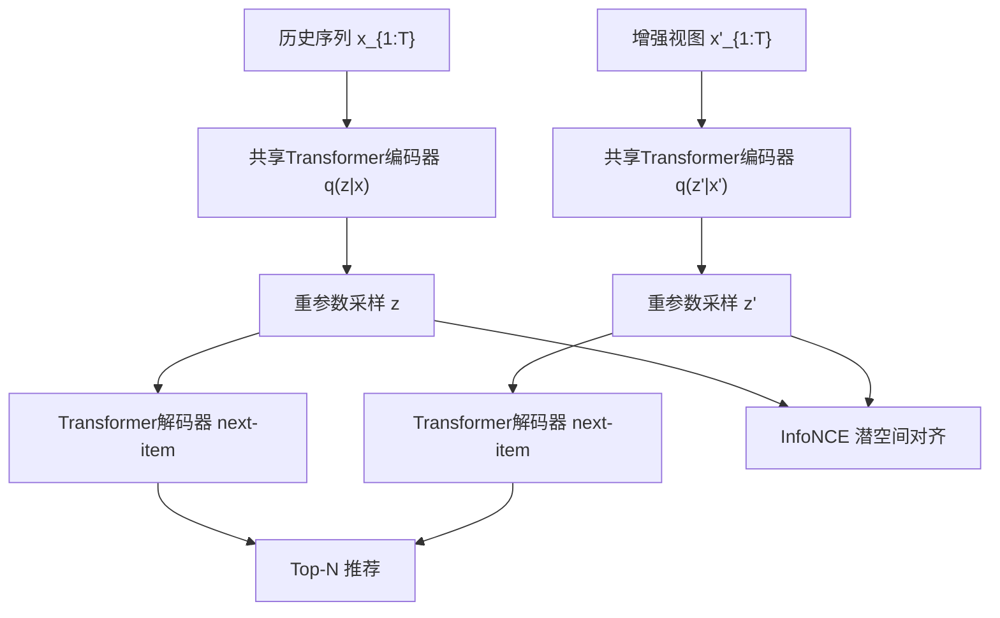
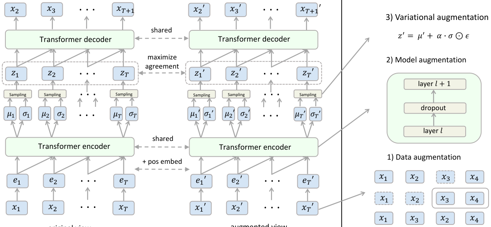

# ContrastVAE: Contrastive Variational AutoEncoder for Sequential Recommendation（对比变分自编码器用于序列推荐）

- **会议/期刊**: CIKM 2022
- **作者与机构**: Yu Wang, Hengrui Zhang, Zhiwei Liu, Liangwei Yang, Philip S. Yu；University of Illinois at Chicago & Salesforce
- **推荐链路定位**: 召回
- **研究方向**: 序列与会话推荐 / 自监督对比学习与交互去噪
- **论文原文**: [https://arxiv.org/abs/2209.00456v2](https://arxiv.org/abs/2209.00456v2)
- **开源代码**: [https://github.com/YuWang-1024/ContrastVAE](https://github.com/YuWang-1024/ContrastVAE)

## TL;DR (1分钟核心速览)

针对序列推荐中交互稀疏、行为不确定性与长尾物品三大痛点，本文把单视角ELBO扩展为双视角ContrastELBO，提出双分支Transformer-VAE，并用模型增强/变分增强构造第二视图，以InfoNCE最大化潜变量互信息。在四个Amazon数据集、5-core + Leave-One-Out + Full-Ranking协议下，R@40相对最强基线提升8.86%–19.34%。

## Background & Motivation (背景与核心矛盾)

- **主流范式**: Transformer序列编码（SASRec/Bert4Rec）、VAE概率序列模型（SVAE/ACVAE）与对比学习（S3Rec/CL4Rec）并行发展。
- **前人局限**: ①VAE在稀疏/长尾序列上易后验坍缩，$D_{KL}[q(z|x)||p(z)]\to0$，不同序列潜表示不可分；②随机mask/crop/reorder在短序列上破坏语义一致性，难以同时处理不确定性与稀疏性。
- **核心洞察 (Key Insight)**: 将VAE从单视角扩展到$(x,z)-(z')-(x')$双视角后，ELBO末项自然变为互信息$I(z,z')$；对比学习既能抗后验坍缩，又能让扰动视图共享语义。
- **本文切入点**: 用双分支VAE显式优化ContrastELBO，在潜空间做增强与对比正则，而非仅依赖输入级数据增强。

## Method (核心方法设计)

### 1. 整体框架 (Overall Architecture)

输入用户历史序列$x_{1:T}$及其增强视图$x'_{1:T}$，共享Transformer编码器分别输出高斯后验$q(z|x)$、$q(z'|x')$，经重参数采样得到$z,z'$；共享Transformer解码器对两个视图做next-item预测，并在序列级潜表示之间施加InfoNCE对比正则。训练同时优化两个视图的重构项、KL项与互信息项；推理仅需原始分支一次前向。

<figure class="paper-figure" markdown="span">
  <figcaption>图 1：ContrastVAE 的高层示意图。(a) 模型框架：模型接收原始视图 𝒙1:𝑇 和一个增强视图 𝒙′</figcaption>
</figure>

图1：ContrastVAE双分支框架与三类增强策略。

### 2. 关键设计拆解 (Key Designs)

1. **ContrastELBO（把单视角ELBO扩到双视角）**：单视角VAE只约束重构与KL，稀疏序列下$z$与$x$互信息消失。本文构造$x\leftarrow z-z'\to x'$，将联合似然下界写为两个单视角ELBO加一项：
$\log p(x,x')\ge \mathrm{ELBO}(x)+\mathrm{ELBO}(x')+\mathbb{E}_{q(z,z'|x,x')}\log\frac{p(z,z')}{p(z)p(z')}$。
取$p(z,z')=q(z,z')$后末项退化为$I(z,z')$，可用InfoNCE估计；直觉是强制同一序列两视图潜变量一致，同时保持不同序列可分，直接对抗后验坍缩。

2. **模型增强与变分增强（在潜空间造第二视图）**：随机数据增强在短序列上易语义不一致。模型增强在每层注入dropout：
$\boldsymbol{h}^{(l+1)}_{1:T}=\boldsymbol{h}^{(l)}_{1:T}+\mathrm{SA}(\boldsymbol{h}^{(l)}_{1:T}\odot\boldsymbol{\xi})$，$\boldsymbol{\xi}\sim\mathrm{Bern}(p)$；
变分增强在重参数采样处学习门控：
$\boldsymbol{z}_{1:T}=\boldsymbol{\mu}_{1:T}+\alpha\cdot\boldsymbol{\sigma}_{1:T}\odot\boldsymbol{\epsilon}$。
不改变离散item语义，只扰动中间表示/后验方差，短序列更稳。

3. **训练目标、负采样与推理效率**：总损失为
$\mathcal{L}=\mathcal{L}_{CE}-\mathcal{L}_{KL}+\mathcal{L}'_{CE}-\mathcal{L}'_{KL}+\lambda\mathcal{L}_{InfoNCE}$，
变分增强时再加$\mathcal{L}_{\alpha}$正则。对比损失为
$\mathcal{L}_{InfoNCE}=\frac1M\sum_u\log\frac{\exp(\boldsymbol{z}_u^\top \boldsymbol{z}'_u/\tau)}{\sum_v\exp(\boldsymbol{z}_u^\top \boldsymbol{z}'_v/\tau)+\sum_{v\ne u}\exp(\boldsymbol{z}_u^\top \boldsymbol{z}_v/\tau)}$。
训练时每个时间步随机采1个负物品（sampled negative）；推理仅单分支，开销与SASRec同阶，训练期双分支约2倍编码/解码计算。

## Experimental Setup & Evaluation Protocol (实验设置与评估协议)

- **数据集与预处理**: 四个Amazon域，按5-core过滤用户/物品，按时间戳排序成序列。

| 数据集 | #Users | #Items | #Interactions | #Ints/item | Avg. seq. len. |
| :--- | :---: | :---: | :---: | :---: | :---: |
| Beauty | 22,363 | 12,101 | 198,502 | 16.40 | 8.3 |
| Toys | 19,412 | 11,924 | 167,597 | 14.06 | 8.6 |
| Tools | 16,638 | 10,217 | 134,476 | 13.16 | 8.1 |
| Office | 4,905 | 2,420 | 53,258 | 22.00 | 10.8 |

- **数据划分与防穿越 (Splitting Strategy)**: 每用户最后1项测试、倒数第2项验证、其余训练，即`Leave-One-Out`；按时间戳排序，无未来信息泄漏。
- **排名评测协议 (Ranking Protocol)**: `Full-Ranking`，对全库未交互物品打分排序，报告R@20/40、N@20/40；训练负采样为每时间步1个随机负物品，非全库softmax。
- **对比基线与超参设置**: 对比ACVAE、S3Rec、CL4Rec、Bert4Rec、SASRec、STOSA、DT4SR等7类代表基线；$d=128$，4头注意力，dropout=0.3，lr=1e-3，Adam，early stop=100；原文未报告显著性检验。

## Key Experimental Results (实验关键数据)

### 1. 主实验对比 (Main Results)

| 数据集 | 指标 | ACVAE | S3Rec | CL4Rec | Bert4Rec | SASRec | STOSA | DT4SR | ContrastVAE | Improv. |
| :--- | :---: | :---: | :---: | :---: | :---: | :---: | :---: | :---: | :---: | :---: |
| Beauty | R@40 | .1294 | .1348 | .0554 | .1285 | .1389 | .1337 | .1404 | **.1541** | 9.76% |
| Beauty | N@40 | .0537 | .0505 | .0200 | .0476 | .0509 | .0542 | .0533 | **.0587** | 8.30% |
| Office | R@40 | .2075 | .2112 | .1025 | .2230 | .2251 | .2391 | .2186 | **.2617** | 9.45% |
| Office | N@40 | .0713 | .0729 | .0368 | .0729 | .0815 | .0859 | .0797 | **.0925** | 7.68% |
| Toys | R@40 | .1030 | .1307 | .0596 | .0982 | .1479 | .1357 | .1478 | **.1610** | 8.86% |
| Toys | N@40 | .0421 | .0536 | .0224 | .0376 | .0614 | .0567 | .0560 | **.0638** | 4.42% |
| Tools | R@40 | .0759 | .0849 | .0634 | .0777 | .0879 | .0867 | .0861 | **.1049** | 19.34% |
| Tools | N@40 | .0294 | .0330 | .0233 | .0268 | .0345 | .0346 | .0342 | **.0381** | 10.12% |

### 2. 消融实验 (Ablation Study)

| 变体 | Toys R@20 | Toys N@20 | Tools R@20 | Tools N@20 |
| :--- | :---: | :---: | :---: | :---: |
| w/o MI（去InfoNCE） | .112 (-3.60%) | .052 (-5.85%) | .070 (-4.11%) | .031 (-5.83%) |
| w/o $\mathcal{L}_{\alpha}$ | .104 (-10.9%) | .051 (-6.03%) | .063 (-13.69%) | .028 (-14.4%) |
| ContrastVAE | **.116** | **.055** | **.073** | **.033** |

### 3. 关键实验发现 (Key Findings)

1. **CL与变分正则缺一不可**：去掉InfoNCE后Toys R@20仅降3.60%，但去掉$\mathcal{L}_{\alpha}$降10.9%，说明变分增强的方差校准是双分支VAE稳定训练的关键。
2. **长尾与短序列是主要收益源**：Toys测试目标中17,353/22,363条序列落在$[≤10]$频次组，ContrastVAE R@40=0.1610，高于SASRec的0.1479；Tools平均序列长仅8.1，R@40提升19.34%最大。
3. **潜空间诊断印证抗坍缩**：AVAE在低频物品上KL散度低且方差趋零，ContrastVAE提高方差并保持更高KL散度；在随机删除/替换噪声下仍稳定优于ACVAE/S3Rec/SASRec。

## Highlights & Limitations (亮点、对比与审稿批判)

- **与代表作对比 (vs. Prior Work)**: 与ACVAE相比，本文不再只最大化输入-用户嵌入互信息，而是做双视图潜变量互信息；与S3Rec/CL4Rec的输入级随机增强相比，本文用模型/变分增强规避短序列语义不一致；与DuoRec依赖同标签序列作正样本不同，本文仅用同序列两视图，无额外监督。
- **可迁移亮点**: ContrastELBO可作为通用插件嵌入其他VAE推荐器；变分dropout门控$\alpha$与潜空间增强适合短序列、长尾场景。
- **审稿级局限批判**: 双分支训练带来约2倍计算/显存开销，$\lambda$对性能敏感；仅在四个Amazon离线数据验证，缺少显著性检验、线上A/B与大规模延迟评估；长序列（如$[≥40]$）上相对SASRec并无优势。

## Rating (四维评分)

- **方法创新性 (Novelty)**: ⭐⭐⭐⭐ （ContrastELBO把VAE与对比学习从双视角统一，理论联系清晰）
- **评估协议与实验扎实度 (Protocol & Experiments)**: ⭐⭐⭐⭐ （4个Amazon域、5-core、LOO、Full-Ranking，消融/长尾/鲁棒性齐全；但无显著性检验与线上A/B）
- **写作与数学规范度 (Clarity & Rigor)**: ⭐⭐⭐⭐ （定理、损失与增强公式清楚，符号略密但可读）
- **工业落地与复现价值 (Industrial & Practical Value)**: ⭐⭐⭐ （代码开源、推理单分支；训练双分支开销与$\lambda$调参限制大规模落地）

