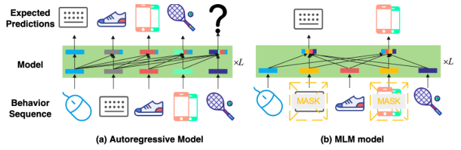
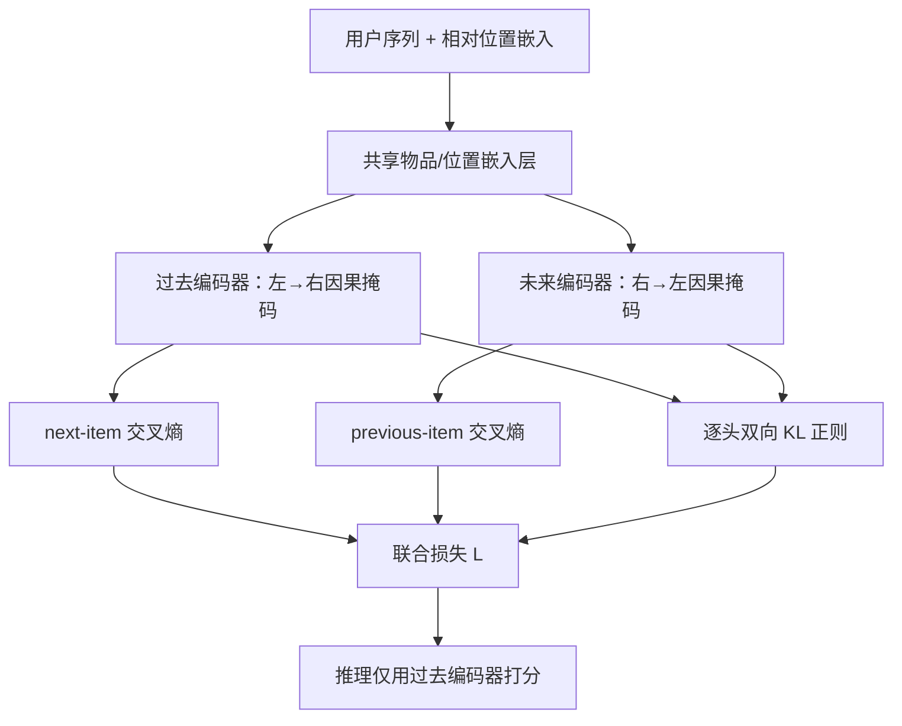
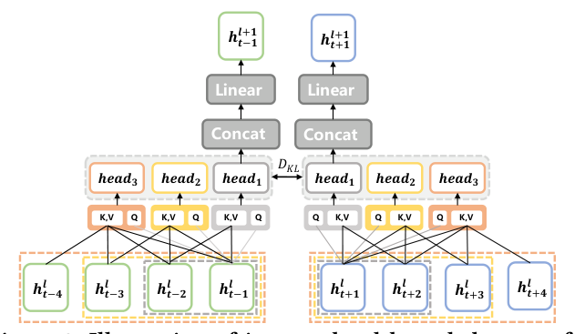

# Disentangling Past-Future Modeling in Sequential Recommendation via Dual Networks (双网络解耦序列推荐中的过去-未来建模)

- **会议/期刊**: CIKM 2022
- **作者与机构**: Hengyu Zhang、Enming Yuan 等；清华大学、华为诺亚方舟实验室、上海交通大学
- **推荐链路定位**: 召回/排序（Next-Item 预测）
- **研究方向**: 序列与会话推荐
- **论文原文**: [arXiv:2210.14577v2](https://arxiv.org/abs/2210.14577v2)
- **开源代码**: [DualRec](https://github.com/zhy99426/DualRec)

## TL;DR (1分钟核心速览)

针对序列推荐引入未来行为训练时，同一编码器在训练时见“过去+未来”、推理时只见过去所造成的训练-推理鸿沟，DualRec 用双编码器分别做 next-item 与 previous-item 预测，并用多尺度双向 KL 蒸馏互增强；在 Beauty/Sports/Toys/Yelp 的 1:99 采样排序下，HR@1 与 MRR 平均较最强基线提升 12.03% 和 6.92%。

## Background & Motivation (背景与核心矛盾)

- **主流范式**：自回归模型（GRU4Rec/SASRec）仅用历史序列做 next-item；BERT4Rec/S3-Rec 用 MLM 把未来行为纳入训练。
- **前人局限**：MLM 训练建模 $P(i|x_{past},x_{future})$，推理却只有$P(i|x_{past},NULL)$，同编码器纠缠过去/未来导致严重训练-推理鸿沟；强制单向自回归又丢弃未来协同信号。
- **核心洞察 (Key Insight)**：未来行为确有增益，但必须与过去建模解耦；过去与未来捕获的用户兴趣互补，可在表示层互相蒸馏而不污染推理路径。
- **本文切入点**：双编码器分别建模过去与未来，推理仅启用过去编码器，从结构上消除上下文不一致。

<figure class="paper-figure" markdown="span">
  <figcaption>图1：常见序列推荐模型示意图。</figcaption>
</figure>

## Method (核心方法设计)

### 1. 整体框架 (Overall Architecture)

输入用户行为序列与相对位置嵌入，两个编码器共享物品/位置嵌入。过去编码器用左→右因果掩码做 next-item；未来编码器用右→左因果掩码做 previous-item。各注意力头被赋予线性/指数多尺度窗口，提取局部到全局兴趣；再以逐头双向 KL 对齐两个编码器的输出分布。训练联合两项交叉熵与 KL 正则，推理仅保留过去编码器，使其输入上下文与训练一致。

### 2. 关键设计拆解 (Key Designs)

1. **双网络解耦 (Dual Network)**：痛点是用同一编码器同时吃过去与未来，推理缺失未来时表示偏移。DualRec 让过去编码器在位置 $t$用$\mathbf{o}^{p}_{t-1}$打分$\mathbf{s}^{p}_{t}=\mathbf{o}^{p}_{t-1}\mathbf{E}_{I}^{\top}$，未来编码器用$\mathbf{o}^{f}_{t+1}$反向打分$\mathbf{s}^{f}_{t}=\mathbf{o}^{f}_{t+1}\mathbf{E}_{I}^{\top}$。共享嵌入让未来知识进入物品表示，但未来上下文不再进入推理路径，故鸿沟被结构性消除。

2. **多尺度兴趣提取 + 双向知识迁移 (BIT)**：用户兴趣有局部与全局尺度，且过去/未来兴趣互补。前 $h/2$个头用线性增长局部窗、后$h/2$个头用指数增长全局窗；再逐头做双向 KL：$\mathcal{L}_{reg}=\frac{1}{2}\sum_{i=1}^{h}[D_{KL}(\mathrm{head}^{p}_{i}\|\mathrm{head}^{f}_{i})+D_{KL}(\mathrm{head}^{f}_{i}\|\mathrm{head}^{p}_{i})]$。该正则无额外参数，促使两个编码器在多尺度上互相校准，而非简单共享一个预测器。

<figure class="paper-figure" markdown="span">
  <figcaption>图3：过去与未来信息之间兴趣级知识迁移的示意图。</figcaption>
</figure>

3. **训练目标、负采样与推理效率**：总损失为 $\mathcal{L}=\alpha\mathcal{L}_{past}+(1-\alpha)\mathcal{L}_{future}+\beta\mathcal{L}_{reg}$，两项交叉熵按全物品内积 softmax 定义，文中未引入额外硬负采样；评测沿用每正例 99 个随机负例。推理只跑过去编码器，复杂度与骨干同阶$O(n^2d)$；训练需双编码器，时间/空间约为骨干 2 倍。

## Experimental Setup & Evaluation Protocol (实验设置与评估协议)

- **数据集与预处理**：沿用 FMLP-Rec 的 5-core 过滤，过滤交互少于 5 的用户/物品；Yelp 仅用 2019-01-01 后交易记录。

| 数据集 | #Users | #Items | #Interactions | 稀疏度/密度 | 特征/场景说明 |
| :--- | :---: | :---: | :---: | :---: | :--- |
| Beauty | 22,363 | 12,101 | 198,502 | 0.07% | Amazon 美妆评论序列 |
| Sports | 25,598 | 18,357 | 296,337 | 0.05% | Amazon 运动户外 |
| Toys | 19,412 | 11,924 | 167,597 | 0.07% | Amazon 玩具游戏 |
| Yelp | 30,431 | 20,033 | 316,354 | 0.05% | 本地商户交易序列 |

- **数据划分与防穿越 (Splitting Strategy)**：遵循 FMLP-Rec 的 `Leave-One-Out`，每用户最后一项测试、倒数第二项验证，其余按时间训练，避免未来交互穿越。
- **排名评测协议 (Ranking Protocol)**：`Sampled Ranking`，每个正例随机采 99 个未交互负例，报告 HR@{1,5,10}、NDCG@{5,10}、MRR；非无偏 Full-Ranking。
- **对比基线与超参设置**：对比 11 个基线，含 GRU4Rec/Caser/SASRec/BERT4Rec/S3-Rec(MIP)/SRGNN/GCSAN/FMLP-Rec 等；$n=50$、$d=64$、2 层 Transformer、8 头、dropout 0.5、Adam$lr=1e^{-3}$、batch 256，显著性$p<0.05$。

## Key Experimental Results (实验关键数据)

### 1. 主实验对比 (Main Results)

下表保留 8 个代表性基线，报告 HR@5 / NDCG@5；粗体为最优，Improv.% 见 table 后说明。

| Method | Beauty HR@5 | Beauty NDCG@5 | Sports HR@5 | Sports NDCG@5 | Toys HR@5 | Toys NDCG@5 | Yelp HR@5 | Yelp NDCG@5 |
| :--- | :---: | :---: | :---: | :---: | :---: | :---: | :---: | :---: |
| GRU4Rec | 0.3612 | 0.2608 | 0.3552 | 0.2487 | 0.3526 | 0.2444 | 0.5788 | 0.3933 |
| Caser | 0.3032 | 0.2219 | 0.2866 | 0.2020 | 0.2614 | 0.1885 | 0.5111 | 0.3696 |
| SASRec | 0.4036 | 0.3022 | 0.3919 | 0.2823 | 0.3975 | 0.2907 | 0.5949 | 0.4198 |
| BERT4Rec | 0.3640 | 0.2622 | 0.3375 | 0.2341 | 0.3344 | 0.2327 | 0.5976 | 0.4252 |
| S3-Rec(MIP) | 0.3710 | 0.2735 | 0.3141 | 0.2143 | 0.3892 | 0.2903 | 0.5978 | 0.4171 |
| SRGNN | 0.3518 | 0.2660 | 0.3367 | 0.2418 | 0.3389 | 0.2528 | 0.5442 | 0.3860 |
| GCSAN | 0.3678 | 0.2864 | 0.3588 | 0.2658 | 0.3613 | 0.2836 | 0.5725 | 0.4162 |
| FMLP-Rec | 0.4103 | 0.3133 | 0.3886 | 0.2839 | 0.4010 | 0.3055 | 0.6246 | 0.4507 |
| **DualRec** | **0.4241** | **0.3320** | **0.4127** | **0.3080** | **0.4152** | **0.3253** | **0.6328** | **0.4681** |

相对最强基线 FMLP-Rec，DualRec 的 HR@5/NDCG@5 平均提升约 **+3.60%/+6.20%**；原文跨指标平均提升为 HR@1 **+12.03%**、HR@10 **+2.74%**、NDCG@10 **+5.77%**、MRR **+6.92%**。

### 2. 消融实验 (Ablation Study)

| 变体 | Beauty HR@5/NDCG@5 | Sports HR@5/NDCG@5 | Toys HR@5/NDCG@5 | Yelp HR@5/NDCG@5 |
| :--- | :---: | :---: | :---: | :---: |
| **DualRec** | **0.4241/0.3320** | **0.4127/0.3080** | **0.4152/0.3253** | **0.6328/0.4681** |
| w/o DE | 0.4154/0.3251 | 0.4037/0.3016 | 0.4098/0.3202 | 0.6273/0.4610 |
| w/o BIT | 0.4235/0.3311 | 0.4102/0.3055 | 0.4122/0.3246 | 0.6284/0.4658 |
| w/o RPE | 0.4216/0.3306 | 0.4093/0.3044 | 0.4130/0.3234 | 0.6320/0.4677 |
| w/o LN | 0.4086/0.3075 | 0.4097/0.3031 | 0.3987/0.2963 | 0.6321/0.4653 |
| w/o RC | 0.3653/0.2642 | 0.3720/0.2632 | 0.3388/0.2360 | 0.5751/0.4052 |

### 3. 关键实验发现 (Key Findings)

1. **解耦是主增益，KL 是辅助增强**：去掉 DE 后 Beauty HR@5 从 0.4241 降至 0.4154、Sports 从 0.4127 降至 0.4037，降幅明显大于去掉 BIT 的 0.4235/0.4102，说明双编码器先解决训练-推理鸿沟，BIT 再提升互补兴趣。
2. **同编码器注入未来会反噬**：BERT4Rec 与 S3-Rec(MIP) 在 Beauty 的 HR@5 仅 0.3640/0.3710，低于纯自回归 SASRec 的 0.4036，印证 MLM 的上下文不一致会抵消未来信号；DualRec 同数据集达 0.4241。
3. **框架兼容性强但 β 需节制**：DualSASRec+BIT 将 Yelp HR@5 从 0.5949 提至 0.6199，DualFMLP-Rec 将 Beauty 从 0.4103 提至 0.4210；但 Yelp 上 DualFMLP-Rec+BIT 从 0.6351 微降至 0.6343，提示知识迁移强度过大可能损失原始信息。

## Highlights & Limitations (亮点、对比与审稿批判)

- **与代表作对比 (vs. Prior Work)**：SASRec 只用过去、无未来增益；BERT4Rec 用同编码器 MLM 引入未来但有鸿沟；FMLP-Rec 用纯 MLP 无未来建模。DualRec 首次以“双任务双编码器 + 双向 KL”同时保留未来增益与推理一致性。
- **可迁移亮点**：共享嵌入层 + 反向预测双任务 + 逐头 KL 正则，可无缝套到 RNN、Transformer、filter-MLP 等骨干；多尺度窗口设计也可迁移到长短期兴趣解耦。
- **审稿级局限批判**：训练需双编码器，显存/时间约 2 倍；评测仅为 1:99 采样排序，未给 Full-Ranking 与线上 A/B；BIT 的 $\beta$与双任务权重$\alpha$ 较敏感，部分骨干上 BIT 收益有限甚至微降。

## Rating (四维评分)

- **方法创新性 (Novelty)**: ⭐⭐⭐⭐ （双任务双编码器把“未来训练”与“过去推理”结构性拆开，切入点清晰，但本质仍是双塔+KL蒸馏的组合创新）
- **评估协议与实验扎实度 (Protocol & Experiments)**: ⭐⭐⭐⭐ （4 个数据集、11 个基线、显著性检验、消融/兼容性/超参分析齐全；扣分在仅采样排序而非全库排序）
- **写作与数学规范度 (Clarity & Rigor)**: ⭐⭐⭐⭐ （问题定义、双任务公式、复杂度分析完整；部分符号重复使用，表 3 正文与表头指标略有不一致）
- **工业落地与复现价值 (Industrial & Practical Value)**: ⭐⭐⭐⭐ （代码开源，推理成本与骨干一致，可直接替换 SASRec/GRU4Rec/FMLP-Rec；训练翻倍与 β 调参是落地成本）

