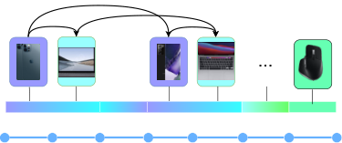
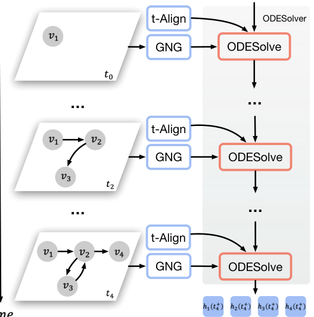
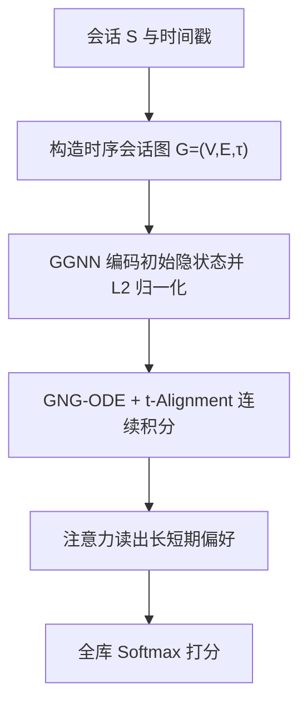

# Evolutionary Preference Learning via Graph Nested GRU ODE for Session-based Recommendation (基于图嵌套GRU-ODE的演化偏好学习用于会话推荐)

- **会议/期刊**: CIKM 2022
- **作者与机构**: Jiayan Guo*, Peiyan Zhang*, Chaozhuo Li, Xing Xie, Yan Zhang, Sunghun Kim；北京大学、HKUST、微软亚洲研究院
- **推荐链路定位**: 端到端会话内下一物品排序（召回/精排一体）
- **研究方向**: 序列与会话推荐 / 图神经网络与知识图谱推荐
- **论文原文**: [https://arxiv.org/abs/2206.12779v2](https://arxiv.org/abs/2206.12779v2)
- **开源代码**: [https://github.com/SpaceLearner/GNG-ODE](https://github.com/SpaceLearner/GNG-ODE)

## TL;DR (1分钟核心速览)

针对会话推荐把偏好演化离散化、忽略不规则时间间隔与时间流逝效应的痛点，本文将会话建成连续时间动态图，用GGNN初始化、GNG-ODE连续积分并以t-Alignment对齐批内异步图更新；在三个基准的全库排序中，HR@20/MRR@20全面领先，Tmall MRR@20相对提升6.05%。

## Background & Motivation (背景与核心矛盾)

- **主流范式**: SBR主流用RNN/GNN建模会话内物品转移，近期工作引入时间戳、动态图快照或多兴趣分解来刻画偏好演化。
- **前人局限**: 快照/等长分箱把连续时间离散化，无法处理不规则点击间隔；时间仅作上下文或离散隐状态，忽略“时间流逝本身”对偏好的影响；结构与时间模式常被分开建模。
- **核心洞察 (Key Insight)**: 用户偏好是连续演化的潜变量，会话中的物品点击只是其在特定时间点的不规则观测。
- **本文切入点**: 构造连续时间时序会话图，用Graph Nested GRU-ODE在连续时间域传播物品隐状态，并用t-Alignment使现有ODE求解器适配批内异步动态图。

<figure class="paper-figure" markdown="span">
  <figcaption>图1：会话中复杂结构与时间模式的示意图。箭头表示邻近和远距离的转移依赖共存。颜色渐变表示随时间推进用户偏好的连续性变化。物品点击可解释为潜在连续用户偏好的观测。</figcaption>
</figure>

## Method (核心方法设计)

### 1. 整体框架 (Overall Architecture)

输入会话及其时间戳，先构造带边时间的时序会话图；GGNN编码静态转移结构得到物品初始隐状态并L2归一化；GNG-ODE在相邻时间戳间连续积分，t-Alignment在每个求解步按时间裁剪边集；最后注意力读出融合长短期偏好，对全物品Softmax打分。训练用全库交叉熵，推理一次ODE求解得到末时刻表示。

<figure class="paper-figure" markdown="span">
  <figcaption>图3：GNG-ODE 框架概览。首先，转换物品嵌入以形成初始隐藏状态。然后，应用 GNG-ODE 推断最新物品表示。最后，应用注意力读出生成会话表示，以预测下一个物品。</figcaption>
</figure>

### 2. 关键设计拆解 (Key Designs)

1. **连续时间时序会话图与GGNN初始态**：痛点是用快照/等长分箱会丢失不规则间隔。本文给每条转移边附加时间$\tau(e)$，形成$\mathcal{G}=(\mathcal{V},\mathcal{E},\tau)$；GGNN聚合邻居并用GRU更新：
\[
\boldsymbol{h}_u^{(l+1)}=\mathrm{GRU}\left(\boldsymbol{h}_u^{(l)},\sum_{v\in\mathcal{N}_u}w_{uv}\boldsymbol{h}_v^{(l)}\right)
\]
再L2归一化到$[-1,1]$，为ODE提供稳定初值；结构先验使后续连续演化不是“无图”的纯序列外推。
2. **GNG-ODE连续演化**：把GNG的离散更新改写为差分$\Delta\boldsymbol{h}_u^t=(1-\boldsymbol{z}_u^t)\odot(\boldsymbol{g}_u^t-\boldsymbol{h}_u^{t-\Delta t})$，令$\Delta t\to0$得
\[
\frac{d\boldsymbol{h}_u(t)}{dt}=(1-\boldsymbol{z}_u(t))\odot(\boldsymbol{g}_u(t)-\boldsymbol{h}_u(t))
\]
其中$\boldsymbol{z}_u(t)$为更新门、$\boldsymbol{g}_u(t)$为候选态，均由图卷积与GRU门控产生。负反馈项使状态有界于$[-1,1]$且Lipschitz常数$K=2$，保证解存在唯一、对不规则采样更稳健；物理直觉是“偏好平滑漂移”，而非在离散层间跳变。
3. **t-Alignment与训练推理**：现有ODE求解器一次只能接受统一时间步，但批内会话图更新时刻不同。本文在每个积分点$t_0+k\Delta t$仅保留$\tau(e)\le t_0+k\Delta t$的边：
\[
\mathcal{G}_{t_0+k\Delta t}=(\mathcal{V}_{t_0:t_0+k\Delta t},\mathcal{E}_{t_0:t_0+k\Delta t})
\]
无需存快照或中断积分。训练目标为全物品交叉熵加L2正则：
\[
\mathcal{L}=-\sum_{i=1}^{|\mathcal{V}|}\left[y_i\log\hat{y}_i+(1-y_i)\log(1-\hat{y}_i)\right]+\lambda\|\Theta\|_2^2
\]
不做显式负采样；复杂度$O((l+T/\Delta t)(|\mathcal{E}|+|\mathcal{V}|))$，Euler求解器每epoch耗时与DAT-MDI/TMI-GNN相当。

## Experimental Setup & Evaluation Protocol (实验设置与评估协议)

- **数据集与预处理**:

| 数据集 | #Clicks | #Train | #Test | #Items | 平均长度 | 平均间隔 |
| :--- | ---: | ---: | ---: | ---: | ---: | ---: |
| Gowalla | 1,122,788 | 675,561 | 155,332 | 29,510 | 4.32 | 11.07h |
| Tmall | 818,479 | 351,268 | 25,898 | 40,727 | 6.69 | 1.49s |
| Nowplaying | 1,367,963 | 825,304 | 89,824 | 60,416 | 7.42 | 4.36h |

剔除单物品会话与出现少于5次的物品（item 5-core），并按常见SBR做法做数据增强。Gowalla/Tmall按时间取末20%会话测试，Gowalla另设1天切分间隔；Nowplaying按每首歌随机20%用户留出测试；验证集取训练集末20%。  
- **排名评测协议**: 无偏`Full-Ranking`，对全部物品Softmax排序；训练交叉熵覆盖全物品，不做采样负例。  
- **对比基线与超参**: 静态RNN/GNN（NARM、SR-GNN、NISER+、LESSR、GCE-GNN、DAT-MDI）与时序模型（TiSASRec、TGSRec、TMI-GNN）。嵌入维度搜索$\{64,128,256,512\}$，取256；Adam，学习率$1e-3$，权重衰减$1e-4$，batch 512，5个随机种子均值，paired t-test$p<0.01$。

## Key Experimental Results (实验关键数据)

### 1. 主实验对比 (Main Results)

| 模型 | Gowalla HR@20 | Gowalla MRR@20 | Tmall HR@20 | Tmall MRR@20 | Now HR@20 | Now MRR@20 |
| :--- | ---: | ---: | ---: | ---: | ---: | ---: |
| NARM | 49.84 | 23.63 | 27.14 | 12.89 | 17.36 | 6.49 |
| SR-GNN | 50.21 | 24.08 | 29.39 | 13.93 | 18.46 | 7.25 |
| NISER+ | 53.58 | 25.43 | 36.32 | 15.72 | 22.35 | 8.52 |
| LESSR | 51.04 | 24.47 | 32.75 | 14.91 | 19.54 | 7.99 |
| GCE-GNN | 53.77 | 25.69 | 33.42 | 15.42 | 22.37 | 8.40 |
| DAT-MDI | 53.98 | 25.65 | 33.23 | 15.64 | 22.45 | 8.67 |
| TGSRec | 53.89 | 25.12 | 36.43 | 16.37 | 21.56 | 7.87 |
| TMI-GNN | 54.03 | 25.47 | 36.87 | 17.19 | 22.28 | 8.89 |
| **GNG-ODE** | **54.58** | **26.91** | **37.66** | **18.23** | **22.83** | **9.23** |
| Improv. | +1.02% | +4.75% | +2.14% | +6.05% | +1.69% | +3.82% |

### 2. 消融实验 (Ablation Study)

| 变体 | Gowalla HR@20/MRR@20 | Tmall HR@20/MRR@20 | Now HR@20/MRR@20 |
| :--- | :---: | :---: | :---: |
| GNG-ODE | **54.58/26.91** | **37.66/18.23** | **22.83/9.45** |
| w/o t-Alignment | 54.16/25.76 | 37.22/17.86 | 22.70/9.17 |
| GCN-ODE | 54.46/26.63 | 37.45/17.83 | 22.65/9.25 |
| GRU-ODE | 54.41/26.76 | 37.33/17.30 | 22.59/9.23 |
| MLP-ODE | 54.34/26.81 | 37.17/17.63 | 22.34/9.18 |

### 3. 关键实验发现 (Key Findings)

1. **连续建模主要提升排序质量而非仅命中率**：GNG-ODE在Tmall的MRR@20从17.19提升到18.23（+6.05%），Gowalla从25.69到26.91（+4.75%），而HR@20仅提升1.02%–2.14%，说明ODE把正例推得更靠前，对Top位置更友好。
2. **t-Alignment与结构-时间联合建模缺一不可**：去掉t-Alignment后Gowalla MRR@20从26.91降到25.76，Tmall从18.23降到17.86；GCN-ODE（仅结构）与GRU-ODE（仅时间）在Tmall MRR@20仅17.83/17.30，均低于GNG-ODE的18.23。
3. **图结构初值在电商场景更关键，求解器需效率折中**：初始编码器用Identity/MLP时Tmall HR@20仅35.03/34.75，GGNN达37.66；求解器上Nowplaying HR@20为Dopri5 22.83、RK4 22.72、Euler 22.51，Euler更快但精度略低，RK4/Dopri5耗时仍可接受。

## Highlights & Limitations (亮点、对比与审稿批判)

- **与代表作对比**: GCE-GNN/LESSR在静态会话图上增强全局或捷径转移；TMI-GNN用离散时间多兴趣建模；GNG-ODE首次把会话图结构变化嵌入连续时间ODE，并用t-Alignment解决批内异步更新。
- **可迁移亮点**: t-Alignment可迁移到任何“批内动态图+ODE求解”的序列/图推荐；带负反馈的GRU-ODE门控结构适合不规则采样的用户行为序列。
- **审稿级局限**: ODE求解器带来额外积分开销，且对求解器/步长有敏感度；实验限于三个公开基准，缺少线上A/B与冷启动分桶；Nowplaying按物品随机留出用户，跨用户泛化评估可能偏乐观。

## Rating (四维评分)

- **方法创新性 (Novelty)**: ⭐⭐⭐⭐ （首次将Graph Nested GRU-ODE用于SBR连续偏好演化，并有有界性与Lipschitz理论支撑）
- **评估协议与实验扎实度 (Protocol & Experiments)**: ⭐⭐⭐⭐ （三数据集全库排序、9个基线、消融/求解器/超参/耗时分析完整，显著性检验到位）
- **写作与数学规范度 (Clarity & Rigor)**: ⭐⭐⭐⭐ （从GNG差分推到ODE的推导清晰，t-Alignment定义明确，复杂度分析简洁）
- **工业落地与复现价值 (Industrial & Practical Value)**: ⭐⭐⭐ （代码开源、Euler版耗时接近基线，但ODE调参与积分开销对线上部署仍有门槛）

