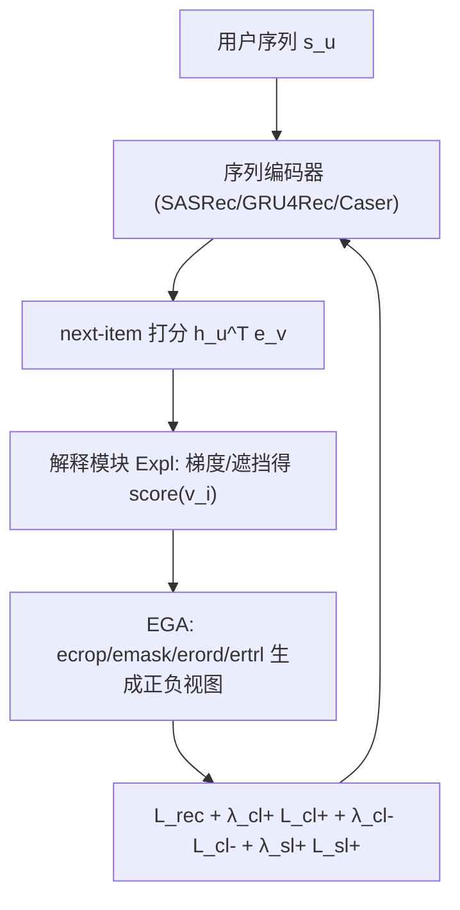
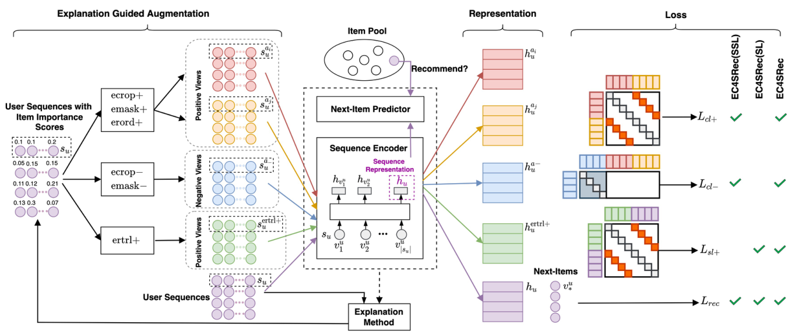

# Explanation Guided Contrastive Learning for Sequential Recommendation (解释引导的序列推荐对比学习)

- **会议/期刊**: CIKM 2022
- **作者与机构**: Lei Wang, Ee-Peng Lim (Singapore Management University); Zhiwei Liu (Salesforce); Tianxiang Zhao (Penn State University)
- **推荐链路定位**: 召回（Next-Item 序列建模，端到端训练）
- **研究方向**: 序列与会话推荐 / 自监督对比学习与交互去噪
- **论文原文**: [https://arxiv.org/abs/2209.01347v1](https://arxiv.org/abs/2209.01347v1)
- **开源代码**: [https://github.com/demoleiwang/EC4SRec](https://github.com/demoleiwang/EC4SRec)

## TL;DR (1分钟核心速览)

现有 CL4SRec/DuoRec 类序列对比学习靠**随机**裁剪/掩码/检索生成正视图，极易产生"假正例"（掩掉关键物品后语义已变）与"假负例"（另一用户序列与锚点高度相似）。本文提出 EC4SRec：用 Saliency/Occlusion 等**模型无关解释方法**反传梯度得到序列内物品重要性分数，据此做"去掉最不重要 / 只留最重要"的正负视图增强（EGA），并把自监督对比 $L_{cl+}$、负视图对比$L_{cl-}$与监督检索对比$L_{sl+}$ 叠加到推荐损失上。四个 Amazon/ML-1M 数据集 Full-Ranking 协议下，NDCG@5 相对 CL4SRec 提升 14%–22%，且可插件式挂载 GRU4Rec/Caser/SASRec 三种编码器。

## Background & Motivation (背景与核心矛盾)

- **主流范式**: 序列推荐以 SASRec/BERT4Rec 等编码器建模下一物品；为缓解长尾稀疏，CL4SRec 用随机 crop/mask/reorder 造正视图做自监督对比，DuoRec 用"共享同一 next-item 的另一用户序列"做监督对比正例。
- **前人局限**: ①增强算子完全随机，可能把承载预测信号的"护发类"物品掩掉，正视图与锚点语义已偏；②负例仅从 batch 内随机取，若采样到的序列恰好共享多个关键物品则成假负例——两者都会把表征拉向错误方向。
- **核心洞察 (Key Insight)**: 作者用合成数据（每条序列标注 3 个真实重要物品）验证：只掩不重要物品的 Oracle 掩码使 CL4SRec 的 HR@3 从 0.3560 升至 0.5180、NDCG@3 从 0.2573 升至 0.3645（+40% 以上）。说明"重要性感知的视图选择"是收益来源，而训练时 next-item 未知，重要性必须被**推断**。
- **本文切入点**: 用解释方法（输入梯度/遮挡）在训练中周期性推断物品重要性，把"随机增强"替换为"保语义增强"，并首次补齐**负视图**增强。

<figure class="paper-figure" markdown="span">
  ![图1：动机示例：(a) 给定用户序列包含七个物品，下一物品为红色吹风机；(b) 通过对给定序列进行随机掩码操作生成的两个正视图，以及由另一用户序列构成的一个负视图。\[M\]表示被掩码的物品。](../../../../assets/papers/2209.01347v1/figure_1.png)<figcaption>图1：动机示例：(a) 给定用户序列包含七个物品，下一物品为红色吹风机；(b) 通过对给定序列进行随机掩码操作生成的两个正视图，以及由另一用户序列构成的一个负视图。[M]表示被掩码的物品。</figcaption>
</figure>

## Method (核心方法设计)

### 1. 整体框架 (Overall Architecture)

输入用户序列 $s_u$经序列编码器（默认 SASRec）得$h_u$，与物品池做内积打分预测 next-item。训练分两阶段节奏：前$\lfloor N/(p+1)\rfloor-1$轮先用 CL4SRec+DuoRec 的混合损失预热编码器；此后在第$l\cdot\lfloor N/(p+1)\rfloor$轮（$1\le l\le p$）调用解释方法$Expl(\cdot)$对当前模型预测计算序列内各物品的重要性分数，EGA 模块据此生成正/负视图，再由$L_{cl+},L_{cl-},L_{sl+}$ 三个对比损失联合优化。推理期只走编码器+打分器，解释模块完全离线，零额外延迟。

<figure class="paper-figure" markdown="span">
  <figcaption>图2：提出的EC4SRec框架。</figcaption>
</figure>

### 2. 关键设计拆解 (Key Designs)

1. **解释引导重要性分数 (Explanation Guided Importance)**：痛点是不知哪个历史物品真正解释 next-item。以 Saliency 为例，对物品嵌入逐维取预测概率梯度并归一化：$score(v_i^u)=\frac{\sum_{j=1}^{d}\lVert \partial y_u/\partial e_{v_i^u,j}\rVert}{\sum_{i'=1}^{|s_u|}\sum_{j=1}^{d}\lVert \partial y_u/\partial e_{v_{i'}^u,j}\rVert}$，满足$\sum_i score(v_i^u)=1$，仅在单条序列内可比。用相对分数而非绝对值，天然适配不同长度序列，且对编码器结构无假设（模型无关）。

2. **解释引导增强 EGA（正视图 + 负视图）**：正视图取"移除/掩码/重排 $k=\lfloor \mu_e|s_u|\rfloor$个**最低分**物品"，如$s_u^{ecrop+}=s_u-[v_{i_1},\dots,v_{i_k}]$；负视图则反向，只保留/掩掉**最高分**物品（$s_u^{ecrop-}=[v_{i_1},\dots,v_{i_k}]$）——这是 CL4SRec/DuoRec 都没有的显式难负例构造。监督对比的检索正例按重要性加权的 Jaccard 效用采样：$P(s_{u_k})\propto \frac{|s_u\cap s_{u_k}|}{|s_u\cup s_{u_k}|}\sum_{v\in s_u\cap s_{u_k}}score(v)$，保证同 next-item 的检索正例在"关键物品"上也相似，而非仅标签相同。

3. **训练目标与开销**：总损失 $\mathcal{L}=\sum_{u\in U_B}\left[L_{rec}(s_u)+\lambda_{cl+}L_{cl+}+\lambda_{cl-}L_{cl-}+\lambda_{sl+}L_{sl+}\right]$，三项对比损失均以 batch 内其他序列为负例（in-batch negative，无额外负采样器）；$L_{cl-}$采用"负视图彼此靠近、与所有正视图远离"的分布级对比。解释更新次数$p$为效率旋钮（Beauty 最优$p=5$，Clothing$p=9$），每次更新需一次全量梯度/遮挡前向，是主要额外开销。

## Experimental Setup & Evaluation Protocol (实验设置与评估协议)

- **数据集与预处理**: 四个公开数据集，均按 `5-core` 过滤并去除重复物品：

| 数据集 | #Users | #Items | #Interactions | 稀疏度/密度 | 特征/场景说明 |
| :--- | :---: | :---: | :---: | :---: | :--- |
| Beauty | 22,363 | 12,101 | 198,502 | 99.93% | Amazon 美妆，均长 8.9 |
| Clothing | 39,387 | 23,033 | 278,677 | 99.97% | Amazon 服装，均长 7.1 |
| Sports | 35,598 | 18,357 | 296,337 | 99.95% | Amazon 运动，均长 8.3 |
| ML-1M | 6,041 | 3,417 | 999,611 | 95.16% | 电影，均长 165.5 |

- **数据划分与防穿越 (Splitting Strategy)**: `Leave-One-Out`——每用户最后 1 个物品为测试、倒数第 2 个为验证、其余全部训练，严格按时间序，无未来信息泄漏。
- **排名评测协议 (Ranking Protocol)**: 无偏 `Full-Ranking`，候选为全物品池且**不做任何候选过滤**（不剔除训练已交互物品），指标 HR@5/10、NDCG@5/10，3 个随机种子取均值。
- **对比基线与超参设置**: BPR-MF（非序列）、GRU4Rec/Caser/SASRec/BERT4Rec/S3Rec$^{MIP}$（无对比学习）、CL4SRec/DuoRec（对比学习）；统一$d=64$，$\mu_e$在 0.1–0.9 网格搜索，$\tau\in\{0.5,1.0,1.5\}$，$\lambda$在 0.1–0.5 内调；对 CL4SRec/DuoRec 做$p<0.05$/$p<0.01$ 显著性检验。

## Key Experimental Results (实验关键数据)

### 1. 主实验对比 (Main Results)

| 数据集/指标 | SASRec | BERT4Rec | S3Rec$^{MIP}$ | CL4SRec | DuoRec | EC4SRec(SSL) | EC4SRec(SL) | EC4SRec | Improv. vs CL4SRec |
| :--- | :---: | :---: | :---: | :---: | :---: | :---: | :---: | :---: | :---: |
| Beauty HR@5 | 0.0365 | 0.0193 | 0.0327 | 0.0495 | 0.0548 | 0.0569 | **0.0585** | 0.0569 | +18.2% |
| Beauty NDCG@5 | 0.0236 | 0.0187 | 0.0175 | 0.0299 | 0.0345 | 0.0358 | 0.0361 | **0.0364** | +21.7% |
| Clothing HR@5 | 0.0168 | 0.0125 | 0.0163 | 0.0187 | 0.0196 | 0.0201 | 0.0205 | **0.0209** | +11.8% |
| Clothing NDCG@5 | 0.0091 | 0.0075 | 0.0101 | 0.0104 | 0.0112 | 0.0113 | 0.0115 | **0.0119** | +14.4% |
| Sports HR@5 | 0.0218 | 0.0176 | 0.0157 | 0.0277 | 0.0310 | 0.0323 | 0.0317 | **0.0331** | +19.5% |
| Sports NDCG@5 | 0.0127 | 0.0105 | 0.0098 | 0.0167 | 0.0191 | 0.0201 | 0.0194 | **0.0203** | +21.6% |
| ML-1M HR@5 | 0.1087 | 0.0733 | 0.1078 | 0.1583 | 0.1672 | **0.1699** | 0.1682 | 0.1672 | +7.3% |
| ML-1M NDCG@5 | 0.0638 | 0.0432 | 0.0616 | 0.0996 | 0.1076 | 0.1095 | **0.1104** | 0.1102 | +10.8% |

**骨干可迁移性**（HR@5/NDCG@5, Beauty）：GRU4Rec 上 EC4SRec 0.0495/0.0332 vs CL4SRec 0.0420/0.0270；Caser 上 0.0269/0.0172 vs 0.0185/0.0108——相对提升 18%–55%，说明 EGA 与编码器正交。

### 2. 消融实验 (Ablation Study)

（NDCG@5；E(SSL) 为逐一去掉某个增强算子后的 EC4SRec(SSL)）

| 配置 | Beauty | Clothing | Sports |
| :--- | :---: | :---: | :---: |
| CL4SRec（随机增强参照） | 0.0299 | 0.0104 | 0.0167 |
| E(SSL) 完整 | **0.0358** | 0.0113 | **0.0201** |
| w/o erord$+$ | 0.0344 | 0.0110 | 0.0181 |
| w/o emask$+$ | 0.0350 | **0.0116** | 0.0200 |
| w/o ecrop$+$ | 0.0353 | **0.0116** | 0.0200 |
| EC4SRec w/o $L_{cl-}$（即$L_{cl+}+L_{sl+}$） | 0.0355 | — | — |
| EC4SRec 全损失 | **0.0364** | **0.0119** | **0.0203** |

### 3. 关键实验发现 (Key Findings)

1. **负视图是"免费"的最大增量**：仅把 CL4SRec 的随机正视图换成解释引导正视图（$L_{cl+}$单独使用）NDCG@5 已从 0.0299→0.0355（Beauty）；再叠加显式负视图$L_{cl-}$ 后再提升到 0.0364，说明"假负例"问题的实际损害不亚于"假正例"。
2. **重要性比例 $\mu_e$存在明显场景最优点**：Beauty 上$\mu_e=0.5$最优（0.0364），$\mu_e=0.9$掉到 0.0355；Clothing 上$\mu_e=0.2$最优（0.0119）而 0.9 为 0.0112——短序列/稀疏域应少扰动，长序列可容忍更大比例；但即便最差$\mu_e$ 仍优于 DuoRec（0.0345）。
3. **解释方法选型影响鲁棒性**：Occlusion 在多数设置最佳，Saliency 次之；Attention 权重作解释时 EC4SRec(SSL) 甚至无法稳定超过 DuoRec，呼应"attention ≠ explanation"的已知争议；更新次数 $p$从 1 到 9 对最终 NDCG@5 影响很小（Beauty 最优$p=5$），故可低频更新以省算力。

## Highlights & Limitations (亮点、对比与审稿批判)

- **与代表作对比 (vs. Prior Work)**: 与 CL4SRec 的本质差异是"增强算子的选择依据从均匀随机变为梯度/遮挡归因"，视图不再是噪声注入而是**语义保持的扰动**；与 DuoRec 的差异是检索正例由"共享 next-item"升级为"next-item 相同且关键物品重叠（重要性加权 Jaccard 采样）"，并首次引入显式负视图 $L_{cl-}$，可看作 CL4SRec+DuoRec 的统一超集。
- **可迁移亮点**: ①"用解释归因决定增广强度/对象"的思路可直接迁移到图对比推荐（SGL/SimGCL 的边/节点丢弃策略）与多模态对比的模态内扰动；②训练中周期性刷新归因分数的 schedule（$p$ 控制）是一种通用的"动态课程式视图"机制，几乎不改动原模型结构。
- **审稿级局限批判**: ①每次归因刷新需全量梯度或遮挡前向，训练开销随 $p$线性增长，论文未给出与 CL4SRec 的 wall-clock 对比，工程性价比不明；②重要性分数仅在单序列内归一化，跨序列不可比，导致$\mu_e$ 必须按数据集重调（0.2 vs 0.5），泛化到未知域时缺乏自适应机制；③所有实验均在 `Leave-One-Out` + 全库排序的离线设定，缺少工业级长序列与在线 A/B 验证。

## Rating (四维评分)

- **方法创新性 (Novelty)**: ⭐⭐⭐⭐ （首个把模型无关解释方法嵌入序列对比学习的视图生成环节，并补齐负视图对比，机制简洁但切入点新颖）
- **评估协议与实验扎实度 (Protocol & Experiments)**: ⭐⭐⭐⭐ （4 数据集 + 全库 Full-Ranking + 3 骨干 + 显著性检验 + 合成数据验证动机，消融完整；缺在线与效率实验）
- **写作与数学规范度 (Clarity & Rigor)**: ⭐⭐⭐⭐ （损失与增强算子定义清晰、符号统一，但重要性归一化与 $p$ 的理论依据多为经验论证）
- **工业落地与复现价值 (Industrial & Practical Value)**: ⭐⭐⭐⭐ （代码开源、推理零额外开销、可插拔挂载任意编码器；训练期归因刷新是主要部署成本）

