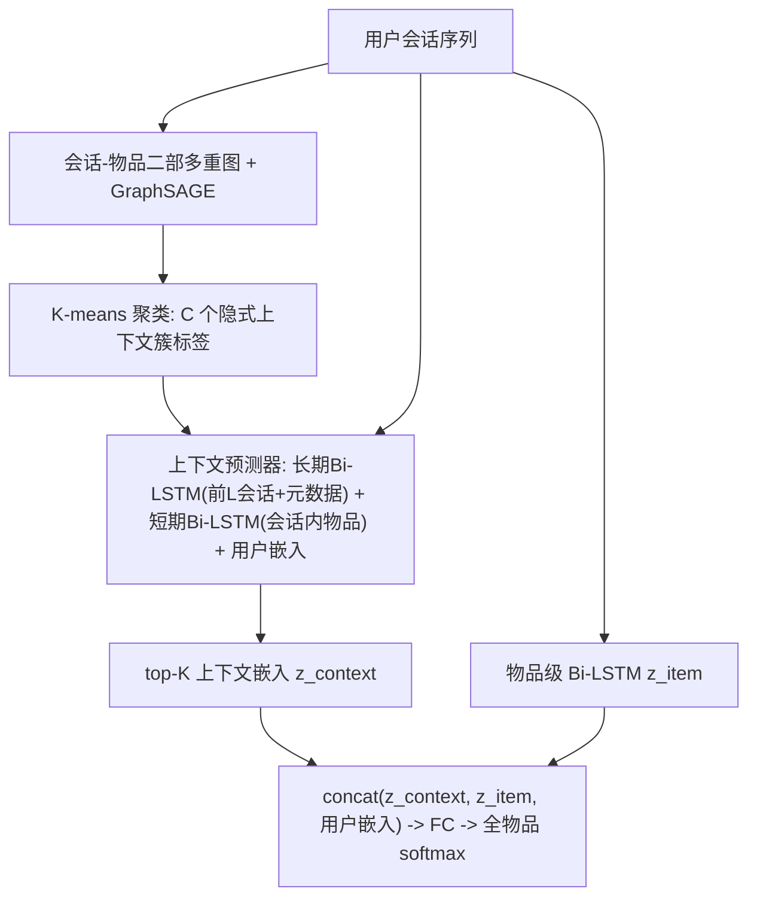
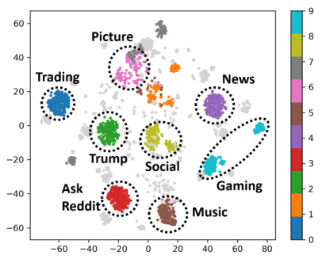

# Implicit Session Contexts for Next-Item Recommendations（面向下一物品推荐的隐式会话上下文）

- **会议/期刊**: CIKM 2022（Short Paper Track）
- **作者与机构**: Sejoon Oh, Ankur Bhardwaj, Jongseok Han, Srijan Kumar（Georgia Institute of Technology）；Sungchul Kim, Ryan A. Rossi（Adobe Research）
- **推荐链路定位**: 召回（会话级端到端 Next-Item 预测）
- **研究方向**: 序列与会话推荐 / 图神经网络推荐
- **论文原文**: [https://arxiv.org/abs/2208.09076v1](https://arxiv.org/abs/2208.09076v1)
- **开源代码**: [https://github.com/srijankr/iscon](https://github.com/srijankr/iscon)

## TL;DR (1分钟核心速览)

会话推荐模型拿不到显式"会话上下文"，而把物品属性简单聚合当作上下文噪声极大。ISCON 先把会话-物品二部多重图做 GraphSAGE 嵌入再 K-means 聚类，得到 $|C|$个隐式上下文簇作为监督标签；再训练一个融合长期会话序列、短期会话内物品与用户嵌入的 Bi-LSTM 上下文预测器，实时输出上下文分布，取 top-$K$ 上下文嵌入与物品级兴趣拼接做 Next-Item 预测。四个数据集全库排序（Full-Ranking）下 MRR/Recall@10 基本全面领先，在最难的 Foursquare 上 MRR 相对最优基线提升 36.5%、Recall@10 提升 34.0%。

## Background & Motivation (背景与核心矛盾)

- **主流范式**: GRU4REC 用 RNN 建模会话内转移，TAGNN/COTREC 用目标感知注意力与图自监督增强物品表征，CSRM 用内/外记忆编码器对当前与邻居会话做上下文化。
- **前人局限**: ① 多数上下文感知模型要求上下文显式给定，而真实数据几乎不提供；② CSRM 式上下文化依赖记忆编码器，对极短会话（仅 1–2 个物品）与训练中未出现的会话不准确，且新会话需重训练；③ 用物品属性均值聚合推断上下文，在只观测到会话前几个物品时严重失真。
- **核心洞察 (Key Insight)**: 上下文本质是"用户在一段交互中的高层意图"，该意图可从**跨会话的物品共现结构**中无监督地归纳出来——同一用户相邻会话的意图往往互补或相近，因而图上的多跳邻域比会话内部序列更能定义上下文。
- **本文切入点**: 把"上下文"做成一个离线可聚类、在线可预测、下游可复用的离散中间变量，而非一次性特征。

## Method (核心方法设计)

### 1. 整体架构 (Overall Architecture)

ISCON 分三段闭环。离线阶段构造以会话与物品为节点、成员关系为无向边的二部多重图，用归纳式 GraphSAGE 得到会话嵌入并对全部会话 K-means 聚类，簇编号即隐式上下文伪标签。在线阶段由一个上下文预测器在每观测到一个新物品时更新：长期 Bi-LSTM 编码前 $L$个会话的"会话嵌入+时长/间隔/长度"元数据，短期 Bi-LSTM 编码当前会话物品序列，与可学习用户嵌入拼接后 softmax 出上下文分布。预测结果取概率最高的$K$个上下文嵌入拼接为$z_{context}$，与独立训练的会话内物品级 Bi-LSTM 输出及用户嵌入拼接，经全连接层对全物品 softmax 输出下一物品概率。两个预测器不共享参数、不联合训练。

### 2. 关键设计拆解 (Key Designs)

1. **图式会话上下文化（离线伪标签生成）**：痛点是用会话内物品属性聚合推断上下文，在短会话上几乎等于噪声。做法是让会话嵌入吸收图中多跳邻居：$\mathbf{h}_s=\mathrm{GraphSAGE}(\{\mathbf{h}_i, i\in\mathcal{N}(s)\})$，再对全部会话嵌入做$K{=}|C|$的 K-means，取$c_s=\arg\min_k\lVert\mathbf{h}_s-\boldsymbol{\mu}_k\rVert_2$。选择 GraphSAGE 而非 transductive 嵌入的关键在于其**归纳性**：测试期新会话无需重训即可嵌入，且聚类后同一簇天然聚合了共享物品的邻近会话，等价于用共现结构平滑了单物品会话的稀疏性。

2. **实时上下文预测器（把聚类结果变成可泛化特征）**：直接对新物品重跑多跳聚合不可扩展，也无法利用跨会话依赖。ISCON 用双 Bi-LSTM 分别抽取长期与短期兴趣，$F_s=\mathrm{concat}(ES_s, D_s, \Delta_s, M_s)$，$z_{long}=\Theta_{long}([F_{s-L},\dots,F_{s-1}])$，$z_{short}=\Theta_{short}([E^I_{i_1},\dots,E^I_{i_k}])$，再与用户嵌入合并：$\hat{y}=\mathrm{softmax}(\mathrm{FC}(\mathrm{concat}(E^U_u,z_{short},z_{long})))$。元数据（会话时长、会话间隔、物品数）显式刻画了"这是不是一个换意图的边界"，因此能在观测到少量物品时即给出较稳的上下文分布；用户嵌入还顺带缓解零观测会话的冷启动。

3. **top-$K$上下文注入与训练目标**：单取 top-1 会让上下文预测误差直接传导到打分。ISCON 取$K=3$个最高概率上下文嵌入拼接，$z_{context}=\mathrm{concat}(E^C_{\hat{C}_1},\dots,E^C_{\hat{C}_K})$，再与独立物品级 Bi-LSTM 输出$z_{item}$（不与$z_{short}$复用，因二者优化目标不同）及$E^U_u$合并，$\hat{p}=\mathrm{softmax}(\mathrm{FC}(\mathrm{concat}(z_{context},z_{item},E^U_u)))$。两个模块分别用交叉熵$\mathcal{L}=-\sum_i p_i\log\hat{p}_i$训练；**不使用负采样**，训练与推理均为全物品 softmax，推理开销为每观测一次新物品更新一次 Bi-LSTM 与一次$O(|I|)$ softmax，图聚类仅在离线执行一次。

## Experimental Setup & Evaluation Protocol (实验设置与评估协议)

- **数据集与预处理**: 过滤交互数少于 10 的用户；因原始数据无会话字段，统一以 **1 小时空闲阈值**切分会话。

| 数据集 | #Users | #Items | #Interactions | 密度 | 特征/场景说明 |
| :--- | :---: | :---: | :---: | :---: | :--- |
| Gowalla | 69,332 | 10,000 | 1,250,045 | 0.18% | POI 签到（美国），会话极短（均值 1.20） |
| Foursquare | 2,321 | 5,596 | 194,105 | 1.49% | POI 签到（新加坡），会话较长（4.49） |
| Reddit | 8,640 | 966 | 134,489 | 1.61% | 子版块发帖，语义上下文可人工核查 |
| LastFM | 954 | 1,000 | 258,620 | 27.1% | 音乐播放，稠密小库 |

- **数据划分与防穿越 (Splitting Strategy)**: **用户内比例划分**——每个用户前 90% 交互按时间序作训练，其后 10% 作测试，训练集末尾 10% 作验证集，严格按时间戳防穿越。
- **排名评测协议 (Ranking Protocol)**: **Full-Ranking（全库未交互排序）**，模型直接对 $|I|$ 个物品输出 softmax 概率，无采样负例；指标为 MRR 与 Recall@10。
- **对比基线与超参设置**: 基线含 GRU4REC、TAGNN、COTREC、CSRM；超参 $|C|=40$、$K=3$、用户/物品嵌入维 256、上下文嵌入维 32、学习率$10^{-3}$、batch 1024、批量序列长 50、训练 200 epoch；结果取 5 次重复均值，单尾 T 检验$p<0.05$。

## Key Experimental Results (实验关键数据)

### 1. 主实验对比 (Main Results)

| 模型 | Gowalla MRR | Gowalla R@10 | Foursquare MRR | Foursquare R@10 | Reddit MRR | Reddit R@10 | LastFM MRR | LastFM R@10 |
| :--- | :---: | :---: | :---: | :---: | :---: | :---: | :---: | :---: |
| GRU4REC | 0.2772 | 0.4724 | 0.0670 | 0.1292 | 0.6354 | 0.7559 | 0.1259 | 0.2628 |
| TAGNN | 0.3261 | 0.4977 | 0.1119 | 0.2126 | 0.6767 | 0.7892 | 0.1338 | 0.2712 |
| COTREC | 0.1746 | 0.3908 | 0.1112 | 0.2373 | 0.4538 | 0.7664 | 0.0930 | **0.2930** |
| CSRM | 0.3133 | 0.5006 | 0.1281 | 0.2461 | 0.6889 | 0.8116 | 0.1319 | 0.2797 |
| **ISCON** | **0.3598** | **0.5530** | **0.1748** | **0.3297** | **0.7266** | **0.8686** | **0.1384** | 0.2838 |
| Improv.% | +10.3% | +10.5% | **+36.5%** | **+34.0%** | +5.5% | +7.0% | +3.5% | −3.1% |

（Improv.% 相对该列最优基线计算；ISCON 在 8 个指标中 7 个最优，$p<0.05$。）

### 2. 消融实验 (Ablation Study)

原论文消融置于附录（正文未披露数值），此处按原文结论整理方向性判断：

| 变体 | 移除/替换内容 | 原文结论 |
| :--- | :--- | :--- |
| w/o 隐式上下文 | 仅用 $z_{item}+E^U_u$ | 上下文特征对精度有实质贡献 |
| 属性均值代替图聚类 | 用物品特征聚合推断上下文 | 图式上下文化优于简单聚合 |
| $K=1$| 仅取 top-1 上下文 |$K=3$ 经验上最优，多上下文增强鲁棒性 |
| w/o 用户嵌入 | 去掉 $E^U_u$ | 个性化与冷启动会话受益 |
| w/o 长期 Bi-LSTM | 去掉跨会话序列 | 跨会话相关性对短会话预测有增益 |

### 3. 关键实验发现 (Key Findings)

1. **收益与数据集"可预测难度"正相关**：Foursquare 会话最长（4.49）但目标最分散，基线 MRR 仅 0.067–0.128，ISCON 取得 +36.5% MRR 的最大增益；而 Gowalla 平均会话长度仅 1.20（大量单物品会话，序列模型无从建模转移），ISCON 仍 +10.3%，佐证图式上下文化确实在"序列信息不足"场景补位。
2. **同赛道对比最能说明机制优势**：CSRM 同样做会话上下文化，但在 Reddit 上被 ISCON 以 +5.5% MRR、+7.0% Recall@10 超越，说明"图聚类生成标签 + 归纳式实时预测"比记忆编码器式上下文化更稳，且可外推到训练期未见会话。
3. **唯一失手点暴露先验特征的作用边界**：LastFM 的 Recall@10 反而下降 3.1%（0.2838 vs COTREC 0.2930），而 MRR 仍最优（+3.5%）。该库仅 954 用户、1,000 物品、密度 27.1%，top-10 覆盖已近饱和，上下文先验主要提升头部排序精度而非拓宽召回面。

图 3 展示了 Reddit 上会话嵌入的 t-SNE 可视化：ISCON 的簇呈清晰分离，人工核查前 10 大簇（每簇取最靠近中心的 100 个会话）可辨识出 Trading、Music、News 等语义一致的上下文，验证了聚类伪标签的合理性。

<figure class="paper-figure" markdown="span">
  <figcaption>图 3：ISCON 在 Reddit 数据集上的隐式会话上下文分配。ISCON 识别会话簇的唯一上下文。</figcaption>
</figure>
图 3：ISCON 在 Reddit 数据集上的隐式会话上下文分配（t-SNE 可视化）

## Highlights & Limitations (亮点、对比与审稿批判)

- **与代表作对比 (vs. Prior Work)**: 相较 TAGNN/COTREC 这类"图/自监督增强物品表征"的模型，ISCON 引入的是**会话级**离散隐变量，而非更精细的物品转移建模；相较 CSRM 的记忆编码器上下文化，ISCON 的 GraphSAGE+K-means 是归纳式且无需对新会话重训；相较 GRU4REC，它把"上下文先验"与"会话内兴趣"解耦为两条并行通路。
- **可迁移亮点**: ① "离线无监督聚类产生离散伪标签 → 在线轻量预测器预测软分布 → top-$K$拼接入下游"这套三段式，可直接迁移到多意图召回、多场景门控与冷启动意图补全；② 取$K>1$ 而非 argmax，是一种廉价且有效的抗预测误差软标签技巧。
- **审稿级局限批判**: ① 作为 6 页短文，上下文"正确性"缺乏客观指标，仅靠 Reddit 一次人工核查，其余三个数据集完全无法验证伪标签质量；② 离线聚类与在线预测器割裂，标签漂移没有反馈校正，且 $|C|=40$、$K=3$ 均为经验设定，LastFM 上 Recall 反降说明其对库规模/密度敏感；③ 全物品 softmax 训练在百万级物品库上不可扩展，且未报告图构建与 GraphSAGE 预训练的离线开销。

## Rating (四维评分)

- **方法创新性 (Novelty)**: ⭐⭐⭐⭐ （把"会话上下文"重构为可聚类、可预测、可注入的离散中间变量，视角清晰且组件咬合紧密，但每个组件本身均为现成技术组合）
- **评估协议与实验扎实度 (Protocol & Experiments)**: ⭐⭐⭐ （全库 Full-Ranking + 5 次重复 + T 检验是加分项，但仅 4 个基线、数据集偏小、消融与超参敏感性全部塞进附录且缺上下文正确性量化）
- **写作与数学规范度 (Clarity & Rigor)**: ⭐⭐⭐⭐ （公式与符号极简清晰，三段式流程可复现；不足在于未给出复杂度分析与两阶段解耦的理论依据）
- **工业落地与复现价值 (Industrial & Practical Value)**: ⭐⭐⭐ （代码与数据已开源、流程可直接复用；但全库 softmax 与"离线聚类 + 在线预测"的工程衔接在高维大库场景下需替换为采样或双塔召回）

