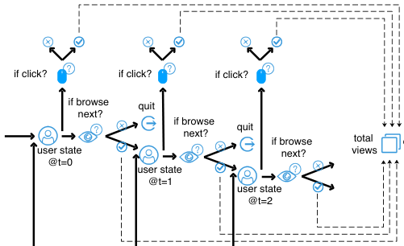
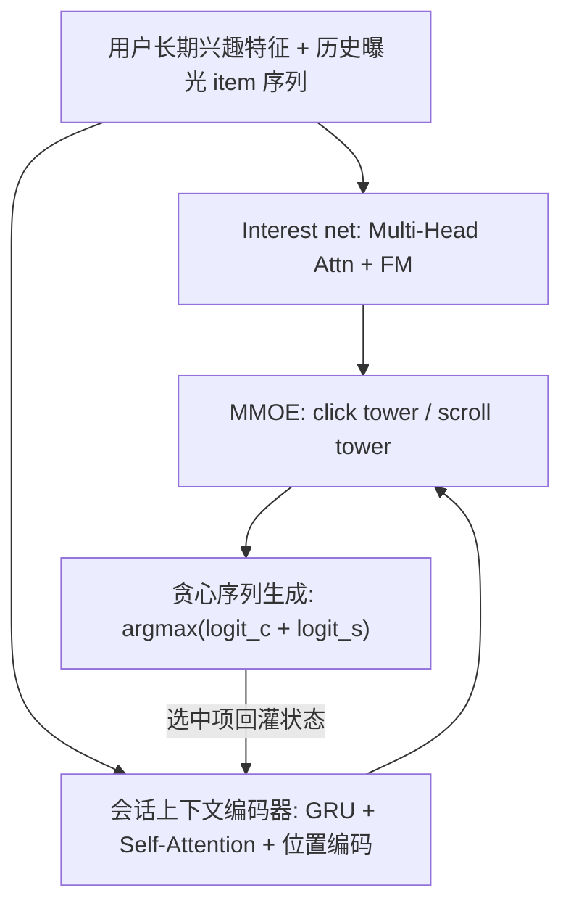
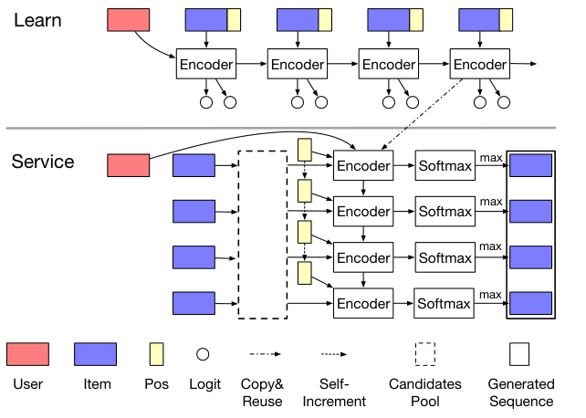

# Intra-session Context-aware Feed Recommendation in Live Systems (面向真实系统的会话内上下文感知信息流推荐)

- **会议/期刊**: CIKM 2022 (Short Paper)
- **作者与机构**: Luo Ji, Gao Liu, Mingyang Yin, Hongxia Yang — 阿里巴巴达摩院
- **推荐链路定位**: 重排 / 端到端列表生成（会话级）
- **研究方向**: 序列与会话推荐 / 多任务学习与列表级重排
- **论文原文**: [https://arxiv.org/abs/2210.07815v2](https://arxiv.org/abs/2210.07815v2)
- **开源代码**: [https://github.com/AaronJi/RecINSCAFER](https://github.com/AaronJi/RecINSCAFER)

## TL;DR (1分钟核心速览)

信息流场景中，用户"是否下滑"这一动作决定了后续 item 是否被曝光，传统 pointwise/pairwise LTR 假设样本 i.i.d.，因此存在严重的**会话内曝光偏置**；更关键的是，把最可能点的 item 置顶往往让用户点完即走，瞬时 CTR 最优 $\ne$ 会话级总曝光/总点击最优。本文把会话事件建成马尔可夫链，给出联合似然推导（可分解为位置级双任务 BCE），用 GRU+Self-Attention 编码会话内曝光序列、MMOE 联合学点击与滑动，线上以 GPT 式贪心序列生成解码。离线 AUC-ctr 0.7836、AUC-scr 0.8562（较最优基线 +0.31% / +7.25%），线上人均曝光 +1.16%、人均滑动 +1.56%、总转化 +1.56%。

## Background & Motivation (背景与核心矛盾)

- **主流范式**: 信息流排序沿用 pointwise（DIN）/pairwise/listwise（ListNet）LTR，或 GRU4Rec、Transformer 类序列模型刻画用户长短期兴趣；RL 理论上可优化长期收益但受探索成本与算力限制难以落地。
- **前人局限**: ① 现有 FR 模型几乎不显式建模 `scroll`，而 `click` 与 `scroll` 是两个独立决策，未滑动则后续 item 永不可见，样本天然非 i.i.d.；② 优化目标错位——所有方法都在压瞬时 CTR，而业务真正关心 session 级总曝光与总点击，二者可冲突（置顶最优 item 会造成"点完即走"）。
- **核心洞察 (Key Insight)**: 会话内用户状态 $h_t$ 是受历史事件递归影响的隐变量，事件序列具**单向时间依赖**（前序决策影响后续，反之不成立），因此应对整条会话序列的联合概率建模，而非逐样本独立打分。
- **本文切入点**: 以最大化 $\mathbb{E}\sum_t(c_t+s_t)$ 为出发点，把联合似然最大化分解为位置级点击/滑动双任务 BCE，从而在纯监督框架内（无需 RL）逼近会话级全局最优。

<figure class="paper-figure" markdown="span">
  <figcaption>图1：典型 feed 会话中用户事件的逻辑流程。在每个位置 t，用户决定是否点击当前 item 和/或浏览下一个 item，或退出会话。会话级推荐目标为最大化总浏览量和点击数。</figcaption>
</figure>

## Method (核心方法设计)

### 1. 整体框架 (Overall Architecture)

模型分离线预训练与在线序列生成两阶段（GPT 式解耦）。离线：用户 embedding 初始化 GRU 隐状态，每步将当前曝光 item embedding 与位置 lookup embedding 拼接后递归更新会话上下文；同时 Interest net（多头注意力 + FM）建模长期兴趣；两路表征经 MMOE（8 experts / click、scroll 双塔）输出 logits，由真实点击与滑动标签监督。在线：固定编码器，候选集逐个前向，按 $p_c+p_s$ 贪心选点，选中项立即回灌编码器更新状态，位置 embedding 自增，直到 15 个坑位填满。

<figure class="paper-figure" markdown="span">
  <figcaption>图3：INSCAFER 框架。学习：序列上下文编码。服务：贪心序列生成。</figcaption>
</figure>

### 2. 关键设计拆解 (Key Designs)

1. **会话事件的马尔可夫联合建模（把曝光偏置写进似然）**：痛点是 i.i.d. 假设下后续曝光被视为必然发生。作者将整条会话的联合概率写为
$P(\mathbf{c},\mathbf{s},\mathbf{h}|\mathbf{x})=\prod_{t=0}^{T}P(c_t|h_t,x_t)P(s_t|h_t,x_t)P(h_{t+1}|h_t,x_t,s_{t-1})$，
对其取负对数并边缘掉先验 $P(h|x)$，得到
$\mathcal{L}=-\sum_{t=0}^{T}\big[\log P_\theta(c_t|h_t,x_t)+\log P_\theta(s_t|h_t,x_t)\big]$。
直觉：会话级似然严格等价于"位置级双任务 BCE 之和 + 隐状态递归估计"，因此不需要 RL 也能把滑动决策纳入监督信号。

2. **会话内上下文编码器 + 位置感知**：$h_t$ 由 GRU 承载前序"曝光-点击-滑动"的时序效应，后接 self-attention 捕捉非相邻 item 间的相互影响（如连续同类内容导致的疲劳），再叠加位置 lookup 刻画位置衰减。实验显示去掉 attention 使 AUC-scr 从 0.8562 掉到 0.8429、去掉位置编码使 AUC-ctr 掉到 0.7722，说明"上下文互扰"与"位置偏置"是两个独立增益源。

3. **训练目标与在线贪心解码**：总损失即上式的双任务 BCE 求和（无额外负采样，充分利用全量曝光日志）。在线打分
$\arg\max_{k}\ \frac{\exp(\text{logit}^{c}_{k}+\text{logit}^{s}_{k})}{\sum_{k'}\exp(\text{logit}^{c}_{k'}+\text{logit}^{s}_{k'})}$。
注意分母对 $k$恒定，故该式实际退化为$\text{logit}^c_k+\text{logit}^s_k$ 的加性排序；推理开销与常规双塔重排同阶，仅增加一次逐步状态更新。

## Experimental Setup & Evaluation Protocol (实验设置与评估协议)

- **数据集与预处理**: 某世界级电子支付平台推荐场景（商品/餐饮/线上服务），约 2 亿用户、日均十亿级曝光，单次请求最多 15 个坑位；数据集已通过天池公开（dataId=109858）。

| 数据集 | #Users | #Items | 场景说明 |
| :--- | :---: | :---: | :--- |
| 阿里 E-Payment Feed (天池 109858) | ~2×10⁸ | 未披露 | 商品/本地生活/线上服务混合信息流，单 session ≤ 15 曝光坑位 |

- **数据划分与防穿越**: 论文**未明确说明**划分方式与时间切分策略，仅给出"离线评测 + 一周线上 A/B"两段实验，此为可复现性短板。
- **排名评测协议**: 采用**分类指标 AUC**（AUC-ctr / AUC-scr），**非** Full-Ranking 或 Sampled Ranking；文中另提及 MRR-of-scr 但未给数值。10 次重复取均值 ± 标准差。
- **对比基线与超参**: 基线含 DIN、DIN-ListNet、MMOE、GRU4rec、GRU4rec-MMOE、Ptr-net。Embedding $d=16$，注意力 2 头（余弦相似度），GRU 隐状态维度 =$d$，MMOE 8 experts、4 tasks、expert 宽 64，塔网络 MLP [128, 32] + sigmoid，Adam lr=$10^{-4}$，训练 >180k 步、约 60k 步收敛。未报告显著性检验。

## Key Experimental Results (实验关键数据)

### 1. 主实验与消融对比 (Main & Ablation)

| Model | AUC-ctr | AUC-scr | 备注 |
| :--- | :---: | :---: | :--- |
| DIN | 0.7771 | 0.5673 | pointwise 工业基线，scroll 几乎不可预测 |
| DIN-ListNet | 0.7362 | 0.5186 | 换 listwise 损失反而大幅劣化 |
| MMOE | 0.7682 | 0.7983 | 双任务有效，但 ctr 被拖累 |
| GRU4rec | 0.7812 | 0.5362 | 会话建模提升 ctr，无 scroll 头 |
| GRU4rec-MMOE | 0.7673 | 0.7885 | 两法拼接，均衡但无突破 |
| Ptr-net | 0.7790 | 0.5642 | seq2seq 生成式，scr 仍差 |
| INSCAFER w/o GRU | 0.7701 | 0.8313 | 去递归状态 |
| INSCAFER w/o atten | 0.7792 | 0.8429 | 去 self-attention |
| INSCAFER w/o pos | 0.7722 | 0.7918 | 去位置编码 |
| **INSCAFER** | **0.7836** | **0.8562** | ctr +0.31%，scr +7.25% |

**线上 A/B（对比 DIN+CVR+曝光优化集成基线，约 1 周）**：

| Model | CTR | 总曝光 | 人均曝光 | 人均滑动 | 单会话曝光 | 总转化 |
| :--- | :---: | :---: | :---: | :---: | :---: | :---: |
| DIN | +0.20% | +0.01% | −0.14% | −0.54% | −0.06% | −0.06% |
| **INSCAFER** | **+0.13%** | **+0.24%** | **+1.16%** | **+1.56%** | **+0.38%** | **+1.56%** |

### 2. 关键实验发现 (Key Findings)

1. **click 与 scroll 是异分布任务**：DIN/Ptr-net 的 AUC-ctr（0.7771/0.7790）尚可，但 AUC-scr 仅 0.5673/0.5642；一旦加上 scroll 头（MMOE 0.7983、本文 0.8562），scr 提升 29–51 个千分点。说明滑动行为无法由点击信号"顺带"学出，必须显式监督。
2. **消融显示两类上下文各司其职**：去 attention 主要损害 scr（−1.33pt），去位置编码主要损害 ctr（−1.15pt）与 scr（−6.44pt），去 GRU 损害 ctr（−1.35pt）；三者同时在场才有 0.7836/0.8562 的双高，验证"时序递归 + item 互扰 + 位置衰减"耦合必要性。
3. **线上验证了"CTR 最优 ≠ 会话最优"**：DIN 把 CTR 拉到 +0.20%，但人均曝光 −0.14%、人均滑动 −0.54%、总转化 −0.06%（典型"点完即走"）；INSCAFER 牺牲 0.07pt CTR 换来人均滑动 +1.56%、总转化 +1.56%，证明会话级目标的增益确实来自延长会话而非抬高单点点击。

## Highlights & Limitations (亮点、对比与审稿批判)

- **与代表作对比**: 相较于 DIN/ListNet（假设曝光必发生、优化瞬时 CTR）和 GRU4Rec（只建模点击序列、无滑动决策），本文的核心差异是把 `scroll` 作为与 `click` 并列的独立事件纳入联合似然；相较 MMOE/GRU4Rec-MMOE 的"工程拼接"，本文的推导给出"多任务 BCE = 会话联合似然"的理论依据，并在服务阶段引入状态回灌的贪心序列生成。
- **可迁移亮点**: ① 任意"曝光受前序行为门控"的列表式场景（短视频、搜索翻页、推荐理由展开）都可复刻"把消费行为拆为 消费 + 继续 双标签"的建模套路；② 用 GPT 式"预训练编码器 + 在线贪心生成"替代 RL 优化长期收益，工程成本极低。
- **审稿级局限批判**: ① **目标与代理的缝隙**：真实总曝光应为 $\sum_t \prod_{\tau<t}s_\tau$（乘性存活概率），而贪心解码只用加性$\text{logit}^c+\text{logit}^s$，忽略"当前 item 会改变后续存活率"的 look-ahead 效应，且 softmax 归一化在 argmax 下无实际作用；② **评估协议薄弱**：仅报告 AUC 分类指标，无 NDCG/Recall 等排序指标、未说明数据划分与候选集构造，且自述"MRR-of-scr 仅第三"，与主结论略有张力；sample size、显著性检验、$d=16$ 超参敏感性均缺失，离线增益（+0.31pt ctr）本身也偏小。

## Rating (四维评分)

- **方法创新性 (Novelty)**: ⭐⭐⭐⭐ （首次把滑动决策纳入会话联合似然并给出"似然 = 多任务 BCE"的干净推导，思路新颖但数学工具朴素）
- **评估协议与实验扎实度 (Protocol & Experiments)**: ⭐⭐⭐ （有难得的一周线上 A/B 与完整消融，但离线仅 AUC、划分方式缺失、无显著性检验）
- **写作与数学规范度 (Clarity & Rigor)**: ⭐⭐⭐⭐ （推导链条清晰、符号统一，但对"似然最大化 ⇒ 总曝光最大化"的等价性论证略跳跃）
- **工业落地与复现价值 (Industrial & Practical Value)**: ⭐⭐⭐⭐⭐ （代码与数据集全开源，$d=16$ 的小模型 + 贪心解码可在重排阶段低成本上线，线上七项指标全面为正）

