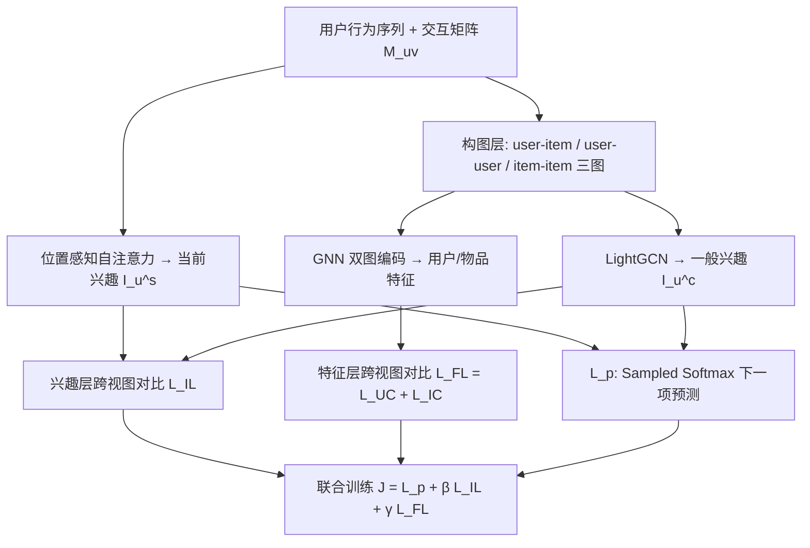
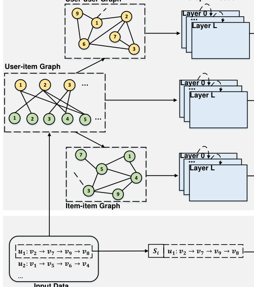

# Multi-level Contrastive Learning Framework for Sequential Recommendation (面向序列推荐的多层级对比学习框架)

- **会议/期刊**: CIKM 2022
- **作者与机构**: Ziyang Wang, Huoyu Liu, Wei Wei, Yue Hu, Xian-Ling Mao, Shaojian He, Rui Fang, Dangyang Chen（华中科技大学 CCIIP / 阿里巴巴 / 北京理工大学 / 平安产险）
- **推荐链路定位**: 召回（Next-Item 序列召回）
- **研究方向**: 序列与会话推荐 / 自监督对比学习与交互去噪
- **论文原文**: [https://arxiv.org/abs/2208.13007v1](https://arxiv.org/abs/2208.13007v1)
- **开源代码**: 暂未开源

## TL;DR (1分钟核心速览)

现有对比学习式序列推荐（CL4SRec、DuoRec）的自监督信号**全部来自单条行为序列本身**（裁剪/掩码/Dropout），序列内条目有限、增广多样性低，信号太弱难以学到有判别力的 embedding。MCLSR 把对比视角从 1 个扩到 4 个（序列视图、用户-物品图、用户-用户图、物品-物品图），在**兴趣层**（序列 vs 用户-物品图）与**特征层**（用户-物品图 vs 用户-用户图 / 物品-物品图）两级做跨视图 InfoNCE，与 Sampled-Softmax 预测损失联合训练。在 Amazon Books/Clothing/Toys 与 Gowalla 四个数据集上（8:1:1 用户划分、预测每用户后 20% 行为），Recall@20 相对最强基线 DuoRec 提升 3.8%–10.3%，平均约 7.0%，$p<0.01$。

## Background & Motivation (背景与核心矛盾)

- **主流范式**: GRU4Rec → SASRec（自注意力）→ GCSAN/MA-GNN（把序列转成 item transition 图）一路都是**纯监督范式**，监督信号只来自观测到的用户行为；近两年 S3-Rec、CL4SRec、DuoRec 引入对比学习，用序列自身增广出正负对补充自监督信号。
- **前人局限 1**: 增广仅作用于**序列内部**（crop/mask/reorder 或 dropout），一条序列平均只有 6.9–14.5 个条目，可提取的自监督信息上限极低；且简单增广得到的对比对**信息多样性差**，正样本几乎是正样本的复制，梯度信号偏弱。
- **前人局限 2**: 完全忽略了两类跨序列的强信号——**协同信息**（user-item 交互）与**共行为信息**（user-user / item-item 共现，co-action）。这与"两个用户买过同一批商品"这类最廉价、最稠密的先验脱节。
- **核心洞察 (Key Insight)**: 对比学习要有效，关键是**视角之间信息足够"不同"**（mutual information 更大）。序列视图刻画"当前兴趣/转移模式"，图视图刻画"一般兴趣/共现关系"，天然互补；而序列内部的两种增广则高度冗余。
- **本文切入点**: 用一次交互矩阵 $\mathbf{M}^{uv}$ 派生出三个图视图，把对比从"同一序列的两个副本"换成"同一用户在不同视图下的表征"，用图结构本身充当增广算子。

## Method (核心方法设计)

### 1. 整体框架 (Overall Architecture)

输入是用户行为序列 $\mathcal{S}^{(u)}$与由其聚合出的交互矩阵$\mathbf{M}^{uv}\in\mathbb{R}^{|\mathcal{U}|\times|\mathcal{V}|}$。框架分四步：① 构图层由$\mathbf{M}^{uv}$派生 user-item 二部图、$\mathbf{M}^{uu}=\mathbf{M}^{uv}(\mathbf{M}^{uv})^{\top}$的 user-user 图与对称的 item-item 图；② **兴趣层**用位置感知自注意力得到当前兴趣$I_u^s$，用 LightGCN 在 user-item 图上做用户感知注意力得到一般兴趣$I_u^c$，二者做跨视图对比；③ **特征层**用同一 GNN 在 user-item 图与 user-user（item-item）图上分别编码同一批用户/物品节点，两组表征做跨视图对比；④ 训练时三个损失联合优化，推理时**只使用当前兴趣$I_u^s$** 与物品 embedding 做内积 Top-N（因图仅用训练数据构建，general interest 在推理时不可得，强行使用会造成信息穿越）。

### 2. 关键设计拆解 (Key Designs)

1. **兴趣层跨视图对比（协同信息 × 序列转移）**: 痛点是把协同信息塞进序列表征时，用户对序列内各 item 的重要性评估口径不同，直接拼接会互相污染。做法是让两个视图**各自用适配自身的注意力**产出兴趣向量，再对比。序列侧用位置感知注意力 $\mathbf{A}_s=\mathrm{softmax}(\mathbf{W}_2\tanh(\mathbf{W}_1(\mathbf{E}_{u,p})^{\top}))$、$I_u^s=\mathbf{A}_s\mathbf{E}_u$；图侧用用户特征作 query 的注意力$\mathbf{A}_c=\mathrm{softmax}(\tanh(\mathbf{W}_3\mathbf{h}_{u,uv})\mathbf{E}_{u,uv}^{\top})$、$I_u^c=\mathbf{A}_c\mathbf{E}_{u,uv}$。同一用户两视图兴趣互为正样本、不同用户兴趣为负样本：
   $$\mathcal{L}_{IL}=\sum_{i}-\log\frac{\Psi(\mathbf{T}_i^{I,s},\mathbf{T}_i^{I,c})}{\sum_{j}\Psi(\mathbf{T}_i^{I,s},\mathbf{T}_j^{I,c})+\sum_{j\neq i}\Psi(\mathbf{T}_i^{I,s},\mathbf{T}_j^{I,s})}$$
   直觉：负样本项里同时包含"跨用户跨视图"与"跨用户同视图"，迫使 $I^s$与$I^c$ 在同一空间对齐的同时保留各自视角的判别性。
2. **特征层跨视图对比（共行为信息 re-observe）**: 纯 user-item 二部图只能刻画"买过同一物品"，无法度量用户与用户之间**共现强度**（买过同一批物品几次）。MCLSR 让同一用户的节点表征分别从 user-item 图与 user-user 图编码，边权即共现次数，天然让高频共现邻居传播权重更大，再做 InfoNCE：$\mathcal{L}_{UC}=\sum_i-\log\frac{\Psi(\mathbf{T}_i^{F,uv},\mathbf{T}_i^{F,uu})}{\sum_j\Psi(\cdot)+\sum_{j\neq i}\Psi(\mathbf{T}_i^{F,uv},\mathbf{T}_j^{F,uv})}$，物品侧对称得$\mathcal{L}_{IC}$，$\mathcal{L}_{FL}=\mathcal{L}_{UC}+\mathcal{L}_{IC}$。相比 SGL 式的边/节点 Dropout，共视图是**结构上不同**的视图，信息多样性更高。
3. **训练目标、负采样与推理效率**: 组合兴趣 $\mathbf{I}_u^{comb}=\alpha\mathbf{I}_u^{s}+(1-\alpha)\mathbf{I}_u^{c}$；预测为 Sampled Softmax，每正样本配 1280 个均匀负采样：$\mathcal{L}_p=\sum_u-\log\frac{\exp((\mathbf{I}_u^{comb})^{\top}\mathbf{h}_{v_o})}{\sum_{k\in \mathrm{Sample}(\mathcal{V})}\exp((\mathbf{I}_u^{comb})^{\top}\mathbf{h}_{v_k})}$；总目标$\mathcal{J}=\mathcal{L}_p+\beta\mathcal{L}_{IL}+\gamma\mathcal{L}_{FL}$。推理只用$I_u^s$，$O(|\mathcal{V}|d)$ 内积，对比分支只在训练时存在，**不增加线上开销**；user-user/item-item 图按边权截断保留每节点 top-50 邻居以控制构图与传播成本。

<figure class="paper-figure" markdown="span">
  <figcaption>图 2：所提出框架的概览。⊕ 表示逐元素求和。</figcaption>
</figure>

## Experimental Setup & Evaluation Protocol (实验设置与评估协议)

- **数据集与预处理**: 四个公开数据集，物品过滤沿用 **5-core（出现次数 < 5 的物品被删）**，训练样本最大长度截断为 20。

| 数据集 | #Users | #Items | #Interactions | 稀疏度 | 特征/场景说明 |
| :--- | :---: | :---: | :---: | :---: | :--- |
| Books (Amazon) | 459,133 | 313,966 | 8,898,041 | 99.993% | 平均序列长 9.7，极稀疏 |
| Clothing (Amazon) | 39,387 | 23,034 | 278,677 | 99.969% | 平均序列长 6.9，最短 |
| Toys (Amazon) | 75,258 | 64,444 | 1,097,592 | 99.977% | 平均序列长 9.6 |
| Gowalla | 65,506 | 174,606 | 2,061,264 | 99.982% | LBS 签到，平均序列长 14.5 |

- **数据划分与防穿越 (Splitting Strategy)**: **用户级比例划分 8:1:1**（train/valid/test 用户互不重叠），非 Leave-One-Out；训练阶段对训练用户的**整条点击序列**做 next-item 自回归监督；推理阶段按 ComiRec 协议取用户**前 80% 行为**生成兴趣、预测**后 20% 行为**，避免 test 行为泄漏进序列编码。
- **排名评测协议 (Ranking Protocol)**: 采用 **Full-Ranking（对全物品库未交互项排序）** 计算 Recall@20/50、NDCG@20/50、Hit@20/50；训练阶段的负采样为 Sampled Softmax（1 正 : 1280 均匀负），属于训练加速而非评测采样。
- **对比基线与超参设置**: 8 个基线覆盖统计（Pop）、RNN（GRU4Rec）、自注意力（SASRec、ComiRec-SA）、图+注意力（GCSAN）、对比学习（S³-Rec^MIP、CL4SRec、DuoRec）。统一 Adam、lr=0.001、$d=64$、batch=128；GNN 层数$l\in\{0,1,2,3\}$、$\tau=0.5$、$\{\alpha,\beta,\gamma\}=\{0.5,1,0.05\}$；显著性检验$p<0.01$（表中 †）。

## Key Experimental Results (实验关键数据)

### 1. 主实验对比 (Main Results)

| 方法 | Books R@20 | Books N@20 | Clothing R@20 | Toys R@20 | Toys N@20 | Gowalla R@20 | Gowalla N@20 |
| :--- | :---: | :---: | :---: | :---: | :---: | :---: | :---: |
| Pop | 1.368 | 0.597 | 1.200 | 0.928 | 0.510 | 1.206 | 1.191 |
| GRU4Rec | 3.787 | 1.923 | 1.623 | 3.214 | 1.641 | 5.642 | 5.536 |
| SASRec | 6.274 | 2.825 | 2.646 | 6.343 | 2.912 | 8.581 | 7.546 |
| ComiRec-SA | 5.489 | 2.262 | 1.678 | 5.315 | 2.114 | 5.559 | 3.891 |
| GCSAN | 5.721 | 2.706 | 2.242 | 6.593 | 2.817 | 7.869 | 6.819 |
| S³-Rec^MIP | 6.336 | 2.964 | 2.704 | 6.670 | 3.073 | 7.823 | 7.351 |
| CL4SRec | 6.544 | 3.161 | 2.863 | 6.983 | 3.072 | 8.804 | 7.601 |
| DuoRec | 6.838 | 3.257 | 2.940 | 7.841 | 3.418 | 8.973 | 7.618 |
| **MCLSR** | **7.469**† | **3.479**† | **3.138**† | **8.254**† | **3.726**† | **9.317**† | **7.759**† |
| Improv. | +9.2% | +6.8% | +6.7% | +10.3% | +9.0% | +3.8% | +1.9% |

（Hit@20/@50 同向：Books Hit@20 由 DuoRec 14.173 → 15.542（+9.6%）；Gowalla Hit@50 由 44.618 → 46.217（+3.5%）。原文平均提升 7.0%。）

### 2. 消融实验 (Ablation Study)

三视图 GNN 深度消融（Metrics@50，**加粗为最优**）：

| 变体 | Books R@50 | Books N@50 | Books Hit@50 | Toys R@50 | Toys Hit@50 | Gowalla N@50 | Gowalla Hit@50 |
| :--- | :---: | :---: | :---: | :---: | :---: | :---: | :---: |
| $l=0$（去图编码 ≈ MCLSR-G） | 9.881 | 3.799 | 20.032 | 11.052 | 21.673 | 8.728 | 40.273 |
| $l=1$ | 10.853 | 4.166 | 21.782 | 13.165 | 25.069 | 10.743 | 45.620 |
| $l=2$（默认） | **11.583** | **4.647** | **23.042** | 13.328 | 25.462 | **11.012** | **46.217** |
| $l=3$ | 10.085 | 3.936 | 20.547 | **13.720** | **26.417** | 10.094 | 43.665 |

组件消融（图 3）：移除两层对比（MCLSR-IF）与仅移除兴趣层对比（MCLSR-I）跌幅最大，仅移除特征层对比（MCLSR-F）在 Clothing 上跌幅最明显，说明共行为信息在该短序列数据集上贡献最突出。

### 3. 关键实验发现 (Key Findings)

1. **增益与稀疏度强正相关**：Books 密度最低（99.993% 稀疏）取得最大提升 Recall@20 +9.2%、Hit@20 +9.6%；Gowalla 序列最长（14.5）信息最充分，提升仅 +3.8%/+1.9%。这直接印证"自监督信号补的是监督信号的空缺"这一动机——序列本身信息越足，跨视图对比的边际价值越小。
2. **GNN 深度呈倒 U 型，过平滑是硬约束**：$l$从 0→2，Gowalla Hit@50 从 40.27 升到 46.22（+14.8%），Books Hit@50 从 20.03 升到 23.04（+15.0%），证明三图协同信息确实需要高阶传播；但$l=3$在 Books 反向掉到 20.55（−10.8%），说明 user-user/item-item 稠密图上的高阶传播极易过平滑，$l=2$ 是安全默认。
3. **辅助对比权重必须"小",主任务必须"强"**：$\beta$从 0→0.5 性能显著上升，但$\beta>1.5$（Gowalla）开始退化；$\gamma$在 0.05 最优，$\gamma=1$时性能大幅下滑；$\alpha=0$（训练只用一般兴趣、推理只用当前兴趣）时最差，暴露**训练/推理表征不一致**的隐患。三者共同说明协同信号是"调味"而非"主菜"。

## Highlights & Limitations (亮点、对比与审稿批判)

- **与代表作对比 (vs. Prior Work)**: 与 **CL4SRec** 相比，本文的增广算子不再是 crop/mask/reorder，而是"换图"，从根本上提升对比对的信息多样性；与 **DuoRec** 相比，DuoRec 只是 model-level dropout + 监督正采样，仍困在单序列信息上限内，MCLSR 引入了跨用户信息；与 **SGL** 相比，SGL 是单一 user-item 图上的节点/边扰动式自监督，本文是**异质视图间的跨视图对齐**，信号互补性更强。定性上（图 5）SASRec 的 item embedding 退化成窄锥，MCLSR 的分布更均匀地铺开在原点周围，表征容量更大。
- **可迁移亮点**: ① **"交互矩阵派生子图 + 跨视图 InfoNCE"** 这一配方可直接套到 CTR 的 user-item-user 三视图、短视频的多行为（曝光/点击/完播）视图上；② **训练用多视图、推理只留序列视图**的解耦设计，零线上延迟地吃掉图侧收益，工程上非常友好。
- **审稿级局限批判**: ① **推理时彻底丢弃 general interest**（$I_u^c$只用于训练），意味着模型容量在线上只能发挥一半，若能用训练期图结构做离线 embedding 预计算（如 PinSAGE 式）本可拿到更多收益，作者未讨论；② **构图依赖全量交互矩阵**，$\mathbf{M}^{uu}$理论上是$|\mathcal{U}|^2$稠密矩阵，虽截断 top-50 邻居，但 45.9 万用户的 Books 上构图与存储成本未做量化分析，且论文只报单次运行结果、无方差与效率对比；③ 超参$\alpha$ 在 Books 最优 0.25、Gowalla 最优 0.75，跨数据集需重调，泛化性说明不足。

## Rating (四维评分)

- **方法创新性 (Novelty)**: ⭐⭐⭐⭐ （把对比学习的"视角"从序列内部搬到四视图跨视图层面，兴趣层/特征层两级设计有清晰的功能分工，但本质仍是 InfoNCE 的组合式应用，缺少理论层面的互信息下界分析）
- **评估协议与实验扎实度 (Protocol & Experiments)**: ⭐⭐⭐ （四数据集 + 8 基线 + $p<0.01$ 显著性 + 组件/深度/超参三组消融较完整，但评测协议细节（全库排序的实现、是否重复实验取均值）描述偏薄，且未报告训练/推理耗时）
- **写作与数学规范度 (Clarity & Rigor)**: ⭐⭐⭐⭐ （四视图、两级对比的公式推导链条完整，符号统一，$\mathcal{L}_{IL}$的负样本项写清了"跨用户跨视图 + 跨用户同视图"两类，动机图对比直观；小瑕疵是式 (8)(11) 的$\sum_{i=1}$ 缺上界、MLP 投影参数在两级中复用同一符号）
- **工业落地与复现价值 (Industrial & Practical Value)**: ⭐⭐⭐ （推理零额外开销、对比分支可训练期剥离是最大卖点，但代码未开源，且 user-user/item-item 稠密图在千万级用户场景的构图成本与冷启动更新策略缺失，落地需自行补齐）

