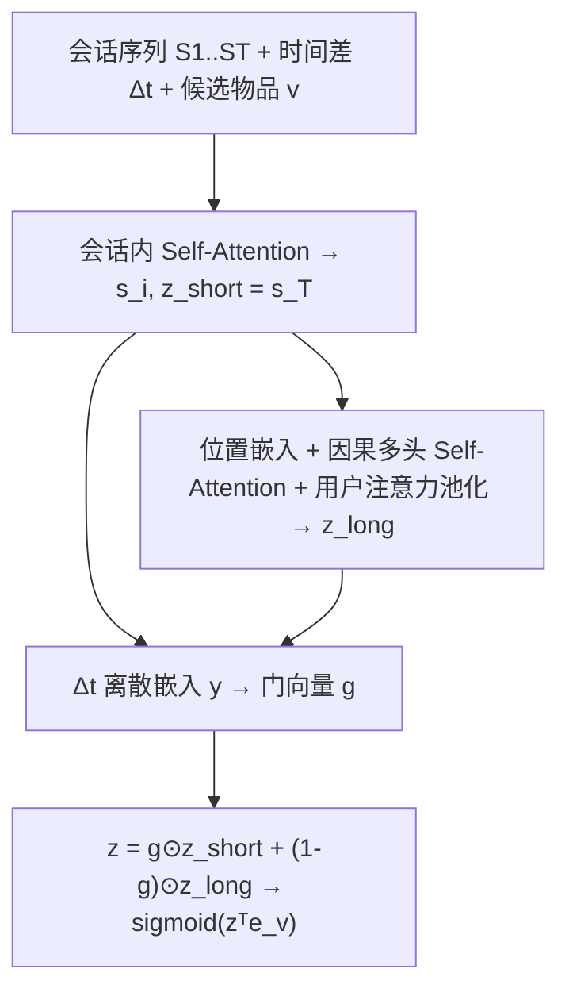
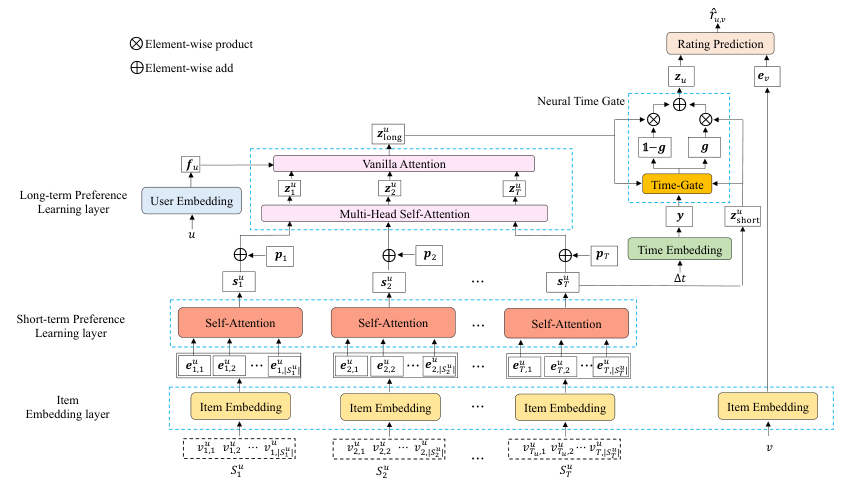
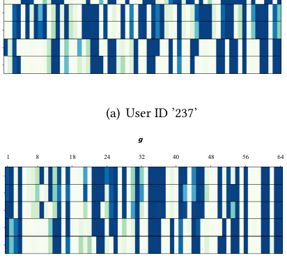

# Time Lag Aware Sequential Recommendation (时间差感知的序列推荐)

- **会议/期刊**: CIKM 2022
- **作者与机构**: Lihua Chen, Ning Yang (四川大学), Philip S. Yu (UIC)
- **推荐链路定位**: 召回 / 用户表征（next-session 排序）
- **研究方向**: 序列与会话推荐
- **论文原文**: [https://arxiv.org/abs/2208.04760v1](https://arxiv.org/abs/2208.04760v1)
- **开源代码**: 暂未开源

## TL;DR (1分钟核心速览)

针对序列推荐中「长短期偏好被扁平建模」「长短期融合只用标量权重」两个痛点，TLSRec 用**层级自注意力**（会话内 self-attention 得局部偏好、会话间带因果掩码的多头自注意力 + 用户注意力池化得全局偏好）分离稳定性与波动性，再用**神经时间门**以 $d$维门向量（输入含"距上次行为的时间差"嵌入）逐维融合长短期偏好。在 4 个数据集、随机 70/10/20 划分、全库 top-$k$ 排序协议下，Amazon Book 上 Hit@20 由 0.2219 提升至 0.3438（+55%）。

## Background & Motivation (背景与核心矛盾)

- **主流范式**: 以 SASRec/BERT4Rec 为代表的单层自注意力直接建模扁平交互序列；DREAM/II-RNN/SHAN 则以两层 RNN 或层次 attention 先把交互聚成 session 再聚合。
- **前人局限 1**: 扁平序列把用户偏好视为跨会话同分布，无法同时刻画「跨会话缓慢变化的稳定长期偏好」与「会话内偏离长期偏好的局部波动」，RNN 类更易被近端会话主导而遗忘远期稳定兴趣。
- **前人局限 2**: SHAN/DREAM 用静态超参权重、部分工作用 attention 标量系数融合长短期，标量权重隐含"同一向量的所有维度同等重要"的假设，粒度过粗——用户买科幻小说可能只因"题材"这一维与长期偏好对齐，其余维度不应被同等加权。
- **核心洞察 (Key Insight)**: 长短期谁的贡献更大，本质上取决于**时间差 $\Delta t$**（距上次行为多久）：间隔越久，短期偏好越失效，应退回长期偏好；且该调节应在**维度级**而非向量级发生。
- **本文切入点**: 层级自注意力（局部→全局）+ 时间差嵌入驱动的 sigmoid 门向量，二者串联完成"分解—融合"。

## Method (核心方法设计)

### 1. 整体框架 (Overall Architecture)

输入为用户按时间排序的 $T$个会话（会话内物品序列）、推荐时刻与上次交互的时间差$\Delta t$、候选物品$v$。物品经 embedding 层后进入**短期偏好层**：会话内共享参数的 self-attention + 求和池化，得到各会话表征$\mathbf{s}^{u}_{i}$，最后一会话表征即短期偏好$\mathbf{z}^{u}_{\text{short}}=\mathbf{s}^{u}_{T}$。**长期偏好层**对$\{\mathbf{s}^{u}_{i}\}$加位置嵌入、经因果掩码多头自注意力与 FFN 得$\{\mathbf{z}^{u}_{i}\}$，再用用户嵌入$\mathbf{f}_{u}$作 query 做 vanilla attention 池化得$\mathbf{z}^{u}_{\text{long}}$。**神经时间门**根据$\Delta t$的离散嵌入生成门向量$\mathbf{g}$，逐维混合两者得$\mathbf{z}^{u}$，与候选物品内积 + sigmoid 输出打分，BPR 成对训练。

<figure class="paper-figure" markdown="span">
  <figcaption>图1：TLSRec 的架构。</figcaption>
</figure>

### 2. 关键设计拆解 (Key Designs)

1. **层级自注意力（分解稳定性 vs 波动性）**: 前人把整个序列当作一个平面建模。本文让短层只在会话内部做 self-attention（捕获会话内共现与局部兴趣偏移），让长层在会话之间做**带因果掩码的多头**自注意力（$i<j$时把$\mathbf{q}_i^{\top}\mathbf{k}_j$ 置零），末尾接 FFN 与残差 LayerNorm。多头使不同子空间各自关注"题材/价格/品牌"等不同维度交互，最终用用户嵌入作 query 的注意力池化，让不同会话按贡献加权：

$$\omega_i=\frac{\exp\left(\mathbf{f}_u^{\top}\phi(\mathbf{W}_L\mathbf{z}^{u}_i+\mathbf{b}_L)\right)}{\sum_{j=1}^{T}\exp\left(\mathbf{f}_u^{\top}\phi(\mathbf{W}_L\mathbf{z}^{u}_j+\mathbf{b}_L)\right)},\quad \mathbf{z}^{u}_{\text{long}}=\sum_{i=1}^{T}\omega_i\mathbf{z}^{u}_i$$

2. **神经时间门（$\Delta t$感知的维度级融合）**: 先把时间差按该用户最小交互间隔$\Delta_{\min}$离散并截断，再查表得时间嵌入$\mathbf{y}$，与长短期表征一起过 sigmoid 得到门向量，而非标量：

$$\delta=\min\left(\left\lceil \Delta t/\Delta_{\min}\right\rceil, C\right),\quad \mathbf{g}=\sigma(\mathbf{W}_l\mathbf{z}^{u}_{\text{long}}+\mathbf{W}_s\mathbf{z}^{u}_{\text{short}}+\mathbf{W}_{\delta}\mathbf{y}+\mathbf{b}_g)$$

$$\mathbf{z}^{u}=\mathbf{g}\odot\mathbf{z}^{u}_{\text{short}}+(\mathbf{1}-\mathbf{g})\odot\mathbf{z}^{u}_{\text{long}}$$

直觉上 $\mathbf{g}$每一维就是"该偏好维度上短期证据的可信度"，$\Delta t$越大$\mathbf{g}$ 整体越小，模型自动退回长期偏好；逐维权重则允许"只让题材维听短期、风格维听长期"。

3. **训练目标、负采样与推理效率**: 沿用 BPR 成对损失，目标会话 $S_{T+1}$ 内每个正例配 1 个随机未观测负例：

$$\mathcal{L}=-\sum_{u}\sum_{o\in\mathcal{O}_u}\sum_{v\in\mathcal{V}^{+}_o,\,v'\in\mathcal{V}^{-}_o}\log\sigma(\hat{r}_{u,v}-\hat{r}_{u,v'})+\lambda\|\Theta\|_2^2$$

免去 softmax 全库归一化；在线只算一次 $O(T\cdot m\cdot d + T^2 d)$的编码（$T\leq 10$，$m$ 为会话长度），开销远低于图模型的多跳传播。

## Experimental Setup & Evaluation Protocol (实验设置与评估协议)

- **数据集与预处理**（隐式反馈，显式评分当作交互；会话按相邻交互时间间隔阈值 $\epsilon$ 切分：Amazon 系 48 小时，MovieLens/Lastfm 2 小时）：

| 数据集 | #Users | #Items | #Interactions | 稀疏度/密度 | 特征/场景说明 |
| :--- | :---: | :---: | :---: | :---: | :--- |
| Amazon Book | 4,621 | 170,474 | 517,556 | 0.0006 | 极稀疏、长尾书目 |
| Amazon Video | 1,709 | 12,434 | 64,298 | 0.0030 | 稀疏、物品数少 |
| MovieLens-1M | 5,492 | 3,692 | 970,346 | 0.0478 | 稠密电影评分 |
| Lastfm | 953 | 22,372 | 16,641,736 | 0.7805 | 音乐收听，以歌手为 item |

- **数据划分与防穿越 (Splitting Strategy)**: `比例划分`——每个数据集随机取 70% 训练 / 10% 验证 / 20% 测试，重复 10 次取均值；序列实例为 $T+1$个会话（滑动窗口切成$T+1$，不足左填充，会话不足用末位物品重复填充）。
- **排名评测协议 (Ranking Protocol)**: `Full-Ranking (全库未交互排序)`——指标 Hit@$k$与 MAP@$k$ 定义在全体物品的预测排名上（训练用 1:1 随机负采样 BPR，评测不做采样）。
- **对比基线与超参设置**: 10 个基线，含 RNN 类（DREAM、II-RNN）、attention 类（NARM、ANAM、SHAN、SASRec、BERT4Rec、TiSASRec）、GNN 类（SURGE、DHCN）；嵌入维度 $d=64$（Amazon Video 为 32），多头数 8，学习率 1e-3，batch 128，dropout 0.5，注意力块可堆叠。原文未报告显著性检验。

## Key Experimental Results (实验关键数据)

### 1. 主实验对比 (Main Results)

| Method | Book Hit@20 | Book MAP@20 | Video Hit@20 | Video MAP@20 | ML-1M Hit@20 | ML-1M MAP@20 | Lastfm Hit@20 | Lastfm MAP@20 |
| :--- | :---: | :---: | :---: | :---: | :---: | :---: | :---: | :---: |
| DREAM | 0.0440 | 0.0020 | 0.0553 | 0.0027 | 0.3837 | 0.0214 | 0.7323 | 0.0661 |
| II-RNN | 0.0668 | 0.0025 | 0.0821 | 0.0031 | 0.4902 | 0.0271 | 0.6311 | 0.0899 |
| SHAN | 0.0480 | 0.0018 | 0.0627 | 0.0061 | 0.3337 | 0.0188 | 0.5556 | 0.0690 |
| SASRec | 0.1209 | 0.0055 | 0.1884 | 0.0145 | 0.4476 | 0.0352 | 0.8065 | 0.0892 |
| BERT4Rec | 0.0902 | 0.0033 | 0.1744 | 0.0092 | 0.3917 | 0.0279 | 0.6515 | 0.0755 |
| TiSASRec | 0.1842 | 0.0062 | 0.2133 | 0.0155 | 0.5025 | 0.0372 | 0.7630 | 0.0981 |
| SURGE | 0.2219 | 0.0091 | 0.1961 | 0.0096 | 0.5077 | 0.0366 | 0.7915 | 0.0905 |
| DHCN | 0.1991 | 0.0075 | 0.2308 | 0.0082 | 0.5301 | 0.0233 | 0.7551 | 0.0808 |
| **TLSRec** | **0.3438** | **0.0130** | **0.2423** | **0.0167** | **0.5640** | **0.0381** | **0.8086** | **0.1044** |
| Improv. | +54.9% | +42.9% | +5.0% | +7.7% | +6.4% | +2.4% | +0.3% | +6.4% |

（Hit@30 趋势一致：Book 0.4161 vs 最好基线 0.3103；Video 0.2884 vs 0.2780；ML-1M 0.6522 vs 0.5922；Lastfm 0.8439 vs 0.8260。）

### 2. 消融实验 (Ablation Study)

| 变体 (Hit@20 / MAP@20) | Book | Video | ML-1M | Lastfm |
| :--- | :---: | :---: | :---: | :---: |
| w/o 短层 self-attn (TLSRec-S) | 0.2741 / 0.0077 | 0.1567 / 0.0119 | 0.5111 / 0.0245 | 0.7604 / 0.0928 |
| w/o 长层 self-attn (TLSRec-L) | 0.3034 / 0.0113 | 0.1789 / 0.0130 | 0.5466 / 0.0367 | 0.7679 / 0.0822 |
| 多头→单头 (TLSRec-M) | 0.3039 / 0.0117 | 0.1875 / 0.0159 | 0.5611 / 0.0372 | 0.8060 / 0.0962 |
| 门→平均池化 (G+A) | 0.2989 / 0.0110 | 0.1702 / 0.0149 | 0.5317 / 0.0360 | 0.8053 / 0.1016 |
| 门→self-attn (G+S) | 0.3070 / 0.0110 | 0.1770 / 0.0159 | 0.5534 / 0.0362 | 0.8035 / 0.1016 |
| 门→多头 attn (G+M) | 0.3213 / 0.0119 | 0.1965 / 0.0163 | 0.5634 / 0.0376 | 0.8065 / 0.1028 |
| **TLSRec** | **0.3438 / 0.0130** | **0.2423 / 0.0167** | **0.5640 / 0.0381** | **0.8086 / 0.1044** |

### 3. 关键实验发现 (Key Findings)

1. **短层 self-attention 是收益主源，而非长层**：Amazon Book 上移除短层 Hits@20 掉 20.3%（0.3438→0.2741），移除长层仅掉 11.7%（→0.3034），说明会话内物品共现去噪对稀疏数据最关键；而多头相对单头的增益在 Book MAP 上达 +11%（0.0117→0.0130）、Lastfm 上几乎为 0（0.1028→0.1044），表明稠密短序列下多头子空间已被充分表达、属于冗余参数。
2. **融合机制比分解机制更"贵"**：把时间门换成平均池化（G+A）在 Amazon Video 上 Hits@20 从 0.2423 跌到 0.1702（-29.8%），即使用 attention 互融合（G+S/G+M）仍只有 0.1770/0.1965，说明增益并非来自"更强的非线性融合"，而是来自 $\Delta t$ 条件化 + 维度级权重这两点本身。
3. **时间门学到符合直觉的单调行为**：门向量在维度上的均值随 $\Delta t$ 从 2 小时到 9–10 天单调衰减（约 0.64 → 0.1），同一门向量内部各维色彩差异明显，实证了"间隔越久越依赖长期偏好"且各维度权重异质；但 Lastfm 上 Hit@20 仅比 SASRec 高 0.3%，说明在高频稠密场景中本文优势被压缩（MAP 仍 +6.4%，排序质量优于命中率收益）。

<figure class="paper-figure" markdown="span">
  <figcaption>图3：时间门向量的可视化。</figcaption>
</figure>

## Highlights & Limitations (亮点、对比与审稿批判)

- **与代表作对比 (vs. Prior Work)**: 相比 SHAN/DREAM 的层次结构，本文多了"因果掩码 + 多头 + 用户 query 池化"的会话间建模；相比 TiSASRec 把相对时间间隔塞进 item-level 注意力，本文把时间差用在**最后一步的长短期融合**上，二者互补而非重叠；相比 SURGE/DHCN 等图模型，本文不做跨会话高阶图传播，依靠会话级注意力即取得更好结果，但代价是放弃了 item-item 长程关联。
- **可迁移亮点**: (1) "把标量门升级为 $d$ 维门向量"在任何双塔/召回端的用户表征融合（长期画像 + 实时行为）中都可直接替换，成本极低；(2) 用用户 ID embedding 作 attention query 聚合历史子序列，是一种廉价的个性化池化替代方案。
- **审稿级局限批判**: (1) 划分方式可疑——以"会话序列实例"为单位随机 70/10/20，而同一用户的滑动窗口实例高度重叠，验证/测试集极可能包含训练期的未来会话，构成时间穿越，指标绝对值（如 Book MAP 仅 0.013）虽低但相对提升被放大；且全文无显著性检验、无冷启动/长尾分桶、无线上实验。(2) $\Delta_{\min}$、截断上限$C$、会话切分阈值$\epsilon$ 均为逐数据集手工设定，缺敏感性分析；推理时需即时取"上次交互时间戳"，对离线批量召回与跨用户批量打分不友好。

## Rating (四维评分)

- **方法创新性 (Novelty)**: ⭐⭐⭐ （时间差条件化的维度级门控是有洞察的增量，但层级注意力 + 门控本身在 2022 年已是常见组合，理论分析仅靠可视化佐证）
- **评估协议与实验扎实度 (Protocol & Experiments)**: ⭐⭐ （4 数据集、10 基线、全库排序较规范，但随机比例划分存在同一用户跨集合泄漏，无显著性检验与分桶分析）
- **写作与数学规范度 (Clarity & Rigor)**: ⭐⭐⭐⭐ （符号与公式定义清晰、推导连贯，门控与掩码细节交代到位，复杂度分析略缺）
- **工业落地与复现价值 (Industrial & Practical Value)**: ⭐⭐⭐ （结构轻、推理开销小、门控思想易迁移，但未开源、时间差在离线打分场景难批量实现）

