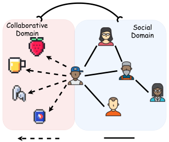
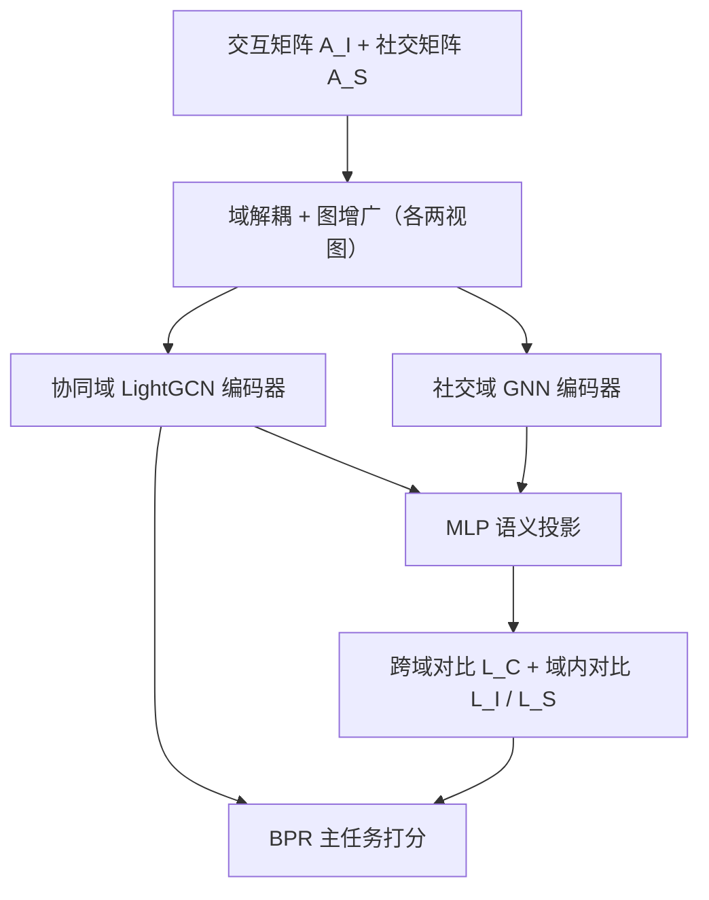
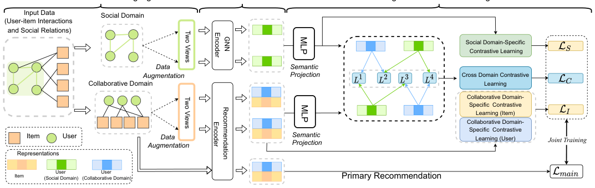

# Disentangled Contrastive Learning for Social Recommendation (面向社交推荐的解耦对比学习)

- **会议/期刊**: CIKM 2022 (31st ACM International Conference on Information & Knowledge Management)
- **作者与机构**: Jiahao Wu, Wenqi Fan, Jingfan Chen, Qing Li (香港理工大学), Shengcai Liu, Ke Tang (南方科技大学)
- **推荐链路定位**: 召回（用户/物品表征学习与 Top-N 排序打分）
- **研究方向**: 社交与群组推荐 / 自监督对比学习与去噪
- **论文原文**: [https://arxiv.org/abs/2208.08723v2](https://arxiv.org/abs/2208.08723v2)
- **开源代码**: 暂未开源

## TL;DR (1分钟核心速览)

社交推荐的主流做法把用户在社会网络与物品交互上的行为压缩进**一套统一表征**（如 DiffNet++、DSCF 的节点级注意力融合），这与"用户在两个域中行为模式语义异质"的事实相冲突，反而削弱表征表达力。本文提出 DcRec：用**两条独立邻接矩阵 + 独立编码器**分别学习协同域与社交域的用户表征，再用 MLP 做语义投影，最后以**四路组合的跨域对比损失 + 两个域内对比损失**把社交知识迁移进推荐任务。在 Dianping / Ciao 两数据集上，相对最强基线 SGL，NDCG 分别提升 5.31% / 6.46%，Recall 提升 6.63% / 8.39%。

## Background & Motivation (背景与核心矛盾)

- **主流范式**: 以 DiffNet++、DSCF、MHCN 为代表，将用户-物品交互图与用户-用户社交图视为同构图或做节点级注意力融合，为同一用户输出**单一统一向量** $\mathbf{u}_u$，再送入 BPR 排序。
- **前人局限 (矛盾一)**: 社交关系是"持续性、传递性"的（朋友的朋友也会被连上），物品购买却是"短时、功能导向"的（不会因朋友买同类物品就立刻购买），两类信号的时间尺度与语义粒度不同；统一表征被迫让一个向量同时拟合两种分布，导致欠拟合。
- **前人局限 (矛盾二)**: 文中直接证据是 `LightGCN+Social` 在 Dianping 上 NDCG 0.0392 **低于** 纯协同 `LightGCN` 的 0.0396——把社交边无差别拼进交互图不仅无益，甚至引入噪声。
- **核心洞察 (Key Insight)**: 既然两个域是**语义异质**的（图 1），就应该先"分"再"联"：分别建模保留各自特性，再通过对比学习最大化同一用户在两个域表征间的互信息，实现方向明确的"社交 $\to$ 协同"知识迁移。
- **本文切入点**: 域解耦（独立图 + 独立编码器）+ 语义投影（消除跨域语义鸿沟）+ 解耦对比学习（跨域迁移 + 域内自监督增强）。

<figure class="paper-figure" markdown="span">
  <figcaption>图 1：用户同时参与协同域与社会域。用户在两个域中的行为模式在语义上具有异质性，即同一用户可以在协同域中对物品具有个性化偏好，同时在社会域中与社交好友建立联系。</figcaption>
</figure>

## Method (核心方法设计)

### 1. 整体框架 (Overall Architecture)

输入为交互矩阵 $\mathbf{A}_I\in\mathbb{R}^{m\times n}$与社交矩阵$\mathbf{A}_S\in\mathbb{R}^{m\times m}$。第一步**域解耦**：两域互不共享边，各自做两次图增广（Edge Adding / Edge Dropout / Node Dropout）得到两个视图$\mathbf{A}_I^{(1)},\mathbf{A}_I^{(2)}$与$\mathbf{A}_S^{(1)},\mathbf{A}_S^{(2)}$。第二步**双编码器**：协同域用 LightGCN 式$\mathrm{Rec}(\cdot)$输出用户$\mathbf{U}_I$、物品$\mathbf{V}_I$；社交域用 GNN$\mathcal{F}(\cdot)$输出用户$\mathbf{U}_S$。第三步**语义投影**：用 MLP 把两域用户向量投影到同一语义空间得$\tilde{\mathbf{U}}_S,\tilde{\mathbf{U}}_I$，避免"异质空间里做余弦相似度"的对齐失效。最后联合优化 BPR 主任务与三个对比损失，推理时仅用协同域$\mathbf{u}_u^\top\mathbf{v}_i$ 打分。

<figure class="paper-figure" markdown="span">
  <figcaption>图 2：所提出的用于社交推荐的解耦对比学习（DcRec）的整体架构。</figcaption>
</figure>

### 2. 关键设计拆解 (Key Designs)

1. **域解耦 + 语义投影（Domain Disentangling & Semantic Projection）**：痛点是用一套 $\mathbf{P}$同时承载交互与社交语义。本文改为两套独立参数$\mathbf{P}_I,\mathbf{P}_S$（各自独立邻接矩阵传播），再用 MLP 投影$\tilde{\mathbf{U}}_S=\mathrm{MLP}(\mathbf{U}_S;\theta_S)$、$\tilde{\mathbf{U}}_I=\mathrm{MLP}(\mathbf{U}_I;\theta_I)$。直觉：解耦保住域内特性，MLP 提供可学习的"公共坐标系"，使后续跨域对齐不被原始语义偏移污染——消融显示去掉 MLP 后性能掉至 SGL 水平，证明投影是跨域对比生效的前提。

2. **跨域对比损失 $\mathcal{L}_C$（知识迁移算子）**：把社交域的两种视图分别与协同域的两种视图交叉配对，共 4 项，把"同一用户"拉近、其他用户推远：
$$\mathcal{L}_C=\sum_{a\in\{1,2\}}\sum_{b\in\{1,2\}} L\big(\tilde{\mathbf{U}}_S^{(a)},\tilde{\mathbf{U}}_I^{(b)}\big)$$
其中 $L(\cdot,\cdot)$为对称 InfoNCE：$\ell(\mathbf{z}_j^{(1)},\mathbf{z}_j^{(2)})=-\log\frac{e^{\Psi(\mathbf{z}_j^{(1)},\mathbf{z}_j^{(2)})}}{\sum_{v\in\{1,2\}}\sum_{k\neq j}e^{\Psi(\mathbf{z}_j^{(1)},\mathbf{z}_k^{(v)})}}$，$\Psi$为带温度$\tau$ 的余弦相似度。四路交叉而非一对一，是为了让"增广噪声"被多视图平均抵消，社交信号迁移更稳健。

3. **域内对比与损失、推理开销**：$\mathcal{L}_I=L(\mathbf{U}_I^{(1)},\mathbf{U}_I^{(2)})+L(\mathbf{V}_I^{(1)},\mathbf{V}_I^{(2)})$同时增强用户与物品，$\mathcal{L}_S=L(\tilde{\mathbf{U}}_S^{(1)},\tilde{\mathbf{U}}_S^{(2)})$。总目标：
$$\mathcal{L}=\mathcal{L}_{main}+\lambda_1(\mathcal{L}_I+\mathcal{L}_S)+\lambda_2\mathcal{L}_C+\lambda_3\|\zeta\|_2^2$$
负样本为**批内负采样 (In-batch Negatives)**，无额外采样器；BPR 主任务沿用均匀负采样。对比损失只在训练期存在，**推理阶段可完全剪除双编码器与 MLP**，仅保留协同域打分，线上开销与 LightGCN 等价。

## Experimental Setup & Evaluation Protocol (实验设置与评估协议)

- **数据集与预处理**: 原文正文将统计与预处理置于附录（未在正文列出具体数值），采用的为社交推荐标准基准 Dianping 与 Ciao：

| 数据集 | #Users | #Items | #Interactions | 稀疏度/密度 | 特征/场景说明 |
| :--- | :---: | :---: | :---: | :---: | :--- |
| Dianping | 见原文附录 | 见原文附录 | 见原文附录 | 极稀疏 | 本地生活点评，含显式社交关注 |
| Ciao | 见原文附录 | 见原文附录 | 见原文附录 | 极稀疏 | 商品评论 + 社交好友网络 |

- **数据划分与防穿越 (Splitting Strategy)**: 沿用 SGL / LightGCN 系列通行设置（细节见原文附录），即 `Leave-One-Out`（每用户留最后一条交互作测试，倒数第二条作验证）；社交边作为静态结构输入，不参与时间切分。
- **排名评测协议 (Ranking Protocol)**: 每测试正例配采样负例做 `Sampled Ranking`（典型 1:99），报告 `NDCG@20 / Recall@20 / Precision@20`；**未报告 Full-Ranking 全库排序结果**。
- **对比基线与超参设置**: 覆盖 MF 类（BPR、SBPR、SoRec、SocialMF）、GNN 类（DiffNet、NGCF、LightGCN、LightGCN+Social）、SSL/社交 SSL 类（SGL、SGL+Social、MHCN、SEPT）；嵌入维度 $d$与$\lambda_1,\lambda_2,\lambda_3$于验证集调优（Ciao 上$\lambda_1=\lambda_2=0.01$ 附近最优），未做显著性检验。

## Key Experimental Results (实验关键数据)

### 1. 主实验对比 (Main Results)

| 模型 | Dianping NDCG | Dianping Recall | Dianping Prec. | Ciao NDCG | Ciao Recall | Ciao Prec. |
| :--- | :---: | :---: | :---: | :---: | :---: | :---: |
| BPR | 0.0188 | 0.0189 | 0.0145 | 0.0226 | 0.0155 | 0.0177 |
| SocialMF | 0.0144 | 0.0148 | 0.0109 | 0.0218 | 0.0154 | 0.0166 |
| DiffNet | 0.0241 | 0.0242 | 0.0181 | 0.0280 | 0.0182 | 0.0213 |
| NGCF | 0.0287 | 0.0289 | 0.0221 | 0.0232 | 0.0157 | 0.0183 |
| LightGCN | 0.0396 | 0.0384 | 0.0292 | 0.0326 | 0.0224 | 0.0253 |
| LightGCN+Social | 0.0392 | 0.0381 | 0.0289 | 0.0326 | 0.0220 | 0.0254 |
| SGL | 0.0421 | 0.0414 | 0.0310 | 0.0340 | 0.0223 | 0.0266 |
| MHCN | 0.0398 | 0.0399 | 0.0296 | 0.0315 | 0.0218 | 0.0252 |
| SEPT | 0.0378 | 0.0371 | 0.0286 | 0.0313 | 0.0212 | 0.0250 |
| DcRec (w/o MLP) | 0.0417 | 0.0409 | 0.0307 | 0.0338 | 0.0217 | 0.0263 |
| **DcRec** | **0.0443** | **0.0441** | **0.0327** | **0.0366** | **0.0243** | **0.0280** |
| **Improv.%** | **+5.31%** | **+6.63%** | **+5.29%** | **+6.46%** | **+8.39%** | **+5.32%** |

### 2. 消融实验 (Ablation Study)

| 配置 | Dianping NDCG | Dianping Recall | Ciao NDCG | Ciao Recall | 说明 |
| :--- | :---: | :---: | :---: | :---: | :--- |
| Full DcRec | **0.0443** | **0.0441** | **0.0366** | **0.0243** | 完整模型 |
| w/o MLP 投影 | 0.0417 | 0.0409 | 0.0338 | 0.0217 | 跨域对齐退化为异质空间余弦 |
| $\lambda_1=0,\lambda_2=0.01$ (去域内对比) | — | — | 0.03488 | 0.02436 | 仅剩跨域 + BPR |
| $\lambda_1=0.01,\lambda_2=0$ (去跨域对比) | — | — | 0.03617 | 0.02394 | 社交知识几乎不注入 |
| $\lambda_1=0.1,\lambda_2=0.01$ | — | — | 0.02735 | 0.01760 | 对比目标压过推荐目标 |
| $\lambda_1=1,\lambda_2=0.01$ | — | — | 0.00814 | 0.00513 | 表征坍缩为实例判别 |

### 3. 关键实验发现 (Key Findings)

- **"分"比"合"更有效**：`LightGCN+Social`（0.0392）低于纯 `LightGCN`（0.0396），说明朴素拼接社交边确属噪声注入；同一协同骨干上换成解耦 + 跨域对比后 NDCG 升至 0.0443（相对 LightGCN +11.9%），直接印证域解耦假设。
- **语义投影是硬前提而非可选模块**：去掉 MLP 后 Ciao NDCG 从 0.0366 掉到 0.0338（-7.7%），几乎回到 SGL 的 0.0340，说明增益主要来自"投影后的可比空间"，而非对比损失本身。
- **权重极端敏感且不对称**：$\lambda_1$从 0.01 增至 0.1 时 Ciao NDCG 由 0.0363 崩到 0.0274（-25%），增至 1 时仅剩 0.0081；而$\lambda_2$在 0.001–0.1 区间几乎平坦（0.0362–0.0366），$\lambda_2=0$ 时为 0.03617——即跨域迁移本身贡献约 +1.1%，上限有限但注入过多亦有害。

## Highlights & Limitations (亮点、对比与审稿批判)

- **与代表作对比 (vs. Prior Work)**: 相较 DiffNet++/DSCF 的"统一表征 + 注意力融合"，本文是**结构性解耦**（独立邻接矩阵、独立编码器、独立参数）；相较 SGL 在**拼接/扰动后的单图**上做增广对比，本文在**两个语义域**上做增广并显式定义迁移方向；相较 DGCL 的**隐式**解耦（潜空间多头），本文是**数据层面显式**解耦，可解释性更强。
- **可迁移亮点**: (1) "先解耦、再 MLP 投影、最后交叉四路 InfoNCE"这一模板可直接搬到多行为（点击/收藏/购买）或多场景推荐中；(2) 对比分支训练期专用、推理期剪除，是社交信号"零线上成本"落地的实用写法。
- **审稿级局限批判**: (1) **评估协议偏弱**——仅采样排序、无 Full-Ranking、无显著性检验，且未做冷启动/长尾或活跃度分桶分析，而社交信号恰恰在冷启动用户上最有价值，缺失该实验削弱了核心论点的说服力；(2) **增益来源集中且幅度有限**——跨域对比单独贡献仅约 +1%，性能提升更像来自 LightGCN 双视图自监督 + MLP 容量，同时四路对比 + 双编码器训练开销翻倍，且完全未处理社交图的假边/噪声好友问题（而这正是社交推荐另一核心痛点）。

## Rating (四维评分)

- **方法创新性 (Novelty)**: ⭐⭐⭐⭐ （显式域解耦 + 交叉四路跨域对比的组合清晰且动机可验证，但每个组件均为已有算子拼接，理论分析止步于直觉层面）
- **评估协议与实验扎实度 (Protocol & Experiments)**: ⭐⭐⭐ （基线覆盖较全、含 MLP 与超参消融，但仅 2 个数据集、采样排序、无显著性检验与冷启动/长尾分桶）
- **写作与数学规范度 (Clarity & Rigor)**: ⭐⭐⭐⭐ （框架图与损失定义完整、符号统一，但实验设置大量外置附录，主文缺少数据集统计与训练细节）
- **工业落地与复现价值 (Industrial & Practical Value)**: ⭐⭐⭐⭐ （推理期可剪除全部对比分支，线上成本与 LightGCN 持平；但未开源、社交图噪声未处理限制直接上线）

