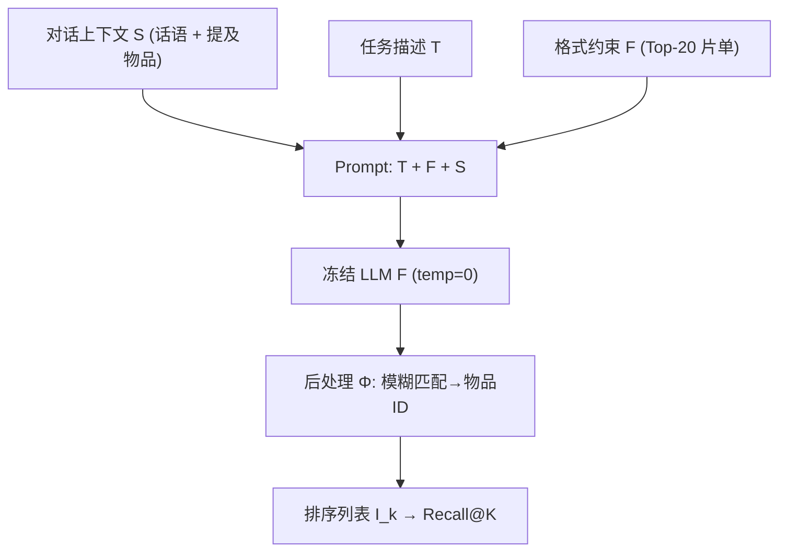
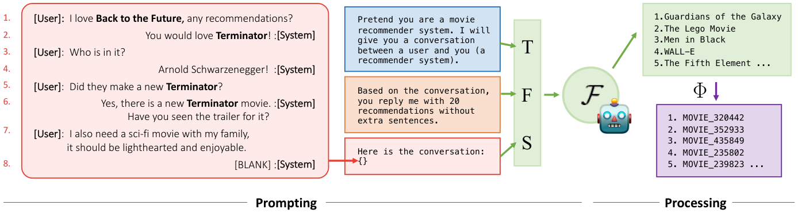

# Large Language Models as Zero-Shot Conversational Recommenders (大语言模型即零样本对话推荐器)

- **会议/期刊**: CIKM 2023 (Long Paper)
- **作者与机构**: Zhankui He, Zhouhang Xie, Julian McAuley 等 (UCSD) 与 Rahul Jha, Harald Steck, Dawen Liang, Nathan Kallus 等 (Netflix)
- **推荐链路定位**: 端到端生成式（生成式检索 / 对话推荐召回）
- **研究方向**: 对话推荐与智能体仿真 / 大语言模型推荐
- **论文原文**: [https://arxiv.org/abs/2308.10053v1](https://arxiv.org/abs/2308.10053v1)
- **开源代码**: [https://github.com/AaronHeee/LLMs-as-Zero-Shot-Conversational-RecSys](https://github.com/AaronHeee/LLMs-as-Zero-Shot-Conversational-RecSys)

## TL;DR (1分钟核心速览)

本文针对"对话推荐是否需要领域微调"这一核心疑问，提出**纯零样本提示框架**：把任务描述、格式要求与对话上下文拼成 prompt 直接喂给 LLM，再用模糊匹配后处理器把自然语言片单转成排序 ID 列表。作者同时揭穿了现有 CRS 评测的**重复物品捷径**（一个"复制历史提及物品"的平凡基线竟优于多数微调模型），剔除重复项重测后，GPT-3.5-t/GPT-4 在 ReDIAL 上 Recall@1 达 0.032（较 UniCRS 的 0.015 提升 113%），并给出 63 万级 Reddit-Movie 真实数据集与系统化探针分析。

## Background & Motivation (背景与核心矛盾)

- **主流范式**: 以 ReDIAL/KBRD/KGSF/UniCRS 为代表的"深"CRS，用知识图谱增强 + DialoGPT prompt-tuning，在众包角色扮演语料上端到端微调"生成器 + 推荐器"两件套。
- **前人局限①（评测虚高）**: 现有协议把第 $k$ 轮提及的所有物品都当作 ground-truth，却未区分"讨论过的物品"与"新推荐物品"——于是"照抄历史物品"即可刷分，掩盖了模型真实推荐能力。
- **前人局限②（数据失真）**: 众包对话中用户常无真实偏好（如"Whatever, I'm open to any suggestion"），偏好表达远弱于真实社区讨论。
- **核心洞察 (Key Insight)**: 对话推荐本质是**强文本依赖、弱交互依赖**的任务；LLM 预训练语料中的内容/上下文知识（类型、导演、氛围）可能比数据集内的协同信号更关键。
- **本文切入点**: 不做任何微调，直接用 prompt 让 LLM 生成物品标题（generative retrieval），并设计 $S_0/S_1/S_2/S_3$ 上下文扰动探针把"内容知识"与"协同知识"分离量化。

## Method (核心方法设计)

### 1. 整体框架 (Overall Architecture)

输入是第 $k$轮之前的完整对话上下文$S$（用户/系统话语 + 物品提及），与手工任务模板$T$（"假装你是电影推荐系统…"）和格式约束$F$（"只回 20 条推荐，不加额外句子"）拼接为 prompt，交给冻结的 LLM$\mathcal{F}$生成自然语言片单；后处理器$\Phi$（模糊字符串匹配 + 可选数据集内过滤）将其对齐为排序列表$\hat{\mathcal{I}}_k$。全程无梯度更新，解码温度固定为 0 以保证可复现。评估侧则引入"新物品/重复物品"划分，在同一生成列表上计算 Recall@K。

<figure class="paper-figure" markdown="span">
  <figcaption>图1：将大语言模型（LLMs）作为零样本对话推荐系统（CRS）。我们引入一种简单的提示策略，为 LLM 定义任务描述 𝑇、格式要求 𝐹 和对话上下文 𝑆，记为 F，随后用处理器 Φ 将生成结果后处理为排序物品列表。</figcaption>
</figure>

### 2. 关键设计拆解 (Key Designs)

1. **零样本生成式对话检索（$\hat{\mathcal{I}}_k=\Phi(\mathcal{F}(T,F,S))$）**：痛点是用 ID 分类头无法冷启动物品、也难利用语义；本文改为让 LLM 直接**生成物品标题**，再由$\Phi$映射回 ID，天然支持数据集外物品与语义泛化。作者进一步区分$\Phi_0$（保留全部生成标题）与$\Phi_1$（仅保留数据集内标题），发现剔除域外标题反而普遍**提升**指标（GPT-4 在 INSPIRED 上 R@1 由 0.062 升至 0.066），说明生成式检索的瓶颈主要是"越界生成"而非语义理解。
2. **重复物品捷径的诊断与封堵**：把第 $k$轮真值拆为重复项$\{i\mid \exists t\in[1,k), i\in\mathcal{I}_t\}$与新物品$\mathcal{I}_k\setminus\bigcup_{t<k}\mathcal{I}_t$，并构造"按时间倒序复制历史物品"的平凡基线。INSPIRED 中超过 15% 的真值物品属于重复项，剔除后所有模型 #HIT@1 平均掉 60% 以上——这解释了以往 CRS 论文"刷点"的来源。
3. **知识来源探针与训练/推理开销**：设计四组上下文扰动——$S_0$原始、$S_1$仅保留物品（ItemOnly，考协同知识）、$S_2$删除物品仅留描述（ItemRemoved，考内容知识）、$S_3$物品随机替换（消除语法扰动偏差），并配套$\Phi_2$（额外剔除上下文中已出现物品）以防低估。此框架无训练损失（$\mathcal{L}\equiv$ prompt 推理），代价是每条样本需一次 LLM 调用，20 条候选生成带来显著在线延迟。

## Experimental Setup & Evaluation Protocol (实验设置与评估协议)

- **数据集与预处理**: 自建 Reddit-Movie（抓取 2012-01~2022-12 五个电影 subreddit，经对话识别→电影提及识别→实体链接流水线）：

| 数据集 | #Conv. | #Turns | #Users | #Items | 特征/场景说明 |
| :--- | :---: | :---: | :---: | :---: | :--- |
| INSPIRED | 999 | 35,686 | 999 | 1,967 | 众包角色扮演，社交式推荐 |
| ReDIAL | 11,348 | 139,557 | 764 | 6,281 | 众包 + 知识图谱实体链接 |
| Reddit-Movie$_{base}$ | 85,052 | 133,005 | 10,946 | 24,326 | 2022 年真实讨论子集 |
| Reddit-Movie$_{large}$ | 634,392 | 1,669,720 | 36,247 | 51,203 | 十年全量，比 ReDIAL 大 50 倍 |

- **数据划分与防穿越 (Splitting Strategy)**: 时间戳切分——Reddit 取 2022 年 12 月（晚于 GPT-3.5 发布、GPT-4 预训练截止 2021-09）的**最近 9k 段对话为测试集**，其余 76k 作训练/验证；INSPIRED/ReDIAL 沿用原划分并重训全部基线。
- **排名评测协议 (Ranking Protocol)**: 生成式评测——每次生成 Top-20 标题列表后取 $K\in\{1,5\}$计算 Recall@K（即 HIT@K），报告均值 ± 标准误；非采样负例排序，也无显式全库打分（域外生成项由$\Phi_0/\Phi_1$ 控制）。
- **对比基线与超参设置**: 微调基线 ReDIAL、KBRD、KGSF、UniCRS（DialoGPT + prompt tuning，SOTA）与平凡复制基线；LLM 基线 BAIZE-V2-13B、Vicuna-13B（LLaMA 蒸馏）及闭源 GPT-3.5-turbo、GPT-4，温度 0，统一 20 条推荐格式。显著性以标准误条呈现（$p<0.05$ 量级）。

## Key Experimental Results (实验关键数据)

### 1. 主实验对比 (Main Results)

新物品（ItemRemoved, $S_2$）设定下的 Recall@1 / Recall@5（GPT-4 行加粗为最优，Improv. 相对 UniCRS）：

| Model | INSPIRED R@1 | INSPIRED R@5 | ReDIAL R@1 | ReDIAL R@5 | Reddit R@1 | Reddit R@5 |
| :--- | :---: | :---: | :---: | :---: | :---: | :---: |
| CRS* (UniCRS) | 0.039 | 0.087 | 0.015 | 0.058 | 0.001 | 0.008 |
| TextEnc* (BERT-small) | 0.038 | 0.090 | 0.013 | 0.053 | 0.002 | 0.009 |
| BAIZE-13B (zero-shot) | — | — | — | — | — | — |
| Vicuna-13B (zero-shot) | 0.024 | 0.062 | 0.014 | 0.053 | 0.008 | 0.025 |
| GPT-3.5-turbo (zero-shot) | 0.057 | 0.123 | 0.030 | 0.105 | 0.018 | 0.068 |
| **GPT-4 (zero-shot)** | **0.062** | **0.128** | **0.032** | **0.102** | **0.019** | **0.075** |
| Improv.% (vs. CRS*) | +59.0% | +47.1% | +113.3% | +75.9% | +1800% | +837.5% |

微调的 ReDIAL/KBRD/KGSF 在原文图 4 中整体低于 UniCRS，且均被 GPT-3.5-t/4 反超；BAIZE 在本文协议下数值极低（R@1≈0.019/0.021/0.012 量级），故正文表格略去。

### 2. 消融实验 (Ablation Study)

以 $S$上下文扰动 + 后处理器$\Phi$作为"知识来源消融"（Recall@1，括号为相对$S_0$ 变化）：

| 设定 | INSPIRED | ReDIAL | Reddit | 含义 |
| :--- | :---: | :---: | :---: | :--- |
| GPT-4, $S_0$+$\Phi_1$ | **0.066** | **0.046** | **0.023** | 原始上下文 |
| GPT-4, $S_2$ (ItemRemoved) | 0.062 (−6%) | 0.032 (−30%) | 0.019 (−17%) | 仅内容/上下文知识 |
| GPT-4, $S_1$(ItemOnly) +$\Phi_2$ | 0.014 (−79%) | 0.025 (−46%) | 0.007 (−70%) | 仅协同知识 |
| ItemCF* (FISM), $S_1$ | 0.042 | 0.029 | 0.004 | 纯协同上限（重训） |
| CRS* (UniCRS), $S_1$ | 0.038 | 0.025 | 0.003 | 纯协同上限（重训） |
| 平凡复制基线（全量协议） | 优于多数微调模型 | — | — | 重复物品捷径 |

### 3. 关键实验发现 (Key Findings)

1. **零样本即可超越微调，但靠的是内容知识而非协同知识**：GPT-4 在 ReDIAL 上 R@1 较 UniCRS 提升 113%，而删掉物品提及（$S_2$）仅掉 6%~30%，只留物品（$S_1$）却掉 79%，说明性能主要由描述性上下文（类型、氛围、导演）驱动。
2. **协同知识是 LLM 的真实短板且具平台依赖性**：仅给物品时 GPT-4 在 INSPIRED 上 R@1 为 0.014，落后 FISM 的 0.042 达 66%；但在长尾严重的 Reddit（12,982 个物品被提及 ≤3 次）反超（0.007 vs 0.004）；在 ML-25M 上预训练（PT）迁移到 Reddit 也不及直接微调（FT），佐证协同信号强依赖数据集/平台。
3. **重复物品捷径与两类偏差**：剔除重复项后所有模型 #HIT@1 平均降幅超 60%，此前的 CRS 结论需重估；同时 GPT-4 推荐高度集中于头部（The Shawshank Redemption 占其推荐约 5%，而 ReDIAL 真值头部仅约 2%、Reddit 仅 0.3%），且英语区影片召回显著高于其他地区，存在流行度与地域偏差；可信度方面 GPT 系生成标题约 95% 可在 IMDB 中匹配（BAIZE 81%、Vicuna 87%），幻觉率尚可。

## Highlights & Limitations (亮点、对比与审稿批判)

- **与代表作对比 (vs. Prior Work)**: 相较 UniCRS（DialoGPT + 知识图谱 prompt tuning）与 KBRD/KGSF（外部 KG 增强），本文完全不训练、不引入 KG，仅靠预训练语义；相较同期 LLM4Rec 工作（如 GPT4Rec、ChatGPT 评分预测研究），本文首次系统量化 CRS 场景并指出**评测协议本身有病**，这是比模型更强的贡献。
- **可迁移亮点**: ①"重复项 / 新物品"切分与平凡复制基线可无缝迁移到序列推荐、下一篮推荐等任何"历史提及计入真值"的任务；②$S_1/S_2/S_3$ 上下文扰动探针是一套通用的"模型知识来源归因"评测范式。
- **审稿级局限批判**: ①仅比较 Recall@1/5，未做全库 Full-Ranking 与 NDCG/MRR，且未报告显著性检验统计量；②生成式评测受字符串匹配质量与"风格化片单"影响，$\Phi$ 的匹配阈值未做敏感性分析；③闭源模型存在训练数据穿越风险（作者虽用时间切分缓解，但 GPT-4 截断时间仅为官方声明），且单次推理成本高，缺乏与传统模型在延迟/成本维度上的对比。

## Rating (四维评分)

- **方法创新性 (Novelty)**: ⭐⭐⭐⭐ （提示框架本身极简，但"重复物品捷径 + 知识来源扰动探针"两个诊断性构造具有方法论新意）
- **评估协议与实验扎实度 (Protocol & Experiments)**: ⭐⭐⭐⭐ （三数据集、重训全部基线、时间切分防穿越到位；扣分在仅 Recall@K 与匹配后处理敏感性缺失）
- **写作与数学规范度 (Clarity & Rigor)**: ⭐⭐⭐⭐ （任务形式化与 11 条 finding 组织清晰；公式偏少，扰动实验的统计说明略显松散）
- **工业落地与复现价值 (Industrial & Practical Value)**: ⭐⭐⭐⭐ （代码与数据集开源，探针与捷径检验可直接用于线上评测；但 LLM 单次 20 条生成的延迟与成本限制实时部署）

