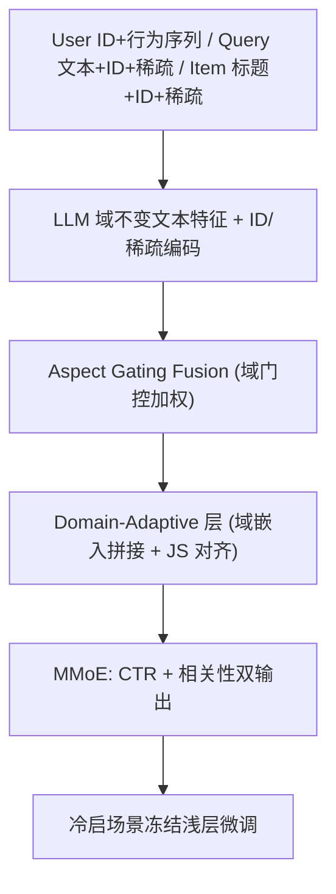
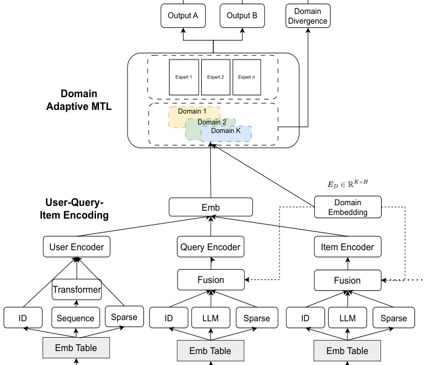

# An Unified Search and Recommendation Foundation Model for Cold-Start Scenario (面向冷启动场景的统一搜索推荐基础模型)

- **会议/期刊**: CIKM 2023（6 页工业应用短文）
- **作者与机构**: Yuqi Gong, Xichen Ding, Yehui Su, Kaiming Shen, Zhongyi Liu, Guannan Zhang（蚂蚁集团 Ant Group）
- **推荐链路定位**: 精排（CTR / Query-Item 相关性打分），并服务于新场景冷启的预训练-微调迁移
- **研究方向**: 冷启动与长尾推荐 / 跨域与多场景推荐
- **论文原文**: [论文原文链接](https://arxiv.org/abs/2309.08939v1)
- **开源代码**: 暂未开源

## TL;DR (1分钟核心速览)

面向"同一 App 内多搜索/推荐场景数据割裂、新场景冷启样本极少、物品异构导致负迁移"的痛点，本文把 LLM 抽取的 **域不变文本特征** 与 ID/稀疏特征经 **Aspect Gating Fusion** 加权融合，再以 **域自适应层 + JS 散度正则 + MMoE** 联合训练 7 个支付宝搜索/推荐任务构成基础模型，最后以冻结浅层的方式微调冷启场景。在逐样本 AUC 协议下，冷启 Task 6/Task 4 分别比单域模型提升 +0.0216/+0.0279 AUC，线上 7 天 AB 的 PVCTR 相对提升 +17.54%。

## Background & Motivation (背景与核心矛盾)

- **主流范式**: 多域建模普遍采用 Shared-Bottom / MMoE / PLE / STAR 等多任务多域结构，共享参数学共性、任务私有参数学差异，S&R 联合建模则多依赖共享物品集与联合损失。
- **前人局限**: ① 新场景（服务卡片、内容 Query 推荐）只有短周期小样本，ID 嵌入几乎训不动；② 搜索 Query 与推荐物品跨域异构、样本分布差异大，硬共享参数会出现负迁移与域偏移。
- **核心洞察 (Key Insight)**: LLM 的文本表征天然跨域可比，可充当不随域变化的"低层语义锚点"，用它对 ID 稀缺的新物品/新 Query 做兜底，同时约束各域表征漂移。
- **本文切入点**: 用域不变文本特征 + 域门控融合 + 域自适应分布对齐，把"多域共性"与"域特异差异"显式解耦后再做冷启微调。

## Method (核心方法设计)

### 1. 整体框架 (Overall Architecture)

模型由三部分组成：**User-Query-Item 编码**、**Aspect Gating Fusion**、**Domain-Adaptive 多任务**。User 塔用 ID 嵌入加搜索/推荐点击混合行为序列（行为类型 S/R 作为稀疏特征区分）；Query 与 Item 塔各自产出三组表征——ID 嵌入、LLM 池化后的域不变文本嵌入、稀疏特征 MLP 嵌入；三组表征经域门控加权求和得 $E(Q),E(I)$，与$E(U)$ 拼接后送域自适应层（拼接域嵌入 + 域特异线性映射 + JS 对齐），最后接 MMoE 同时预测 CTR 与 Query-Item 相关性。冷启阶段冻结浅层 embedding/编码器、随机初始化新域嵌入并微调其余层。

<figure class="paper-figure" markdown="span">
  <figcaption>图1：SR 多领域基础模型架构</figcaption>
</figure>

### 2. 关键设计拆解 (Key Designs)

1. **LLM 域不变文本特征（缓解冷启 ID 失效与物品异构）**：新物品/新 Query 训练样本极少，ID 嵌入欠拟合。做法是对 Q 与 I 的 token 序列过同一 LLM 与 **共享**投影 $W_{lm}$：$E_{lm}(I)=W_{lm}\cdot \text{MEAN}(\phi_{lm}(e^{Token}_{I}))\in\mathbb{R}^{H}$。共享$W_{lm}$ 把 Query 与 Item 拉到同一语义子空间，使文本通道成为跨域"公共基准"，在 ID 缺训时仍可打分。实验显示 BERT-base 特征、冻结编码器最优（AUC 0.7580）。
2. **Aspect Gating Fusion（动态平衡 ID / 文本 / 稀疏三aspect）**：均值融合会让冷启时噪声大的 ID 与信息量高的文本等权。为此以域嵌入 $E_{D_k}$与各 aspect 表征做注意力式门控：$w_a=\frac{\exp(E_{D_k}^{\top}E_a)}{\sum_{a\in|\mathcal{A}|}\exp(E_{D_k}^{\top}E_a)}$，$E(Q)=\sum_a w_a(Q)E_a(Q)$，$|\mathcal{A}|=3$。物理直觉：不同域对"ID 还是文本更可信"的偏好不同，门控让域自适应地调权，冷启域自动偏向文本。
3. **域自适应正则、训练目标与推理开销**：域偏移体现在边缘分布 $p(x_k)$差异。对域$k$样本拼接域嵌入再做域特异映射$\hat{x}_i=W_i(x_i\oplus E_{D_i})$，并以 JS 散度对齐同 batch 内不同域分布：$\mathcal{L}_{reg}=\sum_{i,j}JS(p(\hat{x}_i)\|p(\hat{x}_j))$，优于 MMD 变体。总损失$\mathcal{L}=\mathcal{L}_{ctr}+\mathcal{L}_{sim}+\mathcal{L}_{reg}$，两项均为交叉熵。论文未披露负采样策略与候选集规模；线上仅需一次前向，LLM 文本向量离线预计算缓存，故在线开销与常规 DNN 精排相当。

## Experimental Setup & Evaluation Protocol (实验设置与评估协议)

- **数据集与预处理**: 支付宝搜索排序与 Query 推荐共 7 个工业任务（S=有显式 Query，R=无 Query，S/R=Query 建议类）：

| 任务 | 类型 | #Train | #Eval/#Test | #Query | #Item |
| :--- | :---: | :---: | :---: | :---: | :---: |
| T1 Query-Item 相关性 | S | 76.2M | 12.7M / 12.7M | 40K | 40K |
| T2 Query 建议 CTR | S/R | 145.4M | 23.5M / 23.5M | 0.84M | 0.16M |
| T3 背景词 Query 推荐 | R | 146.2M | 24.3M / 24.3M | — | 65K |
| T4 内容 Query 推荐（冷启） | R | 0.76M | 0.09M / 0.09M | — | 4.6K |
| T6 服务卡片推荐（冷启） | S/R | 1.01M | 0.17M / 0.17M | 1.3K | 1.6K |
| T7 内容搜索排序 | S | 6.13M | 1.03M / 1.03M | 0.27M | 0.14M |

- **数据划分与防穿越 (Splitting Strategy)**: 常规任务按比例划分 Train/Eval/Test；冷启任务 T4、T6 采用**时间切分**——留出最后一天数据作测试，其余用于微调，符合新场景小样本的真实形态。
- **排名评测协议 (Ranking Protocol)**: 采用 **point-wise AUC**（二分类 CTR / 相关性），并非 Full-Ranking 的 NDCG/HR；负样本采样比、曝光去偏处理未说明，属评测披露短板。
- **对比基线与超参设置**: 多任务基线 Shared-Bottom、MMoE、PLE；本文变体含 MLP 头、MMoE-DA-MMD、MMoE-DA-JS；文本侧对比随机初始化 token、随机 Transformer(L=1/6)、BERT-base(L=12)、ChatGLM-6B/ChatGLM2-6B（4096 维 → 2 层 MLP → 32 维）。未报告显著性检验。

## Key Experimental Results (实验关键数据)

### 1. 主实验对比 (Main Results)

| Method (AUC) | T1 | T2 | T3 | T4 | T5 | T6 | T7 |
| :--- | :---: | :---: | :---: | :---: | :---: | :---: | :---: |
| Shared Bottom | 0.6483 | 0.8993 | 0.7829 | 0.6575 | 0.8511 | 0.8015 | 0.8561 |
| MMoE | 0.6482 | **0.9003** | 0.7812 | 0.6650 | 0.8463 | 0.7942 | 0.8599 |
| PLE | **0.7006** | 0.8981 | 0.7815 | 0.6682 | 0.8487 | 0.7978 | 0.8620 |
| Foundation (MLP) | 0.6827 | 0.8974 | 0.7784 | 0.6683 | 0.8462 | 0.7926 | 0.8629 |
| Foundation-MMoE-DA-MMD | 0.6874 | 0.8942 | 0.7971 | 0.6793 | 0.8564 | 0.8203 | 0.8569 |
| **Foundation-MMoE-DA-JS** | 0.6942 | 0.8973 | **0.7912** | **0.6979** | **0.8703** | **0.8312** | **0.8692** |
| Improv.(绝对/相对) | +0.0459 / 7.08% | −0.0020 / −0.22% | +0.0083 / 1.06% | +0.0404 / 6.14% | +0.0192 / 2.26% | +0.0297 / 3.70% | +0.0131 / 1.53% |

冷启微调对比（表 5）：T6 服务卡片 单域 0.8229 → 基础模型微调 **0.8446**（+0.0216）；T4 内容 Query 0.7295 → **0.7574**（+0.0279）。线上 7 天 AB（图 3）PVCTR 相对 +17.54%。

### 2. 消融实验 (Ablation Study)

| 组件 / 配置 | 评测任务 | AUC | 变化 |
| :--- | :---: | :---: | :---: |
| w/o Token 文本特征（仅 ID+稀疏） | T4 | 0.7524 | — |
| 随机初始化 token + Mean Pooling | T4 | 0.7551 | +0.0027 |
| 随机初始化 Transformer(L=6, 微调) | T4 | 0.7559 | +0.0035 |
| **基础模型 + BERT-base，冻结编码器** | T4 | **0.7580** | **+0.0056** |
| 基础模型 + ChatGLM-6B（+prompt） | T4 | 0.7518 / 0.7503 | −0.0006 / −0.0021 |
| Mean-Pooling 融合 | T4 | 0.7385 | — |
| [CLS]-Gating 融合 | T4 | 0.7515 | +0.0130 |
| **Domain-Gating 融合** | T4 | **0.7524** | **+0.0139** |
| w/o 域自适应层（Foundation-MLP） | T4 | 0.6683 | −0.0296 vs JS |
| DA-MMD（替代 JS 正则） | T4 | 0.6793 | −0.0186 vs JS |

### 3. 关键实验发现 (Key Findings)

1. **收益集中在冷启/小样本场景，而非大盘任务**：DA-JS 在样本量最小的 T4（0.76M）与 T6（1.01M）上取得 +0.0404/+0.0297 绝对 AUC，而在数据最充裕的 T2 上反降 0.0020、相关性任务 T1 仍输给 PLE 0.0064，说明"文本兜底 + 域对齐"主要补偿 ID 欠训而非通用增益。
2. **域自适应层是最大单点贡献**：去掉后 T4 掉 0.0296 AUC，且 JS 优于 MMD 0.0186，t-SNE 也显示 MLP 版的域表征散乱、DA-JS 版聚拢对齐——分布对齐比单纯堆参数更关键。
3. **大模型 ≠ 更好，冻结策略更重要**：6B 级 ChatGLM 反而低于 BERT-base（0.7518 vs 0.7580），加 prompt 后进一步下降；冻结 L0+L1（0.7574）优于全微调（0.7562）与只冻 L0（0.7531），印证浅层语义特征"保留通用性、只调任务头"的迁移直觉。

## Highlights & Limitations (亮点、对比与审稿批判)

- **与代表作对比 (vs. Prior Work)**: 相比 JSR 式共享物品集联合损失、双层 Transformer 会话建模、GNN 边属性建模等 S&R 统一方案，本文不依赖 S/R 物品强重叠，而是用共享 LLM 投影构造跨域语义空间；相比 MMoE/PLE/STAR 等纯 ID 多域结构，新增了"文本 aspect + 域门控 + 域分布正则"三重解耦。
- **可迁移亮点**: ① 域嵌入同时驱动门控权重与自适应层输入，一份参数两用，成本极低；② 冷启标准动作"冻结 LLM 编码器 + 冻结浅层 ID 表 + 只调上层"可直接复制到新业务冷启流水线。
- **审稿级局限批判**: ① 评测仅有 point-wise AUC，未做 Full-Ranking、未披露负采样与曝光去偏，多域 AUC 跨任务不可比，且无显著性检验、无重复实验；② 同为 T4，表 2（0.6979）与表 3/4（0.7524–0.7580）数值口径不一致（特征/配置不同），削弱可复现性；③ $\mathcal{L}_{reg}$需同 batch 内两两域计算 JS，$O(K^2)$ 复杂度随域数增长，论文未给 7 域以上的扩展性分析。

## Rating (四维评分)

- **方法创新性 (Novelty)**: ⭐⭐⭐ （LLM 文本作为域不变锚点 + 域嵌入双用门控思路实用，但组件均为已有模块的组合，缺理论分析）
- **评估协议与实验扎实度 (Protocol & Experiments)**: ⭐⭐⭐ （7 个真实工业数据集与线上 AB 亮眼，但仅 AUC、无显著性检验、部分表格数值口径不一致）
- **写作与数学规范度 (Clarity & Rigor)**: ⭐⭐⭐ （公式简洁、门控与域自适应定义清楚，但符号偶有排版错位、负采样与推理开销描述缺失）
- **工业落地与复现价值 (Industrial & Practical Value)**: ⭐⭐⭐⭐ （已在支付宝多场景全量上线，+17.54% PVCTR，方案轻量可复用；可惜未开源代码与特征处理细节）

