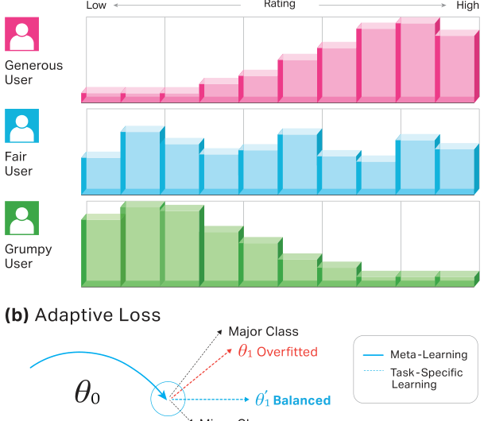
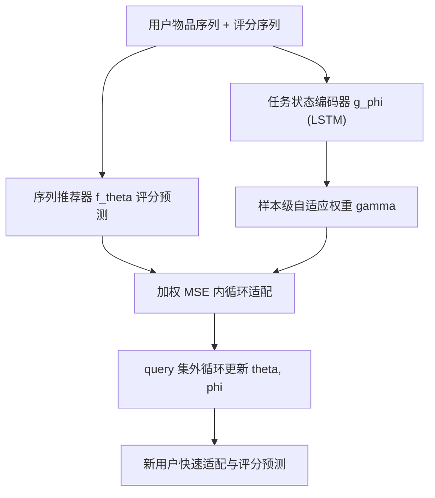
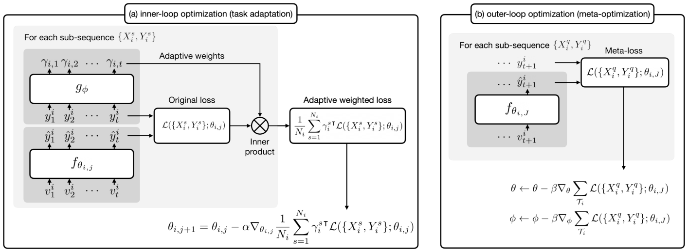

# Meta-Learning with Adaptive Weighted Loss for Imbalanced Cold-Start Recommendation（面向不平衡冷启动推荐的元学习自适应加权损失）

- **会议/期刊**: CIKM 2023
- **作者与机构**: Minchang Kim, Yongjin Yang, Jung Hyun Ryu, Taesup Kim；Seoul National University
- **推荐链路定位**: 精排 / 评分预测（用户冷启动个性化）
- **研究方向**: 冷启动与长尾推荐 / 序列推荐
- **论文原文**: [论文原文链接](https://arxiv.org/abs/2302.14640v2)
- **开源代码**: [开源代码仓库链接](https://github.com/YangYongJin/MELO)

## TL;DR

针对冷启动用户评分分布极度偏斜、MAML 的“任务内样本均衡”假设失效问题，MELO 用评分序列上的循环编码器为每个子序列损失生成自适应权重，修正 MAML 内循环适配路径；在 4 个真实评分数据集、用户级 cold-start episode 协议下，相对 Basic 平均降低 RMSE \(2.33\%\sim8.63\%\)，相对 MAML 降低 \(0.78\%\sim4.67\%\)。

## Background & Motivation

- **主流范式**: 以 MAML 为代表的梯度元学习把每个用户视为一个任务，学习可快速适配新用户的初始化参数；MeLU、MAMO、MetaCSR 分别引入边信息、记忆网络与图表示。
- **前人局限**: MAML 默认 \(N\)-way \(k\)-shot 的任务内类别/数值分布均衡，但真实用户评分高度偏斜（如 Grocery 中 5 分占 \(72.8\%\)），多数类会在内循环中主导梯度；同时，序列推荐长期偏重隐式反馈，显式评分不平衡对冷启动适配的负面影响被低估。
- **核心洞察 (Key Insight)**: 不同用户的评分均值、方差、偏度差异显著，固定或规则化重加权无法刻画任务级状态；应在内循环中按“当前评分序列状态”动态调节每个样本的梯度贡献。
- **本文切入点**: 将用户评分序列输入任务状态循环编码器，输出非负自适应权重，并与 MAML 的快速适配框架端到端结合。

<figure class="paper-figure" markdown="span">
  <figcaption>图1：我们方法的概念。(a) 个体用户具有不同的评分分布，每种情况下的均值、方差和偏度均不同。(b) 自适应加权损失为每个用户校正内循环适应路径。我们期望在任务特定学习中更多考虑少数类，以防止过拟合。</figcaption>
</figure>

## Method (核心方法设计)

### 1. 整体框架 (Overall Architecture)

输入用户按时间排序的物品序列与对应评分；基础序列推荐器 \(f_\theta\) 预测下一物品评分，任务状态编码器 \(g_\phi\)（LSTM）读取评分子序列并输出样本级权重；内循环用加权 MSE 将共享初始化 \(\theta\) 适配到具体用户，外循环在 query 集上联合更新 \(\theta\) 与 \(\phi\)。推理时新用户仅需少量交互，经 1 次左右内循环更新即可个性化预测。框架与 GRU4Rec/NARM/SASRec/BERT4Rec 等模型解耦。

<figure class="paper-figure" markdown="span">
  <figcaption>图2：MELO 框架概览。(a) 序列推荐器 𝑓𝜃𝑖,𝑗 接收物品序列并预测评分。任务状态循环编码器 𝑔𝜙𝑖 接收评分序列并输出自适应权重。将每个原始损失乘以对应权重以计算自适应加权损失。然后，它对 𝜃𝑖,𝑗 进行 𝐽 次局部更新。(b) 𝜃 和 𝜙 均由查询集评估，并在外循环中进行全局更新。</figcaption>
</figure>

### 2. 关键设计拆解 (Key Designs)

1. **自适应加权内循环（Adaptive Weighted Loss）**：MAML 内循环默认对所有样本等权，偏斜评分下多数类会淹没少数类。MELO 为子序列 \(Y_i^s\) 生成权重向量 \(\gamma_i^s\)，内循环改为
\(\theta_{i,j+1}=\theta_{i,j}-\alpha\nabla_{\theta_{i,j}}\frac{1}{N_i}\sum_{s=1}^{N_i}\gamma_i^{s\top}\mathcal{L}(\{X_i^s,Y_i^s\};\theta_{i,j})\)。
直觉上，\(\gamma_i^s\) 是样本级梯度步长，用来抑制主导类、放大稀有但信息量高的评分。

2. **任务状态循环编码器（Task State Recurrent Encoder）**：直接用均值/方差等统计量需要手工预处理且依赖批次。MELO 用 LSTM 顺序读取评分：
\(\gamma_{i,t}=\tilde{g}_\phi^{out}(h_i^t)\in\mathbb{R}_{\ge0},\quad h_i^t=\hat{g}_\phi^{cell}(y_i^t;h_i^{t-1})\)。
权重由当前评分状态逐项生成，既捕捉时间动态，也避免 MeTAL/TAML 式复杂损失网络；编码器仅在外循环更新，作为跨任务共享元知识。

3. **训练目标、负采样与推理效率**：基础损失为逐样本 MSE，总目标为外循环 query 损失
\(\sum_{T_i}\mathcal{L}(D_i^Q;\theta_{i,J})\)，并对 \(\theta,\phi\) 做元更新；无负采样（评分回归而非排序）。默认内循环 \(J=3\)，但实验发现 MELO 仅 1 步即达最优，显著降低 MAML 多步适配开销；外循环仍需二阶/一阶元梯度，训练成本高于普通序列模型。

## Experimental Setup & Evaluation Protocol

- **数据集与预处理**: 移除边信息，仅保留 user/item/rating/timestamp；删除评分少于 50 的物品以规避物品冷启动；序列最大长度 30。

| 数据集 | #Users | #Items | #Interactions | 平均长度 | Balance score |
| :--- | :---: | :---: | :---: | :---: | :---: |
| Grocery | 58,035 | 4,776 | 475,247 | 8.0 | 0.57 |
| Sports | 67,523 | 13,448 | 721,498 | 10.7 | 0.60 |
| Yelp | 41,365 | 1,221 | 445,070 | 10.8 | 0.85 |
| Movie | 6,040 | 2,514 | 977,839 | 29.2 | 0.90 |

- **数据划分与防穿越**: 用户级非重叠 train/val/test；每个用户任务再切 support/query：support 约 25 个前缀样本，query 3 个样本且包含 \(t+1\) 留出交互；不是全局时间戳切分，也非标准 Leave-One-Out。
- **排名评测协议**: 本文是**评分预测回归**，使用 RMSE/MAE，不做 Full-Ranking 或 Sampled Ranking，也无负采样；测试用 1,000 个 episode，5 次独立实验均值，\(p<0.05\) 的 t-test。
- **对比基线与超参**: GRU4Rec、NARM、SASRec、BERT4Rec 各配 Basic/MAML/MELO；LSTM 评分嵌入 16、隐藏 32；默认 \(J=3\)，Adam + cosine annealing；Movie 训练 32k episodes，其余 48k。

## Key Experimental Results (实验关键数据)

### 1. 主实验对比 (Main Results)

下表为 RMSE，粗体为各骨干下最优。

| Dataset | Model | Basic | +MAML | +MELO |
| :--- | :--- | ---: | ---: | ---: |
| Grocery | GRU4Rec | 1.0794 | 1.0293 | **0.9859** |
| Grocery | NARM | 1.0804 | 1.0176 | **0.9935** |
| Grocery | SASRec | 1.0911 | 1.0651 | **0.9949** |
| Grocery | BERT4Rec | 1.0907 | 1.0501 | **0.9925** |
| Sports | GRU4Rec | 1.0364 | 1.0147 | **0.9710** |
| Sports | NARM | 1.0373 | 1.0007 | **0.9667** |
| Sports | SASRec | 1.0360 | 1.0134 | **0.9690** |
| Sports | BERT4Rec | 1.0332 | 1.0041 | **0.9565** |
| Yelp | GRU4Rec | 1.2084 | 1.2396 | **1.2005** |
| Yelp | NARM | 1.2156 | 1.2154 | **1.2049** |
| Yelp | SASRec | 1.2374 | 1.2540 | **1.1931** |
| Yelp | BERT4Rec | 1.2422 | 1.2610 | **1.1777** |
| Movie | GRU4Rec | 0.9937 | 0.9856 | **0.9725** |
| Movie | NARM | 0.9939 | 0.9818 | **0.9733** |
| Movie | SASRec | 0.9944 | 0.9761 | **0.9675** |
| Movie | BERT4Rec | 0.9990 | 0.9755 | **0.9750** |

原文跨四个骨干平均：Grocery 相对 Basic/MAML 提升 \(8.63\%/4.67\%\)，Sports \(6.75\%/4.21\%\)，Yelp \(2.58\%/3.87\%\)，Movie \(2.33\%/0.78\%\)。

### 2. 消融实验 (Ablation Study)

Grocery + BERT4Rec：

| 变体 | RMSE | MAE | ΔRMSE | ΔMAE |
| :--- | ---: | ---: | ---: | ---: |
| ML + AL，去序列推荐器 | 1.0583 | 0.7235 | -6.21% | -8.67% |
| SR + AL，去元学习 | 1.0814 | 0.7967 | -8.22% | -17.06% |
| SR + ML（仅 MAML） | 1.0501 | 0.6803 | -5.49% | -2.87% |
| SR + ML + AL（MELO） | **0.9925** | **0.6608** | - | - |

### 3. 关键实验发现 (Key Findings)

1. **不平衡越强、序列越短，MELO 收益越大**：Grocery（balance 0.57、均长 8.0）上 BERT4Rec+MELO 的 RMSE 为 0.9925，较 MAML 的 1.0501 与 Basic 的 1.0907 分别降 \(4.67\%\)、\(8.63\%\)；Movie（0.90、均长 29.2）相对 MAML 仅 \(0.78\%\)，说明方法主要修复短序列 + 偏斜评分的适配失效。
2. **自适应权重缩短内循环且提升稳定性**：MELO 在 1 次内循环更新即达最优，MAML 需更多步；Yelp 上 MAML 甚至弱于 Basic，而 MELO 仍优于两者，表明任务状态权重能抑制偏斜梯度并增强元学习鲁棒性。
3. **去自适应损失与去序列/元学习均显著退化**：Grocery 上去 AL 使 RMSE/MAE 退化 \(5.49\%/2.87\%\)，去序列推荐器退化 \(8.22\%\)；严重冷启动 \(T=10\) 时 MELO 相对 MAML 提升 \(2.53\%\)，而 \(T=30\) 仅 \(0.44\%\)。

## Highlights & Limitations (亮点、对比与审稿批判)

- **与代表作对比**: MeLU/MAMO/MetaCSR 分别依赖边信息、记忆与图表示，但内循环仍按均衡任务处理；MeTAL/TAML 用复杂损失网络或统计量做重加权，MELO 则以轻量循环编码器直接生成样本级权重，二者在冷启动场景的归因不同。
- **可迁移亮点**: 损失重加权模块与基础序列推荐器解耦，可迁移到其他 few-shot 用户适配任务；用评分序列状态替代手工统计量，适合在线逐条更新。
- **审稿级局限批判**: ① 仅评评分回归，缺少 top-N 全库排序与负采样协议，难以直接对比现代序列推荐；② 仅覆盖用户冷启动，物品少于 50 条被删除且物品跨用户共享，不能声称解决物品冷启动；③ 最大长度 30、无侧信息，LSTM 权重重依赖短评分序列，长序列和高噪声场景仍需验证。

## Rating (四维评分)

- **方法创新性 (Novelty)**: ⭐⭐⭐⭐ （首次将显式评分不平衡引入元学习冷启动，MAML + 序列自适应权重的组合清晰有效，但机制仍属重加权范式）
- **评估协议与实验扎实度 (Protocol & Experiments)**: ⭐⭐⭐ （四个真实数据集、5 次实验与消融/严重冷启动分析较完整，但仅评分回归，缺排序协议与线上验证）
- **写作与数学规范度 (Clarity & Rigor)**: ⭐⭐⭐⭐ （算法、公式与内/外循环定义清楚，复杂度与超参交代充分；部分基础模型嵌入维度未在正文统一给出）
- **工业落地与复现价值 (Industrial & Practical Value)**: ⭐⭐⭐⭐ （代码开源、模型无关、1 步内循环适配有工程吸引力，但 MAML 双循环训练与 LSTM 编码仍带来额外开销）

