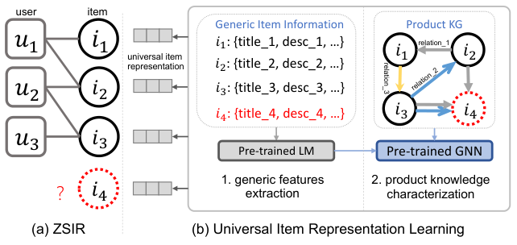
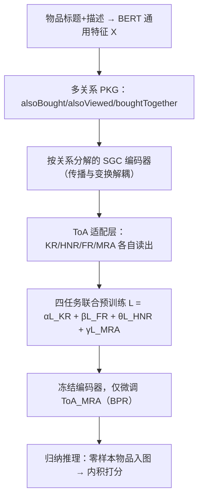
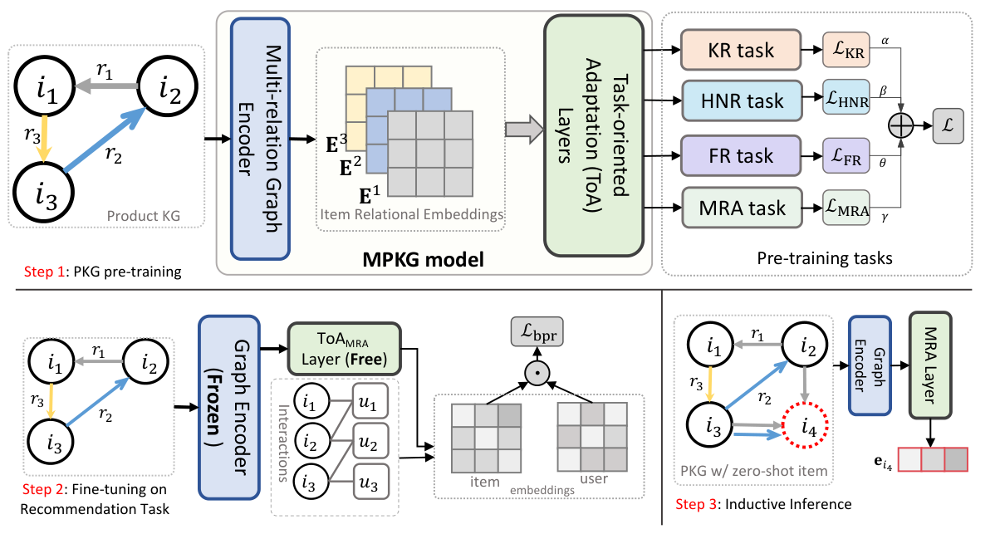

# Zero-shot Item-based Recommendation via Multi-task Product Knowledge Graph Pre-Training (基于多任务商品知识图谱预训练的零样本物品推荐)

- **会议/期刊**: CIKM 2023（11 pages）
- **作者与机构**: Ziwei Fan, Philip S. Yu (University of Illinois Chicago)；Zhiwei Liu, Shelby Heinecke, Jianguo Zhang, Huan Wang, Caiming Xiong (Salesforce AI Research)
- **推荐链路定位**: 召回（item-based 召回 / 物品侧通用表征预训练）
- **研究方向**: 冷启动与长尾推荐 / 图神经网络与知识图谱推荐
- **论文原文**: [论文原文链接](https://arxiv.org/abs/2305.07633v1)
- **开源代码**: 暂未开源

## TL;DR (1分钟核心速览)

针对零样本物品（训练期零交互，无法被 CF 优化表征）的 item-based 推荐，本文指出仅用 PLM 抽取标题/描述文本特征忽略了物品间推荐导向的关系语义，提出 MPKG：在商品知识图谱（alsoBought / alsoViewed / boughtTogether 多关系）上以 KR、HNR、FR、MRA 四任务预训练 SGC 编码器，并为每个任务配一个 ToA 适配层；下游只冻结图编码器、微调 ToA_MRA 层做 BPR。在 Xmarket 18 国市场、`Full-Ranking` + 时间切分协议下，全物品排序 NDCG@20 相对提升 18%–83%，零样本子集排序提升 4.7%–56%。

## Background & Motivation (背景与核心矛盾)

- **主流范式**: 物品冷启动要么用 PLM（BERT）把标题+描述编码成通用物品向量，要么用 CF/GNN 在交互图上学习物品节点表征。
- **前人局限 ①**: PLM 特征纯粹反映文本语义，与"用户会不会买"的推荐语义不齐；共现/替代关系（如"买了 A 也买 B"）完全被丢弃，零样本物品只能靠字面相似度被召回。
- **前人局限 ②**: 传统 GNN/CF 表征是 transductive 的，零样本物品在训练期不在图里，测试时无法生成 embedding；知识图谱类方法（TransE 系列）只建模直接三元组，无法利用多关系与高阶邻居。
- **核心洞察 (Key Insight)**: 物品间关系是从交互日志中抽取的，本质上已浓缩了协同信号；若把 PKG 当作"预训练语料"，PLM 文本特征作为节点初始特征，就能让零样本物品通过关系边"接入"图而获得推荐导向表征。
- **本文切入点**: 把 ZSIR 重新定义为"PKG 预训练 + 任务适配微调 + 归纳推理"三阶段范式，用传播与变换解耦的 SGC 保证新物品可增量入图。

<figure class="paper-figure" markdown="span">
  <figcaption>图 1：(a) 零样本基于物品的推荐（ZSIR）的玩具示例，其中零样本物品 𝑖4 与用户没有任何交互。(b) 通用物品表示学习的通用框架，包含通用特征提取与商品知识表征。</figcaption>
</figure>

## Method (核心方法设计)

### 1. 整体框架 (Overall Architecture)

三阶段闭环：**Step 1** 用 BERT 对物品 title+description 编码得通用特征 $\mathbf{X}$，并以三类关系边构建 PKG；对每种关系$r$抽出单关系子图$\mathcal{G}_r$，用 SGC 得到关系专属表征$\mathbf{E}_r$，再经各任务专属 ToA 层读出并由四个预训练任务联合优化。**Step 2** 在用户-物品交互上微调：图编码器与其余参数全部冻结，**仅训练 ToA_MRA 的自激发权重**$w_r$，用 BPR 拉近用户与其交互物品。**Step 3** 测试时把零样本物品及其边直接加入 PKG 做归纳推理，重新执行解耦的消息传播即得$\mathbf{e}_{i^*}$，与用户向量内积打分。

<figure class="paper-figure" markdown="span">
  <figcaption>图 2：我们提出方法的框架。步骤 1，利用 PKG 上的多个预训练任务预训练 MPKG 模型；每个任务与一种 ToA 层相关联。步骤 2，在带用户-物品交互的推荐任务上微调模型，其中图编码器冻结，ToAMRA 层参数可训练。步骤 3，对零样本物品 𝑖4 进行归纳推理。建议彩色查看。</figcaption>
</figure>

### 2. 关键设计拆解 (Key Designs)

1. **关系分解的 SGC 编码器（保证归纳性）**: 若用带激活的多层 GCN，零样本物品入图需重跑全部前向；本文沿用 SGC 的线性传播 $\mathbf{E}_r = (\mathbf{D}^{-\frac{1}{2}}\tilde{\mathbf{A}}\mathbf{D}^{-\frac{1}{2}})^M \mathbf{X}\mathbf{W}_r$，把高阶连通矩阵$(\cdot)^M$与特征变换$\mathbf{X}\mathbf{W}_r$解耦——新物品只需重算传播项、复用已学$\mathbf{W}_r$，实现真正的 inductive inference，参数量也远小于 GCN/GAT。

2. **四任务 + ToA 适配层（应对多关系与语义分裂）**: ① **KR**：对每个关系做链路预测 $s^r_{ij}=\sigma(\mathbf{E}^r_i\cdot\mathbf{E}^r_j)$，ToA 为恒等读出，锁住各关系自身语义；② **HNR**：因 PKG 稀疏，直接邻居不足以约束，改为重建$K$阶邻居（不分关系），ToA 取所有关系 embedding 的 **concat**，从而把多关系语义揉进同一空间，缓解"文本相似但无互补关系"的语义分裂；③ **FR**：用一个线性 decoder 从$\mathbf{E}_{FR}$重建 PLM 特征$\tilde{\mathbf{X}}=\mathrm{Dec}(\mathbf{E}_{FR})$，以$\ell_2$对齐，防止图传播把文本语义漂移掉；④ **MRA**：把"用其余关系预测关系$r$的边"当作一个模拟的新任务，ToA 为自激发加权$\mathbf{E}_{r\text{-MRA}}=\sum_{r'\in\mathcal{R}\setminus r} w_{r'}\mathbf{E}_{r'}$，本质是**在预训练阶段就演练"关系权重重分配"**，为下游域偏移做准备。

3. **训练目标、负采样与推理开销**: 总损失 $\mathcal{L}=\alpha\mathcal{L}_{KR}+\beta\mathcal{L}_{FR}+\theta\mathcal{L}_{HNR}+\gamma\mathcal{L}_{MRA}$，前三项为 BCE（每正边配 1 个随机负样本），FR 为$\ell_2$；微调阶段用 BPR$\mathcal{L}_{bpr}=-\log\sigma(p_{ui}-p_{ui^-})$，用户向量取交互物品 MRA 表征的均值$\mathbf{e}_u=\frac{1}{|\mathcal{D}_u|}\sum_{i\in\mathcal{D}_u}\mathbf{E}_{MRA}(i)$，负样本均匀采样。推理零新增参数，仅需一次稀疏矩阵乘 + 自激发 MLP。

## Experimental Setup & Evaluation Protocol (实验设置与评估协议)

- **数据集与预处理**: Xmarket（XmRec）Home\&Kitchen 大类，18 个国别市场，过滤用户数 < 1,000 的市场；PKG 汇聚全部市场的关系边。

| 数据集(市场) | #Users | #Items | #Interactions | 稀疏度/密度 | 特征/场景说明 |
| :--- | :---: | :---: | :---: | :---: | :--- |
| br | 1.7K | 60K | 10.5K | 极稀疏（物品远多于交互） | 小市场，零样本占比极高 |
| mx | 3.5K | 7K | 16K | ~6.5e-4 | 小市场 |
| es | 5.9K | 10K | 29K | ~4.9e-4 | 中等市场 |
| uk | 251K | 66K | 1.8M | ~1.1e-4 | 最大市场 |
| PKG(全局) | — | 97,626 | 3,208,583 边 | alsoBought 2.04M / alsoViewed 1.05M / boughtTogether 0.12M | 三类关系边 |

- **数据划分与防穿越**: 按用户交互**全局时间戳切分** 80%/10%/10%（训练/验证/测试）；训练期出现过的物品为 warm，仅测试期出现的为 zero-shot；**训练阶段把所有冷物品从 PKG 中删除**，杜绝关系边泄漏。
- **排名评测协议**: 无偏 `Full-Ranking`——分别对"全部物品候选"与"仅测试期零样本物品候选"生成 top-N 列表；指标 Recall@N、MRR、NDCG@20，取验证集网格搜索最优后的测试值。
- **对比基线与超参**: 三元组类 TransE / TransD / TransH / DistMult，异构图表征类 GPT-GNN / HeCo；隐藏维 $\{64,128\}$、$L_2$权重$\{10^{-3}{\sim}5{\times}10^{-1}\}$、学习率$\{10^{-4},10^{-3},5{\times}10^{-3}\}$、batch 256、SGC 层数默认 3、$K$ 默认 2。

## Key Experimental Results (实验关键数据)

### 1. 主实验对比 (Main Results)

NDCG@20（左：全物品排序；右：仅零样本物品排序），选取 4 个代表性市场：

| Model | br(All) | mx(All) | es(All) | us(All) | br(ZS) | mx(ZS) | es(ZS) | us(ZS) |
| :--- | :---: | :---: | :---: | :---: | :---: | :---: | :---: | :---: |
| TransE | 0.0357 | 0.0250 | 0.0196 | 0.0166 | 0.0467 | 0.0365 | 0.0312 | 0.0215 |
| TransD | 0.0345 | 0.0251 | 0.0189 | 0.0159 | 0.0454 | 0.0332 | 0.0304 | 0.0205 |
| TransH | 0.0393 | 0.0289 | 0.0208 | 0.0197 | 0.0501 | 0.0404 | 0.0312 | 0.0252 |
| DistMult | 0.0344 | 0.0233 | 0.0202 | 0.0155 | 0.0452 | 0.0332 | 0.0309 | 0.0198 |
| GPT-GNN | 0.0397 | 0.0304 | 0.0222 | 0.0210 | 0.0528 | 0.0426 | 0.0319 | 0.0342 |
| HeCo | 0.0384 | 0.0285 | 0.0222 | 0.0217 | 0.0508 | 0.0403 | 0.0326 | 0.0324 |
| **MPKG** | **0.0542** | **0.0433** | **0.0407** | **0.0257** | **0.0601** | **0.0481** | **0.0452** | **0.0358** |
| Improv. | +36.52% | +42.43% | +83.33% | +18.43% | +13.83% | +12.91% | +41.69% | +4.68% |

（MRR 趋势一致：全物品如 br 0.0413 vs. GPT-GNN 0.0329；零样本如 es 0.0358 vs. 0.0229，+56.33%。）

### 2. 消融实验 (Ablation Study)

| 变体 | 知识预测 MRR | 知识预测 Recall@20 | ZSIR MRR | ZSIR NDCG@20 |
| :--- | :---: | :---: | :---: | :---: |
| **MPKG 完整** | **0.0142** | **0.0255** | **0.0253** | **0.0310** |
| w/o KR | 0.0041 | 0.0097 | 0.0124 | 0.0152 |
| w/o FR | 0.0122 | 0.0224 | 0.0216 | 0.0242 |
| w/o HNR | 0.0135 | 0.0238 | 0.0234 | 0.0269 |
| w/o MRA | 0.0120 | 0.0217 | 0.0200 | 0.0245 |

其他：$K{=}1/2/3$时$K{=}2$最优（$K{=}3$明显掉点）；编码器 SGC > GAT > GCN（ZSIR NDCG@20 0.0295 / 0.0286 / 0.0257）；PLM 端 Sentence-BERT 略优于 BERT（0.0304 vs. 0.0310 基本持平）、Distill-BERT 掉点（0.0298）；损失权重$\theta$(HNR) 最敏感，偏离最优即掉点。

### 3. 关键实验发现 (Key Findings)

1. **KR 是绝对主心骨**：移除 KR 后 ZSIR NDCG@20 从 0.0310 跌至 0.0152（−51%），远大于移除 FR（−22%）、MRA（−21%）、HNR（−13%），说明"关系边本身就是最强监督信号"，其余三任务更多起正则/适配作用。
2. **小市场获益远大于大市场**：全物品排序中低资源市场相对提升 ≥36.5%（es 高达 83%），而 uk/us 等富市场 ≤33.5%；零样本子集上 uk 仅 +4.68% 但 es +41.69%，印证 PKG 预训练的优势主要在交互稀缺、零样本占比高的长尾场景兑现。
3. **多关系建模不可被三元组替代**：GPT-GNN/HeCo 在 warm 知识预测 Recall@20 为 0.014/0.012，MPKG 0.018；零样本知识预测更拉开到 0.018/0.016 vs. **0.037**（+88.9%～105.6%），说明线性解耦编码器的归纳能力与多任务约束共同支撑了未见物品的关系外推。

## Highlights & Limitations (亮点、对比与审稿批判)

- **与代表作对比 (vs. Prior Work)**: 相比纯 PLM 表征路线（如 LMRec 类），本文把"关系语义"从交互日志中蒸馏进物品向量；相比 TransE 家族，只用直接三元组，本文用多关系 + 高阶邻居 + 特征重建；相比 GPT-GNN/HeCo 这类通用图预训练，本文额外引入 ToA 适配层与 MRA 任务，显式处理"预训练域 ≠ 下游推荐域"的偏移。
- **可迁移亮点**: ① "仅微调轻量适配层、冻结图编码器"的范式可直接搬到多场景/多任务推荐的场景适配；② SGC 传播项与变换项解耦以获得 inductive 能力，是任何需要新节点实时入图的召回系统的低成本技巧。
- **审稿级局限批判**: ① 只验证了 Xmarket 单一品类（Home\&Kitchen）的数据，且 PKG 关系边本身由同一平台交互抽取，存在"关系边≈交互信息"的信息泄漏风险（虽已删除冷物品节点，但边仍来自全量日志）；② 未报告显著性检验，零样本 us 市场仅 +4.68%，提升幅度在多个市场上波动大；③ 推理需对整个 PKG 重算稀疏传播，物品规模到千万级时的在线时延与图更新成本未讨论；④ 全文仅对比 nDCG/Recall，缺少与"零样本物品冷启动"专用方法（如 meta-learning、内容侧对比学习）的对照。

## Rating (四维评分)

- **方法创新性 (Novelty)**: ⭐⭐⭐⭐ （把 PKG 预训练+ToA 适配层+MRA 元关系适配组合成 ZSIR 新范式，MRA"用其余关系预测目标关系"的自监督设计尤具巧思）
- **评估协议与实验扎实度 (Protocol & Experiments)**: ⭐⭐⭐ （18 个市场 + 全库排序 + 全/零样本双视角较全面，但仅单一数据集、无显著性检验、缺少冷启动专用基线）
- **写作与数学规范度 (Clarity & Rigor)**: ⭐⭐⭐⭐ （四任务与 ToA 层一一对应、公式简洁可复现；但式 (13) 写作 MSE 实为 BCE，符号小瑕疵；缺复杂度分析）
- **工业落地与复现价值 (Industrial & Practical Value)**: ⭐⭐⭐ （SGC 线性编码器与"只微调适配层"极省算力，落地友好；但代码未开源、全图重传播的在线开销与超参 $\theta$ 敏感性增加调优成本）

