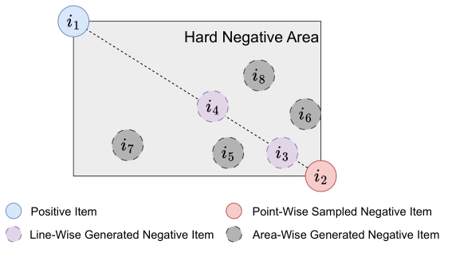
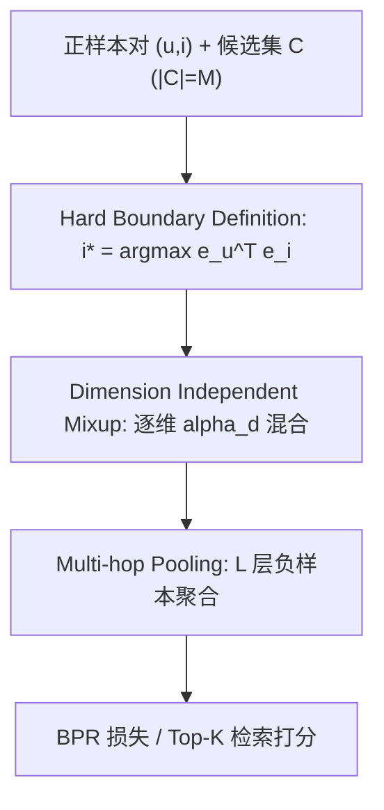
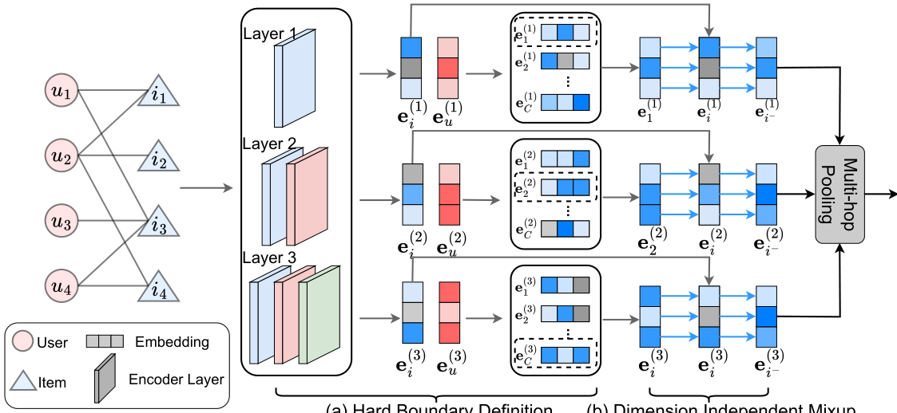

# Dimension Independent Mixup for Hard Negative Sample in Collaborative Filtering (面向协同过滤难负样本的维度独立 Mixup)

- **会议/期刊**: CIKM 2023（32nd ACM International Conference on Information and Knowledge Management）
- **作者与机构**: Xi Wu、Jibing Gong†、Chao Zhou、Tianyu Lin（燕山大学）；Liangwei Yang、Xiaolong Liu、Philip S. Yu（University of Illinois Chicago）
- **推荐链路定位**: 召回（训练期负采样模块，推理零额外开销）
- **研究方向**: 协同过滤与双塔召回 / 自监督对比学习与交互去噪
- **论文原文**: [https://arxiv.org/abs/2306.15905v2](https://arxiv.org/abs/2306.15905v2)
- **开源代码**: [https://github.com/Wu-Xi/DINS](https://github.com/Wu-Xi/DINS)

## TL;DR (1分钟核心速览)

隐式反馈 CF 训练的负采样长期只有两种几何形态：点采样（uniform/popularity/DNS/IRGAN）与线采样（MixGCF 在正负样本连线上做 Mixup），后者把难负样本限制在一条对角线上，硬负区域中大片非对角连续空间未被探索。本文提出 **DINS**，用"最大点积边界 + 逐维独立插值权重 + 多层邻域池化"把采样空间从一条线扩展成一整块体积。在 Alibaba/Yelp2018/Amazon 三个数据集、LightGCN/NGCF/MF 三个 backbone 上，采用 **Full-Ranking 全库排序**协议，Recall@20 相对次优基线最高提升 **36.1%**（MF-Alibaba），NDCG@20 最高提升 **33.3%**。

## Background & Motivation (背景与核心矛盾)

- **主流范式**: 隐式反馈只有正样本，Pair-wise BPR 损失依赖负采样提供判别信号；工业与学术主流做法分四类：静态分布采样（Uniform/Popularity）、难负采样（DNS、IRGAN）、Mixup 生成式采样（MixGCF）、辅助信息采样（KGPolicy）。
- **前人局限**: ① 点采样只能在离散候选集里挑点，采样分布与当前嵌入几何脱节，难度不可控；② MixGCF 虽把采样搬到连续空间，但全维共享同一插值系数 $\alpha$，生成样本必然落在正样本与边界样本的**连线**上，无法调节"某些维度更像负样本、某些维度更像正样本"的混合难度。
- **核心洞察 (Key Insight)**: 作者以"采样区域"为统一视角重新分类负采样（图 1）：点采样是一个点、线采样是一条线段，而由正样本 $i$与最难候选$i^*$ 所张成的**硬负区域是一块连续体积**；区域过小会退化为近似假阴性，过大则丢失正样本可迁移的特征。
- **本文切入点**: 若把 Mixup 的单一 $\alpha$拆成逐维$\alpha_d$，即可在体积内做各向异性的受控插值，从而把"线"撑成"面"。

<figure class="paper-figure" markdown="span">
  <figcaption>图 1：逐点/逐线/逐区域采样方法所采样物品的示意图。</figcaption>
</figure>

## Method (核心方法设计)

### 1. 整体框架 (Overall Architecture)

对每个正样本对 $(u,i)$：先均匀抽$M$个候选负样本，取与$u$点积最大的作为边界$i^*$，从而圈定硬负区域；再按用户-物品逐维相似度的 softmax 分配各维插值权重$\alpha_d$，把$i^*$与正样本$i$ 逐维混合成合成负样本；若 backbone 为 GNN，则对每一层邻域嵌入分别重复上述采样，最后池化（mean/concat）成唯一负样本，代入 BPR 损失反传。整个模块只在训练期生效，推理仍是一次内积检索。

<figure class="paper-figure" markdown="span">
  <figcaption>图 2：DINS 的主框架。对于每个观测交互 (𝑢,𝑖)，DINS 首先利用不同数量的 GNN 层在图内编码 𝑢 和 𝑖 的信息。对于每层输出，(a) DINS 通过 Hard Boundary Definition 模块定义采样区域，然后 (b) 通过提出的 Dimension Independent Mixup 模块将采样物品与对应正物品混合。最后，(c) DINS 通过 Multi-hop Pooling 模块整合来自不同邻域跳的负信号，生成合成负物品。</figcaption>
</figure>

### 2. 关键设计拆解 (Key Designs)

1. **硬边界定义（Hard Boundary Definition）**：解决"采样区域大小无人定义"的问题。在候选集 $\mathcal{C}$中取$i^*=\arg\max_{i\in\mathcal{C}}\boldsymbol{e}_u^{\top}\boldsymbol{e}_i$，以$(i,i^*)$张成的区域作为采样体积。直觉是：$i^*$ 是当前模型最容易被骗的负样本，把区域紧贴正样本又不过界，既保证难度又抑制假阴性；表 3 验证该选法显著优于随机、最小体积与最大体积三种边界。
2. **逐维独立 Mixup（Dimension Independent Mixup）**：解决"线上采样空间受限"的问题。对第 $d$维，$e^d_{i^-}=\alpha_d e^d_{i^*}+(1-\alpha_d)e^d_{i}$，其中权重由该维上的双路相似度竞争决定：

$$\alpha_d=\frac{\exp(e^d_u e^d_{i^*})}{\exp(e^d_u e^d_{i^*})+\beta\,\exp(e^d_u e^d_i)}$$

$\beta>0$作为整体倾向系数：$\beta$越大$\alpha_d$ 越小、合成样本整体越靠近正样本。因为每一维独立决策，合成点可以离开连线、落在整个硬负体积内任意位置，为模型提供多维度、多硬度层次的判别训练信号。
3. **训练目标、负采样与推理效率**：损失仍为原 BPR，$\mathcal{L}=\frac{1}{|\mathcal{E}|}\sum_{(u,i)\in\mathcal{E}}-\log\sigma\big(s(u,i)-s(u,i^-)\big)$，负样本完全由 DINS 合成（无需额外 in-batch 或 hard negative 池）。单次采样复杂度$O(LMD)$（$L$ 为 GNN 层数），与 MixGCF 同阶但探索空间从线扩到体；推理阶段不产生任何额外计算。

## Experimental Setup & Evaluation Protocol (实验设置与评估协议)

- **数据集与预处理**:

| 数据集 | #Users | #Items | #Interactions | 密度 | 特征/场景说明 |
| :--- | :---: | :---: | :---: | :---: | :--- |
| Alibaba | 106,042 | 53,591 | 907,407 | 0.016% | 电商点击，高度稀疏 |
| Yelp2018 | 31,668 | 38,048 | 1,561,406 | 0.13% | 本地商户点评，三者中最稠密 |
| Amazon | 192,403 | 63,001 | 1,689,188 | 0.014% | 电商评论，最稀疏 |

- **数据划分与防穿越**: 沿用 MixGCF/DNS 的固定 train/valid/test 划分（沿用前作设定，非重新随机划分；未采用全局时间戳切分）。
- **排名评测协议**: **Full-Ranking（对全库未交互物品排序）**，指标 Recall@20 与 NDCG@20，对测试集全体用户取平均，未使用采样排序。
- **对比基线与超参设置**: 6 个负采样基线（Popularity、RNS、DNS、IRGAN、DENS、MixGCF×），3 个 backbone（LightGCN、NGCF、MF）；嵌入维度 $d=64$，GNN 层数$L=3$，Xavier 初始化，Adam 优化，batch 2048（LightGCN/MF）与 1024（NGCF）；学习率$\{1e^{-4},1e^{-3},1e^{-2}\}$、权重衰减$\{1e^{-4},1e^{-5},1e^{-6}\}$网格搜索，候选集$M\in\{8,16,32,64\}$，$\beta\in[0,10]$。（原文未报告显著性检验。）

## Key Experimental Results (实验关键数据)

### 1. 主实验对比 (Main Results)

| Backbone | 采样方法 | Amazon R@20 | Amazon N@20 | Alibaba R@20 | Alibaba N@20 | Yelp2018 R@20 | Yelp2018 N@20 |
| :--- | :--- | :---: | :---: | :---: | :---: | :---: | :---: |
| LightGCN | Popularity | 0.0323 | 0.0153 | 0.0481 | 0.0231 | 0.0469 | 0.0369 |
| LightGCN | RNS | 0.0399 | 0.0178 | 0.0550 | 0.0251 | 0.0605 | 0.0493 |
| LightGCN | DNS | 0.0453 | 0.0211 | 0.0576 | 0.0258 | **0.0706** | **0.0581** |
| LightGCN | IRGAN | 0.0338 | 0.0150 | 0.0551 | 0.0255 | 0.0535 | 0.0251 |
| LightGCN | DENS | 0.0429 | 0.0195 | 0.0637 | 0.0294 | 0.0560 | 0.0457 |
| LightGCN | MixGCF | 0.0456 | 0.0214 | 0.0689 | 0.0332 | 0.0691 | 0.0565 |
| LightGCN | **DINS** | **0.0500** | **0.0236** | **0.0764** | **0.0358** | **0.0738** | **0.0604** |
| LightGCN | Improv. | +9.6% | +10.3% | +10.9% | +7.9% | +4.5% | +4.0% |
| MF | DNS | 0.0320 | 0.0154 | 0.0487 | 0.0240 | 0.0663 | 0.0547 |
| MF | MixGCF* | 0.0342 | 0.0156 | 0.0480 | 0.0232 | 0.0642 | 0.0525 |
| MF | **DINS** | **0.0423** | **0.0197** | **0.0663** | **0.0320** | **0.0699** | **0.0579** |
| MF | Improv. | +23.7% | +26.3% | +36.1% | +33.3% | +8.9% | +10.3% |

NGCF backbone 上 DINS 同样全面最优，相对次优提升 3.4%–8.7%（Amazon +8.3%/+8.7%，Alibaba +8.0%/+3.4%，Yelp2018 +3.4%/+3.4%）。

### 2. 消融实验 (Ablation Study)

原作文本仅以图 4（LightGCN）定性呈现消融，未给数值；下表为趋势归纳，另附有精确数值的边界选择消融（表 3）。

| 变体 | 改动 | Recall@20 / NDCG@20 趋势 |
| :--- | :--- | :--- |
| DINS | 完整模型 | 三数据集最优 |
| A | 去掉 Hard Boundary Definition（边界随机） | 下降幅度最大之一，区域体积失控 |
| B | 逐维 Mixup → 传统全维共享 $\alpha$ 的 Mixup | 下降相对最小（Alibaba 上差距最明显） |
| C | 去掉 Multi-hop Pooling（仅用第 1 层） | 下降显著，高阶邻域信号缺失 |

| 边界选择（LightGCN） | Amazon R@20 | Alibaba R@20 | Yelp2018 R@20 |
| :--- | :---: | :---: | :---: |
| Random | 0.0300 | 0.0460 | 0.0653 |
| Min（最小体积） | 0.0145 | 0.0279 | 0.0441 |
| Max（最大体积） | 0.0246 | 0.0182 | 0.0357 |
| **Dot Product (DINS)** | **0.0493** | **0.0764** | **0.0738** |

### 3. 关键实验发现 (Key Findings)

1. **稀疏度决定收益幅度**：DINS 的增益与数据集密度强负相关——最稀疏的 Amazon（0.014%）与 Alibaba（0.016%）上 MF backbone 分别提升 23.7% 与 36.1% Recall@20，而最稠密的 Yelp2018（0.13%）仅 8.9%/4.5%。这说明区域式合成负样本在嵌入分布松散、正负样本难以区分的稀疏场景中补足了最有价值的判别信息。
2. **无消息传递的 backbone 收益最大，揭示机制互补性**：MF 上提升（23.7%–36.1%）远高于 LightGCN（4.5%–10.9%）与 NGCF（3.4%–8.7%）。原因在于 GNN 已通过邻域聚合自动混入部分正样本信息，而 MF 缺乏该通道，DINS 的多层池化恰好为其注入了"人工版"的高阶混合信号；这也解释了 β 最优值的分化：Yelp2018 上 LightGCN 约 $\beta=0.1$、MF 约 2，而 Amazon 上需 2.3 与 8，稀疏数据必须用更大的 β 把合成样本整体拉回正样本附近。
3. **采样区域体积必须"不大不小"**：Min/Max 两种极端边界在全部数据集上均劣于随机边界（如 Alibaba 上 0.0279/0.0182 vs Random 0.0460），而点积边界最优（0.0764）。区域过小使合成负样本过度贴近正样本、丢失负向特征；区域过大则引入近似假阴性、无法保留正样本可迁移信息——与消融 A 的大幅掉点互为印证。t-SNE 案例（图 7）进一步显示 DINS 在最小采样半径 $R=0.22$ 下仍覆盖整圆区域，实为"小而密的区域采样"。

## Highlights & Limitations (亮点、对比与审稿批判)

- **与代表作对比 (vs. Prior Work)**: 相比 RNS/DNS 等点采样，DINS 把候选池 $M$的最大点积复用为**边界**而非直接作为负样本，避免 DNS 式"选最难即假阴性"的风险；相比 MixGCF 同样做多层 hop mixing，但把共享$\alpha$换成逐维$\alpha_d$，在相同$O(LMD)$ 复杂度下把探索空间从线扩到体，且额外支持 MF 这类非 GNN 编码器；相比 DENS 的解耦因子采样，DINS 不引入额外解耦网络，纯几何合成、实现更轻。
- **可迁移亮点**: ① "逐维独立插值系数"可无缝移植到序列推荐对比学习、多模态特征混合与图对比增广（替代 SGL/SimGCL 的均匀 drop 权重）；② 用"当前模型最大点积候选作为边界 + 区域约束"的思路可作为难负样本采样的通用正则器，抑制假阴性。
- **审稿级局限批判**: ① 每个正样本需对 $M$个候选做点积、GNN backbone 上还要按$L$层重复采样与合成，训练吞吐随$M$、$L$线性增长，论文未给训练耗时/显存对比；②$\beta$ 的最优值跨数据集与 backbone 相差近两个数量级（0.1 vs 8），必须逐场景网格搜索，且评估仅限三个中小规模基准，缺少工业级大规模与序列/多模态场景验证，也没有对"区域是否仍会落入假阴性"给出理论界；③ 消融仅以柱状图呈现，未报具体数值与显著性检验，复现门槛略高。

## Rating (四维评分)

- **方法创新性 (Novelty)**: ⭐⭐⭐⭐ （首次以"采样区域"统一重释负采样并提出 Area-wise 范式，逐维独立 Mixup 简洁有效；但本质仍是 Mixup 的几何推广，缺少理论界支撑）
- **评估协议与实验扎实度 (Protocol & Experiments)**: ⭐⭐⭐⭐ （3 数据集 × 3 backbone × 6 基线 + Full-Ranking 全库排序，结论稳健；扣分在消融未给数值、无显著性检验与效率实验）
- **写作与数学规范度 (Clarity & Rigor)**: ⭐⭐⭐⭐ （点/线/面的分类框架清晰，逐维权重公式与 β 语义解释到位，复杂度分析明确；但对 $\alpha_d$ 设计的动机论证偏直觉）
- **工业落地与复现价值 (Industrial & Practical Value)**: ⭐⭐⭐⭐ （PyTorch 开源、即插即用于 MF/LightGCN 等任意 CF backbone，推理零额外开销；训练端采样开销需在 batch 内并行化调优）

