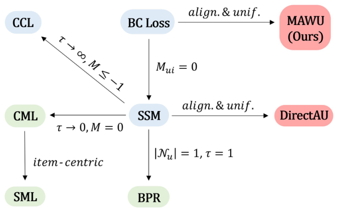
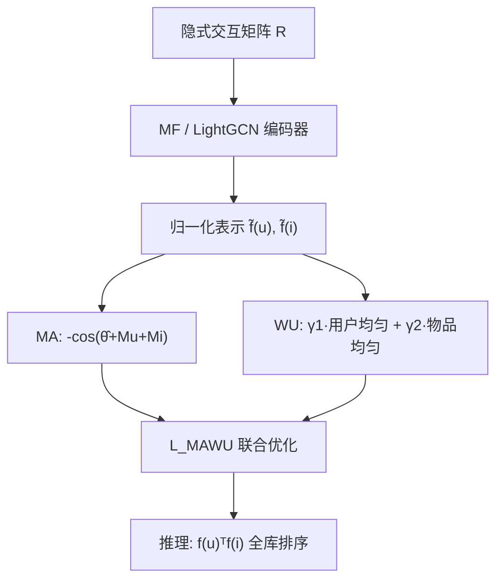
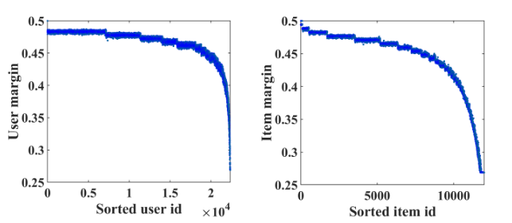

# Toward a Better Understanding of Loss Functions for Collaborative Filtering (面向协同过滤损失函数的再理解)

- **会议/期刊**: CIKM 2023
- **作者与机构**: Seongmin Park, Mincheol Yoon, Jae-woong Lee, Hogun Park, Jongwuk Lee（成均馆大学）
- **推荐链路定位**: 召回（隐式反馈 Top-N 检索的表示学习目标）
- **研究方向**: 协同过滤与双塔召回 / 自监督对比学习与交互去噪
- **论文原文**: [https://arxiv.org/abs/2308.06091v2](https://arxiv.org/abs/2308.06091v2)
- **开源代码**: [https://github.com/psm1206/MAWU](https://github.com/psm1206/MAWU)

## TL;DR (1分钟核心速览)

近期研究表明"只换损失函数"就能让 MF 打赢复杂图模型，但这些损失（BPR/CML/CCL/SSM/BC/DirectAU）彼此关系从未被形式化梳理。本文先证明：**SSM(InfoNCE) 是统一母体**——温度 $\tau\to0$退化为 CML，$|N_u|=1,\tau=1$退化为 BPR，$\tau\to\infty$趋近 CCL，$|N_u|\to\infty$渐近等价于 DirectAU 的"对齐+均匀性"。据此提出 MAWU：以用户/物品可学习角度边缘做**边缘感知对齐**，再以$\gamma_1,\gamma_2$ 差异化加权用户/物品**均匀性**。在 Beauty/Gowalla/Yelp2018 的全库排序协议下，MAWU-LightGCN 相对 DirectAU 在 NDCG@20 上提升 0.89%–6.10%，并全面优于 SGL/SimGCL/LightGCL 等八类 SOTA。

## Background & Motivation (背景与核心矛盾)

- **主流范式**: CF 学习流程被拆为三元组——交互编码器、损失函数、负采样。近年 BC、SSM、CCL、DirectAU 等工作证明只改损失即可让 MF/LightGCN 超过精心设计的图模型，说明"目标函数设计"本身是独立且高性价比的增益来源。
- **前人局限**: 其一，各类损失（逐点/成对/集合/AU）被分门别类地经验性提出，缺乏统一数学刻画，导致 BC 的 margin 思想与 DirectAU 的免负采样思想长期割裂，无人融合；其二，DirectAU 虽免采样，却对用户与物品施加**完全相同**的均匀性权重，且对齐项对所有正样本一视同仁，无法处理幂律分布下热门用户/物品主导梯度的偏差。
- **核心洞察 (Key Insight)**: 作者以 SSM 为参照系做极限推演，发现 pairwise/setwise/AU 三族损失仅由两个负采样相关量（温度 $\tau$与负样本数$|N_u|$）区分：$\tau$控制难度偏置，$|N_u|\to\infty$ 则把 InfoNCE 的负样本项转化为高斯势形式的用户/物品均匀性。这为"同时继承 BC 的边缘"与"继承 DirectAU 的免采样"提供了理论通道。
- **本文切入点**: 把 BC 的交互级 margin 转化为 AU 框架下的对齐边缘，并用数据集 Gini 统计量调节两类均匀性的相对权重，得到单一损失 MAWU。

<figure class="paper-figure" markdown="span">
  <figcaption>图1：除逐点损失函数外的CF损失函数关系图。红、蓝、绿背景分别表示对齐性与均匀性、集合式及成对式损失函数。</figcaption>
</figure>

## Method (核心方法设计)

### 1. 整体框架 (Overall Architecture)

模型沿用轻量骨干（MF 或 2 层 LightGCN）得到归一化表示 $\tilde{f}(u),\tilde{f}(i)$，随后完全抛弃负采样：一个分支计算正样本对的角度余弦并叠加用户/物品可学习边缘，迫使 unpopular 用户与长尾物品的夹角被额外"推开"从而获得更大梯度；另一分支在 batch 内对用户-用户、物品-物品两组高斯势做对数期望估计，分别乘以由数据分布决定的重要性系数$(\gamma_1,\gamma_2)$；两部分相加即得训练目标。推理时不做归一化、不加 margin，直接用内积$f(u)^\top f(i)$ 全库排序，margin 仅在训练期充当"难样本重加权器"。

### 2. 关键设计拆解 (Key Designs)

**1) 损失函数的统一极限分析（把七种损失压成一条主轴）**：作者用极限运算建立可比较坐标系：$\lim_{\tau\to0^+}\mathcal{L}_{SSM}\approx\mathcal{L}_{CML}(m{=}0)$（仅保留最难负样本）、$\mathcal{L}_{SSM}(|N_u|{=}1,\tau{=}1)=\mathcal{L}_{BPR}$、$\lim_{\tau\to+\infty}\mathcal{L}_{SSM}\approx\mathcal{L}_{CCL}(w{=}1)$（泰勒展开一阶近似）、$\mathcal{L}_{BC}(M_{ui}{=}0)=\mathcal{L}_{SSM}$，以及$\lim_{|N_u|\to\infty}\mathcal{L}_{SSM}-\log|N_u|$ 收敛到式 (23) 的对齐项加用户/物品均匀项。意义在于：把"是否加 margin""是否免采样"从经验技巧升级为可组合的正交维度。

**2) 边缘感知对齐 MA（用 $|U|+|I|$参数替代 BC 的流行度编码器）**：BC 需额外流行度编码器估计$|U|\times|I|$个交互级 margin，参数与推断开销大。MA 令$M_{ui}=M_u+M_i$ 可加分解，并将角度约束在单调区间：

$$\mathcal{L}_{MA}=-\mathbb{E}_{(u,i)\sim p_{pos}}\cos\left(\hat{\theta}_{ui}+M_u+M_i\right),\quad 0\le\hat{\theta}_{ui}+M_u+M_i\le\pi$$

物理直觉：余弦在 $\pi$附近非单调，限制区间保证 loss 单调递增；梯度对$M_u,M_i$ 的更新等价于按流行度自动重标定正样本难度，冷门用户/物品获得更大 margin（实验显示取值范围 0.27–0.49），稀疏图上收益最明显。

**3) 加权均匀性 WU（用 Gini 统计量对齐数据分布）**：原 DirectAU 的均匀项对用户/物品同权，隐含假设两者分布同质。WU 改为

$$\mathcal{L}_{WU}=\gamma_1\log\mathbb{E}_{(u,u')\sim p_{user}}e^{-2d(u,u')}+\gamma_2\log\mathbb{E}_{(i,i')\sim p_{item}}e^{-2d(i,i')}$$

若物品分布更偏斜（$Gini_i/Gini_u$ 大），则应降低物品均匀性权重以避免强行拉平长尾表示。

**4) 训练目标与推理效率**：$\mathcal{L}_{MAWU}=\mathcal{L}_{MA}+\mathcal{L}_{WU}$，**完全免负采样**（仅用 batch 内样本），无温度超参，仅新增$|U|+|I|$ 个标量参数；相比 SSM/BC 省去负采样采样器与额外编码器开销。

## Experimental Setup & Evaluation Protocol (实验设置与评估协议)

- **数据集与预处理**: Beauty 采用 `5-core`，Gowalla/Yelp2018 采用 `10-core`，重复交互保留最后一次，划分比例 `train:valid:test = 7:1:2`。

| 数据集 | #Users | #Items | #Interactions | 密度 | $Gini_i/Gini_u$ |
| :--- | :---: | :---: | :---: | :---: | :---: |
| Beauty | 22.4k | 12.1k | 198.5k | 0.07% | 2.096 |
| Gowalla | 29.9k | 41.0k | 1,027.4k | 0.08% | 0.518 |
| Yelp2018 | 31.7k | 38.0k | 1,561.4k | 0.13% | 1.090 |

- **数据划分与防穿越**: 采用**比例划分**（7:1:2），非严格全局时间戳切分，需注意其对时序泛化的乐观偏差。
- **排名评测协议**: 基于 RecBole 的 `Full-Ranking`（全库未交互物品排序），指标 Recall@$\{10,20,50\}$与 NDCG@$\{10,20,50\}$；训练侧除 MCL 随机采样外，负样本数统一取 30，BC/SSM 用 in-batch 负样本，MAWU 无负采样。
- **对比基线与超参**: 10 种损失（BCE/MCL/UIB/BPR/CML/SML/CCL/SSM/BC/DirectAU）+ 8 个模型（NeuMF/ENMF/SimpleX/MultVAE/RecVAE/SGL/SimGCL/LightGCL）；维度 $d=64$、lr$=1e-3$、batch$=2048$、LightGCN 层数 2，$\gamma_1,\gamma_2\in[0.1,5]$，单尾 t 检验标注$p<0.05$/$p<0.01$，结果取 5 次均值。

## Key Experimental Results (实验关键数据)

### 1. 主实验对比 (Main Results)

以 LightGCN 为骨干，报告 NDCG@20 / Recall@20（括号内为相对最优基线的 `Improv.`）：

| 方法 | Beauty | Gowalla | Yelp2018 |
| :--- | :---: | :---: | :---: |
| BPR | 0.0632 / 0.1283 | 0.1422 / 0.1866 | 0.0764 / 0.0921 |
| CML | 0.0249 / 0.0492 | 0.0538 / 0.0810 | 0.0558 / 0.0698 |
| CCL | 0.0524 / 0.0980 | 0.1422 / 0.1847 | 0.0708 / 0.0831 |
| SSM | 0.0627 / 0.1261 | 0.1212 / 0.1601 | 0.0671 / 0.0809 |
| BC | 0.0633 / 0.1276 | 0.1213 / 0.1603 | 0.0676 / 0.0815 |
| DirectAU | 0.0711 / 0.1412 | 0.1461 / 0.1905 | 0.0897 / 0.1054 |
| SGL | 0.0670 / — | 0.1452 / — | 0.0788 / — |
| SimGCL | 0.0657 / — | 0.1395 / — | 0.0848 / — |
| LightGCL | 0.0688 / — | 0.1417 / — | 0.0803 / — |
| **MAWU-LightGCN** | **0.0754 / 0.1457** | **0.1496 / 0.1956** | **0.0905 / 0.1066** |
| Improv.% (vs DirectAU) | +6.05% / +3.19% | +2.39% / +2.68% | +0.89% / +1.14% |

### 2. 消融实验 (Ablation Study)

LightGCN 骨干，NDCG@20（括号为相对完整模型跌幅）：

| 变体 | Beauty | Gowalla | Yelp2018 |
| :--- | :---: | :---: | :---: |
| MAWU 完整 | **0.0754** | **0.1496** | **0.0905** |
| w/o MA | 0.0738 (-2.1%) | 0.1491 (-0.3%) | 0.0903 (-0.2%) |
| w/o WU | 0.0743 (-1.5%) | 0.1482 (-0.9%) | 0.0898 (-0.8%) |
| margin=0 (即 DirectAU) | 0.0711 (-5.7%) | 0.1461 (-2.3%) | 0.0897 (-0.9%) |
| margin=反流行度 | 0.0720 | — | — |
| margin=UIB 式线性 | 0.0720 | — | — |
| margin=BC 式编码器 | 0.0731 | — | — |

### 3. 关键实验发现 (Key Findings)

1. **margin 是主增益源，且"可加分解"比"复杂估计"更优**：Beauty 上把 margin 从 0 换成 BC 式（0.0711→0.0731，+2.8%），再换成 MA 的可加标量边缘（0.0754，+3.1%），而参数量从 $O(|U||I|)$降到$|U|+|I|$；-MA 变体在稀疏的 Beauty 上跌幅 2.1%，远大于稠密的 Yelp2018（0.2%），印证 margin 主要在为长尾样本争取梯度。
2. **WU 的最优权重与数据 Gini 比严格同向**：Beauty/Gowalla/Yelp2018 的最佳 $\gamma_1/\gamma_2$分别为 4 / 1.5 / 2，与$Gini_i/Gini_u$的 2.096 / 0.518 / 1.090 排序一致；三数据集均满足$\gamma_1>\gamma_2$，说明**用户侧均匀性比物品侧更关键**，盲目同权（DirectAU）在偏斜数据上必然次优。
3. **统一损失视角的实战价值大于更换编码器**：仅用 MF+MAWU（Beauty NDCG@20 = 0.0740）已超过 LightGCL（0.0688）、SimGCL（0.0657）、SGL（0.0670）等图模型；而 MAWU-LightGCN 相比最强图基线 LightGCL 在 Beauty 上提升 +9.6%，证明损失设计与编码器设计近似正交、可叠加。

<figure class="paper-figure" markdown="span">
  <figcaption>图3：在Beauty上，用户/物品间隔（即𝑀𝑢和𝑀𝑖）与按流行度排序的用户/物品编号之间的相关性。用户/物品编号越大，用户/物品流行度越高。</figcaption>
</figure>

## Highlights & Limitations (亮点、对比与审稿批判)

- **与代表作对比 (vs. Prior Work)**: 相比 BC——本文剥离其流行度编码器，把交互级 margin 降维成用户/物品标量并迁移到免采样的 AU 框架；相比 DirectAU——本文指出其等权均匀性假设在幂律数据上失效，用 Gini 驱动的 $\gamma_1/\gamma_2$修正；相比 SSM/CCL——本文给出$\tau$与$|N_u|$ 的极限关系，并直接消除负采样带来的采样方差与计算成本。
- **可迁移亮点**: (i) 把任意带 margin 的 softmax 排序损失转写为"对齐+均匀"两段式、再注入可加标量 margin 的套路，可直接搬到序列推荐与多模态对齐损失；(ii) 用 Gini 比作为均匀性权重先验，可迁移到跨域/多场景的辅助损失加权。
- **审稿级局限批判**: (i) 仅用 7:1:2 随机比例划分，未做全局时间戳切分或冷启动划分，长尾增益在真实时序漂移下是否成立存疑；(ii) $\gamma_1,\gamma_2$ 需按数据集网格搜索，论文虽给出与 Gini 相关的经验规律但未给出无搜索的闭式设定，且全库排序下的推理成本与 DirectAU 相同（未讨论大规模 ANN 部署）；(iii) 未报告多次运行的方差与显著性在多数据集上的整体校正。

## Rating (四维评分)

- **方法创新性 (Novelty)**: ⭐⭐⭐⭐ （把七种 CF 损失统一为 SSM 极限族系，并将 margin 与免采样正交组合，理论刻画清晰但组件本身多为已有思想的再组合）
- **评估协议与实验扎实度 (Protocol & Experiments)**: ⭐⭐⭐⭐ （三数据集 + 10 损失 + 8 模型的对照极充分，含 t 检验与 5 次均值；扣分在缺少时间切分/冷启动协议与方差报告）
- **写作与数学规范度 (Clarity & Rigor)**: ⭐⭐⭐⭐ （极限推导链条完整、符号统一，式 (23)(25) 的渐近等价说明严谨；部分泰勒近似缺少误差界讨论）
- **工业落地与复现价值 (Industrial & Practical Value)**: ⭐⭐⭐⭐ （代码开源、无负采样、仅增 $|U|+|I|$ 参数，几乎零额外推理开销，易于插入现有双塔召回训练管线）

