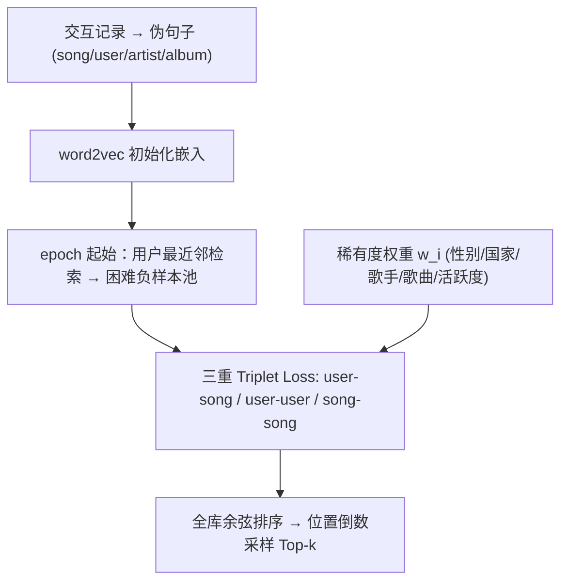
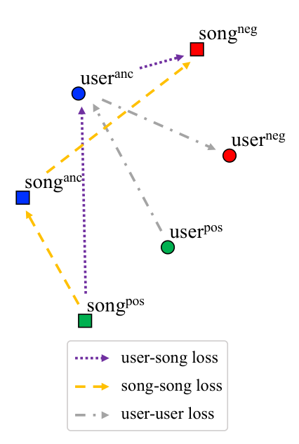

# Triplet Losses-based Matrix Factorization for Robust Recommendations (基于多重三元组损失的鲁棒矩阵分解推荐)

- **会议/期刊**: CIKM 2022 · EvalRS Workshop (CEUR Workshop Proceedings)
- **作者与机构**: Flavio Giobergia（都灵理工大学 控制与计算机工程系，单作者）
- **推荐链路定位**: 召回（全库排序后按位置倒数概率采样出 Top-$k$）
- **研究方向**: 协同过滤与双塔召回 / 去偏公平与可信评测
- **论文原文**: [https://arxiv.org/abs/2210.12098v1](https://arxiv.org/abs/2210.12098v1)
- **开源代码**: [https://github.com/fgiobergia/CIKM-evalRS-2022](https://github.com/fgiobergia/CIKM-evalRS-2022)

## TL;DR (1分钟核心速览)

本文针对 EvalRS 挑战赛提出的核心痛点：常规 Hit Rate 类指标只看"多数派"整体精度，导致长尾用户/物品（少数性别、小国家、冷门歌手）被系统性牺牲。作者在**共享嵌入空间的矩阵分解**上叠加**三重 triplet 损失**（user–song、user–user、song–song 互为锚点），再用性别/国家/歌手/歌曲流行度/用户活跃度五因子稀有度权重调制每条样本的损失，并以 word2vec 上下文初始化嵌入。在 LFM-1b 子集的**全库排序 + 多折一致性 + 分桶 MRED** 协议下，性别、活跃度、曲目流行度 MRED 分别较官方基线收敛 88.9%/84.3%/59.9%，综合榜第 3（1.3304 vs 基线 -1.2122）。

## Background & Motivation (背景与核心矛盾)

- **主流范式**: 以 BPR / WARP 为代表的 pair 式矩阵分解，把用户与物品对齐到同一空间，负样本随机采样（BPR）或按难度采样（WARP），训练目标只优化全局排序精度。
- **前人局限**: ① 单一 user–item 对齐只约束"跨侧"关系，物品侧与用户侧的内部几何结构完全不受约束，长尾实体嵌入易被高频实体挤压；② 均匀样本权重让高频用户/热门歌曲主导梯度，模型在分桶指标上出现显著偏差。
- **核心洞察 (Key Insight)**: EvalRS 榜单显示 **Hit Rate 最高的基线（0.0363）综合得分却最低（-1.2122）**，即精度与公平性在该数据上并不同向；因此"提升长尾实体的表征质量"而非"提升整体命中率"才是破局点。
- **本文切入点**: 用"任意两实体互为锚点"的三元组损失强行规整用户-用户、歌曲-歌曲的邻域结构，并把稀有度直接写进样本权重。

## Method (核心方法设计)

### 1. 整体框架 (Overall Architecture)

离线阶段：把每条交互记录组织为"以歌曲为中心"的伪句子（token 形如 `song=1234`/`user=…`/`artist=…`/`album=…`），用 word2vec 预训练得到用户与歌曲的初始 $d$维向量（相似口味用户、相似歌曲天然靠近）。训练阶段：每 epoch 开始时先按当前用户嵌入做最近邻检索（一次性开销），为每个正样本构造"近邻听过但本用户未听"的困难负样本；随后以三重 triplet 损失 + 稀有度权重优化全部嵌入。推理阶段：对全库歌曲算余弦相似度排序，再按位置倒数概率**随机采样**$k$ 首，使分桶指标反映模型的期望行为而非某次确定性截断的偶然性。

### 2. 关键设计拆解 (Key Designs)

1. **三重 Triplet 损失（把"跨侧对齐"升级为"双侧结构正则"）**：痛点在于 WARP/BPR 只压 $d(u^a,s^p)$与$d(u^a,s^n)$ 的差。本文额外引入两个同侧三元组：以歌曲为锚点、以正/负样本的用户为对照，以及以用户为锚点、其邻域其他用户为对照，统一写为

$$\mathcal{L}=\sum_i w_i\Big[\max\{d(u^a_i,s^p_i)-d(u^a_i,s^n_i)+m_0,0\}+\lambda_1\max\{d(u^a_i,u^p_i)-d(u^a_i,u^n_i)+m_1,0\}+\lambda_2\max\{d(s^a_i,s^p_i)-d(s^a_i,s^n_i)+m_2,0\}\Big]$$

$d(\cdot)$取余弦距离，$m_0=m_1=m_2=0.25$，$\lambda_1=\lambda_2=2.5$。直觉：同侧项迫使"喜欢同一首歌的用户""被同一用户消费的歌"互为近邻，相当于在嵌入空间做**局部平滑**，长尾实体因而能借邻居的梯度获得更稳的方向（图 1 给出三部分对向量的拉扯/排斥方向）。

<figure class="paper-figure" markdown="span">
  <figcaption>图 1：损失各部分对向量作用的表示。箭头方向表示元素被拉向锚点还是被推离锚点。</figcaption>
</figure>

2. **五因子稀有度加权（把公平性写进损失而非后处理）**：对每条训练记录计算 $w_i=\frac{\sum_{f}\theta_f\,\phi_f(i)}{\sum_f\theta_f}$，其中$\phi_f$为归一化到总和 1 的稀有度系数：性别取出现次数倒数，国家/歌手/歌曲流行度/用户活跃度取**对数倒数**（因均近似幂律分布）。搜索得$\theta_{gender}=5,\theta_{country}=10^2,\theta_{artist}=10^4,\theta_{song}=10^5,\theta_{activity}=10^4$——歌曲流行度权重最高，说明"给冷门歌更大梯度"是分桶 MRED 的主要来源。

3. **训练目标、负采样与推理开销**：损失即上式；负样本策略为**邻域困难负采样**（近邻用户听过、本人未听），每 epoch 重算一次以摊薄 $O(|\mathcal{U}|^2)$检索成本；初始化用 word2vec 而非随机，等价于一次廉价的协同预训练；无额外打分网络，推理为一次$d$ 维内积全库扫描，复杂度与原 MF 相同。

## Experimental Setup & Evaluation Protocol (实验设置与评估协议)

- **数据集与预处理**: 基于公开 LFM-1b 的音乐子集（EvalRS 官方发布），**未做任何数据预处理**（未做实体消歧、未重采样，见"失败尝试"）。

| 数据集 | #Users | #Items | #Interactions | 稀疏度/密度 | 特征/场景说明 |
| :--- | :---: | :---: | :---: | :---: | :--- |
| EvalRS / LFM-1b 子集 | 原文未报告 | 原文未报告 | 原文未报告 | 原文未报告 | 听歌事件；附用户性别、国家，歌曲的 artist/album 元数据；5 类分桶（性别/国家/用户活跃度/曲目流行度/歌手流行度） |

- **数据划分与防穿越 (Splitting Strategy)**: 采用挑战赛官方 **$k=4$ 折** 划分，一致性指标在 4 折上统计；用户历史交互仅用训练折构建（词料库、最近邻负样本池均来自训练折）。
- **排名评测协议 (Ranking Protocol)**: **Full-Ranking（全库未交互歌曲排序）**，再按位置倒数概率随机抽 $k$ 首组成推荐列表，因此 Hit Rate/MRR 为期望意义下的数值；公平性用分桶 **MRED（Miss Rate Equality Difference）**，越接近 0 越公平。
- **对比基线与超参设置**: 对比对象为 EvalRS 官方 **baseline** 与榜单 Top-10 队伍（team#1–#10，仅团队 1/2 外挂完整信息）；超参：$d=128$，$m=0.25$，$\lambda_1=\lambda_2=2.5$，$\theta$见上文；**未报告显著性检验**，但补充了自定义的**一致性**$c=\frac{1}{|M|}\sum_{m\in M}\left(1-\frac{\sigma_m}{|\mu_m|}\right)$与 **方差一致性**（用户历史 Gini 不纯度$g_u$与推荐列表不纯度$\hat{g}_u$ 的 Pearson 相关）。

## Key Experimental Results (实验关键数据)

### 1. 主实验对比 (Main Results)

榜单节选（Score 越高越好；MRED 越接近 0 越好，故 |MRED| 缩小即为改善）：

| Solution | Score | Hit rate | MRR | Country (MRED) | User act. (MRED) | Track pop. (MRED) | Gender (MRED) |
| :--- | :---: | :---: | :---: | :---: | :---: | :---: | :---: |
| team#1 | **1.7026** | 0.01548 | 0.00586 | -0.00407 | -0.00693 | **-0.00204** | -0.00169 |
| team#2 | 1.5530 | 0.01607 | 0.00173 | **-0.00373** | **-0.00291** | -0.00105 | **-0.00069** |
| **Proposed** | 1.3304 | 0.01557 | 0.00168 | -0.00404 | -0.00350 | -0.00444 | -0.00080 |
| team#4 | 1.1847 | 0.02162 | **0.00204** | -0.00537 | -0.00442 | -0.00319 | -0.00130 |
| team#9 | -1.1544 | **0.03236** | 0.00205 | -0.01062 | -0.01302 | -0.02199 | -0.00846 |
| baseline | -1.2122 | 0.03634 | 0.00369 | -0.00902 | -0.02236 | -0.01108 | -0.00715 |
| **Improv.（vs baseline，|MRED|↓）** | — | -57.2% | — | **55.2%** | **84.3%** | **59.9%** | **88.9%** |

### 2. 消融实验 (Ablation Study)

| 变体 | Score | 相对完整模型 |
| :--- | :---: | :---: |
| Full approach | **1.3304** | — |
| w/o word2vec 初始化（随机初始化） | 0.8554 | -35.7% |
| w/o 稀有度加权（样本等权） | 0.8427 | -36.7% |
| w/o song–song 三元组 | 0.5292 | -60.2% |
| w/o user–user 三元组 | -100（Hit Rate < 0.015 判负） | 崩塌 |

### 3. 关键实验发现 (Key Findings)

1. **同侧三元组比稀有度加权更"保命"**：去掉 song–song 项分数从 1.3304 掉到 0.5292，去掉 user–user 项直接触发 Hit Rate < 0.015 的 -100 惩罚——说明物品侧/用户侧结构正则是该模型能维持基本精度与分桶稳定的地基，而加权只是在其之上分配收益。
2. **精度与公平在本数据上呈明确 trade-off**：基线 Hit Rate 0.03634 高于所有参赛队（比本文高 57.2%），但因 MRED 全面落后而综合分垫底；本文以牺牲约 2% Hit Rate（0.01557 vs 0.01607）为代价，把 Gender MRED 从 -0.00715 收敛到 -0.00080，换取 +2.54 的总分跨度（vs baseline）。
3. **鲁棒性诊断揭示隐性短板**：4 折一致性总体 0.8344，精度类指标高达 0.9579/0.9949，但 **Gender 仅 0.4573、Track popularity 0.6938**，意味着公平性收益对训练集扰动高度敏感；艺术家维度方差一致性 0.2479（随机≈0）说明模型确实捕捉了用户多样性偏好，但强度仍弱。

## Highlights & Limitations (亮点、对比与审稿批判)

- **与代表作对比 (vs. Prior Work)**: 相对 BPR（随机负样本 + 单一 user–item 项）与 WARP（仅难负样本 + 单一对齐项），本文两点本质差异：① 损失从 1 项扩到 3 项，引入**同侧自监督式结构约束**；② 将公平性前置为**样本级权重**，而非 EvalRS 其他队伍的常见后处理/重采样。
- **可迁移亮点**: (a) "以物品为锚点、以用户为对照"的对称三元组可直接挂到任意双塔召回上，几乎零推理开销；(b) 用**一致性（1-CV）与方差一致性**作为模型自检指标，可作为分桶评测的通用补充工具箱。
- **审稿级局限批判**: ① 数据集规模、划分比例、$k$ 值、显著性检验均未报告，且所有消融沿用完整模型的超参，"w/o"结果可能被超参劣配进一步拉低，因果归因不纯；② 一致性对 4 折统计，方差估计置信区间极宽，性别桶样本量可能极小，0.4573 的结论稳健性存疑；③ 推理端需要"按位置倒数概率随机采样"，使线上打分不可复现、且不利于确定性 Serving，工程可用性存疑。

## Rating (四维评分)

- **方法创新性 (Novelty)**: ⭐⭐⭐ （三重对称 triplet + 稀有度加权思路清晰且实现极简，但本质是 triplet/加权 BPR 的组合变体，缺少理论或谱分析支撑）
- **评估协议与实验扎实度 (Protocol & Experiments)**: ⭐⭐⭐ （多面分桶 + 4 折一致性 + 方差一致性设计有新意，但缺数据统计、显著性检验，且消融未独立调参）
- **写作与数学规范度 (Clarity & Rigor)**: ⭐⭐⭐⭐ （损失、权重、一致性三式定义干净、变量含义清楚，并诚实记录失败尝试，但方差一致性中 Gini 不纯度的方向性未加讨论）
- **工业落地与复现价值 (Industrial & Practical Value)**: ⭐⭐⭐ （代码开源、复杂度与原 MF 同级；随机采样出 Top-$k$ 与每 epoch 邻域检索削弱线上可部署性）

