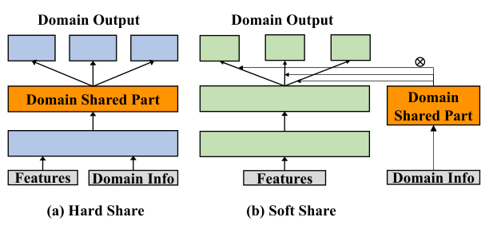
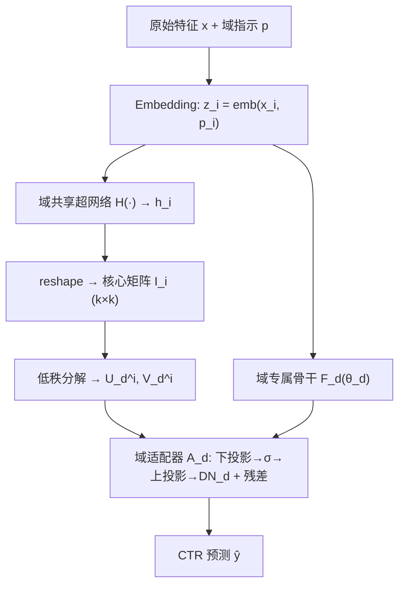
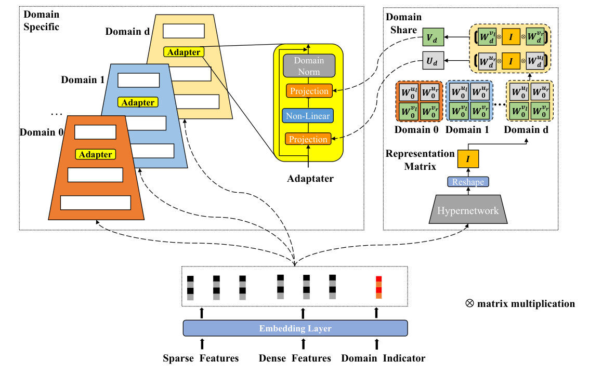

# HAMUR: Hyper Adapter for Multi-Domain Recommendation (多领域推荐超适配器)

- **会议/期刊**: CIKM 2023
- **作者与机构**: Xiaopeng Li, Xiangyu Zhao (香港城市大学)；Fan Yan, Yichao Wang, Bo Chen, Huifeng Guo, Ruiming Tang (华为诺亚方舟实验室)
- **推荐链路定位**: 精排 (多领域 CTR 预估)
- **研究方向**: 跨域与多场景推荐 / CTR 预估与特征交叉
- **论文原文**: [https://arxiv.org/abs/2309.06217v2](https://arxiv.org/abs/2309.06217v2)
- **开源代码**: [https://github.com/Applied-Machine-Learning-Lab/HAMUR](https://github.com/Applied-Machine-Learning-Lab/HAMUR)

## TL;DR (1分钟核心速览)

多领域推荐的核心矛盾是"跨域共享 vs 域内独立"：硬共享（SharedBottom/STAR）把参数强行对齐造成域间负迁移，软共享（PEPNet/M2M）用静态参数无法随域分布自适应。HAMUR 把 NLP 的 Adapter 改造成可直接插入骨干网络顶层的领域适配器（端到端训练，不做两阶段微调），并用一个**域共享超网络**在**实例级**生成适配器的低秩分解核心矩阵 $I_i$，从而隐式共享域间知识。在 MovieLens 与 Ali-CCP 上、以 MLP/DCN/Wide&Deep 三种骨干验证，全库 AUC 与 LogLoss 均显著优于 STAR/APG/SharedBottom/MMOE（$p<0.05$），稀疏域 2# 的 AUC 相对提升约 1.4%。

## Background & Motivation (背景与核心矛盾)

- **主流范式**: 统一多领域模型的两条路线——硬共享（底层共享 + 域塔，STAR 星型拓扑按元素相乘）与软共享（PEPNet 门控、M2M 元单元、ADI 融合层）在域间间接传递信息。
- **前人局限**: ① 硬共享把"参数共享范式"人为前置，对分布差异大的域造成显著 bias 与负迁移；② 无论硬软共享都使用**静态参数**，无法刻画域分布随促销/新品上线的快速漂移。
- **核心洞察 (Key Insight)**: 域间相似性并非全局一致，而是**样本级**的；若能为每个实例生成一组"域条件化"的小参数，既保留域私有模式，又能隐式借用他域信息。
- **本文切入点**: Adapter 只改少量参数即可改变特征分布——把 Adapter 放进多领域骨干顶层，参数不手工设定，而由共享超网络动态生成。

<figure class="paper-figure" markdown="span">
  <figcaption>图1：现有多领域共享方法。</figcaption>
</figure>

## Method (核心方法设计)

### 1. 整体框架 (Overall Architecture)

输入为原始特征 $\boldsymbol{x}$与域指示$p\in\{1,\dots,D\}$，经 Embedding 得到实例表征$\boldsymbol{z}_i$。$\boldsymbol{z}_i$分两路：一路进域专属骨干$F_d(\theta_d)$（MLP/DCN/W&D，各域独立）；另一路进**域共享超网络**$\mathcal{H}(\cdot)$，输出一维向量再 reshape 为$k\times k$核心矩阵$I_i$，随后与各域固有矩阵做低秩相乘，得到该实例在域$d$的适配器权重$U_d^i, V_d^i$。适配器插入骨干**靠近输出端**的位置（倒数第一、二层之间），做下投影–Sigmoid–上投影–域归一化并加残差，最后与骨干隐状态融合打分。训练为单阶段端到端 BCE，无预训练/微调两段式。

<figure class="paper-figure" markdown="span">
  <figcaption>图2：我们提出模型的整体架构示意图。</figcaption>
</figure>

### 2. 关键设计拆解 (Key Designs)

1. **领域适配器 (Domain-Specific Adapter)**：NLP 适配器需两阶段微调，但推荐场景参数需随促销/新物料持续更新，两段式代价不可接受，故直接内嵌骨干参与端到端训练。瓶颈结构压缩再重建，改变的是"域内特征分布"而非重做特征交叉：
$$A_d(\boldsymbol{x}) = DN_d\big(V_d(\sigma(U_d(\boldsymbol{x})))\big) + \boldsymbol{x}$$
直觉：残差保证原有交叉能力不被破坏，瓶颈迫使适配器只学"域偏移"这一低维增量。

2. **共享超网络 + 低秩分解 (Hyper-Network with Low-Rank Decomposition)**：若直接生成 $U_d, V_d$两个$s\times h$大矩阵，实例级生成的开销不可接受。故只生成$k\times k$的$I_i$，其余为域固有可训练矩阵：
$$U_d^i = W_d^{ul} I_i W_d^{ur},\qquad V_d^i = W_d^{vl} I_i W_d^{vr}$$
物理直觉：$I_i$承载 instance 级的跨域共性表达，$W_d^{\cdot}$承载域私有模式并被同域所有实例共享，二者相乘即"共性 + 个性"的解耦，同时把生成量从$O(sh)$降到$O(k^2)$。

3. **领域归一化与训练目标**：LayerNorm 会把不同语义的特征域一起归一化（NLP 里 token 同句相关，推荐里特征域互相独立），故改为在 mini-batch 上做 BatchNorm 并叠加域专属仿射：
$$DN_d(\boldsymbol{x}) = \gamma_d \odot \frac{\boldsymbol{x}-\mu}{\sqrt{\sigma^2+\epsilon}} + \beta_d$$
总损失为逐域交叉熵 $\mathcal{L}_{CTR}=-\frac{1}{|D|}\sum_d\sum_i \big[y_i\log\hat{y}_i+(1-y_i)\log(1-\hat{y}_i)\big]$；CTR 场景使用曝光日志真实负样本，不做额外负采样，推理为一次前向 + 每实例一次低秩矩阵乘。

## Experimental Setup & Evaluation Protocol (实验设置与评估协议)

| 数据集 | #Users | #Items | #Interactions | 稀疏度/密度 | 特征/场景说明 |
| :--- | :---: | :---: | :---: | :---: | :--- |
| MovieLens (1#/2#/3#) | 1.3k/2k/2.6k | 3.4k/3.5k/3.6k | 211k/396k/394k | 21.0%/39.6%/39.4% | 7 用户 + 2 物品特征；按 `age` 切 3 域 |
| Ali-CCP (1#/2#/3#) | 80k/2k/136k | 287k/109k/298k | 16M/319k/26M | 37.8%/0.8%/61.4% | 13 用户 + 5 物品 + 4 组合特征；按位置特征 `301` 切 3 域，点击为标签 |

- **数据划分与防穿越**: MovieLens 采用 **8:1:1 随机比例划分**；Ali-CCP 沿用官方已给的 train/val/test 划分（按时间收集的流量日志）。
- **排名评测协议**: 属于 CTR 预估，评测为**全测试集打分**（非采样负例排序），指标 **AUC**（越大越好）与 **LogLoss**（越小越好），不做 top-K 截断。
- **对比基线与超参**: STAR、APG、SharedBottom、MMOE、MLP/DCN/Wide&Deep；Embedding $d=16$，瓶颈$s=32$，超网络隐层 64，核心矩阵$k=35$（MovieLens）/$65$（Ali-CCP）；骨干层数 2 / 7。显著性检验$p<0.05$。

## Key Experimental Results (实验关键数据)

### 1. 主实验对比 (Main Results)

| 模型 | ML 1# | ML 2# | ML 3# | ML Total | Ali 1# | Ali 2# | Ali 3# | Ali Total |
| :--- | :---: | :---: | :---: | :---: | :---: | :---: | :---: | :---: |
| SharedBottom | 0.8031 | 0.8099 | 0.7942 | 0.8022 | 0.6273 | 0.5908 | 0.6237 | 0.6243 |
| MMOE | 0.8074 | 0.8152 | 0.8018 | 0.8086 | 0.6306 | 0.5854 | 0.6266 | 0.6280 |
| APG | 0.8079 | 0.8104 | 0.8016 | 0.8092 | 0.6282 | 0.5962 | 0.6239 | 0.6246 |
| STAR | 0.8052 | 0.8101 | 0.8000 | 0.8053 | 0.6302 | 0.5967 | 0.6270 | 0.6284 |
| **HAMUR** | **0.8115*** | **0.8192*** | **0.8030*** | **0.8115*** | **0.6332*** | **0.6050*** | **0.6295*** | **0.6300*** |
| Improv.% (vs best) | +0.45% | +0.49% | +0.15% | **+0.77%** | +0.41% | **+1.39%** | +0.40% | +0.25% |

LogLoss（越低越好）：MovieLens Total **0.5206** vs STAR 0.5290 / MMOE 0.5253（$-$1.59%）；Ali-CCP Total **0.1614** vs STAR 0.1619 / MMOE 0.1623。稀疏域 Ali 2# 由 0.1803（SharedBottom 最佳）降至 **0.1788**。

### 2. 消融实验 (Ablation Study)

以"同骨干去掉 HAMUR"作为消融（适配器即唯一增量模块）：

| 骨干网络 | ML 1#/2#/3# (w/o → w/ HAMUR) | Ali 2# (w/o → w/) | Ali 3# (w/o → w/) |
| :--- | :--- | :---: | :---: |
| MLP | 0.8105/0.8171/0.8021 → 0.8115/0.8192/0.8030 | 0.5821 → **0.6050** | 0.6250 → 0.6295 |
| DCN | 0.8141/0.8184/0.8025 → 0.8165/0.8201/0.8061 | 0.6059 → 0.6064 | 0.6270 → 0.6297 |
| Wide & Deep | 0.8099/0.8137/0.7997 → 0.8131/0.8172/0.8035 | 0.5963 → 0.6053 | 0.6221 → 0.6262 |

### 3. 关键实验发现 (Key Findings)

1. **稀疏域是最大受益者**：Ali-CCP 2# 仅占 0.8% 样本，AUC 0.5967 → 0.6050（**+1.39%**），远高于该数据集整体 +0.25%，说明实例级超网络对"小域借大域知识"的收益最直接；而 MMOE 在该域反而只有 0.5854，验证硬共享/门控在极稀疏域会失效。
2. **插件增益取决于骨干的既有交叉能力**：MLP 相对提升最大（Ali 2# +3.93%），DCN 因自带显式高阶交叉、对域偏移已部分吸收，增益最小（2# 仅 +0.08%），Wide&Deep 居中（+1.51%）——HAMUR 补的是"骨干无法刻画域条件分布"这块短板，而非替代特征交叉。
3. **超参呈"够用即可"的非单调性**：核心矩阵维度 $k$越大越好但收益递减（MovieLens$k=35$、Ali-CCP 因域分布极不均衡需$k=65$ 才稳定超过 STAR）；超网络隐层从 64 继续加宽后 AUC 反而下降，存在明显过拟合，说明跨域共性只需低维瓶颈承载。

## Highlights & Limitations (亮点、对比与审稿批判)

- **与代表作对比 (vs. Prior Work)**: 相比 STAR 的"共享 FC × 域 FC"元素级显式相乘，HAMUR 用超网络**隐式**生成参数，避免人为前置共享范式带来的域 bias；相比 APG 生成整个骨干的权重矩阵，HAMUR 只生成适配器参数，域私有骨干得以保留；相比 M2M 依赖预定义场景知识生成 meta-unit，HAMUR 的输入是原始实例表征，无需额外场景先验。
- **可迁移亮点**: ① "只生成 $k\times k$核心矩阵 + 域固有左右矩阵低秩相乘"的参数生成范式，可直接套到任何 hyper-network / 生成式参数方法上，把生成开销压掉一个量级；② 领域归一化（batch 统计 + 域专属$\gamma_d,\beta_d$）可以低成本插入 MMoE/PLE 的 gate 或 expert 输出端，用于多业务场景的分布对齐。
- **审稿级局限批判**: ① **开销未量化**：实例级生成 $I_i$并对每域做两组低秩乘，Ali-CCP 需$k=65$，在线 QPS 与 P99 延迟、显存增量均未报告，与 STAR 的乘法开销缺乏可比性；② **评估面偏窄**：仅 AUC/LogLoss 与两个公开数据集，域划分依赖单一特征（age / position），未做冷启动域、CVR 多目标、域数量扩展性或 batch 内稀有域样本不足时的 BN 统计稳定性分析；③ 显著性仅在整体层面标注$p<0.05$，分域显著性未逐项给出。

## Rating (四维评分)

- **方法创新性 (Novelty)**: ⭐⭐⭐⭐ （首次将 Adapter 引入多领域推荐并改为端到端单阶段训练，超网络 + 低秩分解的实例级参数生成组合新颖，但本质是已有组件的巧妙拼装）
- **评估协议与实验扎实度 (Protocol & Experiments)**: ⭐⭐⭐⭐ （两种分布差异极大的公开数据集 + 三种骨干的可扩展性验证 + 全测试集 AUC/LogLoss + $p<0.05$，但缺线上指标与分域显著性）
- **写作与数学规范度 (Clarity & Rigor)**: ⭐⭐⭐⭐ （公式与算法伪码完整、插入位置与低秩动机交代清晰；Eq.(3) 残差的编号与图示位置略有歧义，超参表分散在附录）
- **工业落地与复现价值 (Industrial & Practical Value)**: ⭐⭐⭐⭐ （代码已开源且有 MindSpore 版本，插件式设计可零重构迁移到已有 MDR 系统；但实例级矩阵生成的推理成本需按业务 QPS 重新调 $k$）

