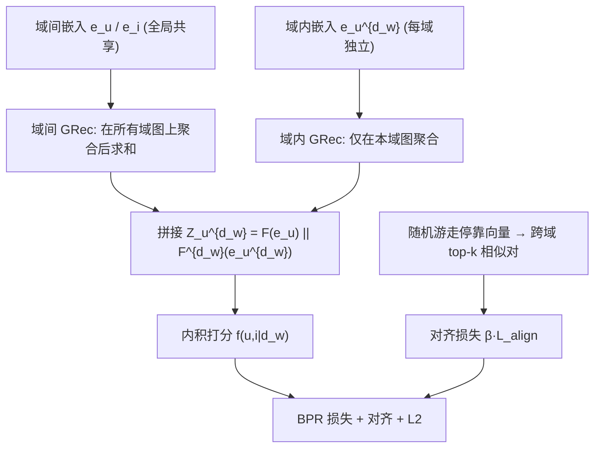
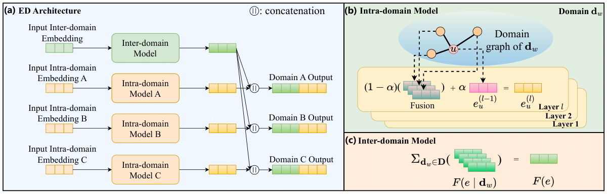
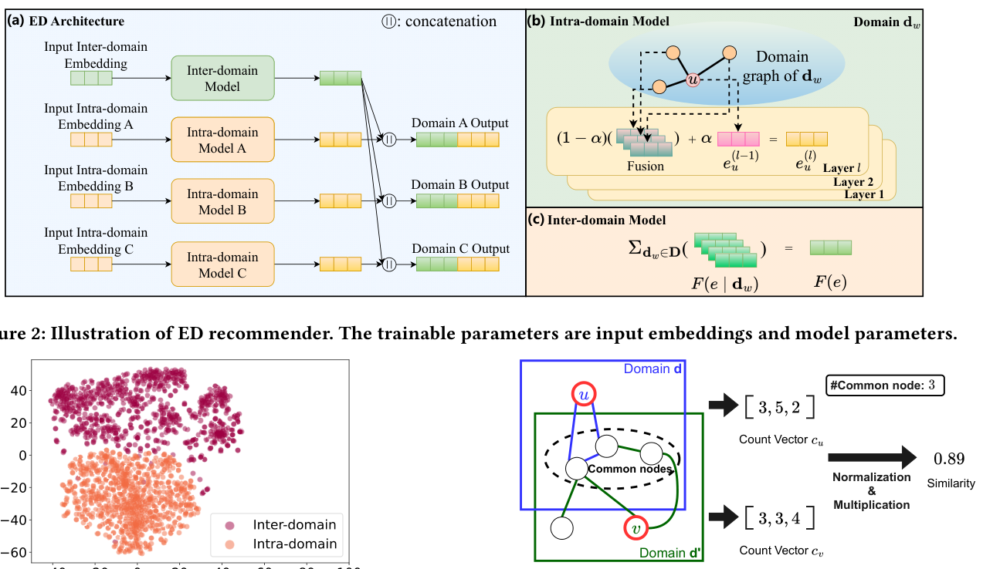

# Multi-domain Recommendation with Embedding Disentangling and Domain Alignment (多域推荐中的嵌入解耦与域对齐)

- **会议/期刊**: CIKM 2023 (Long Paper)
- **作者与机构**: Wentao Ning (HKU / SUSTech), Xiao Yan, Bo Tang (SUSTech), Weiwen Liu (Huawei Noah's Ark Lab), Reynold Cheng (HKU), Rui Zhang
- **推荐链路定位**: 精排（多域统一打分，也可作召回双塔内积）
- **研究方向**: 跨域与多场景推荐 / 图神经网络推荐
- **论文原文**: [https://arxiv.org/abs/2308.05508v2](https://arxiv.org/abs/2308.05508v2)
- **开源代码**: [https://github.com/Stevenn9981/EDDA](https://github.com/Stevenn9981/EDDA)

## TL;DR (1分钟核心速览)

多域推荐（MDR）的两大痛点是：域间可泛化知识与域内专属知识难以分离（现有 STAR/TreeMS/MGFN 只做「模型级解耦」，共享单套嵌入导致梯度方向冲突），以及域名重叠稀疏时知识迁移失效。EDDA 提出**嵌入级解耦**——每个用户/物品同时持有域间嵌入与各域独立域内嵌入，分别经域间模型与域内 GRec 投影后拼接打分；并用**随机游走停靠计数向量**在共有锚点上度量跨域节点相似度，以 top-$k$ 相似对做对齐正则。在 AliCCP/Amazon/AliAd 三数据集、1:10 采样排序协议下，AUC 相对最优基线提升 3.1%–5.7%（单域最高 7.6%），Recall@1 提升 6.7%–31.0%（单域最高 41.8%）。

## Background & Motivation (背景与核心矛盾)

- **主流范式**: MDR 普遍采用「模型解耦」（图 1）：一个共享模型学域间知识、若干域特定模型学域内知识，但**所有域共用同一套输入嵌入**，靠重叠用户/物品作为迁移桥梁。
- **前人局限一（梯度冲突）**: 域间梯度与各域内梯度累积在同一嵌入上，方向相反时相互抵消，解耦只发生在模型层，嵌入层仍纠缠；CATART 的全局嵌入由域特定嵌入生成，共享知识反哺域内嵌入，解耦更不彻底。
- **前人局限二（重叠稀疏）**: 仅靠重叠节点迁移，AliCCP 域对平均重叠率仅 0.019（最小域 <0.005），桥梁几乎不存在，小域极易过拟合。
- **核心洞察 (Key Insight)**: 若两域中来自不同域的两个节点在各自图上随机游走时**倾向于停在相同的共有锚点集合**上，则它们行为模式相似，应被拉近——这给出一种不依赖直接重叠的跨域监督信号。
- **本文切入点**: 把「解耦」从模型层下沉到嵌入层，并用停靠向量相似度构造对齐损失，双管齐下解决负迁移与稀疏迁移。

## Method (核心方法设计)

### 1. 整体框架 (Overall Architecture)

每个用户 $u$（物品$i$）拥有一个全局域间嵌入$\boldsymbol{e}_u$与$W$个域内嵌入$\boldsymbol{e}_u^{d_w}$（各自独立初始化）。域间嵌入经共享 GRec 在**所有域图**上聚合后求和，域内嵌入经该域专属 GRec 聚合，二者分别投影后拼接为最终表示，内积打分；训练用 BPR，并叠加由随机游走预计算出的跨域相似对对齐损失。推理时只做前向聚合与内积，无额外开销；随机游走相似度离线一次性构建。

<figure class="paper-figure" markdown="span">
  <figcaption>图 2：ED 推荐器示意图。可训练参数为输入嵌入和模型参数。</figcaption>
</figure>

### 2. 关键设计拆解 (Key Designs)

1. **嵌入级解耦 (ED Recommender)**：痛点是不论模型怎么分家，嵌入仍是共享的，梯度累积后互相抵消。ED 让域间与域内嵌入彻底物理分离、各自被不同梯度子集更新：域间嵌入 $\boldsymbol{e}_i$被**所有域**中含$i$的三元组更新，域内嵌入$\boldsymbol{e}_i^{d_w}$ 只被本域三元组更新，从而在监督信号层面自然完成解耦。表示与打分为
$$\boldsymbol{Z}_u^{d_w}=\boldsymbol{F}(\boldsymbol{e}_u)\,\|\,\boldsymbol{F}^{d_w}(\boldsymbol{e}_u^{d_w}),\qquad f(u,i|d_w)={\boldsymbol{Z}_u^{d_w}}^{\top}\boldsymbol{Z}_i^{d_w}.$$
域间模型对所有包含该节点的域图分别跑 GRec 并把末层输出**求和**（$\boldsymbol{F}(\boldsymbol{E}_u)=\sum_{d_w\ni u}\boldsymbol{F}(\boldsymbol{E}_u|d_w)$），相当于把多域协同信号叠加成一份「通用画像」；t-SNE（图 3）显示域间/域内嵌入形成两个清晰簇，验证解耦确实发生。域内 GRec 采用去线性层、去非线性的 LightGCN 式传播，并保留自信息系数$\alpha$：$\boldsymbol{e}_u^{(l)}=\alpha\boldsymbol{e}_u^{(l-1)}+(1-\alpha)\sum_{i\in\mathcal{N}_u}\frac{1}{\sqrt{|\mathcal{N}_u|}\sqrt{|\mathcal{N}_i|}}\boldsymbol{e}_i^{(l-1)}$。

2. **随机游走域对齐 (Domain Alignment)**：小重叠域缺乏迁移桥梁。以两域共有节点集 $\mathcal{T}$为锚点，从$u\in\mathcal{G}_d$、$v\in\mathcal{G}_{d'}$各做多次定长随机游走，统计停在各锚点的次数得停靠向量$\boldsymbol{c}_u,\boldsymbol{c}_v$，相似度为归一化余弦：
$$s(u,v)=\hat{\boldsymbol{c}}_u^{\top}\hat{\boldsymbol{c}}_v,\qquad \hat{\boldsymbol{c}}_u=\boldsymbol{c}_u/\|\boldsymbol{c}_u\|_2 .$$
该式本质是「以锚点为坐标系的节点指纹」，两节点指纹一致说明其邻域语义一致。对每个节点取 top-$k$（默认$k=1$）组成相似对集$\mathcal{S}_{dd'}$；由于不同域的嵌入空间不同构，先用域专属线性映射投到共享空间再算平方欧氏距离：$l(u,v)=\|\boldsymbol{e}_u^{d}\boldsymbol{W}_d-\boldsymbol{e}_v^{d'}\boldsymbol{W}_{d'}\|_2^2$。**刻意不把全部共有节点当作相似对**——同一用户在不同域的偏好可能相反（如喜欢蓝色衣服但不喜欢蓝色汽车），作者实验也确认强行加入重叠节点无增益。相似度计算退化为归一化向量的内积检索，可用 ANN 加速、随机游走可并行。

<figure class="paper-figure" markdown="span">
  <figcaption>图 4：我们的基于随机游走的节点相似度示意图。两个域图中节点的相似度利用两域公共节点上的随机游走停止计数向量计算。域 d 与 d′ 之间有 3 个公共节点，在本玩具示例中，我们从节点 𝑢 和 𝑣 执行 10 次随机游走。计数向量的每个条目表示在每个公共节点停止的次数。</figcaption>
</figure>

3. **训练目标、负采样与推理效率**：总损失为
$$\mathcal{L}=\mathcal{L}_{\text{BPR}}+\beta\mathcal{L}_{\text{align}}+\lambda\|\Theta\|_2^2,\quad \mathcal{L}_{\text{align}}=\sum_{d\neq d'}\sum_{(u,v)\in\mathcal{S}_{dd'}}\|\boldsymbol{e}_u^{d}\boldsymbol{W}_d-\boldsymbol{e}_v^{d'}\boldsymbol{W}_{d'}\|_2^2 .$$
负采样为每正样本均匀采 1 个未交互物品（训练/测试同策略），无难负样本挖掘；嵌入维度 64、2 层 GRec、$\alpha=0.1$、edge dropout 0.3、batch 8092、$\beta=0.03$、$\lambda=10^{-4}$。在线阶段与 LightGCN 同级开销，域间嵌入按用户所属域求和需$O(\sum_{d\ni u}L|\mathcal{N}_u|)$。

## Experimental Setup & Evaluation Protocol (实验设置与评估协议)

- **数据集与预处理**: 三个公开多域数据集，无 5-core 过滤说明，仅保留正交互：

| 数据集 | #Domains | #Users | #Items | #Interactions | 平均重叠率 | 场景说明 |
| :--- | :---: | :---: | :---: | :---: | :---: | :--- |
| AliCCP | 3 | 47,000 | 53,201 | 353,150 | 0.0190 | 手淘多场景流量日志，域规模最不均衡（最大/最小 75.7×） |
| Amazon | 6 | 173,528 | 69,215 | 1,437,381 | 0.0830 | 6 个商品类目各为一域，评分即正反馈 |
| AliAd | 8 | 154,607 | 16,607 | 406,952 | 0.1346 | 阿里广告 8 天曝光/点击，8 类广告为域 |

- **数据划分与防穿越 (Splitting Strategy)**: **比例划分** 7:1:2（train/valid/test），按交互记录随机切分，非全局时间戳切分，未显式做冷启动划分。
- **排名评测协议 (Ranking Protocol)**: **Sampled Ranking**——每个测试正样本搭配 10 个随机未交互负样本，共 11 候选；Recall 定义为正样本排第 1 的比例（Recall@1），另报 AUC。**非 Full-Ranking**，绝对数值偏高。
- **对比基线与超参设置**: 12 个基线，覆盖 SDR（MF、NGCF、LightGCN，逐域独立训练）、MTL（Cross-Stitch、MMoE、PLE，把多域当多任务）、MDR（AFT、STAR、SAML、CATART、MGFN、TreeMS）。EDDA 嵌入维度 $d=64$（域间/域内各 64），基线用官方默认配置；最优性采用 paired t-test，$p<0.05$。

## Key Experimental Results (实验关键数据)

### 1. 主实验对比 (Main Results)

三数据集**跨域平均**结果（AUC / Recall@1，8 个代表性基线；加粗为最优）：

| 数据集 | 指标 | MF | NGCF | LightGCN | PLE | STAR | CATART | MGFN | TreeMS | **EDDA** | Improv. |
| :--- | :--- | :---: | :---: | :---: | :---: | :---: | :---: | :---: | :---: | :---: | :---: |
| AliCCP | AUC | 0.588 | 0.659 | 0.692 | 0.619 | 0.583 | 0.547 | 0.778 | 0.803 | **0.849** | +5.7% |
| AliCCP | Recall | 0.201 | 0.243 | 0.278 | 0.194 | 0.149 | 0.145 | 0.252 | 0.400 | **0.524** | +31.0% |
| Amazon | AUC | 0.771 | 0.821 | 0.841 | 0.782 | 0.722 | 0.770 | 0.851 | 0.855 | **0.881** | +3.1% |
| Amazon | Recall | 0.444 | 0.510 | 0.551 | 0.470 | 0.422 | 0.487 | 0.569 | 0.577 | **0.616** | +6.7% |
| AliAd | AUC | 0.825 | 0.837 | 0.844 | 0.860 | 0.855 | 0.814 | 0.856 | 0.870 | **0.902** | +3.7% |
| AliAd | Recall | 0.492 | 0.520 | 0.590 | 0.509 | 0.499 | 0.497 | 0.603 | 0.612 | **0.670** | +9.5% |

单域最优提升出现在 AliCCP：D2 的 AUC 0.805→0.866 (+7.6%)、Recall 0.403→0.571 (+41.8%)。

### 2. 消融实验 (Ablation Study)

ED 组件与对齐损失逐项拆解（各数据集跨域平均；`Inter`/`Intra` 的嵌入维度翻倍以保证参数量可比）：

| 变体 | AliCCP AUC | AliCCP R@1 | Amazon AUC | Amazon R@1 | AliAd AUC | AliAd R@1 |
| :--- | :---: | :---: | :---: | :---: | :---: | :---: |
| Inter only（仅域间，无对齐） | 0.836 | 0.321 | 0.840 | 0.242 | 0.844 | 0.387 |
| Intra only（逐域独立，无对齐） | 0.720 | 0.349 | 0.851 | 0.586 | 0.863 | 0.623 |
| w/o DA（ED 架构，去对齐损失） | 0.840 | 0.507 | 0.866 | 0.599 | 0.885 | 0.647 |
| **EDDA（完整）** | **0.849** | **0.524** | **0.881** | **0.616** | **0.902** | **0.670** |

架构可移植性验证（Recall 平均）：把 GRec 换成 MF，ED_MF 在 AliCCP 0.201→0.292 (+45.6%)、Amazon 0.442→0.526 (+18.9%)、AliAd 0.492→0.550 (+11.8%)，说明解耦框架不依赖特定主干。

### 3. 关键实验发现 (Key Findings)

1. **对齐损失贡献稳定且可观**：相对 `w/o DA`，完整 EDDA 在三个数据集上 AUC 分别 +0.9/+1.5/+1.7（0.840→0.849、0.866→0.881、0.885→0.902），Recall +1.7/+1.7/+2.3 个百分点，且三个数据集**每个域**都提升，说明随机游走配对提供的是与 BPR 正交的监督信号，而非超参噪声。
2. **解耦优于"全共享"与"全独立"两种极端**：`Inter`（纯共享）在 AliCCP 与 AliAd 的 Recall 只有 0.321/0.387，远低 `Intra` 的 0.349/0.623，印证负迁移真实存在；而 `w/o DA` 又普遍优于二者，说明"共享+专属并存"是正解。值得注意的是 `Inter` 在 AliCCP D2 反超 `Intra`（0.865 vs 0.567），该域恰是最小域，直接证明小域从跨域迁移获益最大。
3. **增益与域规模负相关、与域外交互正相关**：图 5 显示同一数据集内各域相对 `Intra` 的 AUC 增益沿"更小域规模、更大域外交互"方向递增；这解释了为何稀疏且重叠仅 0.019 的 AliCCP 收益最大（平均 +5.7%/+31.0%），而重叠率 0.083/0.135 的 Amazon、AliAd 增益收窄至 3% 量级。

## Highlights & Limitations (亮点、对比与审稿批判)

- **与代表作对比 (vs. Prior Work)**: STAR/PLE/MGFN 属模型级解耦，共享一套嵌入，本文证明嵌入级分离才能切断梯度冲突；CATART 的全局嵌入由域特定嵌入派生，共享与专属仍耦合；SAML 只做域相似度融合而无显式跨域配对监督。相较之下 EDDA 的独特之处是**用图上的随机游走锚点指纹创造"非重叠"的跨域监督**，而非依赖用户/物品 ID 重叠。
- **可迁移亮点**: ①停靠计数向量 $\hat{\boldsymbol{c}}$ 是一种廉价、可 ANN 化的跨域节点指纹，可直接用于跨域冷启动或 DDR 中的用户对齐；②"域间嵌入被全域梯度更新、域内嵌入被单域梯度更新"这一隐式解耦机制，无需任何互信息/正交正则即可落地，工程改动小。
- **审稿级局限批判**: ①评测仅用 **1:10 采样排序 + Recall@1**，未做 Full-Ranking，负样本仅 10 个会放大 Recall 差异，且 AUC 与 Recall 的绝对量级不可与其他论文直接横比；②域对齐需对每个节点做 500 次长度 4 的随机游走并做全对相似度 top-$k$检索，节点规模上百万时预计算成本与存储（停靠向量维度 = 锚点数）会成为瓶颈，文中仅给"可 ANN 加速"的定性说明，无实测耗时；③$\beta$敏感性明显，正文默认 0.03，而图 6 报告最优为$10^{-2}$，两者口径不一致，削弱可复现性；④划分按交互随机切分而非时间切分，存在轻度信息泄漏风险。

## Rating (四维评分)

- **方法创新性 (Novelty)**: ⭐⭐⭐⭐ （把解耦从模型层推进到嵌入层并给出梯度流层面的因果解释，随机游走停靠向量作为跨域相似度是新颖且轻量的构造）
- **评估协议与实验扎实度 (Protocol & Experiments)**: ⭐⭐⭐ （12 个基线、3 数据集 17 个域、paired t-test 与充分消融，但仅采样排序 + Recall@1、缺 Full-Ranking 与效率实测）
- **写作与数学规范度 (Clarity & Rigor)**: ⭐⭐⭐⭐ （ED 架构与 GRec 公式、对齐损失推导清晰，$\beta$ 默认值与图 6 最优值不一致是明显瑕疵）
- **工业落地与复现价值 (Industrial & Practical Value)**: ⭐⭐⭐⭐ （代码与数据全开源，域内/域间双嵌入仅使嵌入表翻倍，推理同 LightGCN 量级，多业务线共享底层画像的工业场景可直接套用）

