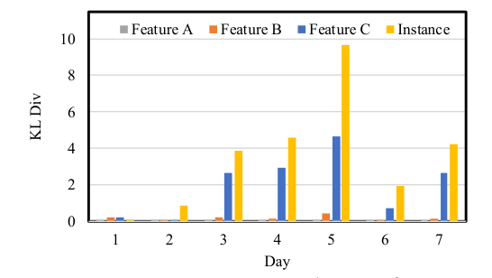
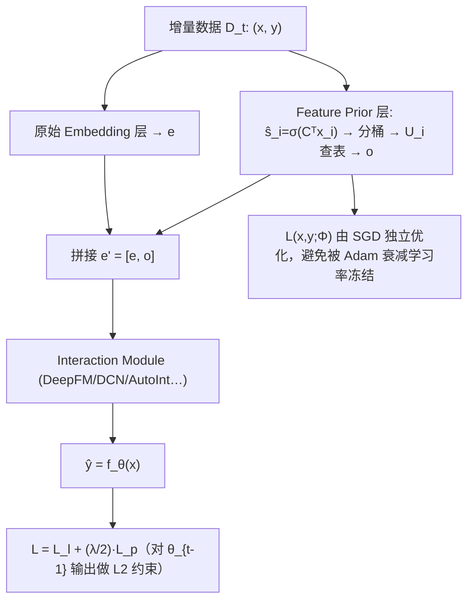
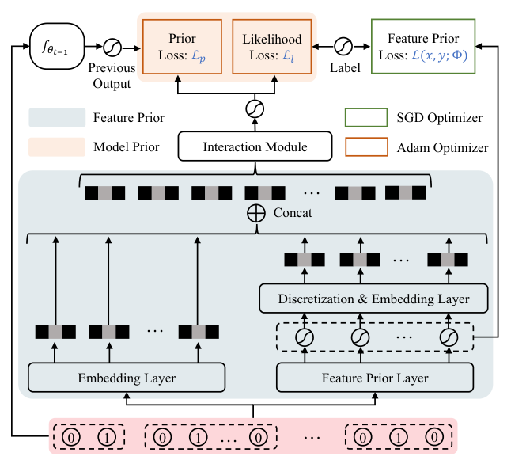

# An Incremental Update Framework for Online Recommenders with Data-Driven Prior (面向在线推荐的数据驱动先验增量更新框架)

- **会议/期刊**: CIKM 2023
- **作者与机构**: Chen Yang, Qian Yu, Xiangdong Wu 等（京东）；Jin Chen（电子科技大学）
- **推荐链路定位**: 精排（CTR 预估，滑窗增量训练）
- **研究方向**: CTR/CVR 预估与特征交叉 / 去偏公平、可信隐私与工业架构
- **论文原文**: [https://arxiv.org/abs/2312.15903v1](https://arxiv.org/abs/2312.15903v1)
- **开源代码**: 暂未开源

## TL;DR (1分钟核心速览)

在线推荐普遍采用滑窗增量更新，但新到数据分布漂移（大促、爆款曝光激增）会让模型过拟合近期样本、丢掉长期兴趣并加剧长尾劣势。本文提出 DDP：**Feature Prior (FP)** 为每个稀疏特征值单独估计平均 CTR，分桶后作为额外 embedding 拼接；**Model Prior (MP)** 由贝叶斯规则推出"增量似然 + 上一模型输出 L2 约束"的可证明先验。在 Criteo/CIKM2019 的流式（按天增量、末日测试）协议下，AUC 相对最强基线 ASMG 提升 0.22%/0.12%，长尾 AUC 相对 DeepFM 提升 0.95%，工业线上 CTR +1.99%、eCPM +2.97%。

## Background & Motivation (背景与核心矛盾)

- **主流范式**: 工业界以滑窗内新到数据 $\mathcal{D}_t$ 做增量微调，避免全量重训；持续学习类方法（IncCTR 的蒸馏 logit、ReLoop 的 hinge margin、ASMG 的 meta-learner）用上轮模型指导本轮学习。
- **前人局限**: ① 这些方法沿用通用持续学习思路，**只在 instance 级做模型先验**，未分析在线推荐"特征极稀疏 + 特征维度极高"的数据特性；② 单物品常需上万次曝光才能收敛，增量窗口下样本量远不足，参数对少数近期曝光极度敏感。
- **核心洞察 (Key Insight)**: 作者用 KL 散度量化连续 7 天统计 CTR 的漂移，发现**特征值粒度的 CTR 分布远比 instance 粒度稳定**（图 2，越稀疏的特征如 Feature C 漂移越大但仍远小于 instance 级）。特征级统计因聚合了大量样本而天然抗噪，且可泛化到同特征的冷门/长尾物品。
- **本文切入点**: 把"特征级统计先验"与"贝叶斯模型后验"两类数据驱动先验统一进端到端训练框架，模型无关（model-agnostic）地插到任意交互模块前。

<figure class="paper-figure" markdown="span">
  <figcaption>图2：连续七天统计 CTR 的 KL 距离。KL 距离衡量当日 CTR 值与平均值之间的距离。</figcaption>
</figure>

## Method (核心方法设计)

### 1. 整体框架 (Overall Architecture)

输入一条曝光样本 $\mathbf{x}=[x_1,\dots,x_M]$（$M$个 field 的 one-hot），走两条支路：主支路经原始 embedding 矩阵$\mathbf{E}$得到$\mathbf{e}=[\mathbf{e}_1,\dots,\mathbf{e}_M]$；辅支路 FP 层用每特征值一个标量先验$\hat{s}_i$估 CTR，经等宽分桶离散化后查表得到$\mathbf{o}_i$，与$\mathbf{e}_i$拼接成$\mathbf{e}'=[\mathbf{e},\mathbf{o}]$送入任意交互模块（DNN/DCN/DeepFM/AutoInt…）输出$\hat{y}=f_\theta(\mathbf{x})$。训练上双优化器：FP 参数$\Phi$用 SGD 优化特征级 BCE，其余参数$\Theta$ 用 Adam 优化"主损失 + MP 正则"。推理时 FP 只多一次查表与拼接，几乎零额外延迟。

<figure class="paper-figure" markdown="span">
  <figcaption>图1：DDP 的架构。</figcaption>
</figure>

### 2. 关键设计拆解 (Key Designs)

1. **Feature Prior：把特征级统计做成可学习 embedding**：痛点是不存在"每个特征值的历史 CTR"这种稳定信号进入模型（MECP 用离线预训练 CTR 静态塞进去，不随分布演化）。本文为每个稀疏特征值设标量 $C\in\mathbb{R}^{N\times1}$，$\hat{s}_i=\sigma(\mathbf{C}^\top\mathbf{x}_i)$，用$\mathcal{L}(\mathbf{x},y;\Phi)=-\mathbb{E}\big[\frac{1}{M}\sum_i y\log\hat{s}_i+(1-y)\log(1-\hat{s}_i)\big]$逐 field 做 BCE。由于真实 CTR 偏小，用$\mathbf{s}_i=\text{One\_Hot}(\lfloor B\sqrt{\hat{s}_i}\rfloor)$的平方根分桶把低 CTR 区间拉开分辨率，再由$\mathbf{U}_i\in\mathbb{R}^{B\times d}$ 查表得到稠密向量——本质是把"高频聚合的稳定统计量"作为软特征注入，天然利好长尾。
2. **Model Prior：贝叶斯推出输出级蒸馏**：全量后验 $\arg\max_\theta\log p(\theta\mid H_t)$展开并约去与$\theta$无关项，得$\arg\max_\theta\{\log p(\mathcal{D}_t\mid\theta)+\log p(\theta\mid H_{t-1})\}$，即"增量似然 + 历史后验"。前者化为 BCE$\mathcal{L}_l$；后者按 EWC/MRNFS 思路在**输出空间**（而非参数空间）做 Laplace 型替代，得$\mathcal{L}_p=\mathbb{E}_{\mathbf{x}\sim\mathcal{D}_t}\|f_\theta(\mathbf{x})-f_{\theta_{t-1}}(\mathbf{x})\|^2$。相比参数级约束，输出级不强行锁死 embedding，给新分布留出适应空间，只在预测函数上做锚定。
3. **训练目标与优化器分工**：总损失 $\mathcal{L}=\mathcal{L}_l+\frac{\lambda}{2}\mathcal{L}_p$，$\lambda$ 平衡拟合与稳定；无需负采样（CTR 二分类用全量曝光日志）。关键工程细节：**FP 必须用 SGD 而非 Adam**——Adam 的自适应学习率随训练衰减，会让 FP 在短期内梯度消失而过拟合，无法持续追踪特征分布漂移；其余参数仍用 Adam 保证交互模块收敛速度。

## Experimental Setup & Evaluation Protocol (实验设置与评估协议)

- **数据集与预处理**: 不做 5-core 过滤，直接使用全量曝光日志。

| 数据集 | #Instances | #Fields | 时长 | 特征/场景说明 |
| :--- | :---: | :---: | :---: | :--- |
| Criteo | 45.84M | 39 | 7 天 | 展示广告点击日志，稠密+稀疏混合特征 |
| CIKM2019 | 58.75M | 8 | 16 天 | 电商行为日志，原始标签二值化为"是否购买" |
| 工业数据 | 7B | — | 121 天 | 首页信息流广告位，含线上 A/B |

- **数据划分与防穿越 (Splitting Strategy)**: **流式时间切分（模拟在线增量）**。前 $w$天数据预热模型，其后按"天"为单位逐日增量更新，每次只在最后一天测试。Criteo：$T=7,w=3$；CIKM2019：$T=16,w=8$。严格的"用过去预测未来"，无未来信息泄漏。
- **排名评测协议 (Ranking Protocol)**: 非 ranking 任务，指标为 **AUC 与 LogLoss**；使用全量曝光样本（**不做负采样**），因此不存在采样偏差，但也不报告 calibration 之外的排序指标。实验重复 5 次（不同随机种子）。
- **对比基线与超参设置**: 基线含 6 个基础交互模型（DNN/DCN/W&D/DeepFM/FwFM/AutoInt）+ 4 个增量学习 SOTA（MECP、IncCTR、RLP、ASMG）；embedding 维度 $d=16$，隐层$[200,200,200]$，学习率与$L_2$权重网格搜索，以 AUC 选最优；最优结果标注$p<0.05$ 显著性。

## Key Experimental Results (实验关键数据)

### 1. 主实验对比 (Main Results)

| 方法 | Criteo AUC↑ | Criteo LogLoss↓ | CIKM AUC↑ | CIKM LL↓ | CIKM 长尾 AUC↑ | CIKM 长尾 LL↓ |
| :--- | :---: | :---: | :---: | :---: | :---: | :---: |
| DNN | 0.7985 | 0.4546 | 0.7588 | 0.1234 | 0.7248 | 0.1212 |
| DCN | 0.7982 | 0.4549 | 0.7588 | 0.1234 | 0.7250 | 0.1212 |
| DeepFM | 0.7996 | 0.4537 | 0.7589 | 0.1234 | 0.7248 | 0.1212 |
| AutoInt | 0.7986 | 0.4546 | 0.7587 | 0.1234 | 0.7247 | 0.1212 |
| MECP | 0.8004 | 0.4531 | 0.7594 | 0.1235 | 0.7278 | 0.1209 |
| IncCTR | 0.8007 | 0.4528 | 0.7597 | 0.1236 | 0.7275 | 0.1210 |
| RLP | 0.8005 | 0.4531 | 0.7595 | 0.1234 | 0.7273 | 0.1209 |
| ASMG | **0.8020** | **0.4517** | 0.7599 | 0.1234 | 0.7231 | 0.1213 |
| FP (仅特征先验) | 0.8031 | 0.4507 | 0.7602 | **0.1232** | **0.7325** | **0.1204** |
| **DDP (FP+MP)** | **0.8038** | **0.4500** | **0.7608** | **0.1232** | 0.7317 | 0.1205 |
| Improv. vs 最优基线 | +0.22% | +0.38% | +0.12% | +0.16% | +0.65% | +0.41% |

### 2. 消融实验 (Ablation Study)

| 配置 | Criteo AUC | Criteo LogLoss | 说明 |
| :--- | :---: | :---: | :--- |
| DeepFM (base) | 0.7996 | 0.4537 | 仅滑窗增量，无任何先验 |
| + MP only (输出 L2) | 未单列 | — | 原文未给出独立 MP 行，仅以 FP→DDP 差值体现 |
| + FP (SGD 优化) | 0.8031 | 0.4507 | 主增益来源 |
| + FP (Adam 优化) | 低于 SGD 全区间 | — | Adam 衰减 LR 使 FP 过拟合/停滞 |
| + FP + MP (DDP) | **0.8038** | **0.4500** | 两先验叠加最优 |
| FP 跨 6 种交互模块平均增益 | +0.44% | +0.66% | model-agnostic 兼容性验证 |

**工业数据（离线 + 线上）**:

| 设置 | AUC↑ | LogLoss↓ | 线上 CTR | 线上 eCPM |
| :--- | :---: | :---: | :---: | :---: |
| Base Model | 0.7382 | 0.1208 | — | — |
| DDP | **0.7425 (+0.58%)** | **0.1199 (−0.75%)** | **+1.99%** | **+2.97%** |

### 3. 关键实验发现 (Key Findings)

1. **增益主要来自 FP，MP 负责补稳定性但会牺牲长尾**：仅 FP 在 CIKM 长尾 AUC 上达 0.7325（DeepFM 0.7248，+1.07%），叠加 MP 后长尾反降至 0.7317、整体 AUC 却从 0.7602 升到 0.7608——说明输出级 L2 约束把模型拉向历史预测的一致性，对头部样本更有利，长尾收益被部分抵消。
2. **增量轮次越早、样本越少，先验越值钱**：在 CIKM2019 连续 7 天（第 10–16 天）的逐日更新中，DDP 全程优于 IncCTR/RLP/DeepFM，且与基线的 AUC/LogLoss 差距在早期最大（图 3），对应"每个特征曝光量不足时 FP 的聚合统计最抗噪"的动机。
3. **在已充分优化的 7B 级工业模型上仍有可观增量**：离线 AUC +0.58%、LogLoss −0.75%，线上 5% 流量 7 天 A/B 得 CTR +1.99%、eCPM +2.97%，证明分布漂移下的先验锚定不是小数据集上的过拟合假象，而具备真实商业收益。

## Highlights & Limitations (亮点、对比与审稿批判)

- **与代表作对比 (vs. Prior Work)**: IncCTR 用 logit 蒸馏、ReLoop 用 hinge margin、ASMG 用 meta-learner，三者均在 **instance/参数层面**做约束，不区分特征粒度；本文的差异是先论证"特征级统计比 instance 级更稳"（KL 实测），再加 FP 这条显式特征支路，并用贝叶斯推导给出 MP 的"增量似然 + 输出正则"闭式，理论链条比纯启发式蒸馏更完整。相对 MECP 用离线静态特征 CTR 的做法，FP 是端到端随流更新，对分布演化的追踪能力更强。
- **可迁移亮点**: ① $\sqrt{\hat{s}}$ 的**平方根等宽分桶**技巧可迁到任何"统计量极度右偏"（如历史 CVR、曝光频次）的离散化场景；② **FP 用 SGD、主干用 Adam** 的双优化器分工，是把"慢统计量"与"快表征"解耦的廉价工程范式；③ 输出级 L2 先验可直接套在现有工业增量训练链路上，无需改交互模块。
- **审稿级局限批判**: ① $p(\theta\mid H_{t-1})$只用**上一时刻单一模型**近似，等价于把长窗口历史压成一个 checkpoint，理论上应保留多步/参数级（EWC 式）后验，但原文未与参数级正则做对照实验；②$\lambda$、分桶数$B$、平方根变换均无敏感性分析，且引入两套优化器使调参成本翻倍；③ 评测仅 AUC/LogLoss，缺少校准误差与真实排序指标，公开数据以"天"为增量粒度，与工业分钟级滑窗仍有差距；④ 数据集统计未给出稀疏度/用户维度，"7B instances / 121 天"的工业表也缺基线工程细节，复现门槛高且无开源。

## Rating (四维评分)

- **方法创新性 (Novelty)**: ⭐⭐⭐⭐ （问题洞察扎实：用 KL 实验证明特征级 CTR 比 instance 级稳定，FP+MP 两类数据驱动先验的组合有贝叶斯推导支撑，但各组件本身（分桶统计特征 + 输出蒸馏）都是已知技术的精巧拼装）
- **评估协议与实验扎实度 (Protocol & Experiments)**: ⭐⭐⭐⭐ （流式按天切分严格防穿越、5 次种子重复 + $p<0.05$ 显著性、长尾分桶与 6 种交互模块兼容性验证、外加 7B 工业集与线上 A/B；扣分在缺 MP-only 独立消融与超参敏感性）
- **写作与数学规范度 (Clarity & Rigor)**: ⭐⭐⭐⭐ （贝叶斯推导从后验到输出级 L2 的链条清晰、FP 离散化公式完整、算法 1 伪代码可落地；但 $\lambda/2$的系数来源、$B$ 的取值与 Laplace 近似的严格性未展开）
- **工业落地与复现价值 (Industrial & Practical Value)**: ⭐⭐⭐⭐ （model-agnostic、推理仅增一次查表、线上 eCPM +2.97% 说服力强；唯无开源代码、双优化器与 $B/\lambda$ 工程调参依赖经验）

