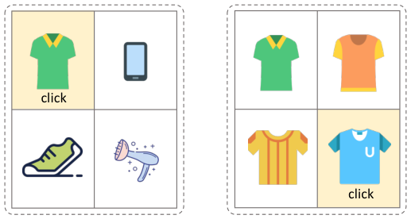
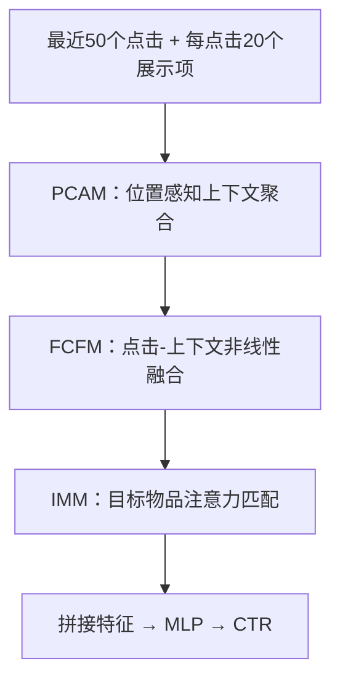
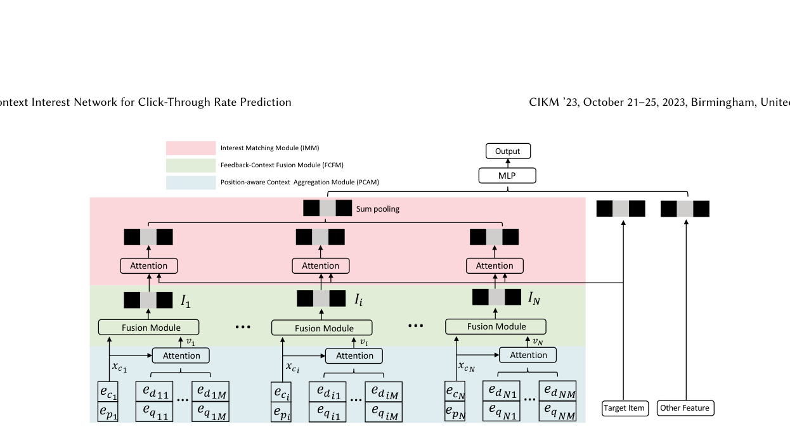

# Deep Context Interest Network for Click-Through Rate Prediction (深度上下文兴趣网络用于点击率预测)

- **会议/期刊**: CIKM 2023
- **作者与机构**: Xuyang Hou, Zhe Wang, Qi Liu, Tan Qu, Jia Cheng, Jun Lei；美团
- **推荐链路定位**: 精排（CTR 预估）
- **研究方向**: CTR/CVR 预估与特征交叉 / 序列与会话推荐
- **论文原文**: [https://arxiv.org/abs/2308.06037v1](https://arxiv.org/abs/2308.06037v1)
- **开源代码**: 暂未开源

## TL;DR (1分钟核心速览)

针对 CTR 行为建模只用点击序列、忽略点击周围展示上下文的问题，DCIN 将每个点击及其 20 个展示位视为上下文单元，以位置感知注意力聚合、非线性融合和目标兴趣匹配学习上下文感知兴趣。美团 31 天、超 10 亿曝光工业数据按前 30 天训练/最后 1 天测试、AUC 评估，DCIN 达 0.66475，较 RACP 的 0.65872 提升 0.00603（RelaImpr 21.24%），线上 CTR/RPM 各 +1.5%。

## Background & Motivation (背景与核心矛盾)

- **主流范式**: DIN/DIEN 用目标注意力或 GRU 建模点击兴趣，DFN 引入未点击负反馈，RACP 做页面级反馈建模。
- **前人局限**: ①仅点击正反馈或分离点击/未点击，忽略同一屏内展示项对点击的竞争影响；②RACP 按页面聚合，无法区分同页不同点击的细粒度兴趣，且未建模位置偏置。
- **核心洞察 (Key Insight)**: 同一物品在不同展示上下文中被点击的概率不同，点击是“物品-兴趣匹配”与“周围替代品竞争”共同作用的结果。
- **本文切入点**: 将每个点击与其周围展示项绑定，学习点击级、位置感知的上下文兴趣，再做目标物品匹配。

<figure class="paper-figure" markdown="span">
  <figcaption>图 1：展示上下文示意图。用户对某一物品的点击行为可能受到其他展示物品的影响。</figcaption>
</figure>

## Method (核心方法设计)

### 1. 整体框架 (Overall Architecture)

输入为用户最近 50 个点击及每点击周围 20 个展示项；PCAM 对每个点击聚合展示上下文并注入绝对/相对位置，FCFM 用 MLP 融合点击与上下文，IMM 以目标物品为 query 对 $N$ 个上下文兴趣做注意力汇聚，最后拼接特征经 MLP 输出 CTR。训练为曝光级点式 NLL；线上因 PCAM/FCFM 与目标无关，可离线预计算兴趣向量，仅 IMM 在线执行。

<figure class="paper-figure" markdown="span">
  <figcaption>图 2：DCIN 网络的架构。</figcaption>
</figure>

### 2. 关键设计拆解 (Key Designs)

1. **Position-aware Context Aggregation Module (PCAM)**：痛点在于只建模点击向量会丢失“同屏竞品”与位置偏置；PCAM 对每个点击 $c_i$的展示项做注意力加权：$\boldsymbol{v}_i=\sum_{j=1}^{M}\mu_{ij}\boldsymbol{W}_V\boldsymbol{e}_{d_{ij}}$，其中$\mu_{ij}=\frac{\exp(\alpha_{ij})}{\sum_{j'=1}^{M}\exp(\alpha_{ij'})}$，$\alpha_{ij}=\boldsymbol{W}_Q\boldsymbol{x}_{c_i}\cdot\boldsymbol{W}_K\boldsymbol{x}_{d_{ij}}+e_{r_{ij}}$，$\boldsymbol{x}_{c_i}=\mathrm{concat}(\boldsymbol{e}_{c_i},\boldsymbol{e}_{p_i})$。相对位置 embedding 直接进入注意力打分，使模型区分“点击居中/边缘”与上下文竞争强度。

2. **Feedback-Context Fusion Module (FCFM)**：若直接把上下文向量当兴趣，点击与上下文的冲突/一致信息未被显式表达；FCFM 用差分与逐元素积构造输入：$\boldsymbol{f}_i^{(0)}=\mathrm{concat}(\boldsymbol{x}_{c_i},\boldsymbol{v}_i,\boldsymbol{x}_{c_i}-\boldsymbol{v}_i,\boldsymbol{x}_{c_i}\odot\boldsymbol{v}_i)$，再经$\boldsymbol{f}_i^{(k+1)}=\mathrm{ReLU}(\boldsymbol{W}^{(k)}\boldsymbol{f}_i^{(k)}+\boldsymbol{b}^{(k)})$得到$\boldsymbol{I}_i=\boldsymbol{f}_i^{(2)}$。差/积项让模型感知“点击与展示环境是否一致”，比简单拼接更易捕捉竞争性上下文。

3. **Interest Matching、训练目标与推理效率**：IMM 沿用 DIN 式目标注意力，$\boldsymbol{U}=\sum_{i=1}^{N}\frac{\exp(\boldsymbol{e}_t^{\top}\boldsymbol{I}_i)}{\sum_{j=1}^{N}\exp(\boldsymbol{e}_t^{\top}\boldsymbol{I}_j)}\boldsymbol{I}_i$，激活与目标物品相关的兴趣。训练采用曝光级点式 NLL：$\mathcal{L}=-\frac{1}{B}\sum_{b=1}^{B}[y_b\log\hat{y}_b+(1-y_b)\log(1-\hat{y}_b)]$，无额外负采样；线上预计算$\{\boldsymbol{I}_i\}$，仅 IMM 依赖目标物品，序列可达 RACP 的 28 倍而在线仅增约 1ms。

## Experimental Setup & Evaluation Protocol (实验设置与评估协议)

- **数据集与预处理**: 美团 31 天工业广告日志，保留最近 50 个点击，每点击取周围 20 个展示项（尽量让点击居中）。

| 数据集 | #Users | #Items | #Interactions | 稀疏度/密度 | 特征/场景说明 |
| :--- | :---: | :---: | :---: | :---: | :--- |
| 美团31天广告日志 | 未披露 | 未披露 | >1B 曝光 | 未披露 | 点击序列+展示上下文+绝对/相对位置 |

- **数据划分与防穿越 (Splitting Strategy)**: 全局时间戳切分，前 30 天训练，最后 1 天测试，避免未来信息穿越。
- **排名评测协议 (Ranking Protocol)**: 非全库排序任务；采用曝光样本点式 CTR 预估与 AUC 评估，无采样负例排序。
- **对比基线与超参设置**: 对比 Wide&Deep、DeepFM、DIN、DIEN、DFN、RACP；Embedding 维度 $d=16$，FCFM MLP 为 64/16，输出层 1024/512/128；Adam，学习率 1e-4，batch 3000；5 次重复取均值；原文未报告显著性检验。

## Key Experimental Results (实验关键数据)

### 1. 主实验对比 (Main Results)

| Model | AUC | RelaImpr |
| :--- | :---: | :---: |
| Wide&Deep | 0.63588 | 0.00% |
| DeepFM | 0.63602 | 0.10% |
| DIN | 0.65012 | 10.48% |
| DIEN | 0.65102 | 11.14% |
| DFN | 0.65220 | 12.01% |
| RACP | 0.65872 | 16.81% |
| DCIN (short) | 0.66186 | 19.12% |
| **DCIN** | **0.66475** | **21.24%** |

DCIN 较 RACP 的 AUC 绝对提升 0.00603（约 +0.92%），RelaImpr 相对 Wide&Deep 计算。

### 2. 消融实验 (Ablation Study)

| 变体 | AUC | RelaImpr | ΔAUC vs DCIN(short) |
| :--- | :---: | :---: | :---: |
| DCIN (short) | 0.66186 | 19.12% | — |
| w/o position | 0.65850 | 16.64% | -0.00336 |
| w/o FCFM | 0.65950 | 17.38% | -0.00236 |

### 3. 关键实验发现 (Key Findings)

- DCIN 全量版较 RACP 提升 0.00603 AUC（0.66475 vs 0.65872），即使同序列长度的 DCIN(short) 也提升 0.00314，说明点击级上下文优于页面级聚合。
- 去掉位置信息后 AUC 降至 0.65850，几乎退回 RACP 水平；去掉 FCFM 降至 0.65950，说明位置编码与点击-上下文非线性融合各自独立贡献。
- 两周线上 A/B 相对 DIN 的 CTR/RPM 各 +1.5%；预计算使行为序列扩展到 RACP 的 28 倍而仅增约 1ms 延迟，验证工业可部署性。

## Highlights & Limitations (亮点、对比与审稿批判)

- **与代表作对比 (vs. Prior Work)**: DIN/DIEN 仅用点击兴趣，DFN 分离点击/未点击，RACP 做页面级兴趣；DCIN 首次把“点击级展示上下文+位置偏置”联合注入 CTR 兴趣建模，且不依赖未点击信号。
- **可迁移亮点**: 目标无关的 PCAM/FCFM 可离线预计算，适合长序列在线服务；FCFM 的差分/逐元素积融合可迁移到任意“主行为+环境上下文”建模。
- **审稿级局限批判**: 使用私有工业数据且无开源代码，公开复现困难；仅报告 AUC，未给 LogLoss、校准或排序指标与显著性检验，固定 20 个展示项、50 长序列的超参敏感度也未充分分析。

## Rating (四维评分)

- **方法创新性 (Novelty)**: ⭐⭐⭐⭐ （把展示上下文与位置引入点击级兴趣建模，相对 RACP 的页面级聚合更细粒度）
- **评估协议与实验扎实度 (Protocol & Experiments)**: ⭐⭐⭐ （31 天十亿级样本与线上 A/B 扎实，但私有数据、无公开复现且未报告显著性）
- **写作与数学规范度 (Clarity & Rigor)**: ⭐⭐⭐⭐ （模块、公式与线上优化交代清晰，符号较简洁，复杂度分析略简）
- **工业落地与复现价值 (Industrial & Practical Value)**: ⭐⭐⭐⭐⭐ （已上线主流量，CTR/RPM 各 +1.5%，预计算仅增约 1ms，落地价值高）

