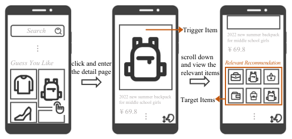
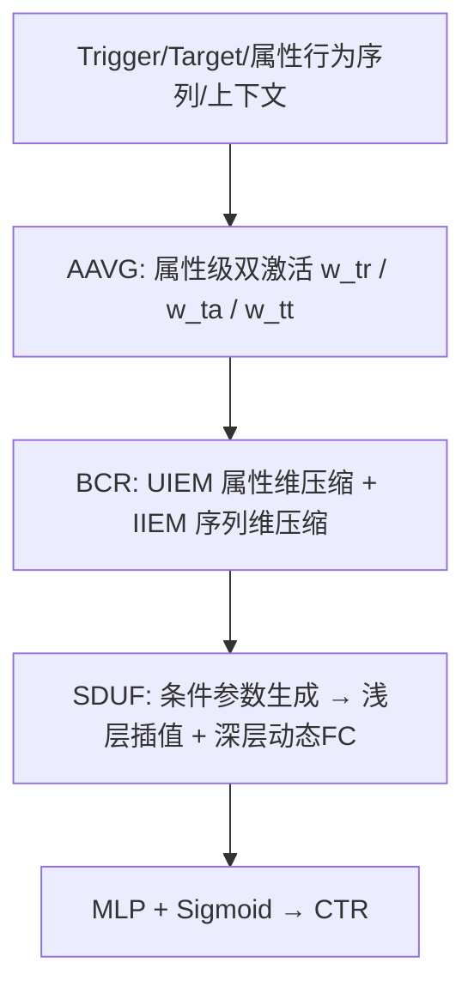
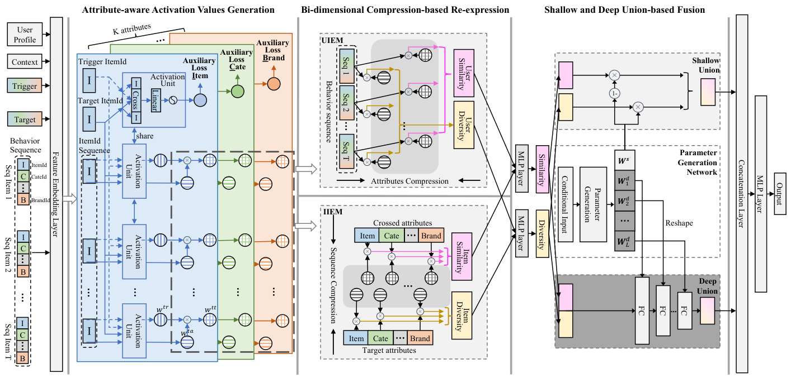
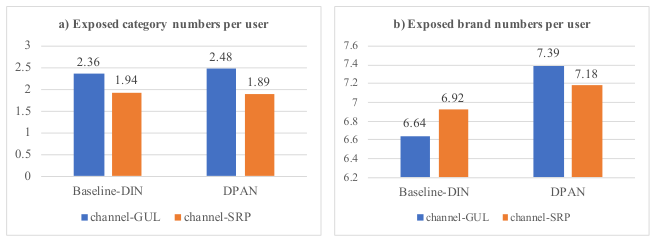

# DPAN: Dynamic Preference-based and Attribute-aware Network for Relevant Recommendations (面向相关推荐动态偏好与属性感知网络)

- **会议/期刊**: CIKM 2023
- **作者与机构**: Wei Dai, Yingmin Su, Xiaofeng Pan, Yufeng Wang (南京邮电大学), Zhenyu Zhu, Nan Xu, Chengjun Mao, Bo Cao — 淘宝天猫集团
- **推荐链路定位**: 精排（商品详情页「相关推荐」场景的 CTR 预估）
- **研究方向**: CTR/CVR 预估与特征交叉 / 序列与会话推荐
- **论文原文**: [https://arxiv.org/abs/2308.10527v1](https://arxiv.org/abs/2308.10527v1)
- **开源代码**: [https://github.com/DavidNeson/DPAN](https://github.com/DavidNeson/DPAN)

## TL;DR (1分钟核心速览)

相关推荐（详情页为"触发商品 trigger"配对相关商品 target）中，候选全部与 trigger 相关，因此条目级多样性度量过粗，且用户对"相似 vs. 多样"的偏好随渠道/意图动态变化，现有 DIN 系列与 R3S/DIHN 均未建模该维度。DPAN 用属性级双激活（AAVG）区分"与 trigger 相似"和"与 target 相关"两种权重，再用双维压缩（BCR）分别压缩出用户兴趣与商品信息的相似/多样表征，最后用条件参数生成网络（SDUF）动态调制融合比例。在 5,935 万曝光工业数据上以全局时间切分、曝光级 AUC 评估，AUC 0.5992→0.6098（RelaImpr +10.69%），线上 A/B 相对 DIN 提升 CTR 7.62%。

## Background & Motivation (背景与核心矛盾)

- **主流范式**: 工业相关推荐多沿用 DIN/DIEN 的 target-attention 序列建模，或用 R3S/DIHN 显式注入 trigger-target 相关性特征，最终以 MLP 拼接过 CTR 塔。
- **前人局限**: ① DIN/DIEN 只做"序列 vs. target"单侧激活，无法表达"该项既像 trigger 又像 target"的二阶一致性；② R3S/DIHN 把 trigger 意图压缩成单一向量，未刻画"用户希望结果更相似还是更多样"这一偏好维度。
- **核心洞察 (Key Insight)**: 同一 trigger 商品，用户从搜索页（SRP）点入时目标明确、倾向比价同类；从首页猜你喜欢（GUL）点入则更偏浏览探索、接受跨类目跨品牌。故"多样性"应定义在**属性级**（类目/品牌/价格/标题）而非条目级，且其权重应由条件上下文动态决定。
- **本文切入点**: 把"相似性表征"与"多样性表征"作为两路显式解耦特征，再用条件生成参数决定二者混合比。

<figure class="paper-figure" markdown="span">
  <figcaption>图1：我们在线平台商品详情页相关推荐的示意图。</figcaption>
</figure>

## Method (核心方法设计)

### 1. 整体框架 (Overall Architecture)

输入侧将 trigger $\boldsymbol{e}_{tr}$、target$\boldsymbol{e}_{ta}$、行为序列$\boldsymbol{e}_s$、用户画像与上下文（渠道、浏览时段、促销）统一嵌入，并按属性把序列拆成$K$条属性子序列。AAVG 对每条子序列施以 trigger/target 双路激活，输出双激活权重$w^{tt}_{ik}$与 target 权重$w^{ta}_{ik}$；BCR 沿属性维压缩得用户兴趣的相似/多样向量，沿序列维压缩得商品信息的相似/多样向量；四者拼接后经 MLP 聚合成$\boldsymbol{v}^{sim}$、$\boldsymbol{v}^{div}$。SDUF 依据条件向量生成浅层插值权重与深层 FC 权重矩阵，输出融合向量后与原始特征拼接送入打分塔算 CTR，损失为 logloss 加属性级辅助损失之和。

<figure class="paper-figure" markdown="span">
  <figcaption>图2：DPAN 的整体架构。核心方法包括属性感知激活值生成（AAVG）、基于双维度压缩的重表达（BCR）以及基于浅层与深层联合的融合（SDUF）。</figcaption>
</figure>

### 2. 关键设计拆解 (Key Designs)

1. **AAVG 属性级三重激活 + 属性辅助损失**：目标是让"相似"与"相关"可分离。对第 $k$个属性的序列元素$\boldsymbol{a}^s_{ik}$，用与 DIN 同构但**同属性共享参数**的 activation unit 分别与$\boldsymbol{a}^{tr}_k$、$\boldsymbol{a}^{ta}_k$交互，得$w^{tr}_{ik}$、$w^{ta}_{ik}$，并以 Hadamard 交叉构造双激活分$w^{tt}_{ik}=w^{tr}_{ik}\cdot w^{ta}_{ik}$；同时对每个属性加一个"该属性是否被点击"的辅助二分类损失$\mathcal{L}_{aux,k}=-\frac{1}{|\mathcal{D}|}\sum_{(\boldsymbol{x},y)}(y\log\hat{y}_k+(1-y)\log(1-\hat{y}_k))$。直觉：双激活只有在元素**同时**贴近 trigger 与 target 时才高分，天然对应"相似"；单侧 target 激活则刻画"相关但不相似"的多样性来源，辅助损失防止弱属性（如价格/标题）嵌入被主任务梯度淹没。

2. **BCR 双维压缩重表达**：作者意识到相似/多样的差异体现在"压缩方向"上。UIEM 沿**属性维**对得分取均值（$\frac{1}{K}\sum_k w^{ta}_{ik}$）做加权池化，得用户兴趣多样性$\boldsymbol{v}^{div}_U=\sum_{i=1}^{T}(\frac{1}{K}\sum_{k=1}^{K}w^{ta}_{ik})\boldsymbol{e}^s_i$；把$w^{ta}$换成$w^{tt}$即得相似性$\boldsymbol{v}^{sim}_U$。IIEM 沿**序列维**取均值（$\frac{1}{T}\sum_i w^{ta}_{ik}$）赋权给 target 的属性交叉项$cross(\boldsymbol{a}^{tr}_k,\boldsymbol{a}^{ta}_k)$得$\boldsymbol{v}^{sim}_I$，赋权给$\boldsymbol{a}^{ta}_k$（剔除 trigger）得$\boldsymbol{v}^{div}_I$。物理直觉：UIEM 回答"历史里哪些行为像"，IIEM 回答"这个商品的哪些属性像"，两维互补。

3. **SDUF 条件参数生成与训练目标**：条件向量 $\boldsymbol{h}_{cond}$（渠道、浏览时段、trigger 信息，**刻意排除 target 以防后验穿越**）经参数生成网络输出$\boldsymbol{W}=\mathrm{PG}(\boldsymbol{h}_{cond})\Rightarrow[\boldsymbol{W}_s,\boldsymbol{W}_{d1},\dots,\boldsymbol{W}_{dL}]$；浅层用$\boldsymbol{v}^{su}=\boldsymbol{W}_s\otimes\boldsymbol{v}^{div}+(1-\boldsymbol{W}_s)\otimes\boldsymbol{v}^{sim}$做逐元素软插值，深层把$\boldsymbol{W}_{dl}$reshape 成$\mathbb{R}^{d_{l-1}\times d_l}$后做$\boldsymbol{h}_l=\sigma(\boldsymbol{h}_{l-1}\boldsymbol{W}_l)$。总损失$\mathcal{L}=\mathcal{L}_{main}+\alpha\sum_k\mathcal{L}_{aux,k}$（$\alpha=0.1$）。负样本采用"曝光未点击、且位于点击项邻近位置"的样本以剔除快速滑屏噪声；推理仅多一次 MLP 生成参数，无 ANN 检索开销，可直接插在现有精排链路。

## Experimental Setup & Evaluation Protocol (实验设置与评估协议)

- **数据集与预处理**（自建工业日志，2022/05/01–05/14，业界无公开相关推荐数据集）：

| 数据集 | #Users | #Triggers | #Items | #Impressions | #Clicks |
| :--- | :---: | :---: | :---: | :---: | :---: |
| Taobao Relevant-Rec | 2,835,644 | 3,321,513 | 8,262,925 | 59,355,035 | 13,668,100 |

- **数据划分与防穿越**: 全局时间戳切分——05/01–05/13 训练、05/14 测试，两段不重叠；此设置保证不泄漏未来行为，也解释了 AUC 绝对值偏低（0.60 量级，正样本率约 23%）。
- **排名评测协议**: 使用 **曝光级点估计 AUC** 而非 Top-K 排序指标（无 Full-Ranking / Sampled Ranking 之分），配合 RelaImpr 衡量相对提升；线上以半个月等流量 A/B（日活 >60 万）验证 CTR。
- **对比基线与超参**: DIN、DIEN、DHAN、R3S+DIN（R3S 无序列建模，故配 DIN）、DIHN；TensorFlow 1.12，batch 1024，Adagrad lr=0.01，属性嵌入 16 维、聚合表征 128 维，序列截断 $T=50$，深层 union 为 2 层 [256,128]，$\alpha=0.1$；属性含 item/brand/category/price/title。

## Key Experimental Results (实验关键数据)

### 1. 主实验对比 (Main Results)

| Model | AUC | RelaImpr |
| :--- | :---: | :---: |
| DIN | 0.5992 | 0.0% |
| DIEN | 0.6009 | 1.71% |
| DHAN | 0.6025 | 3.33% |
| R3S+DIN | 0.6037 | 4.54% |
| DIHN | 0.6052 | 6.05% |
| **DPAN** | **0.6098** | **+10.69%** |

### 2. 消融实验 (Ablation Study)

| 变体 | AUC | Δ vs. Full |
| :--- | :---: | :---: |
| Full DPAN | **0.6098** | — |
| w/o Auxiliary Loss | 0.6086 | −0.0012 |
| w/o 多属性（仅 item） | 0.6073 | −0.0025 |
| w/o User Similarity | 0.6073 | −0.0025 |
| w/o Item Similarity | 0.6065 | −0.0033 |
| w/o Shallow Union | 0.6092 | −0.0006 |
| w/o Deep Union | 0.6079 | −0.0019 |

### 3. 关键实验发现 (Key Findings)

1. **"相似性"通路比"多样性"通路更难替代**：移除 Item Similarity 造成最大跌幅（0.6098→0.6065），移除 User Similarity 次之（0.6073），而多样性分支是保留项；说明在候选已高度相关的场景中，区分"更像 trigger"才是精排的稀缺信号，多样表征只在条件调制下提供增量。
2. **属性粒度是关键增益源**：仅保留 item 单一属性即掉 0.0025 AUC，接近去掉整个用户相似分支的损失，说明 price/title/brand 等弱属性经双激活后被有效利用；辅助损失贡献 0.0012，验证了多属性嵌入需要独立监督以抵抗主任务稀疏梯度。
3. **动态调制的收益集中在深层**：去掉深层 union 掉 0.0019，去掉浅层仅掉 0.0006，即参数生成在非线性高维空间做调制比线性插值更有价值。案例侧（图 3）显示 DPAN 在 GUL 渠道人均曝光类目数由 DIN 的 2.36 升至 2.48、品牌数 6.64 升至 7.39，而 SRP 渠道类目数由 1.94 降至 1.89（更聚焦），与"渠道即意图先验"的设计动机一致，线上 CTR 相对 DIN 提升 7.62%。

<figure class="paper-figure" markdown="span">
  <figcaption>图3：用户从不同渠道点击时每位用户曝光的类别数和品牌数。</figcaption>
</figure>

## Highlights & Limitations (亮点、对比与审稿批判)

- **与代表作对比 (vs. Prior Work)**: 与 DIN/DIEN 相比，DPAN 把"单侧 target attention"升级为"trigger×target 双激活"，多出一个正交的偏好维度；与 R3S+DIN（直接拼 trigger-target 交互特征，4.54%）和 DIHN（先抽 trigger 意图再抽兴趣，6.05%）相比，本文不把 trigger 压成意图向量，而是让它**参与每条行为的属性级打分**，从而保留细粒度而不丢失序列信息。
- **可迁移亮点**: ①"双激活交叉 + 属性维/序列维分别压缩"可作为通用的相似-多样解耦表征模块，迁移到同店推荐、搭配推荐、跨域召回的打分特征；②用条件参数生成做两路表征的软插值，比重排阶段的规则打散更轻量，可替代线上多样性重排中的启发式阈值。
- **审稿级局限批判**: ①评估仅用曝光级 AUC，缺少 GAUC / NDCG 等排序与多样性（如 ILAD、覆盖率）指标，"多样性提升"的证据只停留在人均曝光类目数这类离线统计与案例图上，缺乏在线多样性-相关性权衡曲线；②动态参数生成对渠道/时段等条件强依赖，冷启动渠道或条件组合稀疏时的参数质量未做分桶分析，且论文未报告推理延迟与参数量增量，工业复现成本仍靠工程经验补足。

## Rating (四维评分)

- **方法创新性 (Novelty)**: ⭐⭐⭐⭐ （属性级双激活 + 双维压缩的相似/多样解耦组合新颖，但整体仍是 DIN 激活单元与动态参数网络的工程化拼装，缺理论支撑）
- **评估协议与实验扎实度 (Protocol & Experiments)**: ⭐⭐⭐ （数据集规模与线上 A/B 说服力强，但仅单一 AUC 指标、单日测试集、无显著性检验与方差报告）
- **写作与数学规范度 (Clarity & Rigor)**: ⭐⭐⭐⭐ （AAVG/BCR/SDUF 三模块公式完整清晰、动机与案例自洽，个别符号如 $cross(\cdot)$与$\otimes$ 定义略简）
- **工业落地与复现价值 (Industrial & Practical Value)**: ⭐⭐⭐⭐⭐ （已在淘宝主流量上线、CTR +7.62%，代码开源，模块可即插即用于现有精排链路）

