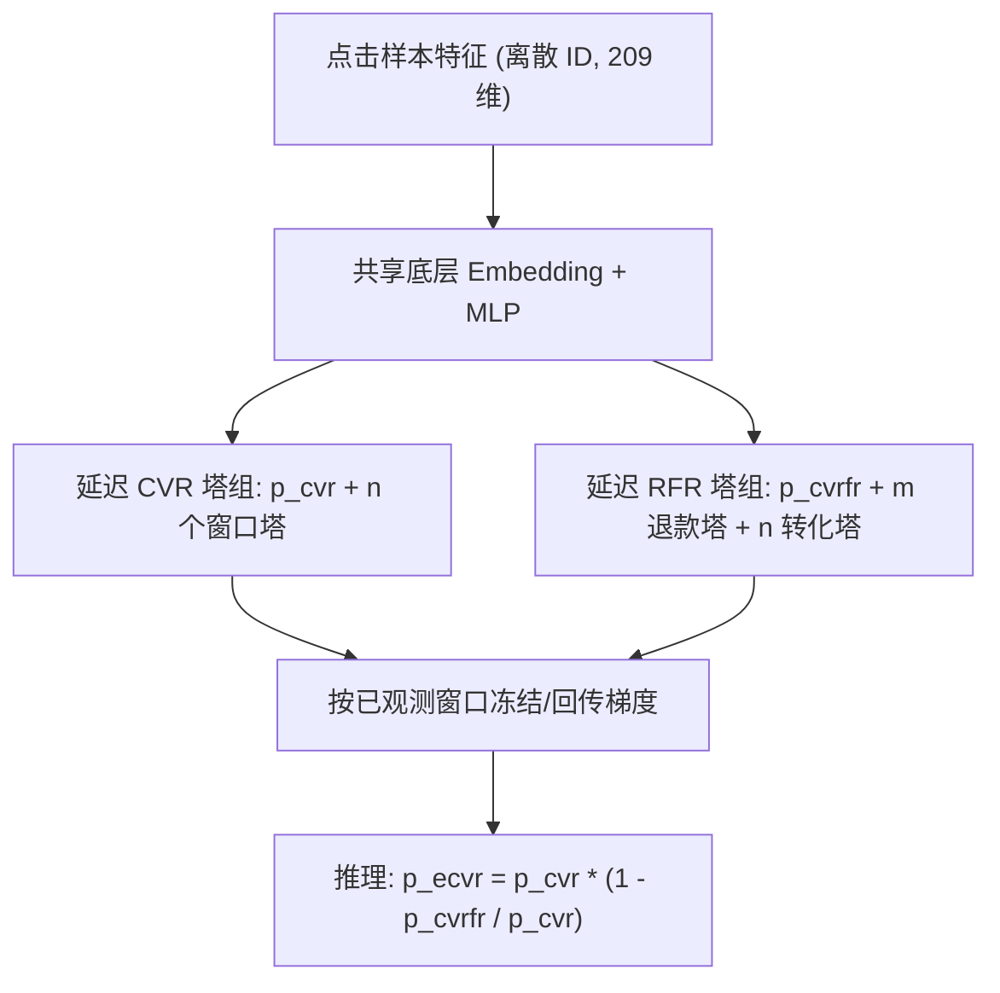
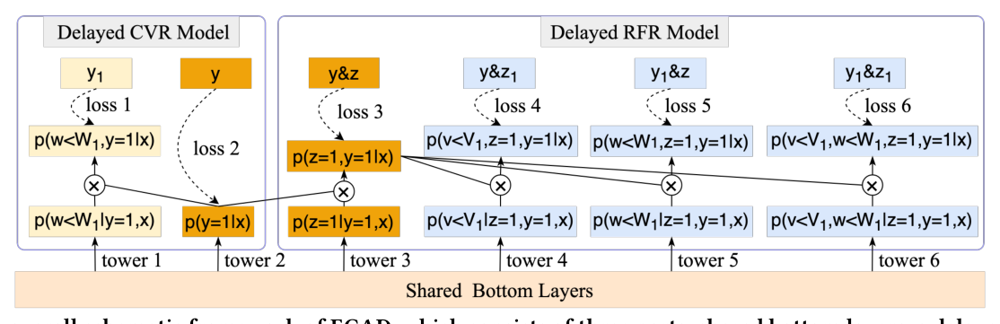

# Entire Space Cascade Delayed Feedback Modeling for Effective Conversion Rate Prediction (面向有效转化率预估的全空间级联延迟反馈建模)

- **会议/期刊**: CIKM 2023
- **作者与机构**: Yunfeng Zhao, Xiaoqiang Gui, Guoxian Yu (山东大学软件学院)；Xu Yan, Shuguang Han, Xiang-Rong Sheng, Jufeng Chen, Zhao Xu, Bo Zheng (阿里巴巴)
- **推荐链路定位**: 精排（CVR/ECVR 预估）
- **研究方向**: CTR/CVR 预估与特征交叉 / 多任务学习与辅助任务
- **论文原文**: [https://arxiv.org/abs/2308.04768v1](https://arxiv.org/abs/2308.04768v1)
- **开源代码**: 暂未开源

## TL;DR (1分钟核心速览)

电商场景中"下单后又退款"极为常见，平台真正关心的是**有效转化率 ECVR**（点击后购买且最终不退款）。本文把 $p_{ecvr}$分解为$p_{cvr}(1-p_{rfr})$，指出 RFR 子任务同时受数据稀疏 (DS)、样本选择偏差 (SSB) 以及**转化/退款双事件序贯延迟 (Cascade Delayed Feedback, CDF)** 三重困境。ECAD 借用 ESMM 的全空间思想构造 CVR 与 CVRFR 双任务消除 DS/SSB，再把 Defer 的单事件多窗口辅助塔扩展为级联多窗口，使"最新点击但标签未定型"的样本也能贡献梯度。阿里 0.56B 工业样本上 ECVR AUC 0.8621，相对提升 RI-AUC 76.47%，线上 7 天 A/B ECVR +5.21% 并已全量部署。

## Background & Motivation (背景与核心矛盾)

- **主流范式**: CVR 预估靠 ESMM 类全空间建模解决 SSB/DS；延迟反馈靠 Defer 类多窗口辅助任务利用转化时延；ECVR 通常被粗暴地当作单个二分类标签端到端训练。
- **前人局限**: ① 独立建模 (IM) 中 RFR 塔只在约 16% 的转化样本上训练，监督信号极稀；且训练用转化样本、推理用全点击样本，分布严重错位。② 直接学 ECVR 需要同时等满 $W$与$V$两个归因窗口（论文设$W=V=3$ 天，即第 5 天才拿到标签），数据新鲜度崩塌，无法跟上分布漂移。
- **核心洞察 (Key Insight)**: 转化与退款是 `click → conversion → refund` 的**序贯依赖**链，两级延迟会级联放大；但正因存在时延 $w,v$，它们本身可作为"提前可观测"的辅助监督信号，让近期样本在窗口未满时也能参与训练。
- **本文切入点**: 用全空间框架把 RFR 的建模空间从"转化样本"扩展到"点击样本"，再用级联多窗口辅助任务把 CDF 拆成两组单级延迟问题分别消化。

## Method (核心方法设计)

### 1. 整体框架 (Overall Architecture)

ECAD 采用共享底层 Embedding&MLP：离散 ID 特征经共享 embedding（占据绝大部分参数）映射为定长向量，同时喂入两个塔组——**延迟 CVR 模型**（1 个主塔 $p_{cvr}$+$n$个窗口塔）与**延迟 RFR 模型**（1 个主塔$p_{cvrfr}$+$m$个退款窗口塔 +$n$个转化窗口塔 + 若干联合塔）。训练时按样本已到达的窗口位置只回传已观测标签对应的损失，未到期塔的梯度被冻结，从而最大化近期样本的利用率；推理时仅需一次前向得到$p_{cvr}$与$p_{cvrfr}$，再依式(1)组合成$p_{ecvr}$，开销与 ESMM 同量级。

<figure class="paper-figure" markdown="span">
  <figcaption>图1：ECAD的整体示意框架，由三部分组成：共享底层、延迟CVR模型和延迟RFR模型。共享底层以样本特征（即离散ID）为输入并输出固定长度向量，然后将该向量输入延迟CVR和延迟RFR模型的塔中以预测相应概率。𝑉1和𝑊1分别表示转化和退款的预定义窗口。</figcaption>
</figure>

### 2. 关键设计拆解 (Key Designs)

1. **全空间 CVRFR 任务替代 RFR 塔（治 DS + SSB）**：痛点在于 $p_{rfr}=p(z=1,y=1\mid\mathbf{x})/p(y=1\mid\mathbf{x})$的除法形式在$p_{cvr}\approx 0.67\%$时极易爆掉。ECAD 改为**乘法分解**、直接在全点击空间上建模联合概率：$p(z=1\mid y=1,\mathbf{x})=p(z=1,y=1\mid\mathbf{x})/p(y=1\mid\mathbf{x})$，而训练损失写成
$$\mathcal{L}=-\sum_{\mathbf{x}} l\big(p(y=1\mid\mathbf{x}),y\big)-\sum_{\mathbf{x}} l\big(p(z=1,y=1\mid\mathbf{x}),y\,\&\,z\big)$$
这样 RFR 塔虽只在转化样本上有正样本，但其共享 embedding 被 560M 点击样本充分驱动，同时训练/推理空间被拉齐——一举消除数值不稳、DS 与 SSB。

2. **级联延迟辅助塔（治 CDF）**：把 Defer 的单事件窗口扩展到两级序贯依赖，先加入
$$\sum_{i} l\big(p(w<W_i,y=1\mid\mathbf{x}), y_i\big)+\sum_{i} l\big(p(v<V_i,z=1,y=1\mid\mathbf{x}), y\,\&\,z_i\big)$$
进一步追加 $n$个$p(w<W_i\mid z=1,y=1,\mathbf{x})$塔与$n\times m$个联合塔，使"已转化但退款窗口未满"或"刚点击未转化"的样本都能找到可用的部分标签，把等待周期从$W+V$压缩到$W_i$或$V_j$ 量级。

3. **独立性近似降塔 (ECAD-Lite)**：完整式(7) 的塔数会膨胀到 $n m+2n+m+2$。ECAD-Lite 假设在给定$z=1,y=1$ 条件下转化时延与退款时延独立：
$$p(v<V_i,w<W_j\mid z=1,y=1,\mathbf{x})\approx p(v<V_i\mid\cdot)\cdot p(w<W_j\mid\cdot)$$
塔数降至 $2n+m+2$，工程可实现性大幅提升；实验证明近似几乎无损。训练无显式负采样（全空间真实样本），单 epoch、Adagrad-Decay、lr 0.05、batch 256。

## Experimental Setup & Evaluation Protocol (实验设置与评估协议)

- **数据集与预处理**: 无公开 ECVR 数据集，作者采集阿里推荐系统 11 天点击日志构建工业数据集（无 5-core 过滤，保留全量真实分布）。

| 数据集 | #Users | #Items | #Interactions | 稀疏度/密度 | 特征/场景说明 |
| :--- | :---: | :---: | :---: | :---: | :--- |
| Alibaba Production | 未披露 | 未披露 | 5.6 亿点击 (转化 375 万 / 退款 61 万 / 有效转化 314 万) | 转化率 ≈0.67%，转化后退款率 ≈16.3% | 209 个稠密/稀疏特征，电商推荐场景 |

- **数据划分与防穿越 (Splitting Strategy)**: **全局时间戳切分**——前 10 天训练、第 11 天测试；测试集随机切 10 份取均值。转化/退款归因窗口均设 $W=V=3$ 天，各基线按窗口剩余天数截断训练数据（如 CVR-Base 用倒数第 2 天前点击样本），严格模拟线上可用数据。
- **排名评测协议 (Ranking Protocol)**: **Full-Ranking（全测试集 AUC 与 PR-AUC，无采样负例）**；并定义归一化相对指标 $RI\text{-}AUC=\frac{AUC_{m}-AUC_{base}}{AUC_{Oracle}-AUC_{base}}$，以 ESMM-Oracle 为上界，衡量模型离"全标签理想模型"的距离。
- **对比基线与超参设置**: 9 个基线覆盖三类范式——单任务截断（CVR-Base / RFR-Base / ECVR-Base）、独立分解（IM、IM-Defer）、全空间（ESMM、ECAD-De、ECAD-Lite、ECAD）外加 Oracle 上界。Embedding/塔隐层统一 $d=\{512,256,128\}$、LeakyReLU、单 epoch；显著性用 student pairwise$t$-test（$p<0.05$，表中 ◦/• 标记）。

## Key Experimental Results (实验关键数据)

### 1. 主实验对比 (Main Results)

| 方法 | CVR AUC | RFR AUC | **ECVR AUC** | ECVR RI-AUC | **ECVR PR-AUC** | ECVR RI-PR-AUC |
| :--- | :---: | :---: | :---: | :---: | :---: | :---: |
| ECVR-Base (直接建模) | – | – | 0.8582 | 0.00% | 0.0458 | 0.00% |
| IM (独立 CVR×RFR) | 0.8568 | 0.6705 | 0.8593 | 21.57% | 0.0472 | 40.00% |
| IM-Defer | 0.8589 | 0.6716 | 0.8596 | 27.45% | 0.0469 | 31.43% |
| ESMM | 0.8565 | 0.6747 | 0.8591 | 17.65% | 0.0466 | 22.86% |
| ECAD-De (式 6) | 0.8584 | 0.6763 | 0.8610 | 54.90% | 0.0473 | 42.86% |
| ECAD-Lite (式 8) | 0.8587 | 0.6784 | 0.8616 | 66.67% | 0.0475 | 48.57% |
| **ECAD (式 7)** | **0.8595** | **0.6800** | **0.8621** | **76.47%** | **0.0480** | **62.86%** |
| ESMM-Oracle (上界) | 0.8612 | 0.6846 | 0.8633 | 100.00% | 0.0493 | 100.00% |

> 在线 A/B（7 天，对照 ECVR-Base）：**ECVR +5.21%**，已在阿里某推荐系统全量部署。

### 2. 消融实验 (Ablation Study)

| 变体 | 移除/替换内容 | RFR AUC | ECVR AUC | Δ ECVR vs ECAD |
| :--- | :--- | :---: | :---: | :---: |
| ECAD-De | 去掉 $p(w<W_i\mid z=1,y=1)$ 与联合塔（式 6） | 0.6763 | 0.8610 | −0.0011 |
| ECAD-Lite | 联合塔用独立性乘积近似（式 8） | 0.6784 | 0.8616 | −0.0005 |
| ESMM | 无任何延迟反馈辅助塔 | 0.6747 | 0.8591 | −0.0030 |
| ECAD | 完整级联多窗口（式 7） | **0.6800** | **0.8621** | – |

### 3. 关键实验发现 (Key Findings)

1. **RFR 子任务上 DS/SSB 比单事件延迟更致命**：IM-Defer (0.6716) 虽引入 Defer 仍不敌无延迟处理的 ESMM (0.6747)，说明把建模空间从转化样本扩到点击样本带来的收益（+0.46%）压过了单级延迟修正；ECAD 在此之上再拿 +0.79%，才是 CDF 处理的真实增量。
2. **CVR 侧决定成败的是新鲜度而非容量**：ESMM 的 CVR AUC 0.8565 **低于** CVR-Base 的 0.8568（RI −6.82%），因其必须等满 $W+V$ 窗口；而 ECAD 0.8595 相对 IM 提升 +0.31%，验证了"部分标签冻结更新"对近期样本的利用价值。
3. **独立性近似几乎免费**：ECAD-Lite 相比完整 ECAD 仅掉 0.0005 ECVR AUC，RFR 掉 0.0016，却把塔数从 $nm+2n+m+2$压到$2n+m+2$；同时 ECVR-Base (0.8582) 全面落后于所有分解式方法，证明"先分解再加延迟修正"的路线本身正确。

## Highlights & Limitations (亮点、对比与审稿批判)

- **与代表作对比 (vs. Prior Work)**: 与 **ESMM** 相比，本文把全空间从 `impression→click→conversion` 两级推进到 `click→conversion→refund` 三级序贯，且显式处理双事件延迟；与 **Defer** 相比，Defer 只对一个事件做 $n+1$塔窗口修正，ECAD 将其级联化并加上跨级联合塔，使退款标签未定的样本同样可用；与 **IM / IM-Defer** 相比，本质差异是用 CVRFR 乘性任务取代 RFR 除法，规避了$p_{cvr}\to 0$ 时的数值爆炸。
- **可迁移亮点**: ① $RI\text{-}AUC$ 归一化指标（以上界模型为分母）可广泛用于工业离线评估，缓解 AUC 千分位比较失敏；② "按窗口冻结未到期塔梯度"的调度策略可迁移到任何多阶段延迟反馈任务（如曝光→点击→加购→下单）。
- **审稿级局限批判**: ① 只有单一工业数据集、无公开数据与开源代码，复现性弱；② 式(8) 的转化/退款时延独立性假设缺乏理论或统计验证，仅在 $W=V=3$的等窗设置下侥幸成立，窗口非对称时可能失效；③ 塔数仍随窗口数线性增长，$n,m$ 增加时训练显存与调度复杂度上升；④ 只报告 AUC/PR-AUC，未评估概率校准（延迟反馈模型的经典必备项），线上也只给 ECVR 单一指标，缺少退款率、GMV 等业务侧证据。

## Rating (四维评分)

- **方法创新性 (Novelty)**: ⭐⭐⭐⭐ （首次形式化 ECVR 与 CDF 问题，全空间 + 级联辅助塔的组合虽为 ESMM/Defer 的自然延伸，但问题定义本身具备开创性）
- **评估协议与实验扎实度 (Protocol & Experiments)**: ⭐⭐⭐⭐ （时间切分与逐基线标签截断严谨，含 Oracle 上界与 RI 归一化指标，且补齐线上 A/B；扣分在单一数据集与无公开复现包）
- **写作与数学规范度 (Clarity & Rigor)**: ⭐⭐⭐⭐ （式(1)–(8) 推导链条清晰、塔数与复杂度交代明确；独立性近似的合法性仅以经验结果带过，略显松散）
- **工业落地与复现价值 (Industrial & Practical Value)**: ⭐⭐⭐⭐⭐ （5.6 亿样本离线 + 7 天 A/B +5.21% ECVR 并已全量部署，ECAD-Lite 的降塔近似直接面向工程可落地性）

