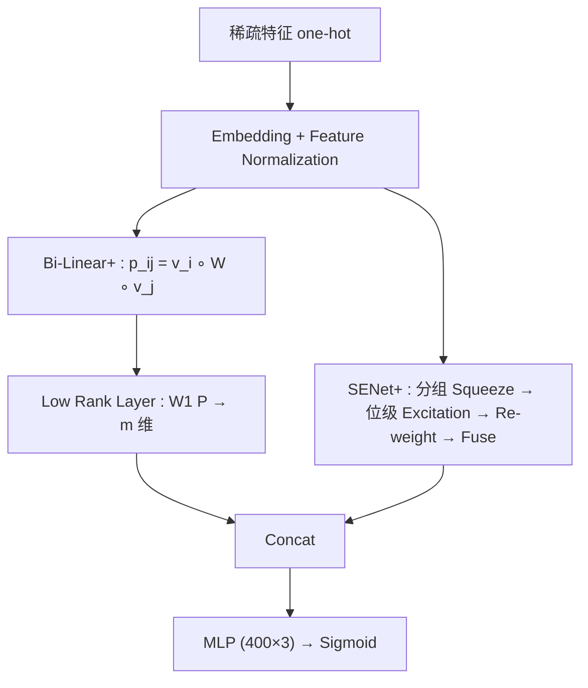
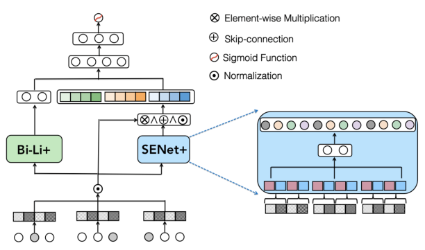

# FiBiNet++: Reducing Model Size by Low Rank Feature Interaction Layer for CTR Prediction (以低秩特征交互层压缩模型体积的 CTR 预估模型)

- **会议/期刊**: CIKM 2023 (32nd ACM International Conference on Information and Knowledge Management)
- **作者与机构**: Pengtao Zhang, Junlin Zhang (新浪微博)；Zheng Zheng (Brandeis University)
- **推荐链路定位**: 精排 (CTR 预估)
- **研究方向**: CTR/CVR 预估与特征交叉
- **论文原文**: [https://arxiv.org/abs/2209.05016v2](https://arxiv.org/abs/2209.05016v2)
- **开源代码**: [https://github.com/recommendation-algorithm/FiBiNet](https://github.com/recommendation-algorithm/FiBiNet)

## TL;DR (1分钟核心速览)

FiBiNet 在 FuxiCTR 开放基准的 24 个模型中曾是 Avazu 最优，但其双线性交互张量与线性部分带来千万级非嵌入参数，工业部署代价高。本文提出 FiBiNet++：把双线性中的 Hadamard 积改成内积使每个特征对只输出 1 维标量，再以受 LoRA 启发的「低秩交互层」把 $f(f-1)/2$维交互向量压到$m{=}50$ 维；同时把 SENet 升级为分组 squeeze + 位级 excitation + 残差 fuse。在 Avazu/Criteo/KDD12 三数据集（8:1:1 随机划分、AUC 全库评估）上，非嵌入参数压缩 12.7×/12.9×/16×，AUC 分别 +0.03/+0.37/+0.46 个百分点，训练与推理提速 37%–81%。

## Background & Motivation (背景与核心矛盾)

- **主流范式**: 显式高阶交叉网络（DCN/DCNv2/xDeepFM/AutoInt+）与注意力式特征重标定（FiBiNet = SENet + 双线性交互）是精排建模的两条主线，普遍以「堆参数换 AUC」。
- **前人局限**: ① FiBiNet 的双线性输出为 $d$维向量并直接拼进首层 MLP，参数量随$f^2 d h$爆炸（$f{=}50,d{=}10,h{=}400$时约 9.8M），再加$t{=}1$M 的线性项，总非嵌入参数达 10.8M；② 在真实系统中，训练/推理时延与存储和 AUC 同等重要，大模型难以在多场景副本中铺开。
- **核心洞察 (Key Insight)**: 类比 LoRA 揭示的 LLM「内在低秩维度」，作者假设 CTR 的特征交互在训练中同样呈现低内在秩，且单个特征对之间的交互信息高度稀疏，用 1 bit 标量表征已足够。
- **本文切入点**: 先做「算子降维」（向量交互→标量交互），再做「空间投影」（高维交互→低秩子空间），用结构重设计同时换到更小体积与更高精度。

## Method (核心方法设计)

### 1. 整体框架 (Overall Architecture)

输入稀疏 one-hot 特征经嵌入表得到 $f$个$d$维向量，先做特征归一化（数值域用 LayerNorm、类别域用 BatchNorm）以稳定训练。归一化后的嵌入分两路并行：Bi-Linear+ 支路先枚举全部特征对做内积式双线性交互，得到$f(f-1)/2$维交互向量，再由低秩层投影到$m$ 维；SENet+ 支路对每个域内嵌入分组做 max/avg 双统计量 squeeze，经两层 FC 学到逐比特注意力权重，再重加权并与原嵌入残差相加、LayerNorm 融合。两支输出拼接后送入 3 层 400 维 MLP，Sigmoid 输出 CTR，端到端以 LogLoss 训练。

<figure class="paper-figure" markdown="span">
  <figcaption>图1：FiBiNet++ 的框架</figcaption>
</figure>

### 2. 关键设计拆解 (Key Designs)

1. **Bi-Linear+：把交互从向量降为标量**：原 FiBiNet 用 $p_{i,j}=v_i\circ W\otimes v_j\in\mathbb{R}^{1\times d}$，每个特征对都要存$d$维输出；本文改为$p_{i,j}=v_i\circ W\circ v_j\in\mathbb{R}^{1\times1}$，全实例交互表示为$P=\mathrm{concat}[p_{1,2},\dots,p_{f-1,f}]\in\mathbb{R}^{1\times f(f-1)/2}$。直觉是特征对交互本质稀疏、1 bit 已足以表达「该对是否共现有效」，此步直接砍掉$d$ 倍交互输出维度。
2. **Low Rank Layer：低秩投影吃掉剩余冗余**：$P$维度仍随$f^2$增长，故加一层薄线性映射$H_{LRL}=\sigma_1(W_1P)\in\mathbb{R}^{1\times m}$，其中$W_1\in\mathbb{R}^{m\times f(f-1)/2}$、$m{=}50$。理论上首层 MLP 输入从$f(f-1)d$降到$m$，参数从$T_{\text{FiBiNet}}=f(f-1)dh+t\approx10.8\text{M}$降至$T_{\text{FiBiNet++}}=fdh+mh+\frac{f(f-1)}{2}m\approx0.28\text{M}$（约 39×），且$f$ 越大压缩比越高。
3. **SENet+ 与训练目标**：squeeze 阶段把 $v_i$切成$g$组，每组取 max 与 avg 拼接成$Z_i\in\mathbb{R}^{1\times2g}$（比原单标量均值池化信息更丰富）；excitation 把域级注意力细化为位级$A=\sigma_3(W_3\sigma_2(W_2Z))\in\mathbb{R}^{1\times fd}$；re-weight 后新增 fuse 步$v_i^u=\mathrm{LN}(v_i^o\oplus v_i^w)$保留原始信息。总损失即标准 LogLoss$\mathcal{L}=-\frac{1}{N}\sum_i[y_i\log\hat{y}_i+(1-y_i)\log(1-\hat{y}_i)]$，无额外负采样设计（CTR 二分类天然用曝光负例）；推理侧无额外开销，反而因首层 MLP 输入维度骤降而显著加速。

## Experimental Setup & Evaluation Protocol (实验设置与评估协议)

- **数据集与预处理**:

| 数据集 | #Fields | #Features | 划分 | 特征/场景说明 |
| :--- | :---: | :---: | :---: | :--- |
| Avazu | 23 | ~1M | 8:1:1 随机 | 移动广告曝光，$d{=}50$ |
| Criteo | 26 类 + 13 数值 | ~1M | 8:1:1 随机 | 展示广告点击，$d{=}10$ |
| KDD12 | 13 | ~1M | 8:1:1 随机 | 搜索广告点击，$d{=}10$ |

- **数据划分与防穿越 (Splitting Strategy)**: 采用 `比例划分`（随机 8:1:1），**非**全局时间戳切分，存在轻微未来信息穿越风险。
- **排名评测协议 (Ranking Protocol)**: 二分类 CTR 任务，报告 `AUC(%)`，测试集全量样本评估（非采样负例），另报告非嵌入参数量 `Paras.` 与单 batch 训练/推理时延 (ms)。
- **对比基线与超参设置**: 8 个基线 FM / DNN / DeepFM / xDeepFM / DCN / AutoInt+ / DCNv2 / FiBiNet；Adam，lr $10^{-4}$，batch 1024，MLP 3×400 + ReLU；SENet+ 压缩比$r{=}3$、分组数$g{=}2$；低秩层$m{=}50$。原文未报告显著性检验（如$p<0.05$）。

## Key Experimental Results (实验关键数据)

### 1. 主实验对比 (Main Results)

| Model | Avazu AUC | Avazu Paras | Criteo AUC | Criteo Paras | KDD12 AUC | KDD12 Paras |
| :--- | :---: | :---: | :---: | :---: | :---: | :---: |
| FM | 78.17 | 1.54M | 78.97 | 1.0M | 77.65 | 5.46M |
| DNN | 78.67 | 0.74M | 80.73 | 0.48M | 79.54 | 0.37M |
| DeepFM | 78.64 | 2.29M | 80.58 | 1.48M | 79.40 | 5.84M |
| xDeepFM | 78.88 | 4.06M | 80.64 | 4.90M | 79.51 | 6.91M |
| DCN | 78.68 | 0.75M | 80.73 | 0.48M | 79.58 | 0.37M |
| AutoInt+ | 78.62 | 0.77M | 80.78 | 0.48M | 79.69 | 0.38M |
| DCNv2 | 78.98 | 4.05M | 80.88 | 0.65M | 79.66 | 0.39M |
| FiBiNet | 79.12 | 10.27M | 80.73 | 7.25M | 79.52 | 6.41M |
| **FiBiNet++** | **79.15** | **0.81M** | **81.10** | **0.56M** | **79.98** | **0.40M** |
| Improv. (vs FiBiNet) | +0.03 | **12.7×↓** | +0.37 | **12.9×↓** | +0.46 | **16×↓** |

### 2. 消融实验 (Ablation Study)

原文未给出逐组件移除式消融，改用「参数分解 + 超参敏感性」作为等价证据，下表整理其量化结论：

| 配置 / 组件 | 关键量 | 效果 |
| :--- | :---: | :--- |
| FiBiNet 参数（$f(f-1)dh$+ 线性$t$） | 10.8M | 基线体积 |
| w/o Low Rank Layer（仅内积降维） | $f(f-1)/2\times h$| 仍随$f^2$ 增长，压缩有限 |
| w/ Low Rank Layer（$m{=}50$） | 0.28M | 约 39× 理论压缩，AUC 不降 |
| 低秩层尺寸 $m>150$ | — | 性能开始下降（过参数化） |
| SENet+ 分组数 $g$增大 |$g{=}1\to$更大 | AUC 单调小幅上升 |
| SENet+ 压缩比 $r\in[1,9]$|$r{=}3$或$9$| 表现最佳，对$r$ 不敏感 |

### 3. 关键实验发现 (Key Findings)

1. **低秩假设成立**：Avazu 上参数从 10.27M 砍到 0.81M（12.7×）时 AUC 仍从 79.12 升到 79.15，Criteo/KDD12 分别 +0.37/+0.46，说明 FiBiNet 的 $f(f-1)dh$ 交互张量中绝大部分容量是冗余的。
2. **交互秩确实很低**：$m$从 50 增到 150 以上反而掉点（图 2c），与 LoRA 式「内在低秩」判断一致；$r{=}3$ 的 SENet+ 压缩比同时兼顾效率与精度。
3. **效率收益来自首层 MLP 输入维度坍塌**：Criteo 单 batch 推理 58ms→11ms（+81.03%）、训练 191ms→72ms（+62.30%），因为拼接向量从 $f(f-1)d{=}24500$维降到$m+fd{=}1000$ 维，而嵌入表规模未变。

## Highlights & Limitations (亮点、对比与审稿批判)

- **与代表作对比 (vs. Prior Work)**: 相比 DCNv2/AutoInt+ 这类「显式高阶交叉 + 注意力」路线，本文不追求更高阶数，而是质疑交互表示的**维度必要性**；相比 FiBiNet，本文删去线性部分与 SENet 上的双线性模块，并用低秩层替换原双线性张量，是「减法式」改进而非叠加模块。
- **可迁移亮点**: ① 低秩交互层可直接插到 ONN、FAT-DeepFFM 等长交互向量模型后做压缩；② SENet 的「分组 max+avg 双统计量 squeeze + 位级 excitation + 残差 fuse」是即插即用的重标定组件。
- **审稿级局限批判**: ① 只统计**非嵌入**参数，而工业 CTR 中嵌入表往往占 90% 以上存储，压缩叙事被放大；② 三数据集均为随机 8:1:1 划分、仅报 AUC，缺少时间切分、LogLoss/校准与线上 A/B，且无显著性检验；③ 消融不完整（未逐项拆解 Bi-Linear+、SENet+、fuse、归一化各自的边际贡献），$g$与$r$ 的调参区间也偏窄。

## Rating (四维评分)

- **方法创新性 (Novelty)**: ⭐⭐⭐⭐ （把 LoRA 低秩先验迁移到 CTR 特征交互，并以「标量化交互 + 低秩投影」两步走给出清晰的压缩机理）
- **评估协议与实验扎实度 (Protocol & Experiments)**: ⭐⭐⭐ （三数据集 + 参数量/时延多维评估较完整，但随机划分、单一 AUC 指标、缺显著性检验与逐组件消融）
- **写作与数学规范度 (Clarity & Rigor)**: ⭐⭐⭐⭐ （参数复杂度推导 $10.8\text{M}\to0.28\text{M}$ 逐项可核，符号统一；SENet+ 各阶段公式交代清楚）
- **工业落地与复现价值 (Industrial & Practical Value)**: ⭐⭐⭐⭐⭐ （12–16× 体积压缩 + 37%–81% 训练推理提速，代码随 FiBiNet 仓库开源，几乎零改造成本即可上线替换）

