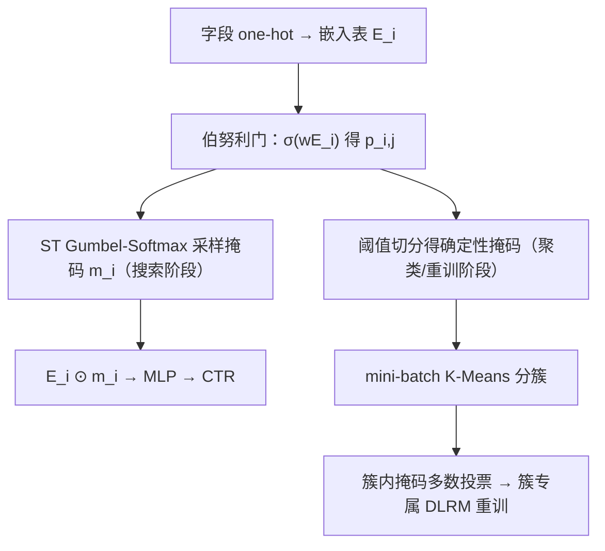
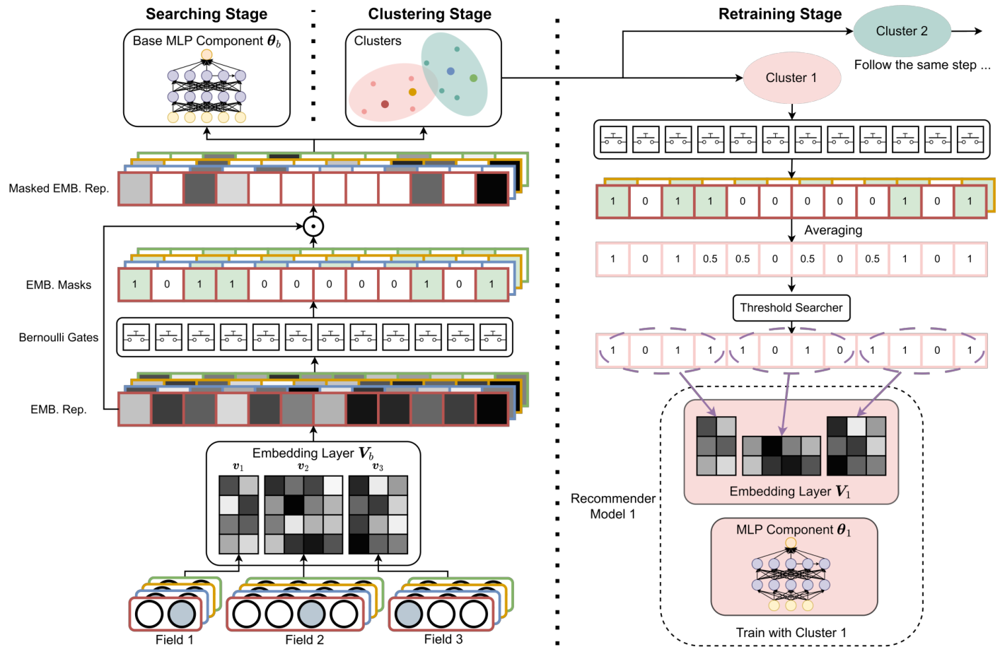
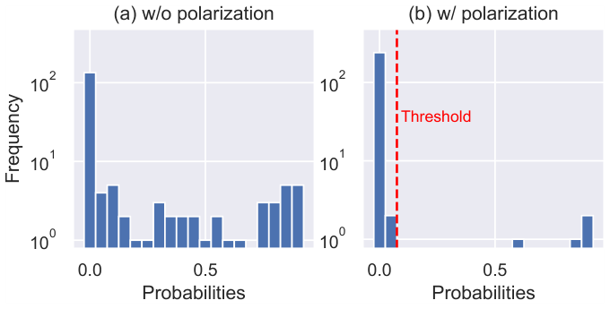

# iHAS: Instance-wise Hierarchical Architecture Search for Deep Learning Recommendation Models（实例级分层架构搜索的深度推荐模型）

- **会议/期刊**: CIKM 2023 (Long Paper)
- **作者与机构**: Yakun Yu, Shi-ang Qi, Jiuding Yang, Liyao Jiang, Di Niu（University of Alberta）
- **推荐链路定位**: 精排（CTR 预估模型的嵌入表结构自动设计）
- **研究方向**: CTR/CVR 预估与特征交叉 / 工业级架构与效率
- **论文原文**: [https://arxiv.org/abs/2309.07967v1](https://arxiv.org/abs/2309.07967v1)
- **开源代码**: [https://github.com/rixwew/pytorch-fm](https://github.com/rixwew/pytorch-fm)（基于该库实现 16 种 DLRM，iHAS 本体未单独开源）

## TL;DR (1分钟核心速览)

现有嵌入维度搜索（AutoField / AutoEmb / OptFS 等）为**全体样本**选一套固定字段/维度，忽略了“同一字段对不同用户-物品组合重要性不同”的异质性，且 top-$K$ 选出的伯努利概率难以区分。iHAS 提出实例级三层框架：搜索阶段用伯努利门 + ST Gumbel-Softmax 为**每个样本**生成维度掩码，并以极化正则把概率压向双峰；聚类阶段用确定性阈值选取掩码后用 mini-batch K-Means 分簇；重训阶段为每簇训练专属 DLRM。在 Avazu/Criteo（80/10/10 随机划分，AUC/Logloss）上，Avazu AUC 0.7815（较最优基线 +0.0038）、Logloss 0.3791，Criteo AUC 0.8043，且推理时间全场最低。

## Background & Motivation (背景与核心矛盾)

- **主流范式**: DLRM 用统一维度 $d$ 的嵌入表编码全部字段，再经 MLP/FM 做特征交叉；AutoML 路线（AutoField、OptEmbed、AdaFS、OptFS、PEP）通过可微控制器或阈值剪枝选出**全局共享**的字段子集或维度组合。
- **前人局限**: 其一，$l_0/l_1$代理或 Gumbel 控制器学出的概率呈重尾、彼此不可区分（图 3a），top-$K$ 极易误删关键字段或保留噪声维度；其二，“一套维度喂所有样本”在高度异质人群上失效——电影推荐里“age”对迪士尼影片需大维度、对喜剧片只需小维度。
- **核心洞察 (Key Insight)**: 维度选择应随样本条件化；但全定制等价于 $2^{N^*}$个架构（$N^*{=}100$时即$2^{100}$），有限数据不可训，必须在“一刀切”与“全定制”之间取中间粒度。
- **本文切入点**: 用实例级伯努利门刻画每样本的维度需求，再把需求相近的样本聚成少数簇，用簇内多数投票定架构，从而以 $K$ 个模型逼近样本级定制。

## Method (核心方法设计)

### 1. 整体框架 (Overall Architecture)

输入为 $N$个类别字段（数值字段分桶后 one-hot），经嵌入表得$\boldsymbol{E}_i\in\mathbb{R}^{N\times d}$；伯努利门把$\boldsymbol{E}_i$映射为长度$N^*{=}N\times d$的概率向量并采样出二值掩码$\boldsymbol{m}_i$，逐元素相乘后送入 MLP 得 CTR 预估值。训练分三阶段：①**搜索**——随机选择模式下联合优化基模型与门参数（warm-up 5 epoch + 双层优化，验证集驱动门更新）；②**聚类**——切换确定性选择模式生成稳定掩码，以掩码嵌入做 mini-batch K-Means 分$K{=}2$ 簇；③**重训**——对每簇掩码取多数维度初始化并独立训练簇专属 DLRM。推理时先算掩码、判簇，再路由到对应小模型，故耗时反而下降。

<figure class="paper-figure" markdown="span">
  <figcaption>图1：iHAS 框架中三阶段训练过程概览。向量边缘的四种颜色（红、蓝、黄、绿）对应四个不同样本，也对应聚类中的点。亮度表示元素值。“Ç”表示逐元素乘积运算。</figcaption>
</figure>

### 2. 关键设计拆解 (Key Designs)

1. **实例级伯努利门 + ST Gumbel-Softmax（把维度开关变成可微、二值化的随机变量）**：痛点是不做 $l_0$松弛就无法梯度下降，而软收缩只“压小”不“关断”维度。做法是用一层 FC + Sigmoid 由样本嵌入直接预测每个维度的开启概率$\{p_{i,j}\}_{j=1}^{N^*}=\sigma(\boldsymbol{w}\boldsymbol{E}_i)$，前向按$\boldsymbol{z}_{i,j}=\mathrm{onehot}(\arg\max(\log p_{i,j}+G_{i,j},\ \log(1-p_{i,j})+G'_{i,j}))$取硬 0/1，反向用带温度$\tau{=}0.1$ 的 softmax 松弛传播梯度。直觉：门以样本表征为条件，同一字段在不同样本上可开出不同长度，且硬采样保证真正零化冗余维度而非仅缩放。

2. **极化正则 + 自动阈值搜索（解决概率重尾、top-$K$误选）**：仅用$\lambda\|\boldsymbol{m}_i\|_0$时概率挤在 0.5 附近，重要与不重要维度无法分离。本文在$l_0$ 项上加入把概率推离样本均值的极化项：

$$\mathcal{R}(\boldsymbol{m})=\sum_i\sum_{j=1}^{N^*}\left[\lambda p_{i,j}-\left|p_{i,j}-\bar{p}_i\right|\right],\quad \bar{p}_i=\frac{1}{N^*}\sum_{j=1}^{N^*}p_{i,j}$$

  副项 $-|p_{i,j}-\bar p_i|$迫使分布双极化，直方图自动形成“近 0 峰 + 高概率峰”（图 3b）。随后从左向右扫描直方图，取第一个局部极小 bin 的下界为阈值，超过则开、反之关——既避免人工设定 top-$K$的$K$，也消除 Gumbel 噪声带来的推理不确定性。

<figure class="paper-figure" markdown="span">
  <figcaption>图3：Avazu 数据集中某样本的伯努利概率直方图，(a) 使用极化正则化项训练，(b) 不使用极化正则化项训练。注意，为便于更直观比较，y轴采用对数刻度且范围相同。</figcaption>
</figure>

3. **训练目标、负采样与推理效率**：总目标为 $\mathcal{L}=\mathbb{E}_i\mathbb{E}_{\boldsymbol{m}_i}\left[\mathrm{BCE}\left(f_{\boldsymbol{\theta}_b}(\boldsymbol{V}_b\boldsymbol{X}_i\odot\boldsymbol{m}_i),y_i\right)\right]+\mathcal{R}(\boldsymbol{m})$；CTR 日志自带正负样本，**无需额外负采样**。门参数$\boldsymbol{w}$与基模型$\{\boldsymbol{V},\boldsymbol{\theta}\}_b$采用双层交替更新（每 100 步取一个验证 batch）。线上推理仅需一次 FC+Sigmoid 前向（$N^*$ 维）+ 路由，簇模型嵌入维度均值仅约 4–12，故整体开销低于单一全维度大模型。

## Experimental Setup & Evaluation Protocol (实验设置与评估协议)

- **数据集与预处理**:

| 数据集 | #Users/样本 | #Fields | #Features | 稀疏度/密度 | 特征/场景说明 |
| :--- | :---: | :---: | :---: | :---: | :--- |
| Avazu | 40,400,000 | 22 | 645,394 | one-hot 极稀疏 | 11 天移动广告点击日志，全类别字段，频次<10 归入 "others" |
| Criteo | 45,840,617 | 39 (26 类别 + 13 数值) | 1,086,810 | one-hot 极稀疏 | 展示广告点击，数值字段 $x>2$时取$\log_2 x$，低频字段同 Avazu 合并 |

- **数据划分与防穿越 (Splitting Strategy)**: `比例划分`——随机 80%/10%/10% 训练/验证/测试；**未采用**全局时间戳切分（Avazu 跨 11 天的时序信息被随机打散）。
- **排名评测协议 (Ranking Protocol)**: 非排序式评估，属 pointwise CTR 二分类：报告 `AUC`（越高越好）与 `Logloss`（越低越好），文档约定 0.001 级变化即视为显著（沿用 AutoField/OptEmbed 口径）。
- **对比基线与超参设置**: 基线含 PEP、AutoField、OptEmbed、AdaFS-soft、AdaFS-hard、OptFS；统一初始嵌入维度 $d{=}16$、MLP 两层$(16,8)$+ReLU、Adam（lr 0.001、weight decay 1e-6）、batch 2048、$\tau{=}0.1$，单卡 RTX 3090。未报告$p$ 值显著性检验。

## Key Experimental Results (实验关键数据)

### 1. 主实验对比 (Main Results)

| 数据集 | 指标 | PEP | AutoField | OptEmbed | AdaFS-soft | AdaFS-hard | OptFS | **iHAS** | Improv. |
| :--- | :--- | :---: | :---: | :---: | :---: | :---: | :---: | :---: | :---: |
| Avazu | AUC↑ | 0.7665 | 0.7773 | 0.7630 | 0.7777 | 0.7763 | 0.7724 | **0.7815** | +0.0038 |
| Avazu | Logloss↓ | 0.3874 | 0.3813 | 0.3894 | 0.3812 | 0.3821 | 0.3840 | **0.3791** | −0.0021 |
| Criteo | AUC↑ | 0.8006 | 0.8029 | 0.7962 | 0.8039 | 0.8031 | 0.8015 | **0.8043** | +0.0004 |
| Criteo | Logloss↓ | 0.4507 | 0.4490 | 0.4543 | 0.4484 | 0.4560 | 0.4504 | **0.4478** | −0.0006 |

### 2. 消融实验 (Ablation Study)

| 变体 (Avazu) | 说明 | AUC↑ | Logloss↓ |
| :--- | :--- | :---: | :---: |
| Base | 全部字段、统一维度 $d{=}16$ | 0.7765 | 0.3818 |
| iHAS-1 | 仅搜索阶段（去掉聚类 + 重训） | 0.7772 | 0.3813 |
| iHAS-2 | 搜索 + 全局单模型重训（不聚类） | 0.7767 | 0.3816 |
| iHAS-3 | 去掉极化正则 | 0.7801 | 0.3800 |
| iHAS-4 | 门概率与样本表征解耦（退化为全局维度选择） | 0.7768 | 0.3817 |
| **iHAS** | 完整三阶段 | **0.7815** | **0.3791** |

**迁移性（Avazu, AUC）**: FM 0.7766→0.7826、W&D 0.7772→0.7797、DeepFM 0.7806→0.7840，三者均优于 AdaFS-soft 迁移结果（0.7799/0.7790/0.7817）。

### 3. 关键实验发现 (Key Findings)

1. **实例级门是最大增益来源**：把门概率与样本嵌入解耦（iHAS-4）后 AUC 掉到 0.7768，几乎回到 Base 的 0.7765；而完整 iHAS 达 0.7815（+0.0047），说明收益并非来自“剪维度”本身，而来自“按样本剪不同的维度”。
2. **极化正则不可省，但不做聚类反而更优**：去掉极化正则（iHAS-3）AUC 降 0.0014、Logloss 升 0.0009，验证重尾概率需双极化才能被阈值切开；而“全局单模型重训”（iHAS-2, 0.7767）竟低于仅搜索（iHAS-1, 0.7772），说明全库平均掩码抹平了实例差异，必须先分簇再重训才有 +0.0043 的净收益。
3. **效率与解释性同向**：iHAS 在 Avazu 全测试集上推理时间最短（图 4，对数刻度下低于 PEP 等全部基线），原因是路由后的小模型维度仅 4–12；案例研究（图 5）显示 `site_id`、`app_id` 等 ID 类字段拿到最大维度，且两个簇对同一字段选出的维度系统性不同，与异质性假设一致。

## Highlights & Limitations (亮点、对比与审稿批判)

- **与代表作对比 (vs. Prior Work)**: AutoField/OptFS 用可微控制器做 **top-$K$全局字段选择**，依赖概率可排序；AdaFS 只是给字段加权软缩放（soft）或统一 top-$K$硬掩码（hard），仍未跳出“全局一套”；iHAS 把选择粒度下沉到样本，并用“极化 + 鞍点阈值”替代 top-$K$，再用聚类把不可行的全定制压缩成$K$ 个可训模型——三点叠加才同时拿到精度与推理效率。
- **可迁移亮点**: ① 极化正则 + 直方图鞍点阈值这一“免 $K$ 值”的硬选择技巧，可直接移植到特征选择、通道剪枝、语义 ID 码本裁剪；② 固定已训门参数、只重训下游模型的两段式迁移范式，便于在工业栈中替换精排主干。
- **审稿级局限批判**: ① 评估用随机 80/10/10 划分而非时间切分，CTR 场景下存在未来信息泄漏风险，且只报 AUC/Logloss、未做 full-ranking 或校准评估，0.0004 的 Criteo 提升缺乏显著性检验；② 簇数 $K$固定为 2、阈值依赖直方图形态，超参敏感度未分析；推理时需先算$N^*$ 维门概率并判簇，多模型并存的显存/维护成本与冷启动样本的簇归属稳定性均未讨论。

## Rating (四维评分)

- **方法创新性 (Novelty)**: ⭐⭐⭐⭐ （实例级伯努利门 + 极化正则 + 簇级架构三段式组合新颖，但单点技术均为已有组件的巧妙拼接，缺理论保证）
- **评估协议与实验扎实度 (Protocol & Experiments)**: ⭐⭐⭐ （两套大规模真实数据集 + 5 个 SOTA 基线 + 4 组消融与迁移实验较完整，但随机划分、无显著性检验、仅 2 个 CTR 数据集）
- **写作与数学规范度 (Clarity & Rigor)**: ⭐⭐⭐⭐ （ST Gumbel 与极化正则公式、算法伪码与三阶段符号清晰一致，复杂度与收敛性分析略欠）
- **工业落地与复现价值 (Industrial & Practical Value)**: ⭐⭐⭐⭐ （模型无关、可迁移到 FM/W&D/DeepFM，推理最快、嵌入表更小，但门控路由与多模型部署成本仍待线上验证）

