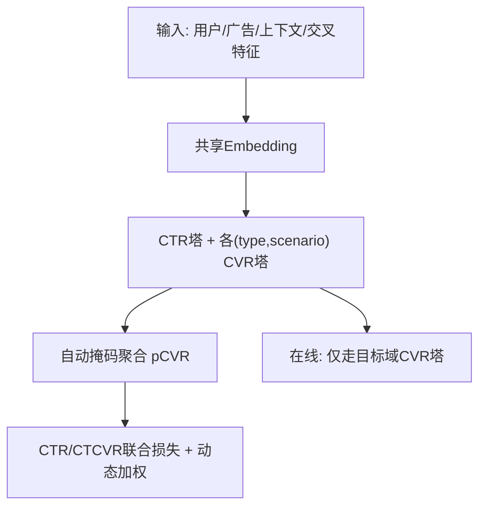
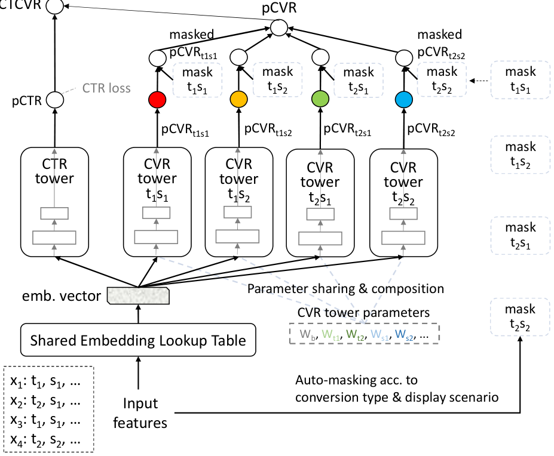

# Masked Multi-Domain Network: Multi-Type and Multi-Scenario Conversion Rate Prediction with a Single Model (面向多转化类型与多展示场景的单模型掩码多域 CVR 预测)

- **会议/期刊**: CIKM 2023
- **作者与机构**: Wentao Ouyang 等，阿里巴巴 / UC Toutiao
- **推荐链路定位**: 精排（CVR 预估）
- **研究方向**: CTR/CVR 预估与特征交叉 / 跨域与多场景推荐
- **论文原文**: [https://arxiv.org/abs/2403.17425v1](https://arxiv.org/abs/2403.17425v1)
- **开源代码**: 暂未开源

## TL;DR (1分钟核心速览)

广告 CVR 同时受“转化类型×展示场景”影响，逐域建模型参数爆炸、数据需切分，统一加特征又欠拟合。本文提出 Masked Multi-Domain Network (MMN)：用“公共+类型+场景”参数相加共享、自动掩码混合 mini-batch、批内动态加权 CTCVR 损失，实现单模型单数据集多域 CVR 预测。News Feed / Criteo 平均 AUC 达 **0.8299 / 0.7394**，线上 CVR 提升 3.2%–12.6%，CPM +5.1%。

## Background & Motivation (背景与核心矛盾)

- **主流范式**: 工业 CVR 常用 ESMM 类全空间建模，多业务则用 MMoE/PLE 多任务或 STAR/MT-FwFM 多域网络。
- **前人局限**: 每个 $(\text{转化类型},\text{展示场景})$单独建模需$N_t\times N_s$ 套参数与数据集，既不 scalable 也不 convenient；直接把类型、场景当普通特征喂入统一模型，又无法刻画细粒度域差异。
- **核心洞察 (Key Insight)**: 真实系统 CVR 随类型、场景剧烈变化（Criteo 类型 6.3%–18.9%，场景 0.9%–14.9%）；域效应可分解为公共共性、类型特异、场景特异三部分。
- **本文切入点**: 将问题形式化为 multi-domain learning，以“和空间参数组合 + 自动掩码 + 动态损失”同时满足准确、可扩展、易维护。

## Method (核心方法设计)

### 1. 整体框架 (Overall Architecture)

输入特征经共享 Embedding 后，CTR 塔利用全曝光空间监督，各 CVR 塔对应一个 $(\text{type},\text{scenario})$域；但每个 CVR 塔第$l$ 层权重由公共、类型、场景三部分相加组成。训练时混合 mini-batch 同时过所有 CVR 塔，自动掩码只保留匹配域输出，并以动态加权 CTCVR 损失更新；线上只计算请求所属域的 CVR 塔。

<figure class="paper-figure" markdown="span">
  <figcaption>图2：掩码多域网络。为简化起见，所有CTR和CVR预测塔均使用由若干全连接层构成的多层感知机。</figcaption>
</figure>

图2：MMN 整体结构；CTR/CVR 塔共享底层，CVR 塔参数按域组合。

### 2. 关键设计拆解 (Key Designs)

1. **参数共享与组合（Product Space → Sum Space）**：逐域独立参数需 $N_t\times N_s$ 套，稀疏且巨大。MMN 令
$\mathbf{W}^l(f_t,f_s)=\mathbf{W}^l_b+\mathbf{W}^l_{f_t}+\mathbf{W}^l_{f_s}$，
即 $h=\mathrm{MLP}(\mathbf{x};\boldsymbol{\theta}(f_t(x),f_s(x)))$，$p_{\mathrm{cvr}}=\sigma(h)$。只需$N_t+N_s+1$ 套参数即可组合出全部域，兼顾共享与特异。

2. **Auto-Masking（混合批次的域路由）**：同一 mini-batch 含不同域样本，但深度学习算子需统一。为每个域构造掩码
$\mathbf{m}_{t_i s_j}(X)=\mathbb{I}[f_t(X)=t_i,f_s(X)=s_j]$，
再聚合
$\mathbf{p}_{\mathrm{cvr}}(X)=\sum_i\sum_j \mathbf{m}_{t_i s_j}(X)\odot \mathbf{p}_{t_i s_j}(X)$。
错误域预测被置 0，不传梯度；因此无需把数据切成 $N_t\times N_s$ 个子集，反向传播也更快。

3. **动态加权损失与推理效率**：标准 ESMM 对整批按 $N$归一，但域$c$的实际损失尺度是$\frac{N_c}{N}\bar a$，小域被系统性压低。MMN 在批内计算
$\mathrm{wt}(x_n)=N/N_c,\ x_n\in\mathcal{D}_c$，
$L_{\mathrm{MMN}}=L_{\mathrm{ctr}}+\alpha L'_{\mathrm{ctcvr}}$，
$L'_{\mathrm{ctcvr}}=\frac{1}{N}\sum_n \mathrm{wt}(x_n)\ell_{\mathrm{ctcvr}}(x_n)$。
权重随 batch 动态变化，缓解域样本不均衡。训练无显式负采样，依赖曝光/点击/转化标签；线上仅走单塔，实测 2.3 ms（ESMM 2.2 ms）。

## Experimental Setup & Evaluation Protocol (实验设置与评估协议)

- **数据集与预处理**:

| 数据集 | #Fields | #Features | #Train | #Test | 类型数(CVR范围) | 场景数(CVR范围) |
| :--- | :---: | :---: | :---: | :---: | :---: | :---: |
| News Feed | 58 | 61,601,087 | 153,300,184 | 5,179,132 | 19 (0.05%–27.6%) | 8 (1.6%–4.1%) |
| Criteo | 18 | 11,772,096 | 11,196,944 | 4,798,690 | 21 (6.3%–18.9%) | 17 (0.9%–14.9%) |

- **数据划分与防穿越**: 使用给定广告日志训练/测试集；训练集再按 70%/30% 切分训练/验证调参。论文未明确全局时间戳切分，存在弱穿越风险。
- **排名评测协议**: CVR 分类任务，采用 per-type、per-scenario AUC 及平均值；非 Full-Ranking/Sampled Ranking，也无负采样排序协议。
- **对比基线与超参**: DNN、ESMM、MMoE、PLE、MT-FwFM、STAR；Embedding 维度 10，MLP 4 层 {512,256,128,128}，Adagrad，3 次平均；未报告显著性检验。

## Key Experimental Results (实验关键数据)

### 1. 主实验对比 (Main Results)

| 方法 | News Feed Avg AUC | Criteo Avg AUC |
| :--- | :---: | :---: |
| DNN | 0.8165 | 0.7311 |
| ESMM | 0.8176 | 0.7298 |
| MMoE (best) | 0.8171 | 0.6934 |
| PLE (best) | 0.8189 | 0.7273 |
| MT-FwFM | 0.7932 | 0.6963 |
| STAR (best) | 0.8235 | 0.7359 |
| **MMN** | **0.8299** | **0.7394** |
| **Improv. vs STAR** | **+0.78%** | **+0.48%** |

### 2. 消融实验 (Ablation Study)

| 变体 | 改动 | 结果趋势（图5/图6） |
| :--- | :--- | :--- |
| MMN (common params.) | 去掉类型/场景特异参数，仅共享参数 | 多数类型/场景 AUC 低于 MMN，说明域特异参数有效 |
| MMN (no dynamic weight) | 用 Eq.(2) 按 $N$ 归一 | 多数域 AUC 明显下降，域样本偏斜时更敏感 |

### 3. 关键实验发现 (Key Findings)

- MMN 在 News Feed / Criteo 平均 AUC 较最强 STAR 分别提升 0.0064 / 0.0035，虽绝对增幅小，但广告系统中常对应显著线上收益。
- 参数集从 $N_t\times N_s$降至$N_t+N_s+1$：Criteo 357→39（-89.1%）、News Feed 152→28（-81.6%）；训练数据集从 357/152 降至 1（-99.7%/-99.3%）。
- 线上 A/B：19 个转化类型、8 个展示场景 CVR 全部提升 3.2%–12.6%，CPM +5.1%，延迟仅 2.3 ms，验证了精度、扩展性与工程便利性的同步收益。

## Highlights & Limitations (亮点、对比与审稿批判)

- **与代表作对比 (vs. Prior Work)**: STAR 受 OOM 限制通常只能在 type 或 scenario 单维展开；MT-FwFM 偏类型特异；MMoE/PLE 面向同域多任务，直接用于多域会失配。MMN 首次把 type×scenario 双维域同时纳入单模型。
- **可迁移亮点**: “公共+维度特异参数相加”可迁移到多业务/多场景 CTR；auto-masking 适合混合域 batch 训练；批内 $N/N_c$ 重加权可推广到不均衡多任务损失。
- **审稿级局限批判**: 加性参数组合忽略 type 与 scenario 的高阶交互，动态权重对 batch 组成较敏感；离线仅报 AUC，缺少校准/LogLoss 与显著性检验，且未开源代码，复现与跨系统泛化仍需验证。

## Rating (四维评分)

- **方法创新性 (Novelty)**: ⭐⭐⭐☆ （工程组合创新强，但理论/谱分析支撑较弱）
- **评估协议与实验扎实度 (Protocol & Experiments)**: ⭐⭐⭐☆ （双数据集+线上 A/B 完整，但缺显著性检验与校准指标）
- **写作与数学规范度 (Clarity & Rigor)**: ⭐⭐⭐⭐ （问题定义、掩码与损失推导清晰，符号紧凑）
- **工业落地与复现价值 (Industrial & Practical Value)**: ⭐⭐⭐⭐⭐ （已服务 UC Toutiao 全流量，延迟近乎无损，扩展性收益明确）

