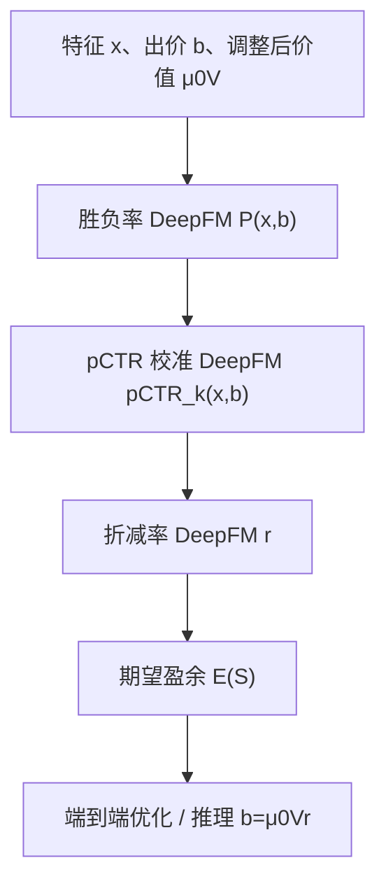
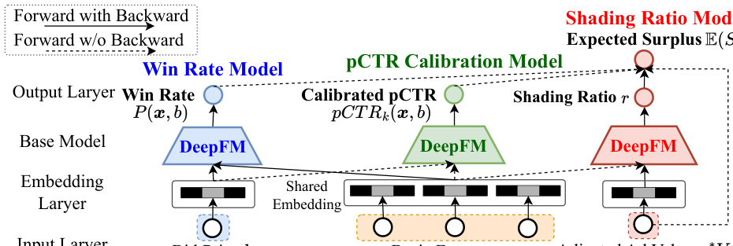

# MEBS: Multi-task End-to-end Bid Shading for Multi-slot Display Advertising (多任务端到端多广告位展示广告出价折减)

- **会议/期刊**: CIKM 2023（arXiv 2024-03）
- **作者与机构**: Zhen Gong, Lvyin Niu, Yang Zhao 等；上海交通大学、阿里巴巴集团
- **推荐链路定位**: 精排后的出价/拍卖（bid shading）
- **研究方向**: CTR/CVR 预估与特征交叉 / 多任务学习与列表级重排
- **论文原文**: [https://arxiv.org/abs/2403.02607v1](https://arxiv.org/abs/2403.02607v1)
- **开源代码**: 暂未开源

## TL;DR (1分钟核心速览)

针对多广告位展示广告中坑位 CTR/成本差异导致出价折减缺少最优性证明、可赢样本稀疏且最优出价无标签的问题，MEBS 用胜负率、pCTR 校准与折减率三任务共享嵌入，端到端最大化期望盈余；离线 Surplus(P&S) 较最强基线约 +10.7%，线上 GMV/ROI/BuyCnt 分别 +7.01%/+7.42%/+3.26%，CPC -8.37%。

## Background & Motivation (背景与核心矛盾)

- **主流范式**: RTB 中单广告位 bid shading 多回归折减率，或先估计 winning price 分布再搜索最优出价。
- **前人局限**: 单广告位把“最低中标价”当最优出价标签；但 MSDA 中折减会改变赢得的坑位，CTR 随坑位变化，最优出价不再由最低中标价唯一决定。且可赢样本与点击极稀疏，最优折减率无 ground truth，两步搜索还增加推理延迟。
- **核心洞察 (Key Insight)**: 广告主目标是最大化期望盈余 $E(S)=(\mu_0 V-C(b))F(x,b)$，其中$F(x,b)=P(x,b)\cdot pCTR_k(x,b)$；该盈余通常单峰，因此可绕开不可知标签，直接优化可计算目标。
- **本文切入点**: 将 MSDA 出价折减拆成 campaign control 与 bid shading，并用多任务端到端模型学习胜负率、坑位感知 pCTR 与折减率。

## Method (核心方法设计)

### 1. 整体框架 (Overall Architecture)

输入为出价 $b$、调整后广告价值$\mu_0V$及用户/曝光/广告/上下文特征。胜负率 DeepFM 估计$P(x,b)$；pCTR 校准模型在冻结的胜负率共享嵌入上学习坑位感知 logit 偏移；折减率模型输出$r$，并用预训练的$P$与$pCTR_k$计算$E(S)$端到端优化$r$。推理仅前向折减率模型，出价$b=\mu_0Vr$，无搜索过程。

<figure class="paper-figure" markdown="span">
  <figcaption>图3：MEBS 架构概览。</figcaption>
</figure>

### 2. 关键设计拆解 (Key Designs)

1. **MSDA 最优出价策略与盈余目标**：痛点是无最优折减标签且坑位影响 CTR。定理将预算约束下最大化期望价值转为 $\mu_0^*=\arg\min_{\mu_0}|\sum_i F(x,b_i)C(b_i)-B|$与$b_i^*=\arg\max_{b_i}(\mu_0^*V_i-C(b_i))F(x,b_i)$；若$E(S)$ 单峰则最优出价唯一。直觉是不回归不可知标签，而是最大化经济盈余。
2. **坑位感知 pCTR 校准**：折减改变赢得坑位，原 $pCTR(x)$与坑位无关。模型学习校准因子$f_k(x,b)$，并计算$pCTR_k(x,b)=\mathrm{Sigmoid}(f_k(x,b)+\log\frac{pCTR(x)}{1-pCTR(x)})$；在可赢样本上训练，使模型感知“出价—坑位—CTR”的联动。
3. **训练目标、共享与推理效率**：胜负率用全量样本交叉熵 $L_{WR}$；校准用可赢样本$L_{Calib}$；折减率用$L_{SR}=-\frac{1}{N_+}\sum_i E(S_i)/\mathrm{stop\_grad}(E(S_i))$，防止极大盈余样本主导。共享嵌入来自胜负率且冻结、仅前向，缓解校准与折减率的数据稀疏。无负采样，按曝光/出价日志全量训练；推理为单次前向，快于两步搜索。

## Experimental Setup & Evaluation Protocol (实验设置与评估协议)

- **数据集与预处理**: 阿里展示广告多广告位二价拍卖日志，无 5-core 过滤，保留全量出价样本：

| 数据集 | #样本 | #中标 | #点击 | 稀疏度/说明 |
| :--- | :---: | :---: | :---: | :--- |
| Alibaba MSDA | 64,557,179,576 | 533,812,872 | 9,641,171 | 中标率约 0.83%，点击极稀疏 |

- **数据划分与防穿越**: 按天切分，第 1 天训练、第 2 天测试，属于时间外推评估。
- **排名评测协议**: 非排序任务，采用全量出价样本的 Surplus 评估，非采样排序。$S=(\mu_0V-C(b))\mathbb{I}(b\ge wp)pCTR_k(x,b)$；Surplus(P&S) 用坑位+场景平均 CTR，Surplus(P) 仅坑位；PCOC=预测 CTR/真实 CTR，越接近 1 越好。
- **对比基线与超参**: 对比 SRR、TSBS-EDDN、TSBS-WR、NPM 等；统一用 DeepFM 基座以降低模型差异。Embedding 维度 32，DeepFM 深层 256-64-16，Adam，lr=1e-2，batch 为 80k/40k。未报告显著性检验。

## Key Experimental Results (实验关键数据)

### 1. 主实验对比 (Main Results)

表1：离线 Surplus 对比（越高越好，加粗为最优）。

| 模型 | Surplus(P&S) | Surplus(P) |
| :--- | :---: | :---: |
| **MEBS** | **16.0207** | **11.6347** |
| SRR(DeepFM) | 14.4672 | 10.9143 |
| SRR(FM) | 13.8589 | 9.2679 |
| NPM | 10.2346 | 6.6380 |
| TSBS-EDDN(DeepFM) | 9.3396 | 6.1745 |
| TSBS-EDDN(FwFM) | 9.7980 | 5.7440 |
| TSBS-WR(DeepFM) | 10.3397 | 6.4542 |
| TSBS-WR(LR) | 8.0900 | 4.8658 |

MEBS 较最强基线 SRR(DeepFM)：Surplus(P&S) **+10.7%**，Surplus(P) **+6.6%**；原文摘要口径为至少 +9.7%/+6.6%。

### 2. 消融实验 (Ablation Study)

表2：核心组件消融。

| 变体 | Surplus(P&S) | Surplus(P) | 变化(P&S) |
| :--- | :---: | :---: | :---: |
| MEBS | **16.0207** | **11.6347** | — |
| w/o Multi-task | 13.5446 | 9.1740 | -15.5% |
| w/o End-to-end | 14.7571 | 10.6235 | -7.9% |
| w/o pCTR Calibration | 14.5370 | 10.0514 | -9.3% |

去掉 pCTR 校准后 PCOC 从 1.0346 退化到 1.1050。

### 3. 关键实验发现 (Key Findings)

1. **多任务共享嵌入是最大增益源**：去掉后 P&S/P 分别下降约 15.5%/21.1%，说明全量胜负率样本有效缓解了校准与折减率的稀疏问题。
2. **端到端盈余目标优于 MSE 回归折减率**：去掉后端到端，P&S 降至 14.76，接近 SRR 水平，验证了绕开不可知最优标签、直接最大化盈余的有效性。
3. **坑位校准同时提升准确性与经济收益**：PCOC 从 1.105 降至 1.035，去掉校准 P&S 降 9.3%；线上 6 天 A/B 中 GMV/ROI/BuyCnt +7.01%/+7.42%/+3.26%，CPC -8.37%，且日级增益稳定。

## Highlights & Limitations (亮点、对比与审稿批判)

- **与代表作对比**: SRR 依赖最优折减率标签，TSBS 依赖 winning price 分布+搜索；MEBS 首次把 bid shading 推广到 MSDA，显式建模坑位 CTR 变化并端到端最大化盈余。与 ESMM 类多任务不同，其共享嵌入服务于拍卖出价而非仅 CVR 稀疏。
- **可迁移亮点**: 用丰富任务（胜负率）预训练嵌入并冻结给稀疏任务（校准/折减率）是通用技巧；$E(S)/\mathrm{stop\_grad}(E(S))$ 的归一化损失可抑制极端样本主导。
- **审稿级局限**: 离线 Surplus 依赖预测 pCTR 与平台 GSP 成本模拟，非真实反事实评估，且未报告显著性检验；线上仅 6 天、25% 请求 A/B，长期预算 pacing 与竞争环境变化仍需验证。

## Rating (四维评分)

- **方法创新性 (Novelty)**: ⭐⭐⭐⭐ （首个将 bid shading 推广到 MSDA 并给出单峰盈余下的最优性证明，但核心仍是 DeepFM+多任务组合。）
- **评估协议与实验扎实度 (Protocol & Experiments)**: ⭐⭐⭐⭐ （按天切分+线上 6 天 A/B，含 7 个基线与消融；但离线指标为模拟 Surplus，缺少显著性检验。）
- **写作与数学规范度 (Clarity & Rigor)**: ⭐⭐⭐⭐ （定理与 KKT 推导完整，公式清楚；GSP 成本与坑位 CTR 假设略依赖平台统计。）
- **工业落地与复现价值 (Industrial & Practical Value)**: ⭐⭐⭐⭐ （线上 CPC 降 8.37%、推理无搜索，工程价值强；未开源且依赖阿里拍卖日志。）

