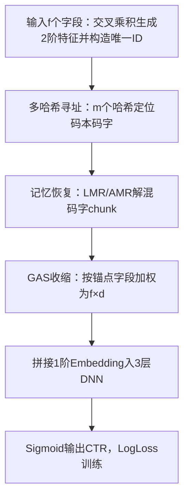
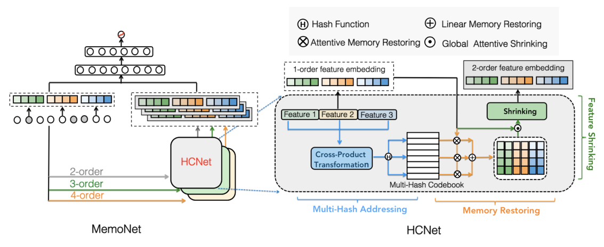

# MemoNet: Memorizing All Cross Features’ Representations Efficiently via Multi-Hash Codebook Network for CTR Prediction (多哈希码本网络高效记忆所有交叉特征表示用于CTR预测)

- **会议/期刊**: CIKM 2023
- **作者与机构**: Pengtao Zhang, Junlin Zhang；新浪微博
- **推荐链路定位**: 精排
- **研究方向**: CTR/CVR 预估与特征交叉
- **论文原文**: [论文原文链接](https://arxiv.org/abs/2211.01334v3)
- **开源代码**: [开源代码仓库链接](https://github.com/ptzhangAlg/RecAlg)

## TL;DR (1分钟核心速览)

针对深度CTR模型扩大参数却难获稳定增益、交叉特征记忆低效的痛点，提出多哈希码本HCNet与MemoNet：以多哈希寻址、记忆恢复和GAS收缩显式记忆全部交叉特征。在Avazu/KDD12/Criteo按8:1:1随机划分、AUC/LogLoss评估下，小模型较DNN提升+0.91/+1.06/+0.57 AUC，线上CTR+9.73%。

## Background & Motivation (背景与核心矛盾)

- **主流范式**: 显式子网建模2阶/高阶交互（DeepFM、DCNv2、xDeepFM、AutoInt、FiBiNet、MaskNet、CAN）；另一类先挖掘少量交互（Wide&Deep、AutoFIS）。
- **前人局限**: 加大DNN参数收益小且易过拟合，说明网络未高效记忆交叉特征；子网把记忆与泛化耦合，CAN参数巨大；挖掘法只选少量交互，漏长尾且难在线即时捕获。
- **核心洞察 (Key Insight)**: LLM的scaling law来自强记忆；CTR中交叉特征就是关键知识，应让独立记忆模块存表示，DNN只做泛化。
- **本文切入点**: 用多哈希码本以有限内存记忆所有交叉特征，并验证码本扩容的缩放律。

## Method (核心方法设计)

### 1. 整体框架 (Overall Architecture)

输入一个实例的f个字段后，先做交叉乘积得到全部2阶特征，并为每个交叉特征拼接字段ID/离散化数值生成唯一ID；HCNet用m个哈希把ID映射到码本的m个码字，分别经LMR或AMR恢复出交叉特征表示；GAS再用1阶Embedding的注意力把同一锚点字段下的f-1个交叉表示加权压缩为f个d维向量，与1阶Embedding拼接后送入3层DNN，Sigmoid输出CTR并以LogLoss训练。推理时可用KIF只让少量关键字段参与交叉，把复杂度从$f(f-1)/2$降到$m(f-1)/2$。

<figure class="paper-figure" markdown="span">
  <figcaption>图 2：MemoNet 与 HCNet 的整体架构</figcaption>
</figure>

### 2. 关键设计拆解 (Key Designs)

1. **多哈希码本寻址（Multi-Hash Addressing）**：单哈希在组合爆炸下把成千上万交叉特征压进同一码字，表示严重混合；本文用m个独立哈希定位m个码字，完整表示被切成m个chunk，只有m个哈希同时碰撞才难区分，碰撞概率随m指数下降。核心寻址：$\mathbf{A}^{(i,j)}=\{H_t(\mathrm{ID}^{(i,j)})\boldsymbol{o}d|\mathbf{C}|\}_{t=1}^{m}$，码字矩阵$\mathbf{C}\in\mathbb{R}^{n\times l}$训练中更新。

2. **记忆恢复（Memory Restoring）**：码字chunk仍是混合表示。LMR把$\mathbf{C}^{(i,j)}\in\mathbb{R}^{m\times l}$展平后线性投影：$\mathbf{v}^{(i,j)}=\phi_1(\mathrm{flatten}(\mathbf{C}^{(i,j)})\mathbf{W}_1)$，刻意不加非线性，避免过早交互削弱各chunk信号。AMR用1阶$\mathbf{v}_i,\mathbf{v}_j$生成掩码$\mathbf{I}$，对每个码字逐元素过滤：$\mathbf{C}^{(i,j)}_I=\mathbf{I}_r\odot\mathbf{C}^{(i,j)}$，再展平投影；小码本碰撞多时AMR更能恢复。

3. **特征收缩、训练目标与推理效率**：若直接拼接$f(f-1)$个交叉向量，Embedding层过宽且稀疏噪声大。GAS用全部1阶Embedding$\mathbf{V}$生成$f(f-1)$维注意力$\mathbf{R}$，按锚点字段加权：$\mathbf{v}_i^2=\sum_{j\ne i}a_j\mathbf{v}^{(i,j)}$，输出压缩为$f\times d$。损失为二分类LogLoss：$\mathcal{L}=-\frac{1}{N}\sum_i[y_i\log\hat{y}_i+(1-y_i)\log(1-\hat{y}_i)]$。无负采样，Adam/batch=1024；默认2哈希、1M码字，码字维度同1阶Embedding；10M码本用于验证缩放律。

## Experimental Setup & Evaluation Protocol (实验设置与评估协议)

- **数据集与预处理**: 未做`5-core`过滤，直接使用原始CTR曝光样本。

| 数据集 | #Instances | #Fields | #Features | 过滤/场景说明 |
| :--- | ---: | ---: | ---: | :--- |
| Avazu | 40.4M | 23 | 9.4M | 未做5-core；广告点击 |
| KDD12 | 194.6M | 13 | 54.6M | 未做5-core；广告CTR |
| Criteo | 45M | 39 | 33.7M | 未做5-core；26类别+13连续 |

- **数据划分与防穿越 (Splitting Strategy)**: 随机8:1:1训练/验证/测试；非全局时间戳切分，也非冷启动划分。
- **排名评测协议 (Ranking Protocol)**: CTR逐曝光二分类，AUC↑/LogLoss↓；不是Full-Ranking或Sampled Ranking，未点击曝光作负例。
- **对比基线与超参设置**: 对比FM/W&D/AutoFIS/DeepFM/xDeepFM/DCN/FiBiNet/AutoInt+/MaskNet/DCNv2/CAN/DNN；5个随机种子平均，未报告p值。Embedding维度d=10/50/10，MLP为3层×400，Adam，batch=1024。

## Key Experimental Results (实验关键数据)

### 1. 主实验对比 (Main Results)

| 模型 | Avazu AUC | Avazu LogLoss | KDD12 AUC | KDD12 LogLoss | Criteo AUC | Criteo LogLoss |
| :--- | ---: | ---: | ---: | ---: | ---: | ---: |
| DeepFM | 78.64 | 0.3769 | 79.40 | 0.1538 | 80.58 | 0.4457 |
| xDeepFM | 78.88 | 0.3747 | 79.51 | 0.1534 | 80.64 | 0.4450 |
| AutoInt+ | 78.62 | 0.3758 | 79.69 | 0.1529 | 80.78 | 0.4438 |
| DCNv2 | 78.98 | 0.3738 | 79.66 | 0.1530 | 80.88 | 0.4430 |
| FiBiNet | 79.12 | 0.3730 | 79.52 | 0.1533 | 80.73 | 0.4441 |
| MaskNet | 78.94 | 0.3740 | 79.89 | 0.1521 | 81.07 | 0.4410 |
| CAN | 79.02 | 0.3737 | 79.71 | 0.1530 | 80.81 | 0.4440 |
| DNN | 78.67 | 0.3756 | 79.54 | 0.1533 | 80.73 | 0.4440 |
| MemoNet-L(1M) | 79.58 | 0.3704 | **80.60** | **0.1508** | 81.28 | 0.4390 |
| MemoNet-A(1M) | 79.52 | 0.3707 | 80.52 | 0.1516 | 81.30 | 0.4387 |
| MemoNet-L(10M) | **79.87** | **0.3684** | — | — | **81.39** | **0.4380** |
| **Improv. vs best baseline** | **+0.75** | **-0.0046** | **+0.71** | **-0.0013** | **+0.32** | **-0.0030** |

最佳基线分别为FiBiNet/MaskNet/MaskNet；提升为AUC绝对值。

### 2. 消融实验 (Ablation Study)

| 骨干 | Avazu AUC | KDD12 AUC | Criteo AUC |
| :--- | :--- | :--- | :--- |
| xDeepFM → +HCNet | 78.88→79.49 (+0.61) | 79.51→80.34 (+0.83) | 80.64→81.22 (+0.58) |
| DCNv2 → +HCNet | 78.98→79.42 (+0.44) | 79.66→80.37 (+0.71) | 80.88→81.36 (+0.48) |
| MaskNet → +HCNet | 78.94→79.57 (+0.63) | 79.89→80.50 (+0.61) | 81.07→81.40 (+0.33) |
| DNN（2阶HCNet） | 78.67→79.44 (+0.77) | 79.54→80.29 (+0.75) | 80.73→81.30 (+0.57) |

### 3. 关键实验发现 (Key Findings)

1. **独立记忆显著且可缩放**：表2小MemoNet较DNN提升+0.91/+1.06/+0.57 AUC；最佳MemoNet较最佳基线提升+0.75/+0.71/+0.32。Avazu/Criteo码本从0.01M扩到100M时AUC继续升至79.91/81.52，复现CTR中的scaling law。
2. **AMR/LMR按碰撞程度分工**：小码本下AMR优于LMR，KDD12/Criteo拐点0.2M、Avazu 5M；码本变大后LMR反超，说明注意力适合解混，线性投影适合低碰撞。
3. **KIF与线上效率**：FAR取Top4字段在Avazu/Criteo/KDD12保留93.90%/74.58%/65.79%的HCNet增益；线上96字段只用4个KIF，14天A/B的CTR+9.73%、Watch Time+6.86%，延迟仅+10.33%。

## Highlights & Limitations (亮点、对比与审稿批判)

- **与代表作对比 (vs. Prior Work)**: xDeepFM/DCNv2用子网显式交叉，仍把记忆与泛化耦合；CAN为每特征学micro-MLP，参数223M/569M/105M却低于MemoNet小模型；AutoFIS只挖掘少量交互，漏长尾且难在线。MemoNet以独立码本存全部交叉表示，DNN只泛化，且可扩容。
- **可迁移亮点**: HCNet可插到xDeepFM/DCNv2/MaskNet（+0.33~+0.83 AUC）；FAR/KIF用极少字段保留大部分收益，适合在线降复杂度。
- **审稿级局限批判**: 哈希冲突不可避免；10M码本在Avazu/Criteo达578M/110M参数，内存与延迟压力大；主要验证2阶，高阶需多码本；随机8:1:1非时间切分，未报告显著性检验，线上仅单平台14天。

## Rating (四维评分)

- **方法创新性 (Novelty)**: ⭐⭐⭐⭐ （将LLM记忆/缩放律引入CTR，多哈希码本+LMR/AMR有新意，但哈希+码本非全新）
- **评估协议与实验扎实度 (Protocol & Experiments)**: ⭐⭐⭐⭐ （三大规模数据集、5次种子平均、线上14天A/B；但随机划分、无显著性检验）
- **写作与数学规范度 (Clarity & Rigor)**: ⭐⭐⭐⭐ （三阶段流程清晰，公式完整；部分符号与表2/表3数值口径略乱）
- **工业落地与复现价值 (Industrial & Practical Value)**: ⭐⭐⭐⭐ （开源、线上CTR+9.73%，延迟+10.33%；码本内存与冲突需工程权衡）

