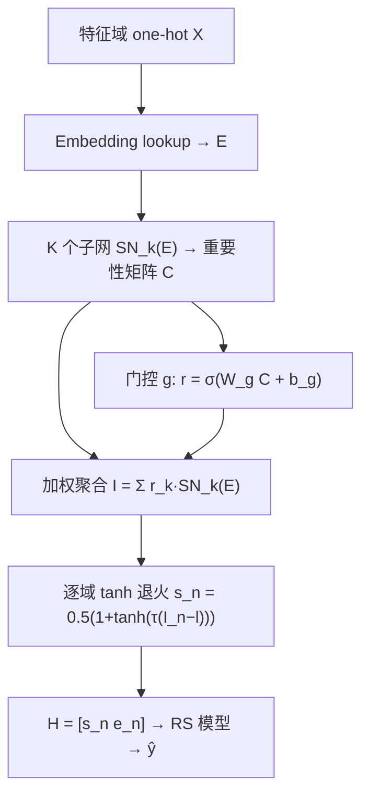
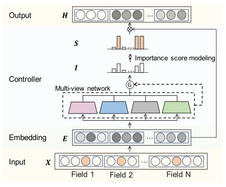
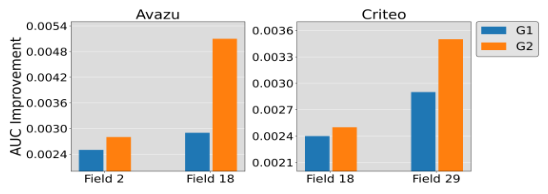

# MvFS: Multi-view Feature Selection for Recommender System (多视图特征选择推荐系统)

- **会议/期刊**: CIKM 2023
- **作者与机构**: Youngjune Lee, Yeongjong Jeong, Keunchan Park (NAVER Corp.)；SeongKu Kang (UIUC，通讯作者)
- **推荐链路定位**: 精排（CTR 预估模型的前置输入层，模型无关插件）
- **研究方向**: CTR/CVR 预估与特征交叉 / 特征选择
- **论文原文**: [https://arxiv.org/abs/2309.02064v2](https://arxiv.org/abs/2309.02064v2)
- **开源代码**: [https://github.com/dudwns511/MvFS_CIKM23](https://github.com/dudwns511/MvFS_CIKM23)

## TL;DR (1分钟核心速览)

CTR 模型盲目喂入全部特征域会引入冗余与噪声，而 SOTA 的实例级自适应选择器 AdaFS 用**单个** controller 为全库样本打分，导致选择结果被高频主导特征模式"绑架"，且其跨域归一化重加权引入特征间伪依赖。本文提出 MvFS：控制器由 $K$个子网（MoE）+ 门控组成，按样本特征模式分流打分；再用逐域独立的$\tanh$ 退火把软选择平滑过渡到硬选择。在 Avazu/Criteo 上以 8:1:1 比例划分、AUC/Logloss 评估，四个骨干（MLP/DeepFM/DCN/IPNN）共 8 组设置**全部**取得最优，AUC 相对最强基线提升 0.18–0.34 个千分点。

## Background & Motivation (背景与核心矛盾)

- **主流范式**: 特征选择已从离线统计/手工筛选，演进到与 RS 模型联合优化的 AutoML 路线（AutoField 用 NAS 选全局固定域，OptFS 考虑特征交互选全局子集）；AdaFS 进一步做**实例级**软/硬选择，认为同一特征域的重要性随 user-item 对不同而变化。
- **前人局限**: (1) AdaFS 仅用**单一** controller 覆盖全部样本，打分过程天然偏向出现频率高的少数主导特征模式，对含低频特征的数据几乎无增益；(2) AdaFS 为让重要性之和恒定而做**跨域重加权**，当选中 $k$个域时平均重要性尺度按$1/k$ 缩放，人为制造特征间依赖，反而损害精度。
- **核心洞察 (Key Insight)**: 特征重要性不是"全局常量"也不是"单一函数"，而是**分模式（multi-view）**的——不同特征模式的数据应由不同子网来评估重要性；同时重要性打分应**逐域独立**，不应互相归一化耦合。
- **本文切入点**: 把 mixture-of-experts 的 divide-and-conquer 思想塞进 controller（多子网+门控），并去掉 reweighting、改用逐域 $\tanh$ 退火。

## Method (核心方法设计)

### 1. 整体框架 (Overall Architecture)

输入为 $N$个特征域 one-hot 向量$\boldsymbol{X}=[\boldsymbol{x}_1,\dots,\boldsymbol{x}_N]$，经 embedding lookup 得$\boldsymbol{E}=[\boldsymbol{e}_1,\dots,\boldsymbol{e}_N]$。$\boldsymbol{E}$送入多视图控制器：$K$个子网各自输出一个$N$维重要性向量，门控模块$g$依据**子网输出**（而非原始$\boldsymbol{E}$）生成$K$维权重$\boldsymbol{r}$，加权求和得融合重要性$\boldsymbol{I}$；再经逐域 tanh 退火映射为分数$\boldsymbol{s}$，与$\boldsymbol{E}$逐域相乘得$\boldsymbol{H}$，最后送入任意黑盒 RS 模型输出$\hat{y}$。控制器与 RS 模型端到端 BCE 联合训练，RS 模型先 warm-up 3 个 epoch。

<figure class="paper-figure" markdown="span">
  <figcaption>图1：MvFS 概览。</figcaption>
</figure>

### 2. 关键设计拆解 (Key Designs)

1. **多视图子网 + 输出驱动门控（缓解主导模式偏置）**: 单网 controller 在长尾特征上失效的根因是"一个函数拟合全部模式"。MvFS 让第 $k$个子网输出$\mathrm{SN}_k(\boldsymbol{E})\in\mathbb{R}^{N}$，门控以子网输出的拼接$\boldsymbol{C}$为输入：$\boldsymbol{r}=\sigma(\boldsymbol{W}_g\boldsymbol{C}+\boldsymbol{b}_g)$，最终$\boldsymbol{I}=\sum_{k}r_k\cdot \mathrm{SN}_k(\boldsymbol{E})$。之所以用$\boldsymbol{C}$而非$\boldsymbol{E}$做门控输入（作者实测更优），是因为子网输出已是"重要性摘要"，相似特征模式的样本自然得到相似$\boldsymbol{r}$，形成隐式软聚类分流；子网用单层线性+Softmax 即可，几乎不增参数。
2. **逐域独立的重要性分数建模（解耦特征间依赖）**: 用单位阶跃函数的 $\tanh$近似替代 AdaFS 的跨域重加权：$s_n=0.5\left(1+\tanh\left(\tau\cdot(I_n-l)\right)\right)$，$\tau=\max\left(5,\,1+0.001t\right)$，$l$为选择阈值，$t$为训练步。$\tau$ 随训练增大使曲线陡峭化，实现"早期软选择探索特征组合 → 后期硬选择裁剪冗余域"的平滑退火，且每个域独立计算、尺度不随选中个数漂移；测试阶段直接用阶跃硬选择。
3. **训练目标与推理开销**: $\min_{\theta_{RS},\theta_{C}}\frac{1}{M}\sum_{m=1}^{M}\mathcal{L}_{\mathrm{BCE}}\left(RS(\boldsymbol{H}_m),y_m\right)$，CTR 场景无需额外负采样（曝光未点击即负例），无对比/正则辅助损失。推理时 controller 只做$K$ 次线性映射 + 一次门控，与骨干网络相比开销可忽略，且训练好的 controller 可冻结迁移到别的骨干（Table 2）。

## Experimental Setup & Evaluation Protocol (实验设置与评估协议)

- **数据集与预处理**: 两个公开 CTR 基准，均为样本级特征域数据（非 user-item 交互图，故不涉及 $k$-core 过滤）：

| 数据集 | #Users | #Items | #Interactions | 稀疏度/密度 | 特征/场景说明 |
| :--- | :---: | :---: | :---: | :---: | :--- |
| Avazu | — | — | — | — | 移动广告点击日志，24 个特征域（论文未报告样本量） |
| Criteo | — | — | — | — | 展示广告点击日志，39 个特征域（论文未报告样本量） |

- **数据划分与防穿越 (Splitting Strategy)**: **随机比例划分 8:1:1**（train/valid/test）。注意：此处为随机切分而非全局时间戳切分，存在轻度时序泄漏风险（CTR 流式数据尤甚）。
- **排名评测协议 (Ranking Protocol)**: 非排序式评估，采用 CTR 分类指标 **AUC↑ / Logloss↓**，无负采样、无候选集构造，直接在全量测试样本上算分；作者指出 AUC 千分点级（0.001）提升即为显著。
- **对比基线与超参设置**: 基线为 No Selection、AutoField、AdaFS、OptFS；骨干为 MLP、DeepFM、DCN、IPNN。Embedding 维度 $d=16$，batch 4096，MLP 塔两层 [16, 8]；学习率与 L2 在$10^{-3}\sim10^{-6}$网格搜索；MvFS 的$K\in\{3,4,5\}$（消融中扩到 1–8）、$l\in\{0.1,0.2,0.3,0.4\}$，warm-up 3 epoch；显著性用双侧 t 检验（$p\le0.05$）。

## Key Experimental Results (实验关键数据)

### 1. 主实验对比 (Main Results)

| 方法 | Avazu MLP | Avazu DeepFM | Avazu DCN | Avazu IPNN | Criteo MLP | Criteo DeepFM | Criteo DCN | Criteo IPNN |
| :--- | :---: | :---: | :---: | :---: | :---: | :---: | :---: | :---: |
| No Selection | 0.7823 | 0.7836 | 0.7839 | 0.7864 | 0.8040 | 0.8094 | 0.8059 | 0.8093 |
| AutoField | 0.7823 | 0.7830 | 0.7841 | 0.7862 | 0.8038 | 0.8095 | 0.8060 | 0.8093 |
| AdaFS | 0.7832 | 0.7835 | 0.7854 | 0.7837 | 0.8083 | 0.8086 | 0.8084 | 0.8083 |
| OptFS | 0.7814 | 0.7850 | 0.7859 | 0.7861 | 0.8027 | 0.8043 | 0.8065 | 0.8082 |
| **MvFS** | **0.7866*** | **0.7871*** | **0.7884*** | **0.7898*** | **0.8107*** | **0.8118*** | **0.8116*** | **0.8111*** |
| **Improv.** | +0.34pt | +0.21pt | +0.25pt | +0.34pt | +0.24pt | +0.23pt | +0.32pt | +0.18pt |

（* 表示对最强基线双侧 t 检验 $p\le0.05$；Logloss 方向 MvFS 同样在 8 组设置中全部最优，如 Avazu-IPNN 0.3745、Criteo-DeepFM 0.4401。）

### 2. 消融实验 (Ablation Study)

原文图 4 以柱状图报告（未标注具体数值），此处记录方向性结论：

| 配置 | MLP | DeepFM | DCN | IPNN | 说明 |
| :--- | :---: | :---: | :---: | :---: | :--- |
| Full MvFS | 基准 | 基准 | 基准 | 基准 | 完整模型 |
| w/o Ism | AUC↓ | AUC↓ | AUC↓ | AUC↓ | 去掉式(6)，直接用 $\boldsymbol{I}$ 当选择分数 |
| w/o gate | AUC↓ | AUC↓ | AUC↓ | AUC↓ | 门控权重 $\boldsymbol{r}$ 退化为均匀分布 |

另：$K=1$（退化为单网 AdaFS 式控制器）显著劣于$K\ge2$，$K$ 在 6–8 附近性能收敛。

### 3. 关键实验发现 (Key Findings)

1. **全局固定子集基本无效甚至有害**：AutoField/OptFS 在 8 组设置中多次低于 No Selection（如 Criteo-MLP：OptFS 0.8027 vs. 无选择 0.8040；Avazu-MLP：OptFS 0.7814 vs. 0.7823），反证"实例级动态选择"这一范式的前提成立，也说明本文的增益来自选择机制本身而非更多参数。
2. **增益在长尾特征组更明显**：按特征频率把测试集切成高频 G1（前 95%）与低频 G2（后 5%），MvFS 相对 AdaFS 在两组均涨、且在 G2 上提升幅度显著更大——这正是多视图控制器"防主导模式偏置"的直接证据，而非单纯的容量红利。
3. **控制器可迁移但需量身定制**：把在 MLP 上训练好的冻结 controller 迁移到 DeepFM/DCN/IPNN，Avazu 上 AUC 分别为 0.7864 / 0.7875 / 0.7869，均优于各自 No Selection（0.7836 / 0.7839 / 0.7864）；但每组最优仍出现在"与骨干联合训练"时，说明不同骨干预测行为不同、特征选择需与骨干对齐（呼应 OptFS 的论点）。

<figure class="paper-figure" markdown="span">
  <figcaption>图3：相较 AdaFS 的 AUC 提升。（左）Avazu 的字段 2 和字段 18。（右）Criteo 的字段 18 和字段 29。对于每个数据集，我们选择 AdaFS 在次要特征组（G2）中表现最受限的两个字段。</figcaption>
</figure>

## Highlights & Limitations (亮点、对比与审稿批判)

- **与代表作对比 (vs. Prior Work)**: vs. **AdaFS**（单 controller + 跨域重加权）——本文把"一个打分器"换成"MoE 打分器 + 输出驱动门控"，并删掉制造伪依赖的 reweighting，是其全部增益来源；vs. **AutoField / OptFS**（全局固定域子集）——二者无法刻画实例级重要性差异，实验上频繁不敌 No Selection；vs. **AutoField 的 NAS 开销**——MvFS 子网仅单层线性，搜索成本几乎为零。
- **可迁移亮点**: (1) "以子网输出而非原始输入做门控"这一 trick 可迁移到任意 MoE/PLE 式多专家结构（如 MMoE 门控输入改造）；(2) $\tau=\max(5,1+0.001t)$ 的退火式软→硬选择，可直接用于其他需要"训练探索-推理稀疏"的剪枝/门控模块。
- **审稿级局限批判**: (1) 评估仅 AUC/Logloss 的**随机 8:1:1 划分**，未做时间切分与线上 A/B，"降低特征数带来的训练/推理加速"这一最大工程卖点缺乏吞吐与时延实测；(2) 消融仅以柱状图呈现、缺少数值表与方差，$K$、$l$、$\tau$初始斜率等超参敏感度分析偏弱，且$K$的"最优区间 6–8"与正文搜索空间$\{3,4,5\}$ 存在不一致，影响可复现性判断。

## Rating (四维评分)

- **方法创新性 (Novelty)**: ⭐⭐⭐ （把 MoE 与退火硬选择组合进特征选择器，思路干净但属模块级组合创新，缺乏理论刻画）
- **评估协议与实验扎实度 (Protocol & Experiments)**: ⭐⭐⭐ （2 数据集 × 4 骨干 × 4 基线覆盖较全且有 t 检验，但随机划分、消融无数值、无线上验证）
- **写作与数学规范度 (Clarity & Rigor)**: ⭐⭐⭐⭐ （公式少而精、四个式子即可完整复现，符号统一；门控输入选择的动机有实测支撑）
- **工业落地与复现价值 (Industrial & Practical Value)**: ⭐⭐⭐⭐ （模型无关插件、代码开源、子网为线性层开销极低，可直接嵌进现有 CTR 精排链路）

