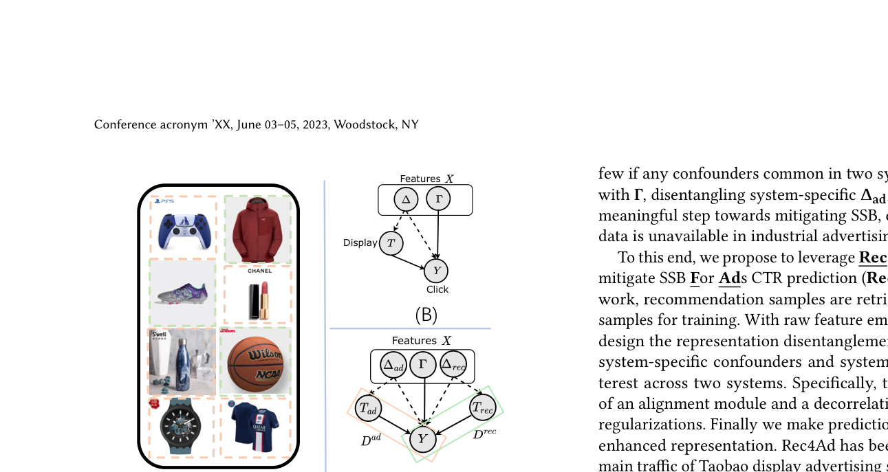
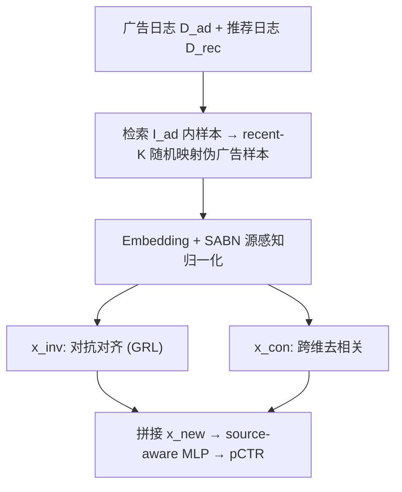
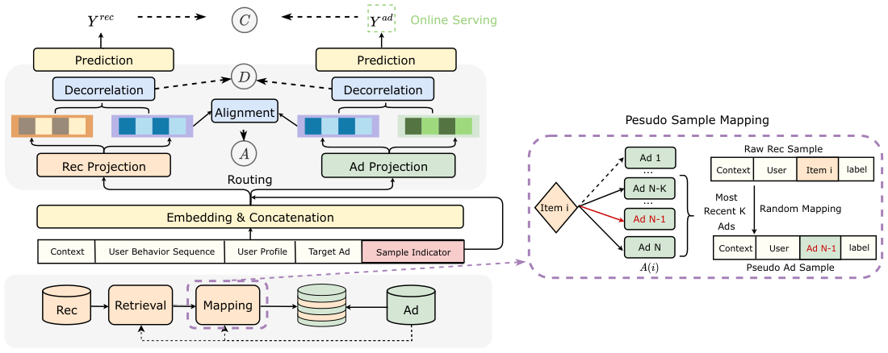

# Rec4Ad: A Free Lunch to Mitigate Sample Selection Bias for Ads CTR Prediction in Taobao (借推荐样本作免费午餐：缓解淘宝广告 CTR 样本选择偏差)

- **会议/期刊**: CIKM 2023 (arXiv 2306.03527)
- **作者与机构**: Jingyue Gao, Shuguang Han, Han Zhu, Siran Yang, Yuning Jiang, Jian Xu, Bo Zheng（阿里巴巴）
- **推荐链路定位**: 精排（广告 CTR 预估）
- **研究方向**: CTR/CVR 预估与特征交叉 / 去偏公平与工业架构
- **论文原文**: [https://arxiv.org/abs/2306.03527v1](https://arxiv.org/abs/2306.03527v1)
- **开源代码**: 暂未开源

## TL;DR (1分钟核心速览)

广告曝光由 $pctr \times bid$ 自身策略选出，训练分布偏离推理分布（SSB）；IPS 重加权方差大、校准差，均匀数据（uniform data）昂贵且量级不足。本文发现手淘同一界面混排广告与推荐、二者选择机制不同但用户点击动因相同，于是把推荐样本检索后映射为伪广告样本，用 source-aware BN + 对抗对齐（不变兴趣）+ 去相关（系统混杂）做解耦表征。在淘宝两周真实日志（19 亿广告样本训练、1890 万随机策略曝光测试）上 AUC 0.6778→0.6805，ECE 降低 71%，线上 CTR +6.6%、RPM +2.9%。

## Background & Motivation (背景与核心矛盾)

- **主流范式**: 工业 CTR 模型在"已曝光广告"日志上持续训练（图 1 的服务-更新闭环），天然存在训练/推理空间不一致。
- **前人局限**: IPS/IPS-C 依赖难以准确估计的倾向分，高方差且改变标签分布导致校准崩坏；uniform data 路线需随机流量，1% 随机策略即损害体验与收入，且数据量不足以喂饱十亿级参数模型。
- **核心洞察 (Key Insight)**: 作者用曝光率 $\mathrm{IR}(a)=\frac{\#\{a\text{ 被曝光}\}}{\#\{a\text{ 进入候选}\}}$度量机会不均，首尾分组差近 200 倍；低 IR 广告 AUC/ECE 明显更差。但**同一批广告对应的商品在推荐侧曝光充足**（图 5 左），把排序函数由$pctr\times bid$换成$pctr$的模拟实验直接改变了曝光分布（图 5 右）——说明两个系统的选择机制不同、混杂因子$\Delta_{ad}/\Delta_{rec}$几乎不重叠，而用户点击只由真实兴趣$\Gamma$ 决定。
- **本文切入点**: 把推荐样本当作**免采集成本的负偏校正数据**，用解耦表征把系统特有混杂 $\Delta$从兴趣$\Gamma$ 中剥离（图 2 因果图）。

<figure class="paper-figure" markdown="span">
  <figcaption>图2：(A) 广告（绿色虚线）与推荐（橙色虚线）的混合结果。(B,C) 广告和推荐中CTR预测的因果图。</figcaption>
</figure>

## Method (核心方法设计)

### 1. 整体框架 (Overall Architecture)

两阶段闭环：**数据增广**阶段从推荐日志中检索"有关联广告的商品"曝光，随机映射为伪广告样本，与真实广告样本混批；**解耦表征**阶段把拼接特征经 SABN 归一化与 MLP 得到原始表征 $x^s$，再分两路投影出系统不变表征$x_{inv}$与系统特有混杂表征$x_{con}$，分别由对抗判别器（GRL）与跨维度去相关约束塑造，最后拼接回$x_{new}$经 source-aware 预测层输出$pctr$。训练损失为点击 CE + 对齐 + 去相关，线上推理只需广告分支，结构与基线 DIN 同量级。

<figure class="paper-figure" markdown="span">
  <figcaption>图3：Rec4Ad的整体框架（建议彩色查看）。</figcaption>
</figure>

### 2. 关键设计拆解 (Key Designs)

1. **检索式增广与 recent-K 随机伪映射（让推荐样本"长得像"广告）**：痛点是不加筛选地把 $D_{rec}$混入既浪费算力又引入无关分布，且$D_{rec}$落在$\mathcal{U}\times\mathcal{I}$空间与广告的$\mathcal{U}\times\mathcal{A}$空间不兼容。做法是仅保留"存在对应广告的商品"集合$\mathcal{I}_{ad}=\{i\in\mathcal{I}\mid \exists a\in\mathcal{A}, I(a)=i\}$，得$\hat{D}_{rec}$；再对每条推荐样本在对应广告集合$\mathcal{A}(i)$中**按最近$K$个广告随机抽一个**：$\tilde{D}_{rec}=\{(u,a',c,y)\mid (u,i,c,y)\in\hat{D}_{rec},\,a'\in\mathcal{A}(i)\}$。关键是"随机"而非按曝光频次选，避免把广告系统的选择偏差二次注入。

2. **SABN + 对抗对齐（剥离系统不变兴趣 $\Gamma$）**：混合批的统计量与线上仅用广告样本归一化的统计量不一致，共享 BN 参数会破坏校准，故引入源感知归一化$\mathrm{SABN}(e,s)=\gamma_s\frac{e-\mu_s}{\sqrt{\sigma_s^2+\epsilon}}+\beta_s,\ s\in\{ad,rec\}$。对齐不采用 MMD/Wasserstein（小批难估且慢），而是训二分类判别器$H$并接梯度反转层：$L_A=-\sum_{D_{ad}}\log\hat{s}-\sum_{\tilde{D}_{rec}}\log(1-\hat{s})$，反向时$\frac{\partial L_A}{\partial x_{inv}}=-\alpha\frac{\partial L_A}{\partial \mathrm{GRL}(x_{inv})}$，使$x_{inv}$ 在两类样本上不可分——物理直觉即"用户分不清广告还是推荐，点击动因应被对齐"。

3. **去相关解耦与训练目标**：仅对齐会让 $x_{con}$残留共享信息，故对$x_{inv}$与$x_{con}$的逐维皮尔逊相关施加惩罚$\Upsilon(p_i,q_j)=\frac{\mathrm{Cov}(p_i,q_j)}{\sqrt{\mathrm{Cov}(p_i,p_i)}}$，$L_D=\sum_{i=1}^{d}\sum_{j=1}^{d}[\Upsilon(p_i^{ad},q_j^{ad})^2+\Upsilon(p_i^{rec},q_j^{rec})^2]$，逼迫$x_{con}$只承载被对齐模块丢弃的系统特有混杂。总目标$\mathcal{L}=\mathcal{L}_{C}+\lambda_1 L_A+\lambda_2 L_D$（$\lambda_1=0.005,\lambda_2=0.5$，$d=128$，$\alpha=0.1$，$K=3$）。预测仍拼接$x_{new}=x_{inv}\oplus x_{con}$——非因果关联对精度亦有贡献，不能直接丢弃。训练**无需负采样**（全曝光样本做二分类），推理侧零额外开销。

## Experimental Setup & Evaluation Protocol (实验设置与评估协议)

- **数据集与预处理**: 淘宝展示广告 + 推荐系统 2022/06 两周日志。

| 数据集 | #Users | #Items/Ads | #Interactions | 说明 |
| :--- | :---: | :---: | :---: | :--- |
| 训练集 $D_{ad}$ | 2 亿 | 广告全集 | 19 亿 | 常规策略下的广告曝光 |
| 训练集 $\hat{D}_{rec}$| 同上 |$\mathcal{I}_{ad}$ | 6 亿 | 检索后推荐曝光 |
| 测试集 | 1030 万 | — | 1890 万 | 小流量**随机策略**采集的广告曝光 |

- **数据划分与防穿越 (Splitting Strategy)**: 全局时间戳切分——第 1 周数据训练，第 2 周随机策略曝光作测试；测试集本身近似无偏，用于对抗 SSB 评估。
- **排名评测协议 (Ranking Protocol)**: 全量测试集排序评估（无负采样），指标 AUC（排序）+ ECE（校准，$K=100$ 分桶）；经验上 AUC 绝对提升 0.001 ≈ 线上 CTR +1%。
- **对比基线与超参设置**: Base(DIN)、DAG(直接混样)、IPS、IPS-C(截断)、IV(工具变量)；Embedding 16 维，Adam，lr 0.001，batch 6000，5 次随机初始化取均值，t-test $p<0.01$ 显著性。

## Key Experimental Results (实验关键数据)

### 1. 主实验对比 (Main Results)

| Method | AUC | Impv. | ECE | Impv. |
| :--- | :---: | :---: | :---: | :---: |
| Base (DIN) | 0.6778 | — | 0.0007 | — |
| DAG | 0.6724 | -0.0054 | 0.0032 | -0.0025 |
| IPS | 0.6618 | -0.0160 | 0.0023 | -0.0016 |
| IPS-C | 0.6783 | +0.0005 | 0.0015 | -0.0008 |
| IV | 0.6790 | +0.0012 | 0.0009 | -0.0002 |
| **Rec4Ad** | **0.6805\*** | **+0.0027** | **0.0002** | **+0.0005** |

分 IR 分组（$G_{top}$前 25% /$G_{bottom}$ 后 25%）：

| Group | Method | AUC | Impv. | ECE |
| :--- | :--- | :---: | :---: | :---: |
| $G_{top}$ | Base / IPS-C / IV / **Rec4Ad** | 0.6741 / 0.6736 / 0.6743 / **0.6757\*** | — / -0.0005 / +0.0002 / **+0.0016** | 0.0002 / 0.0004 / 0.0002 / **0.0002** |
| $G_{bottom}$ | Base / IPS-C / IV / **Rec4Ad** | 0.6625 / 0.6648 / 0.6734 / **0.6654\*** | — / +0.0023 / +0.0009 / **+0.0029** | 0.0021 / 0.0018 / 0.0021 / **0.0010\*** |

### 2. 消融实验 (Ablation Study)

| 变体 | AUC | ECE | 结论 |
| :--- | :---: | :---: | :--- |
| Rec4Ad 完整 | 最优 | 最优 | — |
| w/o SABN | 略降 | **显著退化** | 共享 BN 统计量错配 → 激活尺度失准、校准崩坏 |
| w/o Alignment | **< 0.679** | 下降 | 无法提取共享兴趣，混样反而互相干扰 |
| w/o Decorrelation | 下降 | 下降 | 混杂未被剥离，$x_{con}$ 污染共享子空间 |

### 3. 关键实验发现 (Key Findings)

1. **混样 ≠ 去偏**：DAG 直接合并推荐样本后 AUC 反降 0.0054、ECE 恶化 3 倍以上，而 Rec4Ad 在同样数据下 +0.0027，说明增益来自解耦机制而非数据量本身。
2. **长尾收益且无跷跷板**：$G_{bottom}$上 AUC +0.0029、ECE 改善 0.0011，同时$G_{top}$仍 +0.0016；反观 IPS-C 在$G_{top}$ 掉点 0.0005，重加权式去偏的"拆东墙补西墙"被规避。
3. **表征层面可验证**：t-SNE 显示 $x_{inv}$上广告/推荐样本完全混叠、$x_{con}$ 上明显分离；对抗判别器 AUC 随训练收敛至 0.5，定量佐证不变兴趣被成功抽取。线上长尾场景 CTR +12.6%（首页）、+3.6%（购后），显著高于整体 +6.6%/+3.0%，与离线分组结论一致。

## Highlights & Limitations (亮点、对比与审稿批判)

- **与代表作对比 (vs. Prior Work)**: 与 IPS 系列相比不依赖倾向分、不改标签分布故保校准；与 uniform data / 蒸馏路线相比零额外流量成本、数据量级大两个数量级；与 IV 相比不局限于"用户跨系统行为"这一工具变量假设，而是显式建模混杂-兴趣的加性解耦。
- **可迁移亮点**: (1) 多源混合 batch 下的 **SABN** 可直接迁移到跨场景/多业务联合训练；(2) GRL 对抗对齐 + 跨维相关惩罚的"对齐-去相关"双约束，可复用于跨域推荐与序列/图对比去偏。
- **审稿级局限批判**: (1) 强依赖平台"广告-推荐同屏混排"前提，纯广告位或单系统场景不成立，且两系统**共有**混杂（如全站流行度）仍残留于 $\Gamma$；(2) 表 2 中 IV 在$G_{bottom}$ 的 0.6734 与标注 +0.0009 自相矛盾（按 Base 0.6625 应为 ~0.6634），且消融仅以 Fig. 6 曲线呈现、无具体数值表，复现与显著性核验受限；(3) 伪样本映射需维护 item-ads 索引与消息队列级数据管线，训练吞吐与工程改造成本未量化。

## Rating (四维评分)

- **方法创新性 (Novelty)**: ⭐⭐⭐⭐ （把"推荐样本"重解释为免费的无偏校正源，并用因果图+解耦表征给出可验证的机制，非简单混样）
- **评估协议与实验扎实度 (Protocol & Experiments)**: ⭐⭐⭐⭐ （随机策略曝光测试集是工业级稀缺协议，含分组/线上 A/B，但消融缺数值、表 2 有内部不一致）
- **写作与数学规范度 (Clarity & Rigor)**: ⭐⭐⭐⭐ （SABN/GRL/去相关三式定义清晰、动机连贯，去相关公式的归一化写法略显简写）
- **工业落地与复现价值 (Industrial & Practical Value)**: ⭐⭐⭐⭐⭐ （推理零额外开销、已在淘宝主流量上线一年，+6.6% CTR / +2.9% RPM 的线上证据极强；仅代码未开源）

