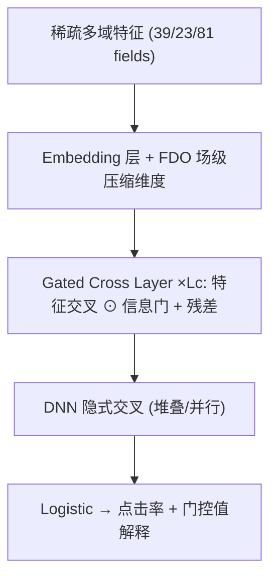
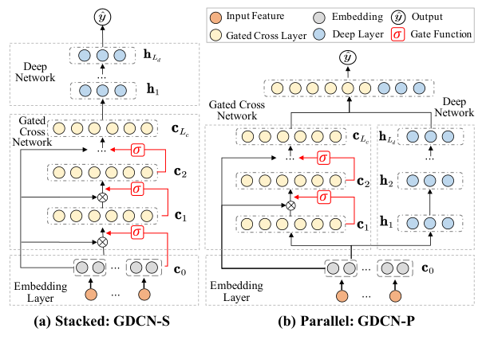

# Towards Deeper, Lighter and Interpretable Cross Network for CTR Prediction (面向更深、更轻、更可解释的 CTR 交叉网络)

- **会议/期刊**: CIKM 2023
- **作者与机构**: Fangye Wang、Tun Lu、Peng Zhang、Ning Gu（复旦大学），Hansu Gu（Seattle），Dongsheng Li（微软亚洲研究院）
- **推荐链路定位**: 精排（CTR 预估）
- **研究方向**: CTR/CVR 预估与特征交叉
- **论文原文**: [arxiv.org/abs/2311.04635](https://arxiv.org/abs/2311.04635v1)
- **开源代码**: [github.com/anonctr/GDCN](https://github.com/anonctr/GDCN)

## TL;DR (1分钟核心速览)

DCN-V2 类显式交叉网络存在三个痛点：交叉阶数超过 3 层后，指数膨胀的交叉项引入噪声，导致 AUC 掉点；所有交叉项等权聚合，高阶交叉缺乏可信归因；各 field 共用统一 embedding 维度，冗余参数占模型 90% 以上。本文提出 **GDCN**：在每一阶交叉上并联一个 sigmoid **信息门 (information gate)** 对交叉位进行软筛选，使交叉深度可安全推进到 8–16 层；并配套 **FDO** 后验 PCA 方式为每个 field 学习压缩维度。在 Criteo/Avazu/Malware/Frappe/ML-tag 五数据集上，GDCN-P 相对最强基线 SerMaskNet 平均 AUC 提升 **0.38%**、LogLoss 降 **4.26%**，FDO 用 **23%** 参数取得同级精度。

## Background & Motivation (背景与核心矛盾)

- **主流范式**: 并行或堆叠结构并列显式交叉网络（CN/CN-V2/CIN/FINT）与 DNN，联合建模显式与隐式高阶交叉；该领域公认 AUC 提升 0.001 即为显著。
- **前人局限一（深度失效）**: 交叉项数目随层数指数增长，但大多数交叉项是噪声；几乎所有 SOTA（DCN-V2、xDeepFM、AFN、FINT）的超参分析都显示交叉阶数超过 2–3 层后性能反降。
- **前人局限二（不可解释 + 参数冗余）**: 基于 attention 的解释把全部特征融合，无法定位具体是哪一阶交叉起作用；同时各 field 强制同维度，DCN-V2 的 $(feature\_num)^{0.25}$经验公式只依赖特征基数、忽略 field 重要性，反而把参数做大（Criteo 上$D=18.66>16$）。
- **核心洞察 (Key Insight)**: 高阶交叉并非无用，而是"未被筛选"；作者可视化证实——第 1 层门控中大量交叉位是红色（重要），到第 3 层绝大多数转为白/蓝（中性/无用），重要交叉数逐层锐减。
- **本文切入点**: 在每阶交叉后乘一个 bit-wise 软门，只放行本阶有信息量的交叉位，从而让"更深"变成正收益，并顺带提供实例级解释。

## Method (核心方法设计)

### 1. 整体框架 (Overall Architecture)

输入多域稀疏特征经 embedding 层拼接为 $\mathbf{c}_0\in\mathbb{R}^D$（GDCN 允许各 field 维度异构，故$D=\sum_f d_f$）。核心 Gated Cross Network (GCN) 以$\mathbf{c}_0$ 为恒定锚点做多项式显式交叉，每层输出先经门控筛选再残差回传；GCN 可与 DNN 组成堆叠结构 **GDCN-S**（GCN 后接 DNN）或并行结构 **GDCN-P**（两路输出拼接）。最终向量过 logistic 层输出点击概率。训练用标准 LogLoss + Adam，推理无额外开销。

<figure class="paper-figure" markdown="span">
  <figcaption>图1：GDCN-S 和 GDCN-P 的架构。⊗ 是公式1中的交叉操作（又称门控交叉层）。</figcaption>
</figure>

### 2. 关键设计拆解 (Key Designs)

1. **门控交叉层 (Gated Cross Layer)**：原 CN-V2 层为 $\mathbf{c}_{l+1}=\mathbf{c}_0\odot(\mathbf{W}_l^{(c)}\mathbf{c}_l+\mathbf{b}_l)+\mathbf{c}_l$，所有$l{+}2$ 阶交叉被等权送入下一层，噪声逐层累积。本文把交叉结果与门控向量做 Hadamard 积：
$$\mathbf{c}_{l+1}=\mathbf{c}_0\odot\underbrace{\left(\mathbf{W}_l^{(c)}\mathbf{c}_l+\mathbf{b}_l\right)}_{\text{Feature Crossing}}\odot\underbrace{\sigma\!\left(\mathbf{W}_l^{(g)}\mathbf{c}_l\right)}_{\text{Information Gate}}+\mathbf{c}_l$$
门值由 $\mathbf{W}_l^{(g)}$依当前实例动态生成，$\sigma(\cdot)>0.5$放大、$<0.5$ 抑制。直觉：门控相当于对指数增长的交叉空间做一次"实例条件化的稀疏化"，故深层只保留必要信息，性能不再掉点。当门全为 1 时退化为 DCN-V2，因此是其严格泛化。
2. **场级维度优化 FDO (Field-level Dimension Optimization)**：先用固定 $d=16$训一个全模型，对每个 field 的 embedding 表$\mathbf{E}_f$做 PCA，按奇异值累计信息比（95%/80%）截断得压缩维度$d_f$，再以新维度重训。与经验公式不同，这是**后验**重要性度量：Criteo 上 field #20/#23/#24 重要 → 维度 14/15/14，而特征数最多的 #16/#25 仅得 4/2 维。$D$从 16 降至 5.92（95% 比），embedding 参数降到 37%，并连带把交叉/门控矩阵$\mathbf{W}^{(c)},\mathbf{W}^{(g)}\in\mathbb{R}^{D\times D}$缩小（$K$ 从 16→7.87）。
3. **训练目标与效率**：损失即二元交叉熵 $\mathcal{L}=-\frac{1}{N}\sum_i[y_i\log\hat{y}_i+(1-y_i)\log(1-\hat{y}_i)]$，无特殊负采样（CTR 场景为曝光样本全量训练，正样本比例 17%–50%）。门控只增加两个$D\times D$ 矩阵，训练时间与 DCN-V2 同量级；叠加 FDO 后 GCN-FDO / GDCN-P-FDO 在 Criteo 上参数约 5M、单 epoch 训练快于全部 SOTA。

## Experimental Setup & Evaluation Protocol (实验设置与评估协议)

- **数据集与预处理**:

| 数据集 | #Users/样本(训练) | #Features | #Fields | 正样本率 | 说明 |
| :--- | :---: | :---: | :---: | :---: | :--- |
| Criteo | 36,672K | 1,086K | 39 | 26% | 频次<10 归 `<unknown>`，数值 $\lfloor\log_2 z\rfloor$ 归一 |
| Avazu | 32,343K | 1,544K | 23 | 17% | 频次<5 归 `<unknown>` |
| Malware | 7,137K | 976K | 81 | 50% | 安全场景 |
| Frappe | 231K | 5K | 10 | 33% | 小规模 App 使用 |
| ML-tag | 1,605K | 90K | 3 | 33% | 极低域数 |

- **数据划分与防穿越**: **随机比例划分 8:1:1**（train/valid/test），非时间切分；CTR 任务依赖随机打散而非时间对齐，故不存在严格防穿越设计，这一点弱于工业时序验证。
- **排名评测协议**: 本文为 **point-wise 二分类**，不涉及召回侧的 Full-Ranking/Sampled Ranking；指标为 **AUC 与 LogLoss**，AUC 提升 0.001 级即视为显著。**无负采样比例设置**（全曝光样本训练）。
- **对比基线与超参**: 覆盖一阶 LR、二阶 FM/FwFM/DIFM/FmFM、高阶 CN/CIN/AutoInt/AFN/CN-V2/IPNN/OPNN/FINT/FiBiNet/SerMaskNet，以及并行 WDL/DeepFM/DCN/xDeepFM/AutoInt+/AFN+/DCN-V2/NON/FED/ParaMaskNet。统一 embedding $d=16$、DNN 3 层 400-400-400、batch 4096、lr 0.001、dropout 0.5、early stopping patience 5；每模型 **10 次随机种子**均值，双尾 t 检验$p<0.01$。

## Key Experimental Results (实验关键数据)

### 1. 主实验对比 (Main Results)

AUC（/LogLoss 见原文），加粗为全局最优：

| 模型 | Criteo | Avazu | Malware | Frappe | ML-tag |
| :--- | :---: | :---: | :---: | :---: | :---: |
| DNN | 0.8139 | 0.7886 | 0.7424 | 0.9794 | 0.9598 |
| DeepFM | 0.8140 | 0.7891 | 0.7424 | 0.9808 | 0.9606 |
| DCN-V2 | 0.8144 | 0.7898 | 0.7433 | 0.9810 | 0.9603 |
| FINT | 0.8128 | 0.7891 | 0.7424 | 0.9807 | 0.9598 |
| SerMaskNet | 0.8141 | 0.7891 | 0.7440 | 0.9804 | 0.9602 |
| **GCN** (仅显式交叉) | 0.8154 | 0.7903 | 0.7445 | 0.9820 | 0.9619 |
| **GDCN-S** | 0.8158 | 0.7905 | 0.7456 | 0.9838 | 0.9645 |
| **GDCN-P** | **0.8161** | **0.7909** | **0.7462** | **0.9852** | **0.9663** |
| Improv.% (vs SerMaskNet) | +0.25% | +0.23% | +0.30% | +0.49% | +0.63% |

平均 $\Delta$AUC 上，GCN +0.14%、GDCN-S +0.28%、GDCN-P **+0.38%**；平均$\Delta$LogLoss 分别$-0.45\%$、$-2.70\%$、$-4.26\%$（LogLoss 降幅远大于 AUC 升幅，说明收益主要来自概率校准/置信度提升）。

### 2. 消融与组件分析 (Ablation)

Criteo 上 FDO 信息比扫描（GCN 主干）：

| 配置 | $D$|$K$ | #Params | 占比 | AUC | LogLoss |
| :--- | :---: | :---: | :---: | :---: | :---: | :---: |
| Full ($d$=16) | 16 | 16 | 19.73M | 100% | 0.8154 | 0.4367 |
| FDO-98% | 7.56 | 9.54 | 9.04M | 45.8% | **0.8157** | **0.4365** |
| FDO-95% | 5.92 | 7.87 | 7.00M | 35.5% | **0.8157** | **0.4365** |
| FDO-80% | 3.98 | 4.85 | 4.54M | **23.0%** | 0.8155 | 0.4366 |
| FDO-50% | 1.97 | 2.26 | 2.54M | 11.1% | 0.8137 | 0.4380 |
| 直接固定 $d$=8 | 8 | 8 | 9.27M | 47.9% | 0.8151 | 0.4371 |

交叉深度消融（去门控即 DCN-V2）：层数 1→8 时 GCN 的 AUC 单调升至 0.8165 附近，而 AFN/FINT/CN-V2/DNN/IPNN 在 2–4 层后即掉点；GDCN-P 在 4–6 层达平台，GCN 在 8–10 层达平台，之后保持平稳不退化。

### 3. 关键实验发现 (Key Findings)

1. **门控是深度收益的唯一来源**：同等结构下去掉信息门即退化为 DCN-V2，8 层时 AUC 反而低于 3 层；加门后 8 层 GCN 比 3 层高约 0.001，且门值统计显示第 1 层重要交叉位占多数、第 3 层大部分落入 $[0.4,0.6]$ 中性区，定量印证"高阶交叉需筛选而非全收"。
2. **FDO 是"减参不降效"而非"减参换效"**：80% 信息比仅用 23% 参数即打平全维模型，95% 甚至略超；但直接把 $d$统一降到 8（参数量相近）却掉点，证明收益来自**逐 field 差异化**而非单纯维度降低。学习到的维度与第 1 层平均门值相关系数达 **0.82**（$p<10^{-9}$），即维度本身可作为 field 重要性的代理指标。
3. **门控矩阵保留可迁移的静态语义**：GCN 与 GCN-FDO 的块状交叉矩阵 $\mathbf{W}^{(c)}_1$ 余弦相似度 **0.89**，说明 FDO 压缩维度后并未破坏学到的 field 间交互结构，压缩后的维度组可在不同模型间复用（表 6 中跨模型迁移精度几乎无损）。

## Highlights & Limitations (亮点、对比与审稿批判)

- **与代表作对比**: 相比 DCN-V2，GDCN 的门控目的不是省参数（DCN-V2 的 MMoE 式门控用于分解 $\mathbf{W}^{(c)}$ 降非 embedding 参数），而是**筛选交叉语义 + 提供实例级解释**；相比 AutoInt/DCAP 的 attention 解释，门控给出的是 bit-wise 与 field-wise 两级可视化而非整体融合权重；相比 FmFM 的 field 级维度，FDO 用后验 PCA 信息比替代先验特征数公式。
- **可迁移亮点**: ①"交叉/交互算子 + 一个 $\sigma(\mathbf{W}\mathbf{x})$ 软门 + 残差"的即插即用范式，可直接套到 CIN、FINT 等交叉层；②用训练好的全维 embedding 表做逐 field PCA 定维，避免大范围调维搜索，且维度组可跨模型复用。
- **审稿级局限批判**: ①随机 8:1:1 划分而非时间切分，工业分布漂移下 AUC 收益可能缩水，缺线上 A/B 验证；②FDO 需"先训全模型→PCA→重训"两阶段流程，且信息比 95% vs 80% 的选择缺乏自动化准则，跨数据集需人调；③门控引入 $\mathbf{W}^{(g)}$ 使每层交叉参数翻倍，虽经 FDO 抵消，但纯 GCN 在主实验中的增益（+0.14%）相对 DCN-V2 幅度有限，收益更依赖与 DNN 的组合。

## Rating (四维评分)

- **方法创新性 (Novelty)**: ⭐⭐⭐⭐ （信息门控对高阶交叉做实例级位筛选，机制简洁且有可视化证据支撑，但本质是 CN-V2 + 门控的增量式改进）
- **评估协议与实验扎实度 (Protocol & Experiments)**: ⭐⭐⭐⭐ （5 数据集 × 20+ 基线 × 10 随机种子 + $p<0.01$ 检验，消融覆盖深度扫描与 FDO 信息比扫描；扣分在随机划分无时序验证、无线上实验）
- **写作与数学规范度 (Clarity & Rigor)**: ⭐⭐⭐⭐⭐ （单式定义门控交叉层、退化关系与 GCN/DCN-V2 门控动机的区别交代清晰，参数复杂度 $\mathcal{O}(T D)$ 推导到位）
- **工业落地与复现价值 (Industrial & Practical Value)**: ⭐⭐⭐⭐⭐ （代码开源；FDO 将 embedding 参数压到 23%、训练更快，且维度组可复用，对线上大特征空间 CTR 系统有直接落地价值）

