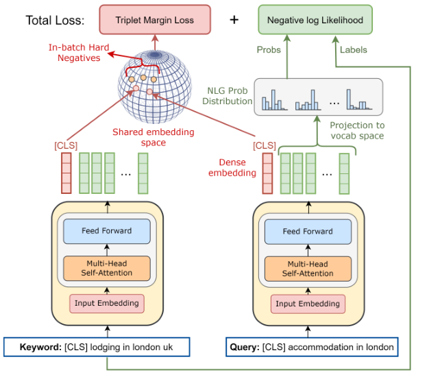
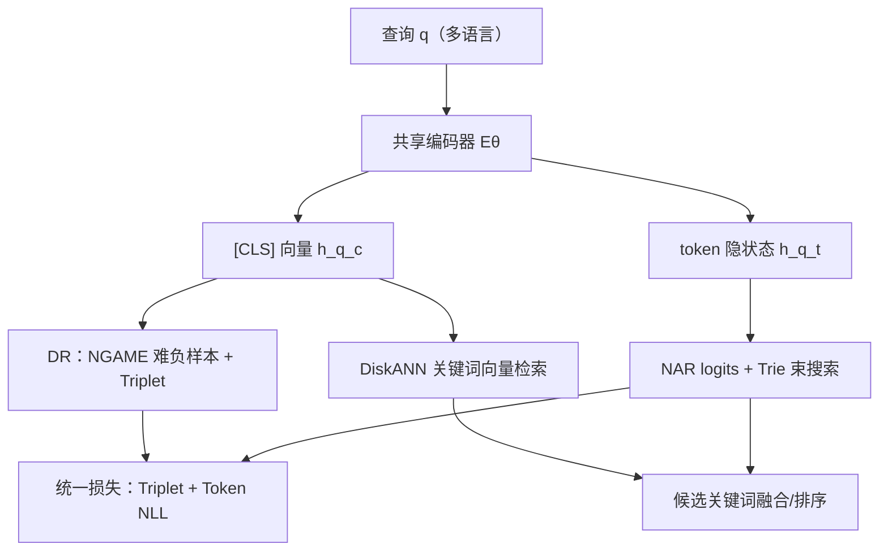

# Unified Generative & Dense Retrieval for Query Rewriting in Sponsored Search (赞助搜索中统一生成式与稠密检索的查询改写)

- **会议/期刊**: CIKM 2023
- **作者与机构**: Akash Kumar Mohankumar, Bhargav Dodla, Gururaj K, Amit Singh；Microsoft、IIT Madras
- **推荐链路定位**: 召回/检索（广告关键词匹配与查询改写）
- **研究方向**: CTR/CVR 预估与特征交叉（广告检索链路） / 生成式推荐与离散语义 ID
- **论文原文**: [论文原文链接](https://arxiv.org/abs/2209.05861v2)
- **开源代码**: 暂未开源

## TL;DR (1分钟核心速览)

赞助搜索需为短查询实时召回大量高质量出价关键词，生成式 NLG 与稠密检索 DR 各有盲区：前者擅长同义/上下位 token，却受关键词长度与自回归延迟制约；后者不受长度限制，却缺乏 token 级监督。本文提出 CLOVER-Unity，用共享 XLM-R 编码器同时优化 DR Triplet 与 NAR token NLL，一次前向即可做 DiskANN 检索与 Trie 束搜索。在 Bing 内部 Query2Bid 与两个公开极端分类基准上，Unity 比单独 DR/NLG 模型分别平均提升 7.4%/19.2%，比两模型 ensemble 高 9.8% 好词密度且 GPU 成本低 45.8%；线上 140+ 国家平均点击 +0.89%、收入 +1.27%。

## Background & Motivation (背景与核心矛盾)

- **主流范式**: 查询改写有两条路线：DR 将 query/keyword 编码后做 ANN 近邻检索；NLG 将关键词生成约束到出价关键词 Trie 中。
- **前人局限**: AR 生成式模型需逐 token 解码，CLOVERv1/Deep-Shallow 推理成本比 DR 高一个数量级；NAR 生成虽快，却因并行预测全部 token 而偏向短关键词。
- **核心洞察 (Key Insight)**: 两路线高度互补——约 40% 的高质量关键词是各自独有的；NLG 检索结果含更多同义词/上下位词，DR 更能覆盖带额外 token 的长关键词。
- **本文切入点**: 不复刻 ensemble，而是让同一编码器在同一任务上同时学习“token 级生成”和“向量级判别”，用共享表征互补两类归纳偏置。

## Method (核心方法设计)

### 1. 整体框架 (Overall Architecture)

输入查询 $q$经共享 Transformer 编码器$E_\theta$ 得到 `[CLS]` 向量与 token 隐状态：前者作为 DR 表征，后者投影到词表得到 NAR logits。训练时对同一批 query-keyword 正例同时计算 NGAME 难负样本 Triplet 损失与 token NLL；推理时一次前向并行执行 DiskANN 向量召回和 Trie 约束束搜索，再将两路候选按质量阈值融合。图1 展示共享编码器同时接收两类梯度；整体流程如下。

<figure class="paper-figure" markdown="span">
  <figcaption>图1：CLOVER-Unity 使用对比式 DR 和对数似然 NLG 损失函数的训练过程</figcaption>
</figure>

### 2. 关键设计拆解 (Key Designs)

1. **NAR 生成 + Trie 约束解码（把生成式召回变快且可控）**：AR 每 token 一次前向且 beam 成本 $O(B)$，难以承接高 QPS。本文假设 token 条件独立：
   $p_{\mathrm{NAR}}(K_1,\ldots,K_m|Q,\theta)=\prod_{t=1}^{m}p_{\mathrm{NAR}}(K_t|Q,\theta)$，
   再用出价关键词 Trie 将解码限制在闭集：
   $\tilde p(K_t=k_t|k_{<t},q,\mathcal K)=p_{\mathrm{NAR}}(K_t=k_t|q)$若$k_t\in\mathrm{child}_{T_{\mathcal K}}(k_{<t})$，否则为 0。Trie 充当外部 AR 语言模型，避免 NAR 的重复 token 与模式混合；置换解码进一步缓解同前缀候选多样性不足。

2. **共享编码器的统一检索（让 DR 获得 token 级词法归纳）**：标准多任务通常是不同任务共享底层，本文是同一任务两种解法共享全编码器。`[CLS]` 向量 $\mathbf{h}^{q}_{c}$用于 DR，token 隐状态经$\log\tilde p(K_t|q,\theta)=\mathbf{W}\mathbf{h}^{q}_{t}$ 得到 NAR 词表分布。由于 NLG 损失显式监督同义/上下位 token，DR 分支也间接学到词级关系；这解释了 Unity-DR 比 NGAME 多 11.2%/13.1% 同义/上下位词。

3. **训练目标、负采样与推理效率**：DR 用 NGAME 批内难负样本，NLG 无需负采样。总损失为
   $\mathcal L=\frac{1}{L}\sum_{q,k\in\mathcal D}\left[(\mathbf{h}^{l}_{c})^{\top}\mathbf{h}^{q}_{c}-(\mathbf{h}^{k}_{c})^{\top}\mathbf{h}^{q}_{c}+\gamma\right]_{+}-\alpha\sum_{t=1}^{m}\log p(K_t=k_t|q,\theta)$。
   推理仅一次编码器前向；表3 中 Unity 全模型 GPU 延迟 5.64 ms、10k QPS 日成本 \$853，ensemble 为 \$1,577。

## Experimental Setup & Evaluation Protocol (实验设置与评估协议)

- **数据集与预处理**: 赞助搜索数据从 Bing 日志挖掘高质量 query-keyword pair，覆盖 30+ 语言；公共基准来自极端分类库。

| 数据集 | #Labels/类别 | #Train | #Test | 平均标签数 | 场景说明 |
| :--- | :---: | :---: | :---: | :---: | :--- |
| Query2Bid-1M | 997,994 | 16,366,540 | 500,000 | 1.68 | Bing 广告关键词 |
| Query2Bid-5M | 4,995,652 | 49,571,313 | 500,000 | 2.80 | Bing 广告关键词 |
| Query2Bid-10M | 10,011,695 | 75,532,741 | 500,000 | 3.82 | Bing 广告关键词 |
| AmazonTitles | 131,073 | 294,805 | 134,835 | 2.29 | 公开短文本检索 |
| WikiSeeAlsoTitles | 312,330 | 693,082 | 177,515 | 2.11 | 公开短文本检索 |

- **数据划分与防穿越**: 固定 train/test 划分，测试集 500k query；非 Leave-One-Out，也未做冷启动切分。
- **排名评测协议**: 赞助搜索为 Top-100 候选评估（DR ANN 取 100、NLG beam 100），并非全库 Full-Ranking；用人工标注训练的质量模型 $M_e/M_p$（AUC-ROC 0.837）计算 Good Keyword Density$Q@0.5$、$Q@0.7$。公共基准报告 P@5、PSP@5、PSN@5、N@5、R@100。
- **对比基线与超参**: XLM-R base，max len 16，batch 1024，4×A100；NLG beam 100，DR top-100；线上 A/B 以 $p<0.01$ 判断显著性。

## Key Experimental Results (实验关键数据)

### 1. 主实验对比 (Main Results)

表1 Query2Bid-1M 主结果（Top-100 候选；`Improv.` 为 Unity 相对 ensemble 的 Exact Q@0.5 提升）：

| 模型 | Exact Q@0.5 | Exact Q@0.7 | Phrase Q@0.5 | Phrase Q@0.7 | Improv. |
| :--- | ---: | ---: | ---: | ---: | ---: |
| CLOVERv1 (AR) | 1.86 | 0.91 | 7.11 | 5.03 | — |
| Deep-Shallow (AR) | 1.33 | 0.64 | 5.21 | 3.67 | — |
| CLOVERv2 (NAR, beam100) | 2.49 | 1.19 | 9.81 | 6.64 | — |
| SimCSE (DR) | 3.34 | 1.58 | 10.15 | 6.97 | — |
| NGAME (DR) | 3.45 | 1.63 | 10.47 | 7.19 | — |
| NGAME + CLOVERv2 ensemble | 4.11 | 1.85 | 15.54 | 10.03 | — |
| **CLOVER-Unity (full)** | **4.43** | **2.07** | **17.08** | **10.90** | **+7.8%** |

在 Query2Bid-5M/10M 上，Unity 的 Exact Q@0.5 为 12.79/19.60，分别比 ensemble 的 11.59/17.91 高约 10.4%/9.4%；公开基准 PSP@5 与 R@100 平均提升 4.4%/3.2%。人工评测中 Unity-DR 的 exact/phrase 好词率相对 NGAME 提升 8.94%/12.58%。

### 2. 消融实验 (Ablation Study)

表2 组件拆分与统一增益（Query2Bid-1M）：

| 设置 | Exact Q@0.5 | Exact Q@0.7 | Phrase Q@0.5 | Phrase Q@0.7 | 结论 |
| :--- | ---: | ---: | ---: | ---: | :--- |
| NLG only: CLOVERv2 | 2.49 | 1.19 | 9.81 | 6.64 | 生成式基线 |
| DR only: NGAME | 3.45 | 1.63 | 10.47 | 7.19 | 稠密基线 |
| Ensemble | 4.11 | 1.85 | 15.54 | 10.03 | 两路互补 |
| Unity (NLG component) | 2.97 | 1.45 | 11.71 | 7.78 | 比 CLOVERv2 平均 +19.2% |
| Unity (DR component) | 3.62 | 1.70 | 11.53 | 7.58 | 比 NGAME 平均 +7.4% |
| **Unity (full)** | **4.43** | **2.07** | **17.08** | **10.90** | 比 ensemble +9.8% |

### 3. 关键实验发现 (Key Findings)

- **互补性是可加和的**：约 40% 好关键词为 NLG/DR 各自独有，union ensemble 比最佳单路平均高 17.5%（exact）和 44.3%（phrase）；Unity 进一步把互补信号压进单模型，比 ensemble 高 9.8% 且 GPU 成本低 45.8%。
- **token 级损失会“回流”到 DR**：Unity-DR 检索词含同义/上下位词比 NGAME 多 11.2%/13.1%，说明 NLL 的显式 token 监督补足了纯对比学习缺失的词法结构；这也解释了 Unity-DR 的稳定增益。
- **线上收益集中在长尾查询**：Bing 140+ 国家 A/B 平均点击 +0.89%、收入 +1.27%；英文 +0.86%/+1.12%，非英文 +0.93%/+1.43%，QBR/广告缺陷无显著恶化；查询覆盖率在所有 decile 提升，尾部 query 增益更明显。

## Highlights & Limitations (亮点、对比与审稿批判)

- **与代表作对比 (vs. Prior Work)**: CLOVERv1 是 AR 生成式改写，CLOVERv2 用 NAR+Trie 提升效率但仍只做生成；NGAME 是强 DR 但无 token 级目标。Unity 的本质差异是“同一任务、同一编码器、两种损失”的联合训练，而非后融合 ensemble。
- **可迁移亮点**: 共享编码器同时承载判别式向量与 token 生成，可迁移到广告/电商关键词召回；Trie 约束 + 置换解码适合闭集生成；DR 向量聚类可把 DiskANN 索引内存降约 3×，Trie 早剪枝可把 P99 延迟降约 3×。
- **审稿级局限批判**: 评估依赖学习式质量模型 $M_e/M_p$，仍是人工标注的代理指标；赞助搜索只评 Top-100 候选，未做全库 Full-Ranking，可能高估召回上限。NAR 的 token 条件独立假设对长关键词和跨 token 依赖仍不友好；线上点击/收入增益虽显著但幅度小于离线指标，生产收益受流量与关键词动态性影响。

## Rating (四维评分)

- **方法创新性 (Novelty)**: ⭐⭐⭐⭐ （同一任务上用共享编码器统一生成式与稠密检索，并用 Trie+置换解码解决 NAR 落地问题，机制新颖但非全新范式）
- **评估协议与实验扎实度 (Protocol & Experiments)**: ⭐⭐⭐⭐ （内部三规模数据+两个公开基准+人工评测+线上 A/B 较完整；Top-100 候选与代理质量模型是主要短板）
- **写作与数学规范度 (Clarity & Rigor)**: ⭐⭐⭐⭐ （NAR 分解、Trie 约束与统一损失定义清晰，工程细节充分；部分训练目标符号可更严谨）
- **工业落地与复现价值 (Industrial & Practical Value)**: ⭐⭐⭐⭐⭐ （Bing 线上验证、成本/延迟数据完整、优化技巧可直接复用；暂未开源，复现需自建 Trie 与质量评估器）

