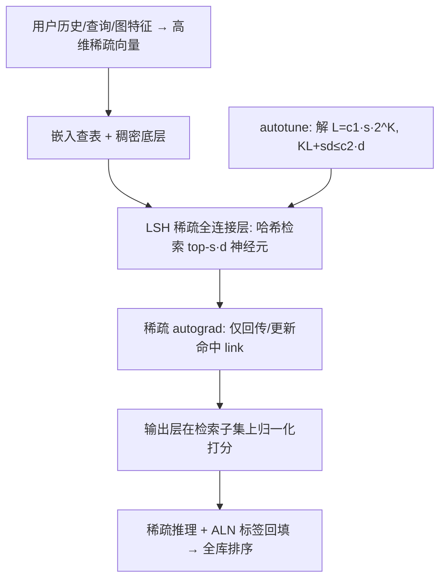
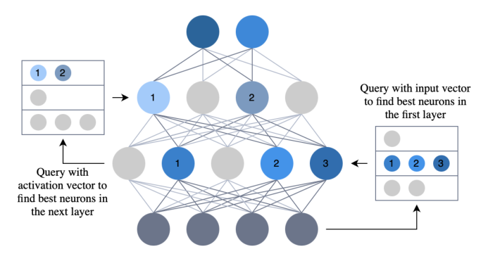
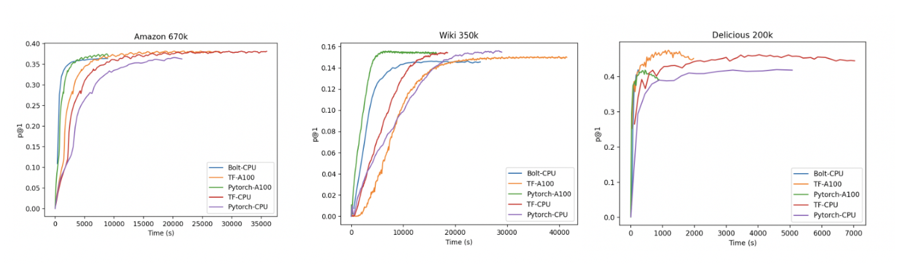

# BOLT: An Automated Deep Learning Framework for Training and Deploying Large-Scale Search and Recommendation Models on Commodity CPU Hardware (在商用 CPU 硬件上训练与部署大规模搜索推荐模型的自动化深度学习框架)

- **会议/期刊**: CIKM 2023 (Applied Research Track)
- **作者与机构**: Nicholas Meisburger, Vihan Lakshman, Benito Geordie 等（ThirdAI；Anshumali Shrivastava 为 Rice University / ThirdAI）
- **推荐链路定位**: 端到端训练 + 在线推理服务（召回/粗排的高维输出层打分）
- **研究方向**: 去偏公平、可信隐私与工业架构 / 序列推荐
- **论文原文**: [https://arxiv.org/abs/2303.17727v4](https://arxiv.org/abs/2303.17727v4)
- **开源代码**: [https://github.com/ThirdAIResearch/BOLT_Benchmarks](https://github.com/ThirdAIResearch/BOLT_Benchmarks)

## TL;DR (1分钟核心速览)

大规模搜索推荐模型的输出空间动辄数十万至上亿类，主流做法是堆 GPU + 蒸馏/量化压缩来换取毫秒级延迟，成本与碳排高企。BOLT 把 SLIDE 的 LSH 动态稀疏思想做成生产级框架：前向只对"权重与输入角相似"的 $s\cdot d$个神经元求激活，并自动推导哈希表数$L$、桶宽$K$与桶容量$R$。在 Amazon-670K 上，全库 Precision@1 为 0.345、推理延迟 4.4 ms（PyTorch-CPU 27.4 ms，dense 推理 63 ms），个性化召回 Recall@10 达 TFRec 的 6.6 倍而延迟低 56 倍。

## Background & Motivation (背景与核心矛盾)

- **主流范式**: 推荐/检索模型输出层极宽（$10^5\sim10^8$ 类），训练依赖 GPU 稠密矩阵乘，部署前再靠蒸馏、量化、剪枝压缩到 CPU 可服务的延迟。
- **前人局限**: ① 剪枝/量化只在推理阶段省算力，训练仍锁死在 GPU，重训成本随用户交互频次线性膨胀；② 静态剪枝破坏宽层表达力，压缩后质量掉点，且需为每个业务重做一次压缩调参。
- **核心洞察 (Key Insight)**: GPU 是**显存带宽受限**，CPU 是**吞吐受限**——只要把计算量降下来而把内存开销提上去，CPU 反而划算。ReLU 单调，故激活值随内积 $\mathbf{w}_i^\top\mathbf{x}=\|\mathbf{w}_i\|\|\mathbf{x}\|\cos\theta$ 单调，**高激活神经元就是与输入角相似的那一小撮**，可用 LSH 碰撞直接"采样"而非全量计算。
- **本文切入点**: 把 LSH 稀疏层产品化，并补齐两个落地缺口——稀疏超参自动调优、以及推理阶段也保持稀疏（含标签神经元回填 ALN）。

## Method (核心方法设计)

### 1. 整体框架 (Overall Architecture)

输入侧把用户历史、物品元数据等离散特征展开为高维稀疏向量（个性化任务中把有序序列特征显式编码进稀疏槽位），经嵌入查表后进入若干 LSH 稀疏全连接层：每层仅检索并计算 top-$\approx s\cdot d$个神经元，输出层在检索到的神经元子集上做归一化打分，直接对应全库 label 排序。训练用定制 autograd，只沿被激活的 link 反向传播、只更新本 batch 命中过的参数行；`autotune` 模块按层维度与目标稀疏度反解$(L,K,R)$。推理沿用同一套哈希索引，配合 ALN 保证正确类别的召回。

<figure class="paper-figure" markdown="span">
  <figcaption>图 1：SLIDE 算法概述</figcaption>
</figure>

### 2. 关键设计拆解 (Key Designs)

1. **LSH 动态稀疏层（把"选神经元"变成"查近邻"）**：稠密层算全部 $d$个神经元的代价是$d\cdot d_{\text{prev}}$，而实际只有少量神经元被激活。BOLT 把每个权重向量$\mathbf{w}_i$哈希入$L$张表，输入$\mathbf{x}$哈希后取各表同桶神经元并集，只算$a_i=f(\mathbf{w}_i^\top\mathbf{x}+b_i)$，$i\in\mathcal{S}(\mathbf{x})$。角敏感哈希的碰撞概率正比于$\cos\theta$，因此该采样对"高激活"近似无偏，而宽层参数一个都不删——这是它相对静态剪枝保表达力的物理直觉。

2. **稀疏超参自动调优（$L,K,R$的闭式反解）**：表太少召回不到足够神经元，表太多哈希开销吃掉收益。设在$d$维层上取稀疏度$s$（被显式计算神经元占比），桶内期望元素$d/2^K$，则需$Ld/2^K\ge c_1 s d$，即$L=c_1 s 2^{K}$；再叠加哈希+求值成本约束$KL+sd\le c_2 d$与经验上界$L\le256$，取$c_1=1$（>95% 概率够用）、$c_2=0.1$（目标 10× 加速），并限制单桶容量$R=2\cdot d/2^K$ 做负载均衡。作者在 Amazon-670K 上前 3 epoch 网格搜索验证：自动调优与最优组合仅差 1 个绝对百分点，而随机参数组差 3–5 个点。

3. **稀疏推理与 ALN（标签神经元回填）**：训练稀疏、推理稠密的传统做法浪费了索引。BOLT 推理时同样只检索，但存在"正确类神经元未被召回"的风险，于是引入 ALN：训练中若含正确标签的桶没被选中，就把该标签神经元强行插入被选中的桶，使相似样本未来更易召回它。配合"推理稀疏度略高于训练稀疏度"双保险。

4. **训练目标、负采样与推理开销**：损失为检索子集上的 softmax 交叉熵 $\mathcal{L}=-\log\frac{\exp(z_y)}{\sum_{j\in\mathcal{S}(\mathbf{x})}\exp(z_j)}$，即**免显式负采样**——分母由 LSH 碰撞隐式给出，代价是负样本分布偏向"与输入相似"的类（理论偏置，见局限）。优化器更新仅限命中参数，单步复杂度约$O(KL d_{\text{prev}}+s d d_{\text{prev}})$；实测 CPU 端推理 1–10 ms。

## Experimental Setup & Evaluation Protocol (实验设置与评估协议)

- **数据集与预处理**（极端分类按「样本/Label」统计，其余为用户-物品交互；标注 ≈ 为公开基准常规统计）：

| 数据集 | #Users | #Items(Label) | #Interactions | 稀疏度/密度 | 特征/场景说明 |
| :--- | :---: | :---: | :---: | :---: | :--- |
| Amazon-670K | ≈490K 样本 | 670,091 | ≈490K | 每样本 1 正类 | 极端分类/商品检索，输出空间最大 |
| Wiki-350K | ≈1.4M 样本 | ≈350K | — | 多标签 | 文档主题检索 |
| Delicious-200K | ≈196K 样本 | ≈200K | — | 多标签 | 网页标签推荐 |
| Movielens-1M | 6,040 | 3,706 | 1,000,209 | 4.47% | 序列 Next-Item |
| Amazon Games | — | — | — | 稀疏 | 序列 Next-Item |
| Netflix-100M | ≈480K | 17,770 | ≈100M | 1.18% | 序列 Next-Item |
| YelpChi / Pokec / Penn94 | — | — | — | 异配图 | 节点分类（YelpChi 用 ROC-AUC） |

- **数据划分与防穿越**: 序列推荐采用 **Leave-Last-Out**（每用户最后一次交互为测试集，之前全部训练，数据按时间戳排序）；极端分类与文本分类沿用基准仓库默认划分；图任务沿用 Non-Homophilous Benchmark 划分。
- **排名评测协议**: 序列推荐为**无偏 Full-Ranking**（"out of all items"，并对 TFRec 基线做"移除已见物品"的等价增强以免高估）；极端分类为全库 Precision@1；文本分类为测试集 P@1；图任务为全图节点分类。
- **对比基线与超参设置**: 引擎层对比 TensorFlow/PyTorch 的 CPU 与 A100-GPU 版本；任务层对比 TFRec 双塔、MLP/GCN/GAT/LinkX、TinyBERT/DistilBERT（预训练+微调）、RoBERTa。CPU 侧统一 AWS c6i.8xlarge（16 核/64 GB），GPU 侧 A100-80GB；延迟取 1000 条样本均值。**无显著性检验**。

## Key Experimental Results (实验关键数据)

### 1. 主实验对比 (Main Results)

**(A) Amazon-670K：全库排序质量 vs 推理延迟（训练 5 epoch）**

| 模型/引擎 | Precision@1 | 推理延迟 (ms) | 硬件 |
| :--- | :---: | :---: | :--- |
| PyTorch-GPU | **0.349** | **0.6** | A100 |
| TensorFlow-GPU | 0.346 | 1.9 | A100 |
| BOLT dense 推理 (ALN) | 0.348 | 63 | CPU |
| **BOLT sparse 推理 (ALN)** | 0.345 | **4.4** | CPU |
| TensorFlow-CPU | 0.346 | 44.4 | CPU |
| PyTorch-CPU | 0.341 | 27.4 | CPU |

**(B) 个性化 Next-Item（Full-Ranking）与异配图节点分类**

| 数据集 | 指标 | BOLT | 最强基线 | Improv. |
| :--- | :--- | :---: | :---: | :---: |
| Movielens-1M | Recall@10 / 延迟 | **0.240** / **1 ms** | 0.0364 / 56 ms (TFRec) | +559% / 56× |
| Amazon Games | Recall@10 / 延迟 | **0.134** / **10 ms** | 0.0193 / 117 ms | +594% / 11.7× |
| Netflix-100M | Recall@10 / 延迟 | **0.0661** / **7 ms** | 0.00759 / 92 ms | +771% / 13× |
| YelpChi | ROC-AUC | **93.18** | 87.94 (MLP) / 77.91 (LinkX) | +6.0% |
| Pokec | Accuracy | 78.06 | **82.04** (LinkX) | −4.8% |
| Penn94 | Accuracy | 81.26 | **84.71** (LinkX) | −4.1% |

**(C) 文本分类与碳足迹**：Amazon Polarity/Yelp/DBPedia/AG News/Emoji 上，BOLT 从零训练即达 TinyBERT/DistilBERT 蒸馏模型的同级准确率，且训练时间与延迟更低（图 3）；Yelp Polarity 上 BOLT 与 RoBERTa 同为 93.3% 准确率，而碳排 6.1 vs 267.99 gCO2eq、时租 \$0.224 vs \$32.773。

<figure class="paper-figure" markdown="span">
  <figcaption>图 2：Amazon-670K、Wiki-350K 和 Delicious 200K 极端分类推荐基准上的 Precision@1 与时间关系。越靠左上越好。我们观察到，CPU 上的 BOLT 往往与在性能强得多的 A100 GPU 上训练的 TensorFlow 和 PyTorch 模型表现相当。我们还看到，随着输出类别数增加（从右到左），BOLT 的优势逐渐显现，这验证了 BOLT 稀疏计算激活的策略。</figcaption>
</figure>

### 2. 消融实验 (Ablation Study)

| 配置 | Precision@1 | 延迟 (ms) | 说明 |
| :--- | :---: | :---: | :--- |
| sparse 推理 + ALN | 0.345 | 4.4 | 完整方案 |
| dense 推理 + ALN | 0.348 | 63 | 去掉稀疏推理，延迟 14× |
| sparse 推理，无 ALN | 0.298 | 4.0 | ALN 贡献 +4.7 pt |
| dense 推理，无 ALN | 0.325 | 67 | 同一结论在 dense 下复现 |
| 自动调参 vs 网格最优 | −1 pt | — | 随机参数组差 3–5 pt |

### 3. 关键实验发现 (Key Findings)

1. **稀疏推理几乎零损**：稀疏+ALN（0.345/4.4 ms）相对 dense+ALN（0.348/63 ms）仅掉 0.3 个百分点却快 14 倍；ALN 是稀疏可用的前提，缺它时精度从 0.345 塌到 0.298（−13.6%），说明"正确标签未召回"是稀疏推理的主要失效源。
2. **收益随输出空间增大而放大**：Amazon-670K > Wiki-350K > Delicious-200K 的 Precision@1–时间曲线上（图 2），BOLT 相对 GPU 基线的劣势逐步收窄，验证了"桶检索开销被 $d$ 摊薄"的规模化直觉；CPU 引擎层面比 PyTorch-CPU 快 6.2×，逼近 A100 同一数量级。
3. **建模方式而非算力带来召回跃迁**：把序列特征展开为高维稀疏槽位后，Recall@10 达 TFRec 的 6.6–7.7 倍，且端到端延迟低一个数量级——但该优势部分来自 TFRec 双塔+采样 softmax 的表达上限，并非纯粹"CPU 更快"。同时异配图任务上 BOLT 在 YelpChi 大胜（93.18 vs 82.04）、在 Pokec/Penn94 反落后 4 个百分点，提示稀疏化在稠密同配小图上并非无脑更优。

## Highlights & Limitations (亮点、对比与审稿批判)

- **与代表作对比 (vs. Prior Work)**: 相比 SLIDE 原始论文，本文补上了生产级 autograd、$(L,K,R)$ 自动反解与**推理阶段稀疏 + ALN**；相比 TinyBERT/DistilBERT 这类"先大模型再蒸馏"的路线，它从零在 CPU 上训练宽输出层，避免了两阶段成本；相比剪枝/量化，它保留全部参数、只稀疏激活，因此不牺牲宽层容量。
- **可迁移亮点**: ① 稀疏层超参的闭式反解（$L=c_1s2^K$与$KL+sd\le c_2d$ 联立）可直接搬来做"稀疏度可调的宽输出层"配置器；② ALN 这一"训练期把正确标签塞进命中桶"的技巧，对任何 ANN 索引式输出层（如双塔召回的分桶 softmax）都适用。
- **审稿级局限批判**: ① 评估以 Precision@1 / Recall@10 单点为主，缺 NDCG@K、HR@K 与 SASRec/BERT4Rec 等序列 SOTA 对照，且明确无显著性检验，"6.6 倍召回"更接近建模差异而非系统收益；② 桶负载均衡假设在分布漂移或高维稠密特征下会失效，标签回填只是启发式、无召回概率保证；③ 商业保密导致主模型结构与超参不公开，仅以 API 脚本复现，第三方独立复现与全链路延迟（含特征服务）验证不足。

## Rating (四维评分)

- **方法创新性 (Novelty)**: ⭐⭐⭐⭐ （LSH 稀疏层本身源自 SLIDE，但稀疏超参闭式反解、稀疏推理 + ALN 属实打实的增量，且有内积–角相似的理论支点）
- **评估协议与实验扎实度 (Protocol & Experiments)**: ⭐⭐⭐ （覆盖极端分类/文本/序列/图四类任务且用 Full-Ranking，但单点指标、无显著性检验、缺序列 SOTA 对照）
- **写作与数学规范度 (Clarity & Rigor)**: ⭐⭐⭐⭐ （稀疏层成本不等式推导清晰、参数取值有依据，但部分架构细节因保密缺失）
- **工业落地与复现价值 (Industrial & Practical Value)**: ⭐⭐⭐⭐⭐ （已在 Wayfair 线上 A/B 部署，CPU 端 1–10 ms 延迟、碳排降 44×，代码与基准脚本开源，落地价值极高）

