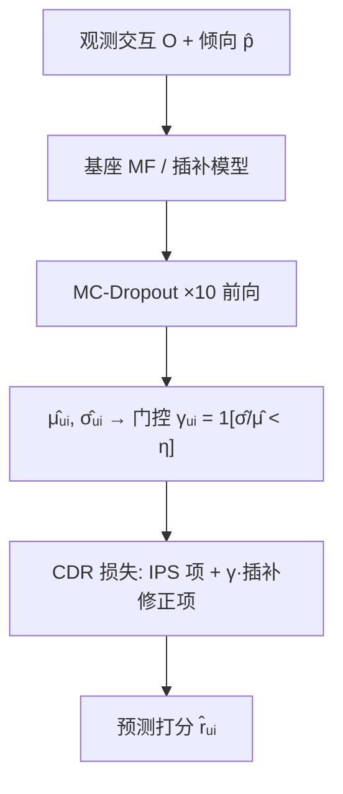
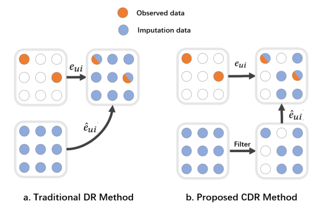

# CDR: Conservative Doubly Robust Learning for Debiased Recommendation (面向去偏推荐的保守双稳健学习)

- **会议/期刊**: CIKM 2023
- **作者与机构**: Zijie Song, Jiawei Chen (通讯), Sheng Zhou, Qihao Shi, Yan Feng, Chun Chen, Can Wang — 浙江大学 / 浙大城市学院
- **推荐链路定位**: 精排（训练损失层，模型无关插件）
- **研究方向**: 去偏公平与工业可信 / 强化学习与 Bandit 估计
- **论文原文**: [https://arxiv.org/abs/2308.08461v2](https://arxiv.org/abs/2308.08461v2)
- **开源代码**: [https://github.com/CrazyDumpling/CDR_CIKM2023](https://github.com/CrazyDumpling/CDR_CIKM2023)

## TL;DR (1分钟核心速览)

双稳健（DR）估计器在去偏推荐中被广泛采用，但它对**全部**用户-物品对做误差插补，而插补模型只在极稀疏的观测数据上训练。作者发现大量插补反而有害（$|\hat{e}_{ui}-e_{ui}|>e_{ui}$，实测占比普遍 >35%，最高 48.1%），称之为“有毒插补 (Poisonous Imputation)”。CDR 提出对插补值做**均值/方差门控**：仅当$\hat{\sigma}_{ui}/\hat{\mu}_{ui}<\eta$ 时保留插补，否则退化为纯 IPS。该方法模型无关、可即插即用，在 Coat/Yahoo!R3/KuaiRand 三个含无偏随机日志的基准上，为 4 类 DR 基线带来最高 +6.27% NDCG@5 与 +4.77% Recall@5 的相对提升。

## Background & Motivation (背景与核心矛盾)

- **主流范式**: 处理选择偏差有三条路线——生成式因果图建模、逆倾向得分 IPS 重加权、以及在 IPS 基础上叠加误差插补的双稳健学习 DR（DR-JL / MRDR / DR-BIAS / TDR）。
- **前人局限**: ① IPS 虽可无偏但方差极大，对倾向得分估计极为敏感；② DR 虽具“双重稳健”性质，但其无偏性依赖插补精度，而插补模型由少量观测数据外推到全量用户-物品对，必然在部分对子上严重失真。
- **核心洞察 (Key Insight)**: 作者在测试集上直接比较 $|\hat{e}_{ui}-e_{ui}|$与$e_{ui}$，发现四类 DR 方法的有毒插补比例在 Coat/Yahoo/KuaiRand 上分别高达 36%–48%，**即 DR 相对 IPS 的优势被这部分反向插补大量抵消**。
- **本文切入点**: 理想过滤条件是 $|\hat{e}_{ui}-e_{ui}|<e_{ui}$，但真实标签不可得；作者转而用插补值的**分布统计量（均值、方差）**构造可计算的替代判据。

## Method (核心方法设计)

### 1. 整体框架 (Overall Architecture)

CDR 是在任意 DR 估计器之上加装的一层“插补准入闸门”。训练时先由基座模型（MF）与插补模型联合给出预测误差 $e_{ui}$、插补误差$\hat{e}_{ui}$与倾向$\hat{p}_{ui}$；随后对插补模型做 10 次 Monte-Carlo Dropout 前向，统计$\hat{e}_{ui}$的均值$\hat{\mu}_{ui}$与标准差$\hat{\sigma}_{ui}$；依据$\hat{\sigma}_{ui}/\hat{\mu}_{ui}<\eta$生成 0/1 门控$\gamma_{ui}$，把不可信插补的贡献整体回退到 IPS 项。门控只作用于损失，不改变推理路径，因此线上打分零额外开销。

<figure class="paper-figure" markdown="span">
  <figcaption>图1：说明我们的 CDR 如何改进传统 DR 方法——利用过滤协议移除可能损害去偏的有害插补。</figcaption>
</figure>

### 2. 关键设计拆解 (Key Designs)

1. **有毒插补的形式化与保守门控**：定义 $|\hat{e}_{ui}-e_{ui}|>e_{ui}$为有毒插补——此时插补同时**放大**偏差项与方差项（式 5 中两项均含$|\hat{e}_{ui}-e_{ui}|$）。CDR 把不可观测的真值比较替换为可观测的分布量比较：在$\hat{e}_{ui}\sim\mathcal{N}(\hat{\mu}_{ui},\hat{\sigma}_{ui}^2)$、$e_{ui}\sim\mathcal{N}(\mu_{ui},\sigma_{ui}^2)$且两分布有界偏差$\varepsilon_\mu,\varepsilon_\sigma$的假设下，Lemma 1 给出$\Pr(|\hat{e}_{ui}-e_{ui}|<e_{ui})\geq\rho$的充分条件，即$\hat{\sigma}_{ui}/\hat{\mu}_{ui}$小于某个仅依赖$(\rho,\varepsilon_\mu,\varepsilon_\sigma,m_\sigma,M_\mu)$的常数。工程上把右端整体重参数化为单一阈值$\eta$，得到极其轻量的判据$\gamma_{ui}=\mathbb{I}[\hat{\sigma}_{ui}/\hat{\mu}_{ui}<\eta]$：方差越大（预测越不稳）越倾向丢弃，均值越大（真实误差本就大，插补难超 2 倍）越倾向保留，与直觉完全一致。

2. **CDR 估计器：DR 与 IPS 的自适应插值**：在 DR-JL 形式 $o_{ui}e_{ui}/\hat{p}_{ui}+\hat{e}_{ui}(1-o_{ui}/\hat{p}_{ui})$ 上引入门控：
$$\mathcal{L}_{\text{CDR}}=\frac{1}{|\mathcal{D}|}\sum_{(u,i)\in\mathcal{D}}\left(\frac{o_{ui}e_{ui}}{\hat{p}_{ui}}+\gamma_{ui}\,\hat{e}_{ui}\Big(1-\frac{o_{ui}}{\hat{p}_{ui}}\Big)\right)$$
当 $\gamma_{ui}=1$退化为标准 DR，当$\gamma_{ui}=0$ 完全退化为 IPS。由此可得 Lemma 2 的偏差/方差闭式：
$$\text{Var}[\mathcal{L}_{\text{CDR}}]=\frac{1}{|\mathcal{D}|^2}\sum_{(u,i)}\frac{p_{ui}(1-p_{ui})}{\hat{p}_{ui}^2}\big(\gamma_{ui}(\hat{e}_{ui}-e_{ui})^2+(1-\gamma_{ui})e_{ui}^2\big)$$
方括号内取 $\min\{(\hat{e}_{ui}-e_{ui})^2,e_{ui}^2\}$，即逐点选择更小的方差源；Corollary 3.1 进一步证明在$\eta$ 合适时 CDR 的方差与 Hoeffding 尾界同时优于 IPS 与 DR。

3. **训练目标、负采样与推理效率**：损失直接沿用基座 MF 的 BCE/RMSE 误差定义，不引入额外负采样（评估基于无偏日志的真实评分，而非采样负例）。不确定性估计用 10 次、每维 50% 丢弃率的 MC-Dropout 前向完成，且**仅在估计 $\hat{\mu},\hat{\sigma}$ 时启用、不参与插补模型训练**，避免干扰收敛。由于门控会剔除一部分样本参与反向传播，实测总训练耗时仅增加约 8%（Coat 136.7s→147.3s），推理阶段无任何改动。

## Experimental Setup & Evaluation Protocol (实验设置与评估协议)

- **数据集与预处理**: 三个数据集都自带“有偏交互集 + 随机曝光无偏集”，是去偏领域的标准配置；评分以阈值 3 二值化（>3 为正）。

| 数据集 | #Users | #Items | #Biased | #Unbiased | 场景说明 |
| :--- | :---: | :---: | :---: | :---: | :--- |
| Coat | 290 | 300 | 6,960 | 4,640 | 稠密小规模，自选偏置极强 |
| Yahoo!R3 | 15,400 | 1,000 | 311,704 | 54,000 | 经典 MNAR 评分集 |
| KuaiRand-Pure | 27,285 | 7,583 | 1,436,609 | 1,186,059 | 短视频真实曝光日志 |

- **数据划分与防穿越**: **比例划分 + 无偏日志切分**——有偏数据全部作训练集；无偏随机日志按 10%/90% 划为验证/测试，测试集标签从未进入训练，杜绝穿越。
- **排名评测协议**: 在无偏测试集上对每个用户做**全量真实评分排序**（非采样负例），报告 AUC、NDCG@5、Recall@5；K 取 5 属较短列表，偏保守。
- **对比基线与超参**: 基座统一为 MF（维度论文正文未显式给出，沿用 [5] 设置）；基线含 IPS、EIB、CVIB、INV、TDR 及 DR-JL/MRDR/DR-BIAS。Adam 优化，学习率 $\{0.005\sim0.1\}$，$\eta\in\{0.1,0.5,1,3,5,7,10,50\}$，batch 按数据集规模在 128–32768 间网格搜索。

## Key Experimental Results (实验关键数据)

### 1. 主实验对比 (Main Results)

| Method | Coat AUC | Coat N@5 | Coat R@5 | Yahoo AUC | Yahoo N@5 | Yahoo R@5 | Kuai AUC | Kuai N@5 | Kuai R@5 |
| :--- | :---: | :---: | :---: | :---: | :---: | :---: | :---: | :---: | :---: |
| MF | 0.7053 | 0.6025 | 0.6173 | 0.6720 | 0.6252 | 0.7155 | 0.5432 | 0.2932 | 0.2905 |
| IPS | 0.7144 | 0.6173 | 0.6267 | 0.6785 | 0.6345 | 0.7214 | 0.5446 | 0.2987 | 0.2987 |
| CVIB | 0.7230 | 0.6278 | 0.6347 | 0.6811 | 0.6482 | 0.7229 | 0.5512 | 0.3099 | 0.3027 |
| INV | 0.7416 | 0.6394 | 0.6542 | 0.6767 | 0.6443 | 0.7251 | 0.5465 | 0.3081 | 0.3013 |
| TDR | 0.7388 | 0.6378 | 0.6525 | 0.6789 | 0.6436 | 0.7269 | 0.5523 | 0.3088 | 0.3026 |
| DR-JL | 0.7286 | 0.6271 | 0.6355 | 0.6834 | 0.6474 | 0.7236 | 0.5485 | 0.2967 | 0.2924 |
| **DR-JL+CDR** | 0.7502 | 0.6557 | 0.6658 | 0.6881 | 0.6558 | 0.7307 | 0.5540 | 0.3153 | 0.3045 |
| Improv. | +2.96% | +4.56% | +4.77% | +0.69% | +1.31% | +0.98% | +1.00% | +6.27% | +4.14% |
| MRDR | 0.7319 | 0.6317 | 0.6447 | 0.6829 | 0.6484 | 0.7243 | 0.5503 | 0.3041 | 0.2949 |
| **MRDR+CDR** | 0.7508 | 0.6520 | 0.6587 | 0.6879 | **0.6571** | 0.7311 | **0.5547** | **0.3167** | **0.3078** |
| Improv. | +2.58% | +3.21% | +2.17% | +0.73% | +1.34% | +0.94% | +0.80% | +4.14% | +4.48% |
| DR-BIAS | 0.7424 | 0.6408 | 0.6578 | 0.6860 | 0.6486 | 0.7269 | 0.5478 | 0.3024 | 0.2952 |
| **DR-BIAS+CDR** | **0.7513** | **0.6567** | **0.6678** | **0.6912** | 0.6565 | **0.7323** | 0.5533 | 0.3098 | 0.3048 |
| Improv. | +1.20% | +2.48% | +1.52% | +0.76% | +1.22% | +0.74% | +1.00% | +2.45% | +3.25% |
| EIB | 0.7225 | 0.6288 | 0.6382 | 0.6844 | 0.6427 | 0.7241 | 0.5456 | 0.3010 | 0.2938 |
| **EIB+CDR** | 0.7509 | 0.6533 | 0.6608 | 0.6909 | 0.6549 | 0.7310 | 0.5510 | 0.3087 | 0.2975 |
| Improv. | +3.93% | +3.90% | +3.54% | +0.95% | +1.90% | +0.95% | +0.99% | +2.56% | +1.26% |

### 2. 消融实验 (Ablation Study)

以 DR-JL 为受试基座，拆解门控机制（$\eta\to0$等价 IPS，$\eta\to\infty$ 等价原 DR）：

| 配置 | Coat AUC | Coat N@5 | Yahoo AUC | Yahoo N@5 | Kuai AUC | Kuai N@5 | Kuai R@5 |
| :--- | :---: | :---: | :---: | :---: | :---: | :---: | :---: |
| $\eta\to0$（退化为 IPS） | 0.7144 | 0.6173 | 0.6785 | 0.6345 | 0.5446 | 0.2987 | 0.2987 |
| $\eta\to\infty$（无过滤 DR） | 0.7286 | 0.6271 | 0.6834 | 0.6474 | 0.5485 | 0.2967 | 0.2924 |
| CDR（$\eta$ 调优） | **0.7502** | **0.6557** | **0.6881** | **0.6558** | **0.5540** | **0.3153** | **0.3045** |

有毒插补比例（测试集真值可算）：DR-JL 45.9% / 41.9% / 38.8%，MRDR 48.1% / 43.1% / 41.2%，DR-BIAS 44.1% / 40.4% / 39.2%，TDR 42.3% / 36.2% / 36.3%。

### 3. 关键实验发现 (Key Findings)

1. **过滤的收益随数据规模与偏置强度放大**：Coat 上 CDR 只带来 +1.2%~+3.9% 的 AUC 增益，而在最大且最稀疏的 KuaiRand 上，DR-JL+CDR 的 NDCG@5 提升达 **+6.27%**、Recall@5 达 **+4.14%**；这与“插补模型在数据越稀疏时外推误差越大”的机理吻合，说明 CDR 恰好补在 DR 最脆弱的环节。
2. **门控不是简单的性能调参，而是真的移除了有害样本**：Fig.2 显示四类基线在接入 CDR 后，有毒插补比例在三个数据集上均一致下降；KuaiRand 上 DR-JL+CDR 的 NDCG@5 从 0.2967 跳到 0.3153（甚至反超更复杂的 MRDR/TDR），说明大部分精度损失来自少数极端插补而非整体插补质量。
3. **$\eta$存在明确的最优区间而非单调关系**：随$\eta$增大性能先升后降——低$\eta$时接近 IPS，浪费了可靠插补的方差削减收益；高$\eta$时重新引入有毒插补，退化回 DR。这从侧面验证了“保留与丢弃”的自适应权衡确实存在，也意味着$\eta$ 需要按数据集调，是部署时的主要成本。

## Highlights & Limitations (亮点、对比与审稿批判)

- **与代表作对比 (vs. Prior Work)**: DR-JL 只在观测数据上联合优化插补误差，MRDR 从方差缩减角度改进插补模型，DR-BIAS 平衡偏差与方差，TDR 用非参数插补模块——**四者都在“如何把插补做得更准”上做文章，并默认全量插补**；CDR 换了个问题，问“哪些插补根本不该用”，以极轻量的后置门控实现，且与上述所有方法正交可叠加（实验中四类基线全部受益）。
- **可迁移亮点**: ① 用 MC-Dropout 的 $\hat{\mu}/\hat{\sigma}$做“准入式拒绝 (reject option)”，可平移到伪标签蒸馏、难负样本筛选、对比学习增广过滤等任何“用不可靠估计替换真值”的场景；② 把理论判据的多个不可知参数整体重参数化为单一阈值$\eta$，是理论落地工程化的干净做法。
- **审稿级局限批判**: ① 核心 Lemma 依赖 $\hat{e}_{ui}$与$e_{ui}$的独立高斯假设，而插补模型恰恰是在拟合$e_{ui}$，独立性存疑；作者也在未来工作中承认应引入更灵活分布（GAN/扩散）；② 理论阈值含 5 个参数$(\rho,\varepsilon_\mu,\varepsilon_\sigma,m_\sigma,M_\mu)$，最终被直接替换为调参得到的$\eta$，理论与实践的链条被削弱，$\eta$ 在三个数据集上的最优值各不相同（搜索范围跨越 0.1–50），跨场景迁移缺少选择准则；③ 评估仅在离线无偏日志上做，K 只取 5，且 DR 类方法训练开销本就是 MF 的 7 倍以上（KuaiRand 6390s vs 834s），CDR 虽只再加 ~8%，但整体链路仍难在工业级全量数据上直接铺开。

## Rating (四维评分)

- **方法创新性 (Novelty)**: ⭐⭐⭐⭐ （“有毒插补”这一问题的提出本身比解法更有价值，把不确定性估计引入 DR 门控是自然但此前缺失的一环，理论给出了方差与尾界的改进证明）
- **评估协议与实验扎实度 (Protocol & Experiments)**: ⭐⭐⭐⭐ （三个含无偏随机日志的标准数据集 + 四类基线全量插件验证 + 有毒插补比例的机制级佐证很扎实，扣分在 K=5 的短列表与缺乏线上 A/B）
- **写作与数学规范度 (Clarity & Rigor)**: ⭐⭐⭐⭐ （Lemma 1/2 与 Corollary 3.1 层层递进，证明收入附录且可复现；扣分在 $\eta$ 重参数化后理论与实现之间的松弛未充分讨论）
- **工业落地与复现价值 (Industrial & Practical Value)**: ⭐⭐⭐⭐ （代码开源、模型无关、推理零开销、训练仅 +8%，是少见的“改一行损失即可接入”的去偏组件；但依赖无偏随机日志做验证，实际工业场景中获取成本较高）

