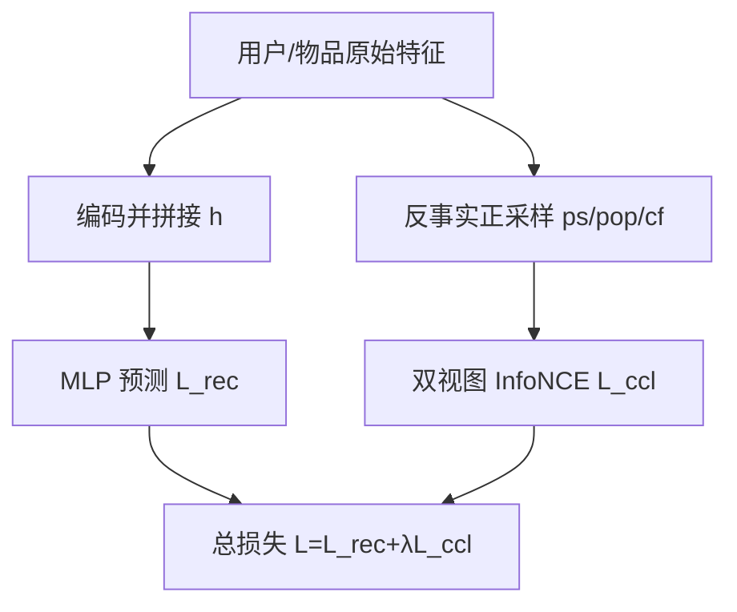
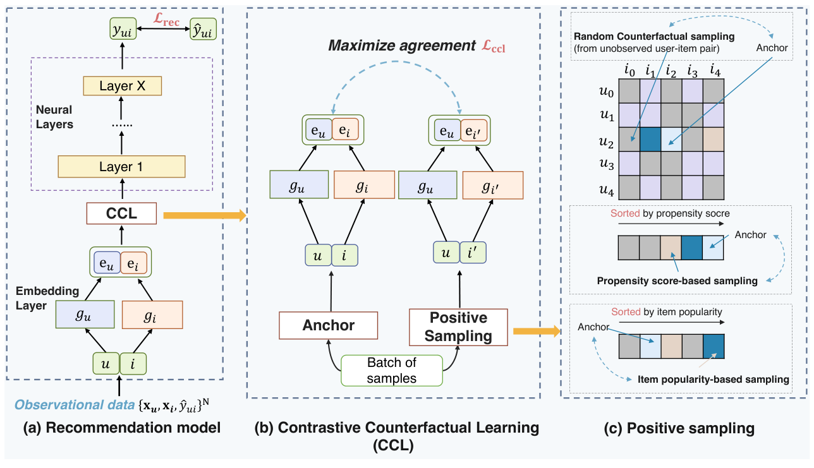

# Contrastive Counterfactual Learning for Causality-aware Interpretable Recommender Systems (因果感知可解释推荐系统的对比反事实学习)

- **会议/期刊**: CIKM 2023
- **作者与机构**: Guanglin Zhou, Chengkai Huang, Xiaocong Chen (UNSW)；Xiwei Xu, Chen Wang, Liming Zhu (Data61/CSIRO)；Lina Yao (Data61/CSIRO & UNSW)
- **推荐链路定位**: 精排/通用排序（评分预测与 Top-N 排序）
- **研究方向**: 去偏公平与工业系统 / 自监督对比学习与交互去噪
- **论文原文**: [论文原文链接](https://arxiv.org/abs/2208.06746v3)
- **开源代码**: [开源代码仓库链接](https://github.com/RyanWangZf/CVIB-Rec)

## TL;DR (1分钟核心速览)

曝光机制导致观测反馈的 MLE 有偏，现有 IPS 降偏但方差大、CVIB 缺乏显式曝光建模。本文用因果图定位隐藏混杂 $Z\to I$，提出 CCL：以 IPS 等价的正例采样与反事实正例扩展做对比自监督。在 Coat/Yahoo! R3 无偏测试集全库排序上，CCL 的 NDCG@10 较最强基线最高提升 1.2%，并显著降低 Gini。

## Background & Motivation (背景与核心矛盾)

- **主流范式**: 将推荐视为 causal treatment，用 IPS/SNIPS/DR 对观测交互重加权，或用 CVIB 等信息瓶颈方法学习无偏表征。
- **前人局限**: IPS 类方法依赖倾向得分估计，方差与稳定性差；RCT 无偏数据在真实场景难获得；信息瓶颈方法未显式建模“曝光”这一数据生成机制。
- **核心洞察 (Key Insight)**: 因果图中 $Z\to I$与$Z\to Y$使$X\leftarrow Z\to Y$后门路径未阻断，仅拟合$P(Y|X)$ 会学到曝光假象；在表征空间模拟“均匀曝光”可近似干预。
- **本文切入点**: 用对比 SSL 的正例采样替代/补充 IPS 重加权，并通过扩大反事实正例集逼近全物品集。

## Method (核心方法设计)

### 1. 整体框架 (Overall Architecture)

模型输入用户/物品原始特征，经 $g_u,g_i$编码并拼接为$h_{u,i}$，再由 MLP$f(\cdot)$预测偏好并计算$\mathcal{L}_{rec}$。同时，对每个 batch 样本$x_k$用三种反事实正采样器$t\sim\mathcal{T}$生成正视图，构造$2N$个视图并用 InfoNCE 计算$\mathcal{L}_{ccl}$。总损失联合优化，推理阶段只保留编码器与 MLP，不执行采样。

<figure class="paper-figure" markdown="span">
  <figcaption>图2：整体框架。(a) 包含新式 CCL 模块的推荐模型结构，其中 L𝑟𝑒𝑐 表示偏好预测的经验风险。(b) CCL 模块本身，采用三种新式采样方法，旨在通过 L𝑐𝑐𝑙 最大化两个视图之间的一致性。(c) 三种新式采样方法，包括随机反事实采样、基于倾向得分的采样和基于物品流行度的采样。</figcaption>
</figure>

### 2. 关键设计拆解 (Key Designs)

1. **曝光混杂的因果解释与 CCL 等价性**：常规 $\mathcal{L}_{MLE}$只在$O_{u,i}=1$上计算，$\mathbb{E}[\mathcal{L}_{MLE}]\neq\mathcal{L}_{full}$。作者通过$Z\to I$阻断将“去曝光偏置”转化为表征空间均匀曝光；当正例分布取$p_{pos}=1/P_{u,i}$且负例覆盖物品集时，对比损失退化为 IPS 型目标：$\mathcal{L}_{con}\propto-\sum_{(u,i)\in D}\frac{1}{P_{u,i}}\log p_\theta(i|u)$。这为“正例采样即去偏”提供了依据。
2. **三种反事实正采样器**：①倾向得分采样：固定用户，选与其倾向得分差异最大的物品，模拟均匀曝光；②物品流行度采样：以 $\text{pop}_i=\sqrt{\#interactions_i/\max_j\#interactions_j}$ 替代难估的倾向得分，选流行度差异最大的物品；③随机反事实采样：直接取同一用户未曝光物品作为正例。前两者依赖曝光估计，后者无需倾向得分且实证最优。
3. **训练目标、负采样与推理效率**：CCL 损失为 $\ell_{ccl}(a,p)=-\log\frac{\exp(sim(\tilde h_a,\tilde h_p)/\tau)}{\sum_{m=1}^{2N}\mathbb{I}[m\neq a]\exp(sim(\tilde h_a,\tilde h_m)/\tau)}$，总目标$\mathcal{L}=\mathcal{L}_{rec}+\lambda\mathcal{L}_{ccl}$。正例由采样器生成，负例来自同 batch 其余$2N-1$个视图；推理无额外采样开销，但训练需$2N$ 视图存储。

## Experimental Setup & Evaluation Protocol (实验设置与评估协议)

- **数据集与预处理**:

| 数据集 | #Users | #Items | #Interactions | 稀疏度/密度 | 特征/场景说明 |
| :--- | :---: | :---: | :---: | :---: | :--- |
| Coat | 290 | 300 | 6,960 训 / 4,640 无偏测 | 训练密度约 8.0% | 5 星评分，≥3 判为正反馈 |
| Yahoo! R3 | 15.4K 训 / 5.4K 测 | — | 300K+ 训 / 54K 无偏测 | 极稀疏 | 用户-歌曲评分；无偏测试用户随机评 10 首 |

- **数据划分与防穿越**: Coat 每用户 24 条自选训练 + 16 条随机曝光测试；Yahoo! R3 自选训练 + 5,400 用户各 10 条随机测试。属于随机曝光测试集，非 Leave-One-Out。
- **排名评测协议**: 无偏测试集上全物品候选 Top-N 排序（Full-Ranking），未采用采样负例评估；报告 NDCG、Recall、MRR、Gini 与 Global Utility。
- **对比基线与超参**: 对比 MF/NCF/LightGCN 及 IPS/SNIPS/DR/CVIB 等 10 个基线；$d\in\{4,8,16,32,64\}$，层数$\{1,2,3\}$，batch$\{512,1024,2048,4096\}$，$\lambda\in[0.5,1.5]$，$\tau\in[0.1,1.5]$；10 次运行，显著性$p<0.05$。

## Key Experimental Results (实验关键数据)

### 1. 主实验对比 (Main Results)

| 数据集 | 方法 | NDCG@5 | NDCG@10 | Recall@5 | MRR | Gini↓ |
| :--- | :--- | ---: | ---: | ---: | ---: | ---: |
| Coat | MF | 0.6189 | 0.6858 | 0.4706 | 0.7241 | 0.3286 |
| Coat | MF+IPS | 0.5461 | 0.6423 | 0.4453 | 0.6960 | 0.3704 |
| Coat | MF+SNIPS | 0.6195 | 0.6933 | 0.4725 | 0.7024 | 0.3354 |
| Coat | MF+DR | 0.6102 | 0.6831 | 0.4586 | 0.7236 | 0.3358 |
| Coat | MF+CVIB | 0.6356 | 0.7066 | 0.4858 | 0.7534 | 0.3339 |
| Coat | NCF+CVIB | 0.6275 | 0.7025 | 0.4881 | 0.7426 | 0.3413 |
| Coat | **CCL w/cf** | **0.6461** | **0.7151** | **0.4907** | **0.7550** | **0.3127** |
| Yahoo! R3 | MF | 0.6347 | 0.7629 | 0.6678 | 0.4364 | 0.5822 |
| Yahoo! R3 | MF+IPS | 0.6461 | 0.7654 | 0.7006 | 0.4309 | 0.5571 |
| Yahoo! R3 | MF+SNIPS | 0.6384 | 0.7640 | 0.6837 | 0.4324 | 0.5656 |
| Yahoo! R3 | MF+DR | 0.6562 | 0.7729 | 0.7046 | 0.4443 | 0.5576 |
| Yahoo! R3 | MF+CVIB | 0.6961 | 0.7992 | 0.7388 | 0.4840 | 0.5411 |
| Yahoo! R3 | NCF+CVIB | 0.6675 | 0.7810 | 0.7161 | 0.4565 | 0.5478 |
| Yahoo! R3 | **CCL w/cf** | **0.6967** | **0.7997** | **0.7400** | **0.4873** | **0.5378** |

相对最强非 CCL 基线：Coat 的 NDCG@5/NDCG@10/Recall@5/MRR 分别 **+1.65%/+1.20%/+0.53%/+0.21%**，Gini 相对降 **6.35%**；Yahoo! R3 分别 **+0.08%/+0.06%/+0.16%/+0.69%**，Gini 相对降 **0.63%**。评分预测上 Coat AUC 0.774 高于 NCF+DR 的 0.768，Yahoo AUC 0.702 低于 MF+CVIB 的 0.710，存在排序-评分权衡。

### 2. 消融实验 (Ablation Study)

| 数据集 | 变体 | NDCG@10 | Recall@5 | MRR | Gini↓ | AUC↑ |
| :--- | :--- | ---: | ---: | ---: | ---: | ---: |
| Coat | 仅 $\mathcal{L}_{rec}$ | 0.690 | 0.448 | 0.738 | 0.334 | 0.761 |
| Coat | $\mathcal{L}_{rec}+\mathcal{L}_{ccl}$ | **0.715** | **0.491** | **0.755** | **0.313** | **0.774** |
| Yahoo! R3 | 仅 $\mathcal{L}_{rec}$ | 0.736 | 0.647 | 0.387 | 0.585 | 0.701 |
| Yahoo! R3 | $\mathcal{L}_{rec}+\mathcal{L}_{ccl}$ | **0.800** | **0.740** | **0.487** | **0.538** | **0.702** |

正采样策略对比（NDCG@5 / Recall@5）：Coat 为 w/o SSL 0.6087/0.4484，w/pop 0.6144/0.4611，w/ps 0.6314/0.4782，w/cf 0.6461/0.4907；Yahoo! R3 为 0.5960/0.6467、0.6852/0.7302、0.6852/0.7302、0.6967/0.7400。

### 3. 关键实验发现 (Key Findings)

- 移除 CCL 后 Yahoo! R3 的 Recall@5 从 0.740 降至 0.647、NDCG@10 从 0.800 降至 0.736；Coat NDCG@5 从 0.646 降至 0.609，说明增益主要来自曝光去偏而非 MLP 容量。
- 随机反事实采样最优：Yahoo! R3 NDCG@5 0.6967，高于倾向得分采样的 0.6852 与无 SSL 的 0.5960，表明扩大并多样化正例集比精确估计倾向得分更关键。
- Gini 下降（Coat 0.334→0.313；Yahoo 0.585→0.538）同时 Global Utility 提升，表征空间曝光更均匀；但 Yahoo AUC 略低于 CVIB，提示排序公平与评分校准需折中。

## Highlights & Limitations (亮点、对比与审稿批判)

- **与代表作对比 (vs. Prior Work)**: IPS/SNIPS 通过重加权纠偏，易引入高方差；CVIB 用信息瓶颈学无偏表征，但未显式建模曝光；SGL 类图增广面向协同图结构，本文直接用“未曝光反事实对”作正例，针对曝光混杂更直接。
- **可迁移亮点**: 将反事实/未曝光物品作为对比正例，可低成本注入曝光均匀先验；三种采样器可作为插件接入 MF/NCF/MLP 等排序模型。
- **审稿级局限批判**: 随机反事实采样把未交互对当正例，可能引入假阳性，尤其用户本就不喜欢的物品；仅两个基准且无大型工业验证，w/ps 与 w/pop 对倾向得分/流行度估计较敏感，训练需 $2N$ 视图增加显存开销。

## Rating (四维评分)

- **方法创新性 (Novelty)**: ⭐⭐⭐⭐ （因果图+IPS 等价推导+三类反事实正采样，机制清晰且有理论衔接）
- **评估协议与实验扎实度 (Protocol & Experiments)**: ⭐⭐⭐⭐ （两个无偏测试基准、10 个基线、10 次运行与 $p<0.05$，但数据集规模与场景仍有限）
- **写作与数学规范度 (Clarity & Rigor)**: ⭐⭐⭐⭐ （从 MLE 偏置到对比损失退化的推导完整，但“可解释性”更多停留在因果图层面）
- **工业落地与复现价值 (Industrial & Practical Value)**: ⭐⭐⭐ （代码开源、推理零采样开销；训练需 2N 视图，随机反事实正例的假阳性风险需线上验证）

