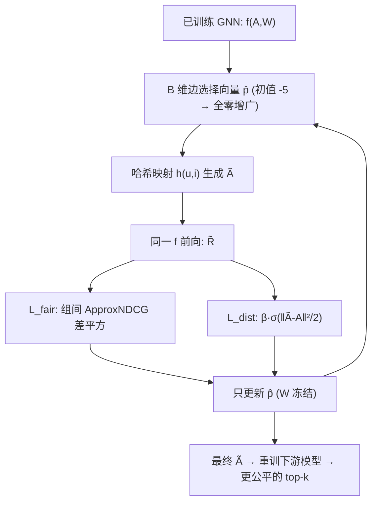
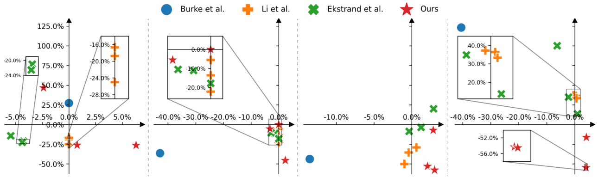

# Counterfactual Graph Augmentation for Consumer Unfairness Mitigation in Recommender Systems (面向消费者不公平性缓解的反事实图增广)

- **会议/期刊**: CIKM 2023 (short paper, 5 页)
- **作者与机构**: Ludovico Boratto, Gianni Fenu, Mirko Marras, Giacomo Medda (University of Cagliari)；Francesco Fabbri (Spotify)
- **推荐链路定位**: 推理期图增广 / 重排（不重训推荐模型）
- **研究方向**: 去偏公平、可信隐私与工业架构 / 图神经网络与知识图谱推荐
- **论文原文**: [https://arxiv.org/abs/2308.12083v1](https://arxiv.org/abs/2308.12083v1)
- **开源代码**: [https://github.com/jackmedda/RS-BGExplainer](https://github.com/jackmedda/RS-BGExplainer)

## TL;DR (1分钟核心速览)

现有工作把“可解释性”和“公平性”分开做：解释只告诉你为什么不公平，去偏只按数学约束硬压差距。本文把二者合并——在已训练 GNN 的二部图邻接矩阵上，用一个 B 维可微二值向量 $\hat{p}$反事实地新增少量 user-item 边，使劣势群体（$U_D$）的 ApproxNDCG 抬升、组间差$\Delta$NDCG 收缩。在 ML-1M / LFM-1K 上按 7:1:2 时序划分、全库 top-10 排序评估，最优策略组合把 NGCF 的性别$\Delta$NDCG 相对降低 100%、LightGCN 的年龄$\Delta$NDCG 降低 97.2%，且 NDCG 不降反升（LFM-1K 年龄 0.413，全表最高）。

## Background & Motivation (背景与核心矛盾)

- **主流范式**: 消费者不公平性缓解主要走三条路——重排/正则化的公平约束、嵌入层去偏、以及基于 GNN 的图结构干预；解释侧则用反事实扰动说明“哪条边导致了不公平”。
- **前人局限**: ① 解释与缓解割裂，[11,16] 能定位不公平却无法据此生成缓解方案；② 唯一把解释用于缓解的 [12] 面向**单部图分类**，节点同质、无 user-item 语义，无法迁移到推荐；③ 图扰动代表工作 [26] 用 $n\times n$稠密矩阵$P$逐元素扰动$A$，对二部图而言 99% 以上的 user-user / item-item 位置是恒零冗余，内存$O(n^2)$ 不可扩展。
- **核心洞察 (Key Insight)**: 若在“不公平的图”上只加极少数边就能让劣势群体的推荐效用追平，那么这批边同时承担了两件事——(i) 解释原图缺失了哪类公平相关知识；(ii) 本身就是缓解算子。
- **本文切入点**: 把“选边”参数化为一个长度 $B\ll|U||I|$ 的可微二值向量，冻结 GNN 权重、只对边选择做梯度下降，用组间 NDCG 差的平方作损失。

## Method (核心方法设计)

### 1. 整体框架 (Overall Architecture)

给定二部图 $G=(U,I,E)$与邻接矩阵$A$，先用 RecBole 正常训练一个 GNN 推荐器$f(A,W)\to\hat{R}$并冻结$W$。缓解阶段引入扩展模型$\tilde{f}(\tilde{A},W;\hat{p})$：$\hat{p}$经 sigmoid + 0.5 阈值二值化后，按哈希映射$h(u,i)$把$B$条候选边写入$\tilde{A}$的缺失位置；$\tilde{A}$送入**同一个**$f$得到被扰动的$\tilde{R}$，再用$L_{fair}$（组间 ApproxNDCG 差）与$L_{dist}$（扰动规模）反传更新$\hat{p}$。迭代收敛后得到的$\tilde{A}$ 即“反事实世界”的图：把它并入训练集、并从验证/测试集中剔除同名边，重训下游模型，即可在评测集上观测到不公平性下降。

### 2. 关键设计拆解 (Key Designs)

1. **稀疏二值边选择向量（把 $O(n^2)$扰动压成$O(B)$）**：痛点源于 [26] 的$\tilde{A}=P\odot A$需对全邻接矩阵建模。本文改为$\tilde{A}_{u,i}=p_{h(u,i)}$（当$h(u,i)\in\mathbb{N}_{<B}$），否则保持$A_{u,i}$，并把$\hat{p}$全部初始化为$-5$，使 sigmoid 后$\approx 0$、保证起点$\tilde{A}=A$。直觉：反事实解释天然稀疏，只需极少数“关键边”，因此参数量应与候选边数$B$ 而非节点对数量成正比。
2. **双项损失 + 单侧加边约束（只抬升、不打压）**：公平项取所有群体对的效用差平方均值 $L_{fair}=\frac{1}{\binom{|\mathcal{G}|}{2}}\sum_{i<j}\lVert S(\tilde{R}_{\mathcal{G}_i},A_{\mathcal{G}_i})-S(\tilde{R}_{\mathcal{G}_j},A_{\mathcal{G}_j})\rVert_2^2$，其中$S$用可微的 ApproxNDCG 替代不可微的 NDCG；距离项$L_{dist}=\beta\cdot\sigma(\frac{1}{2}\lVert\tilde{A}-A\rVert_2^2)$把扰动规模压住，$\beta=0.5$使公平项占主导。关键约束是**边只允许连到劣势群体用户节点$U_D$**，因此不可能靠压低优势群体来“拉平”，实验也证实$U_A$ 的 NDCG 几乎不变。
3. **候选空间采样策略（缓解的真正瓶颈）**：$B$条候选边从何而来决定成败，作者设计 U 类策略（ZN：$\text{NDCG}@10=0$的零命中用户；LD：最低度数用户；SP：交互物品平均流行度最低的稀疏用户；FR：到$U_A$最短路径最远的用户，$\Psi_U=35\%$）与 I 类策略（IP：$U_D$最偏好的前$\Psi_I=20\%$物品），并允许 U+I 跨侧组合。训练与推理成本：只做$f$的前向传播，不反传$W$，单次迭代开销约等于一次全量打分。

## Experimental Setup & Evaluation Protocol (实验设置与评估协议)

- **数据集与预处理**: 沿用 [5] 的公平性评估工件，未做 5-core 过滤；LFM-1K 额外补齐 user-artist 时间戳。

| 数据集 | #Users | #Items | #Interactions | 稀疏度 | 敏感属性 / 优势群体 |
| :--- | :---: | :---: | :---: | :---: | :--- |
| ML-1M | 6,040 | 3,706 | 1,000,209 | 4.47% | 性别（Male 71.7%）、年龄（Younger 56.6%） |
| LFM-1K | 1,892 | 17,632 | 92,834 | 0.28% | 性别（Female 42.2%）、年龄（Older 42.2%） |

- **数据划分与防穿越 (Splitting Strategy)**: 按每用户交互**时间升序**做 `7:1:2` 时序切分（train/val/test）；验证集复用为**扰动集 (perturbation set)**，用于选边与早停；增广边写入训练集、并从 val/test 中删除同名边，杜绝标签泄漏。
- **排名评测协议 (Ranking Protocol)**: RecBole 默认 `Full-Ranking`（全库未交互物品排序），报告 $\text{NDCG}@10$与组间差$\Delta\text{NDCG}=\text{NDCG}_{U_D}-\text{NDCG}_{U_A}$（越接近 0 越公平，负值表示劣势群体反超）。
- **对比基线与超参设置**: 基线含 SLIM-U [7]、BiasedMF [24]、ItemKNN [13] 三类经典去偏/相似度方法，以及 NCF、PMF、TopPopular、UserKNN；本文方法分别挂在 GCMC、NGCF、LightGCN 三个 GNN 上。仅保留 NDCG 高于最佳模型一半的基线（故 LBM/STAMP/FunkSVD 被剔除）；超参网格搜索，LFM-1K 结果因划分不同已重跑。

## Key Experimental Results (实验关键数据)

### 1. 主实验对比 (Main Results)

| 模型 | ML-1M NDCG↑ | ML-1M ΔNDCG(Gender)↓ | ML-1M ΔNDCG(Age)↓ | LFM-1K NDCG↑ | LFM-1K ΔNDCG(Gender)↓ | LFM-1K ΔNDCG(Age)↓ |
| :--- | :---: | :---: | :---: | :---: | :---: | :---: |
| SLIM-U [7] | 0.084 | -0.028 | **-0.014** | 0.301 | -0.072 | -0.145 |
| BiasedMF [24] | 0.112 | -0.013 | -0.017 | 0.245 | -0.049 | -0.060 |
| NCF | 0.120 | -0.015 | -0.019 | 0.202 | **-0.023** | -0.048 |
| ItemKNN [13] | 0.134 | -0.030 | -0.024 | 0.286 | -0.116 | 0.020 |
| TopPopular | 0.104 | -0.030 | -0.034 | 0.321 | -0.102 | -0.050 |
| UserKNN | 0.131 | -0.024 | -0.023 | **0.411** | -0.106 | -0.031 |
| Ours + GCMC | 0.123 | -0.022 | -0.017 | 0.392 | -0.024 | -0.039 |
| **Ours + LightGCN** | **0.135** | **-0.014** | **-0.012** | 0.409 | -0.030 | **-0.030** |
| Ours + NGCF | 0.130 | -0.017 | -0.023 | 0.398 | -0.077 | -0.062 |

<figure class="paper-figure" markdown="span">
  <figcaption>图1：横轴（纵轴）表示在性别和年龄组上应用各方法前后测得的推荐效用 NDCG（效用差异 ΔNDCG）之间的相对差异，记为 Rel. Diff.。每种方法的多个点表示该方法使用了多个模型。横轴（纵轴）上的正值（负值）表示 NDCG（ΔNDCG）的增加（减少）。</figcaption>
</figure>

图 1：横轴为 NDCG 相对变化、纵轴为 $\Delta$NDCG 相对变化，本文方法（Ours）在纵轴上系统性最低，且多数点落在横轴右侧（效用不降）。

### 2. 消融实验 (Ablation Study)

原文以“采样策略消融”替代常规模块消融，指标为施加策略前后 $\lvert\Delta\text{NDCG}\rvert$ 的相对变化（负值 = 不公平被缓解，-100% = 完全消除）：

| 策略 | ML-1M-Gender GCMC | ML-1M-Gender NGCF | LFM-1K-Age LightGCN | LFM-1K-Age NGCF |
| :--- | :---: | :---: | :---: | :---: |
| BM（无采样全空间） | +14.5% | +6.9% | +271.0% | -32.6% |
| ZN | 0.0% | +0.8% | -97.2% | -49.9% |
| SP | +1.7% | +11.5% | -80.9% | -32.6% |
| FR | +5.1% | +5.4% | -79.4% | -32.6% |
| IP | +9.4% | +18.5% | -0.4% | -34.6% |
| ZN + IP | **-53.8%** | **-100.0%** | +0.2% | -32.6% |
| FR + IP | +9.4% | +4.6% | +1.3% | -34.8% |

### 3. 关键实验发现 (Key Findings)

1. **“加哪条边”远比“加多少边”重要**：不做采样约束的全空间增广（BM）在 LFM-1K 年龄组上把 $\Delta$NDCG 放大 **271%**（LightGCN），而仅用 ZN 采样就将其压缩 **97.2%**——同样的损失函数、同样的$B$，性能差异全部来自候选边先验，说明瓶颈在搜索空间而非优化目标。
2. **不公平是“用户侧零曝光 × 物品侧偏好集中”的联合产物**：在 ML-1M 性别组上，单独 ZN（0.0%）或单独 IP（+18.5%）都无效，只有 ZN+IP 组合才把 NGCF 的 $\Delta$NDCG 相对降低 **100%**（完全消除）；而同一组合在 LFM-1K 上几乎无效（+0.2%），证明部分不公平是数据集层面（跨模型稳定）、部分是模型层面（随 GNN 变化）。
3. **无“打压优势群体”的代价，但深层 GNN 收益衰减**：所有降低 $\Delta$NDCG 的策略对$U_A$的 NDCG 影响可忽略，LightGCN 在 LFM-1K 年龄组同时取得最高 NDCG（0.413）与最低$\Delta$NDCG（-0.030）；然而 GCMC/NGCF 这类深层模型因多层传播把局部边扰动平滑掉，增广的边际影响明显弱于浅层 LightGCN。

## Highlights & Limitations (亮点、对比与审稿批判)

- **与代表作对比 (vs. Prior Work)**: 相比 [5,7,13,24] 这些只在打分函数上加约束/重排的去偏方法，本文不改模型参数、只在图拓扑上做最小干预，因而天然保留原模型容量；相比 [12] 的反事实 GNN 解释器，本文首次把该范式从单部图分类搬到二部图 top-$k$推荐；相比 [26] 的$P\odot A$稠密扰动，参数量从$O(n^2)$降到$O(B)$。
- **可迁移亮点**: ① “冻结主干 + 只学一个 B 维二值 mask”的推理期干预范式，可直接套到序列模型/双塔的 item 侧或样本权重上；② 用验证集当扰动集、增广边回写训练集并做去重防泄漏的评估流程，是公平性干预实验的干净模板。
- **审稿级局限批判**: ① 优化目标只覆盖 NDCG，Recall/HR/覆盖率等其他效用维度是否同步改善未知，且 ApproxNDCG 与真实 NDCG 存在代理偏差；② $B$、$\Psi_U=35\%$、$\Psi_I=20\%$、$\beta=0.5$ 均凭经验固定，缺少敏感度分析，且只测了两个二值敏感属性、两套数据；③ 每次用户组或群体定义变化都需重跑选边 + 重训下游模型，线上多业务场景下延迟与维护成本不低。

## Rating (四维评分)

- **方法创新性 (Novelty)**: ⭐⭐⭐⭐ （把“反事实解释”直接当作“去偏算子”用，并用 B 维稀疏二值向量替换稠密扰动矩阵，思路干净且首次落到二部图推荐）
- **评估协议与实验扎实度 (Protocol & Experiments)**: ⭐⭐⭐ （时序划分 + 验证集作扰动集 + 增广边去泄漏的设计严谨，但仅两数据集两属性、无显著性检验、无超参敏感度）
- **写作与数学规范度 (Clarity & Rigor)**: ⭐⭐⭐⭐ （问题形式化与 $\tilde{A}$生成、双项损失定义清晰，5 页短文中符号自洽；哈希映射$h$ 的具体构造略欠细节）
- **工业落地与复现价值 (Industrial & Practical Value)**: ⭐⭐⭐⭐ （代码已开源、不重训主干即可干预、内存 $O(B)$；但依赖离线重跑与群体标签，线上实时部署仍需工程改造）

