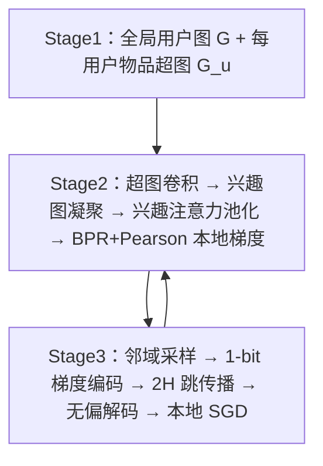
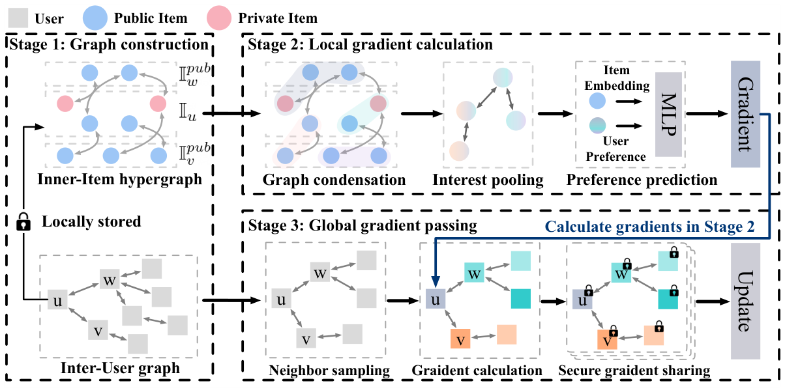

# Decentralized Graph Neural Network for Privacy-Preserving Recommendation (面向隐私保护推荐的去中心化图神经网络)

- **会议/期刊**: CIKM 2023
- **作者与机构**: Xiaolin Zheng, Zhongyu Wang, Chaochao Chen, Jiashu Qian (浙江大学), Yao Yang (之江实验室)
- **推荐链路定位**: 召回（用户/物品表征学习，去中心化端侧训练）
- **研究方向**: 去偏公平、可信隐私与工业架构 / 图神经网络推荐
- **论文原文**: [论文原文链接](https://arxiv.org/abs/2308.08072v1)
- **开源代码**: 暂未开源

## TL;DR (1分钟核心速览)

在 GDPR 类法规下平台不得收集原始交互，联邦 GNN 通信瓶颈严重、去中心化 GNN 又直接明文共享梯度导致隐私泄露。本文提出 DGREC：Stage1 构建全局用户图和用户内物品超图，Stage2 用超图凝聚 + 兴趣注意力在端侧建模偏好并算梯度，Stage3 用 `secure gradient-sharing`（1-bit Bernoulli 编码 → 2H 跳 gossip 传播 → 无偏解码）在邻域共享梯度。全库排序（Full-Ranking）协议下，DGREC 在 Flixster/Book-Crossing/Weeplaces 的 recall@20 比最佳隐私保护基线提升 10.9%/25.2%/7.6%，并逼近集中式 LightGNN/HyperGNN。

## Background & Motivation (背景与核心矛盾)

- **主流范式**: 隐私推荐分两派——联邦 GNN（FedGNN/FeSoG，中心 server 聚合 + LDP/Gaussian 加噪）与去中心化 GNN（SpreadGNN/DLGNN/P2PGNN，客户端与邻居异步交换梯度）。
- **前人局限**: 联邦路线中心节点通信成为训练瓶颈；去中心化路线交换梯度全程无保护，恶意邻居可由梯度反推用户交互（矛盾一）。同时现有工作把**全部**交互视为私密，忽视了用户愿意公开部分交互（社交媒体打卡/影评）以换取更好体验（矛盾二）。
- **核心洞察**: 单用户的交互是稀疏弱信号，需靠「邻居公开交互 + 物品标签超边」补全；而加噪式 DP（Laplacian/Gaussian）虽保隐私但有偏，直接损失精度——**若编码-解码可做到期望无偏，隐私与精度就不必对立**。
- **本文切入点**: 去中心化训练 + 超图兴趣建模 + 满足 RDP 的 1-bit 梯度编码共享，做到「通信最省、隐私可证、解码无噪」。

## Method (核心方法设计)

### 1. 整体框架 (Overall Architecture)

DGREC 以「用户」为训练单元闭环：Stage1 用通信协议构建全局用户图 $\mathcal{G}=\{\mathcal{V},\mathcal{E}\}$（边来自好友/地理邻近），并为每个用户单独建物品超图$\mathcal{G}_u=\{\mathcal{V}_u,A_u\}$（节点=自己交互 ∪ 邻居公开交互的物品，超边=物品标签）；Stage2 在本地做超图卷积 → 兴趣图凝聚 → 兴趣注意力池化得用户表征$e_u$，与物品表征拼接过 MLP 打分，用 BPR + Pearson 独立性损失算梯度（**原始交互永不出端**）；Stage3 先按损失/迭代数采样多跳邻域，再把梯度 1-bit 编码后在邻域并行扩散$2H$ 步，无偏解码后本地 SGD 更新。

<figure class="paper-figure" markdown="span">
  <figcaption>图 1：我们提出的 DGREC 框架。这里展示用户 𝑢 的训练过程。邻居采样后，所有被采样的用户在第 2 阶段同时计算梯度。</figcaption>
</figure>

### 2. 关键设计拆解 (Key Designs)

1. **超图凝聚 + 多兴趣软分配（把弱交互聚成强兴趣）**：逐条交互信号太弱，作者借鉴 DiffPool 但改为「一物品可属多兴趣」。用 $E'_u=D_v^{-1/2}A_uD_t^{-1}A_u^{\top}D_v^{-1/2}E_uW_1$聚合标签超边特征，$S_u=\mathrm{softmax}(D_v^{-1/2}A_uD_t^{-1}A_u^{\top}D_v^{-1/2}E_uW_2)$给出分配概率，再$\hat{E}_u=S_u^{\top}E'_u,\ \hat{A}_u=S_u^{\top}A_uS_u$得到低维兴趣图。因软分配易产生冗余兴趣（一个兴趣可由其他兴趣线性表示），引入 Pearson 损失$\mathcal{L}^d_u=\frac{1}{n_i^2}\sum_{j,k}\mathrm{cov}(\hat{E}_{u,j},\hat{E}_{u,k})/\sqrt{\mathrm{var}(\hat{E}_{u,j})\mathrm{var}(\hat{E}_{u,k})}$ 强制兴趣间去相关，加速收敛。

2. **兴趣注意力（抑制噪声兴趣）**:邻居不总同好、随机点击普遍存在，故用兴趣图邻居关系而非独立 attention 打分：$\hat{P}_{u,i}=\hat{E}_{u,i}W_3+\sum_{j\in N_i}\hat{A}_u(i,j)(\hat{E}_{u,i}W_4-\hat{E}_{u,j}W_5)$，$e_u=\mathrm{softmax}(\hat{P}_u^{\top})\hat{E}_u$。差分形式让「与邻居兴趣偏离大」的兴趣自动降权，物理直觉即孤立兴趣=噪声。

3. **1-bit 安全梯度共享（noise-free 的 LDP）**：梯度先裁剪到 $[-\delta,\delta]$再按 Bernoulli 采样映射为$\pm1$：
$g^*_u\sim 2\cdot\mathrm{Bernoulli}\!\left(\frac{1}{e^{\beta}+1}+\frac{(e^{\beta}-1)(\mathrm{clip}(g_u,\delta)+\delta)}{2(e^{\beta}+1)\delta}\right)-1$；
传播 $2H$跳后按$\bar{g}_u=\delta(e^{\beta}+1)\,\mathrm{mean}(\hat{g}_u)/(e^{\beta}-1)$解码。**定理 1** 证明其满足$(1.5,\epsilon)$-RDP，$\epsilon=2n_s\log\!\big(\frac{1.5\pi\delta(e^{\beta}+1)}{2(e^{\beta}-1)}+\frac{e^{-0.5\beta}+e^{1.5\beta}}{e^{\beta}+1}\big)$；**命题 1** 证明$\mathbb{E}[\bar{g}]=\mathbb{E}[g]$（无偏），故解码无残噪；通信量为$2Hn_s(1-n_u^{H})/(1-n_u)$bit，仅为联邦/普通去中心化（$d_r=64$bit 实数）的$1/32$ 量级。

4. **训练目标、采样与开销**：$\mathcal{L}_u=\mathcal{L}^p_u(\text{BPR})+\mathcal{L}^d_u+\lambda\|\Theta_u\|_2^2$，负样本为未交互物品（未观测即负，无特殊难负采样）；邻居采样概率$p_{u,v}\propto \mathcal{L}_v/(\ln(cnt_v+1)+1)$，即**欠拟合、少迭代的邻居优先被拉入训练**，缓解「热门用户过度训练带偏他人」。推理仅需本地前向 MLP，无跨端通信。

## Experimental Setup & Evaluation Protocol (实验设置与评估协议)

- **数据集与预处理**: 保留交互数 ≥18（Flixster/Book-Crossing）、≥10（Weeplaces）的用户与物品：

| 数据集 | #Users | #Items | #Interactions | 稀疏度 | 特征/场景说明 |
| :--- | :---: | :---: | :---: | :---: | :--- |
| Flixster | 3,060 | 3,000 | 48,369 | 0.9946 | 电影社交，含好友关系与物品关联 |
| Book-Crossing | 3,060 | 5,240 | 222,287 | 0.9860 | 图书社区，同地区连用户、作者/出版社连物品 |
| Weeplaces | 8,720 | 7,407 | 546,781 | 0.9915 | LBS 签到，类别派生物品关系 |

- **数据划分与防穿越**: 每用户交互随机 **8:1:1 比例划分**（train/val/test），非时间序切分，属随机留出。
- **排名评测协议**: **Full-Ranking（全库未交互物品排序）**，候选集为训练正例之外的全部物品，指标 recall@20、ndcg@20；5 个随机种子取均值并报标准差。
- **对比基线**: 集中式 NeuMF/LightGCN/HyperGNN，联邦 FedRec/FedGNN，去中心化 DMF/DLGNN；统一 SGD，lr∈{0.001,0.005,0.01}，L2∈{1e−3,1e−2,1e−1}，$d\in\{16,32,48,64\}$；本文$\delta=0.1$、$\beta=1$（对应$(1.5,0.54)$-RDP），$H=4$、$n_u=3$、$n_i\in\{6,12,18\}$、$d_i\in\{5,10,15,30\}$。

## Key Experimental Results (实验关键数据)

### 1. 主实验对比 (Main Results)

| 方法 | Flixster R@20 | N@20 | Book-Crossing R@20 | N@20 | Weeplaces R@20 | N@20 |
| :--- | :---: | :---: | :---: | :---: | :---: | :---: |
| NeuMF | 3.28 | 2.68 | 6.70 | 3.76 | 15.85 | 10.15 |
| LightGCN | 3.47 | 3.13 | **9.94** | **5.49** | 18.78 | 12.25 |
| HyperGNN | **3.89** | **3.49** | 8.36 | 4.34 | **20.17** | **13.12** |
| FedRec | 3.24 | 2.62 | 6.32 | 3.50 | 15.18 | 9.27 |
| FedGNN | 3.38 | 3.02 | 7.40 | 3.89 | 17.29 | 10.84 |
| DMF | 3.15 | 2.52 | 6.56 | 3.62 | 15.46 | 9.77 |
| DLGNN | 3.30 | 2.84 | 7.73 | 4.08 | 18.50 | 11.89 |
| **DGREC** | 3.75 | 3.27 | 9.68 | 5.13 | 19.91 | 12.76 |
| **Improv.%**（vs 最佳隐私基线） | +10.9% | +8.3% | +25.2% | +25.7% | +7.6% | +7.3% |

### 2. 消融实验 (Ablation Study)

| 变体 | BC R@20 | BC N@20 | WP R@20 | WP N@20 |
| :--- | :---: | :---: | :---: | :---: |
| w/ non-item graph | 6.98 | 3.83 | 16.18 | 10.45 |
| w/ non-neighbor | 6.77 | 3.61 | 17.07 | 10.71 |
| w/ non-item hypergraph（改物品-标签二部图） | 9.20 | 4.66 | 17.69 | 11.17 |
| w/ non-attention（换 attention-pooling） | 9.19 | 4.78 | 19.35 | 12.43 |
| w/ non-pearson | 9.41 | 4.84 | 18.53 | 11.88 |
| w/ non-sharing（改 Laplacian 加噪） | 8.17 | 4.11 | 18.46 | 11.96 |
| **DGREC** | **9.68** | **5.13** | **19.91** | **12.76** |

### 3. 关键实验发现 (Key Findings)

- **图结构是主要增益来源**：去掉物品图（退化为交互物品均值池化）使 Book-Crossing/Weeplaces recall 由 9.68/19.91 跌至 6.98/16.18（−27.9%/−18.7%），去掉邻居公开交互跌至 6.77/17.07；说明超图与跨用户行为相似性两者共同贡献了大部分收益。
- **无偏解码优于加噪保护**：将编码-解码替换为 Laplacian 加噪（w/ non-sharing）直接损失 15.6%（BC）/7.3%（WP）recall——隐私预算下「有偏噪声」的代价被量化，验证命题 1 的工程价值。
- **隐私-精度-公开比例三维优势**：公开交互比例从 1.0 降至 0.1 时集中式/普通去中心化方法性能断崖式下滑，DGREC 与联邦方法保持相对稳定且在全部比例下领先（图 2）；同时 $H=1$退化回 gossip 训练时性能明显下降，说明多跳邻域扩散（$H=4$）既摊薄编码噪声又扩大训练数据。注意兴趣数$n_i$ 增大反而降性能（冗余兴趣问题），与 Pearson 损失的必要性互为印证。

## Highlights & Limitations (亮点、对比与审稿批判)

- **与代表作对比**: 相对 FedGNN/FeSoG（需中心 server + 加噪、通信瓶颈），DGREC 无中心节点、通信量降一个数量级；相对 DLGNN/DLGNN 类明文梯度交换，本文首次给出 $(1.5,\epsilon)$-RDP 可证隐私与无偏解码；相对 HyperGNN（集中式超图），它以端侧超图 + 邻居公开交互逼近其精度（Book-Crossing 9.68 vs 8.36 反超）。
- **可迁移亮点**: ①「1-bit Bernoulli 编码 + 多跳平均解码」是通用梯度压缩/隐私共享组件，可移植到联邦精排与跨域迁移；②按损失与迭代数定义采样概率 $p_{u,v}$，是解决去中心化训练中客户端收敛速度不齐（straggler bias）的轻量方案。
- **审稿级局限批判**: ①实验在**单机上模拟**去中心化环境，未报告真实网络延迟、掉线与恶意节点注入攻击下的鲁棒性；②评估为随机 8:1:1 划分而非时间切分，存在穿越风险，且未报告训练/推理时延与显存开销；③隐私仅覆盖梯度共享，用户图/物品标签仍以明文构建，`(1.5,ε)` 在小样本邻居下的紧致性缺乏实证；④$H$、$n_i$、$\beta$ 三组超参交互敏感，缺乏自适应隐私预算分配。

## Rating (四维评分)

- **方法创新性 (Novelty)**: ⭐⭐⭐⭐ （首个去中心化 GNN 推荐框架，1-bit 编码共享同时给出 RDP 证明与无偏性证明，超图软分配 + Pearson 去冗余有巧思）
- **评估协议与实验扎实度 (Protocol & Experiments)**: ⭐⭐⭐⭐ （三数据集 Full-Ranking + 5 种子标准差，含公开比例泛化、消融、参数与 $K$ 曲线；但单机模拟、缺时间切分与效率报告）
- **写作与数学规范度 (Clarity & Rigor)**: ⭐⭐⭐⭐ （三阶段结构清晰，定理 1/命题 1/2 与通信量分析完整；部分符号与传播算法细节需查附录）
- **工业落地与复现价值 (Industrial & Practical Value)**: ⭐⭐⭐⭐ （通信量 $1/32$ 且无中心节点、无噪解码，天然适配端侧/跨机构场景；但代码未开源，恶意客户端防御留待后续）

