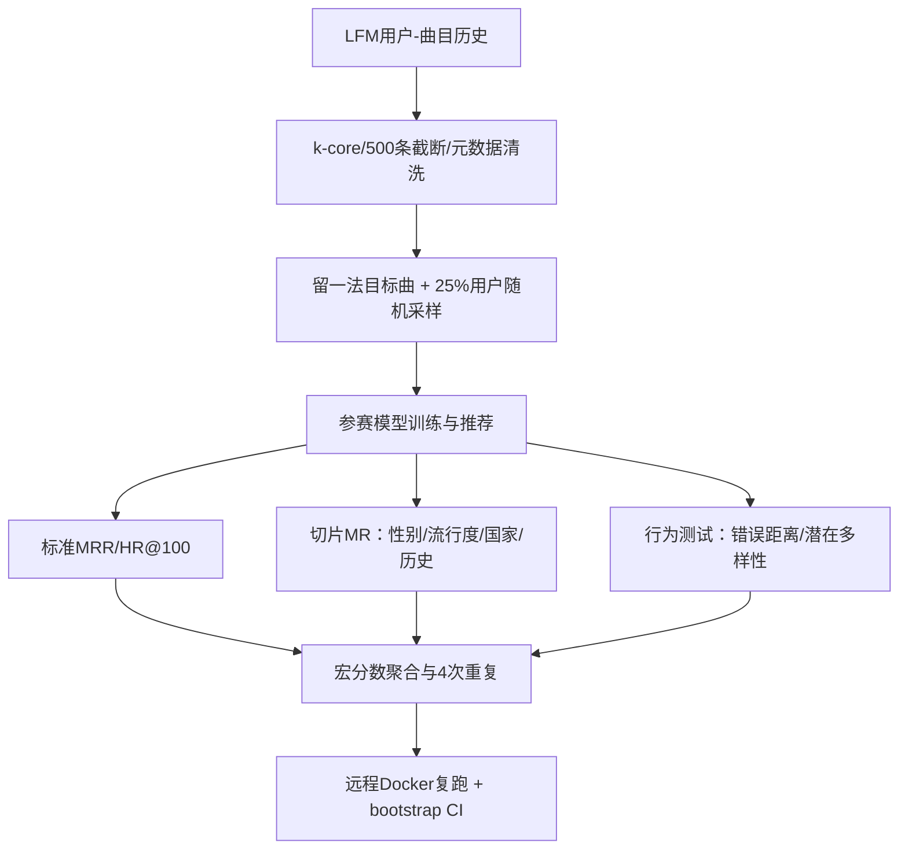

# EvalRS: a Rounded Evaluation of Recommender Systems（EvalRS：推荐系统的全方位圆融评估）

- **会议/期刊**: CIKM 2022 Data Challenge Paper
- **作者与机构**: Jacopo Tagliabue、Ciro Greco、Patrick John Chia（Coveo Labs/Coveo）；Federico Bianchi（Stanford）；Tobias Schnabel（Microsoft）；Giuseppe Attanasio（Bocconi）；Gabriel de Souza P. Moreira（NVIDIA）
- **推荐链路定位**: 端到端评测（覆盖召回排序与部署前行为检查）
- **研究方向**: 去偏公平、可信隐私与工业架构 / 冷启动与长尾推荐
- **论文原文**: [https://arxiv.org/abs/2207.05772v2](https://arxiv.org/abs/2207.05772v2)
- **开源代码**: [https://github.com/RecList/evalRS-CIKM-2022](https://github.com/RecList/evalRS-CIKM-2022)

## TL;DR (1分钟核心速览)

EvalRS并非提出新召回/精排模型，而是针对“只用MRR、HR、NDCG等单点指标评测推荐系统”的痛点，构建LFM音乐推荐挑战与RecList测试套件：在标准MRR/HR@100之外加入性别、艺术家/歌曲流行度、国家、用户历史等切片MR测试，以及“少错一点”与潜在多样性行为测试；采用留一法、每轮随机25%用户、4次重复和95% bootstrap置信区间校验。论文未报告模型主实验数值，核心贡献是开源、可复现的全方位评测协议。

## Background & Motivation (背景与核心矛盾)

- **主流范式**: 推荐研究长期以留出数据上的MRR、Recall、HR@K、NDCG等点式排序指标为唯一或主要基准，追求单一排行榜分数。
- **前人局限**: 单点指标是“有损压缩”，会掩盖子群体体验退化；在长尾/幂律分布下，热门物品的微小提升可能伴随小众用户与冷启物品的显著损伤。工业侧还关心冷启动、领域特殊性、错误类型不等价与鲁棒性，而静态离线指标无法覆盖。
- **核心洞察 (Key Insight)**: 应把模型当黑盒，用“行为测试”把公平、长尾、错误距离、多样性等期望写成可执行代码；并用随机重复评测抑制leaderboard过拟合。
- **本文切入点**: 以公开Last.fm数据构建统一挑战，标准化数据、评测循环与测试API，让研究者和工业界在同一套“超越准确率”的协议下比较推荐系统。

## Method (核心方法设计)

### 1. 整体框架 (Overall Architecture)

EvalRS以LFM音乐推荐为场景：输入用户ID与历史听歌序列，模型需从已知曲库中推荐曲目。数据经k-core与元数据清洗后，按留一法为每用户随机移除一首目标曲；每轮随机采样25%用户，重复4次训练/评测，得到标准指标、切片指标与行为测试分数，再聚合成leaderboard宏分数。远程评审重跑提交的Docker镜像，并用均值比较与95% bootstrap CI做一致性校验。

### 2. 关键设计拆解 (Key Designs)

1. **切片MR与公平/长尾诊断**：单点MRR无法暴露子群退化，EvalRS对测试集按性别、艺术家流行度、歌曲流行度、用户国家、用户历史长度分桶，计算切片Miss Rate $MR_s$与全体$MR_{\text{all}}$ 的偏差，并用负平均绝对偏差作为分数：
   $S_{\text{slice}}=-\frac{1}{n}\sum_{s=1}^{n}|MR_s-MR_{\text{all}}|$。
   该式迫使模型在保持总体准确率的同时，不牺牲小众艺术家、冷门歌曲或特定用户群；流行度类切片采用10进制对数桶，避免人为二分阈值。

2. **行为测试：Be less wrong与Latent diversity**：传统指标把“推荐错一首同风格歌”和“推荐错一首无关流行歌”视为同等错误。EvalRS用曲目embedding计算预测与真值的平均余弦距离，惩罚语义上更远的错误；多样性测试则用预测空间密度与预测均值到真值向量的偏差，最终分数为
   $S_{\text{div}}=0.3\cdot \text{diversity}-0.7\cdot \text{bias}$。
   0.3/0.7的经验权重体现“正确性优先、多样性不能被刷分”的取向。

3. **训练目标、负采样与推理效率**：EvalRS不规定统一损失函数，参赛者可自定义推荐模型；官方提供ready-made recommender与RecList API作为baseline和测试入口。评测以留一目标曲目为正样本，论文未报告显式负采样比例，排序应在已知曲库/固定候选集上完成。远程评审要求提交Docker镜像，在目标云机时限内复跑本地评测脚本；具体算力预算与超时以仓库为准。

## Experimental Setup & Evaluation Protocol (实验设置与评估协议)

- **数据集与预处理**: 使用LFM（由LFM-1b转换）。先对用户-艺术家二部图做 $k=10$的k-core过滤；仅保留用户对某曲目的首次交互，并保留每用户最近$N=500$首唯一曲目；再对用户-曲目图做$k=10$ 过滤；删除缺失元数据的曲目/专辑/艺术家/事件。

| 数据集 | #Users | #Items | #Interactions | 稀疏度/密度 | 特征/场景说明 |
| :--- | :---: | :---: | :---: | :---: | :--- |
| LFM | 119,555 | 820,998 tracks（62,943 artists；1,374,121 albums） | 37,926,429 listening events | ≈0.039%（按用户-曲目全库） | 音乐消费；用户国家/年龄/性别/平台时长；曲目艺术家/专辑元数据；历史长度25/50/75分位为241/346/413 |

- **数据划分与防穿越 (Splitting Strategy)**: `Leave-One-Out` + 随机用户采样。每折先采样25%用户，每用户从历史中随机抽一首作为测试目标，训练集移除该曲；共4次重复，平均分为leaderboard分数。远程评审重跑提交代码并重复随机评测循环，比较均值与95% bootstrap CI。
- **排名评测协议 (Ranking Protocol)**: 使用MRR与HR@100（Recall@100）作为标准排序指标；目标曲目为留一正样本，模型在已知曲库/固定候选集上排序。论文未明确负采样候选比例，不能按“采样负例排序”解读；公平/长尾/行为测试均为黑盒输入-输出评测。
- **对比基线与超参设置**: 官方提供ready-made recommender作为baseline与API示例；论文未给出5–8个SOTA模型的数值对比、嵌入维度 $d$、显著性$p$ 值或超参搜索空间，故不能伪造主实验表。最终提交需包含Docker镜像，并强制参赛者至少贡献一个自定义测试。

## Key Experimental Results (实验关键数据)

### 1. 主实验对比 (Main Results)

原文为挑战赛设计论文，**未报告模型主实验数值表**；下表汇总可复现的评测套件与口径，而非伪造SOTA对比。

| 评测组 | 指标/测试 | 计算口径 | 评测目的 |
| :--- | :--- | :--- | :--- |
| 标准准确性 | MRR、HR@100 | 留一目标曲目排序 | sanity check与量化底线 |
| 性别公平 | Slice MR | Female切片MR与全体MR的绝对差 | 检查性别子群偏差 |
| 艺术家流行度 | Slice MR | 10进制对数桶 | 小众艺术家是否被系统性惩罚 |
| 用户国家 | Slice MR | Top-10国家切片 | 地域文化/版权/语言差异 |
| 歌曲流行度 | Slice MR | 10进制对数桶 | 冷门/新歌冷启动鲁棒性 |
| 用户历史 | Slice MR | 播放次数对数桶 | 低活跃/冷启动用户鲁棒性 |
| Be less wrong | 平均余弦距离 | 预测与真值曲目embedding距离 | 区分“错得近”与“错得远” |
| Latent diversity | $0.3\cdot diversity-0.7\cdot bias$ | 预测空间密度与均值偏差 | 多样性不牺牲正确性 |

### 2. 消融实验 (Ablation Study)

原文无模型消融数值；以下为“移除某类测试”对评测协议本身的逻辑消融。

| 移除项 | 预期评测影响 | 原文依据 |
| :--- | :--- | :--- |
| 仅保留MRR/HR@100 | 无法暴露子群退化与错误类型差异 | 单点指标是lossy compression |
| 去掉切片MR | 公平、长尾、冷启动问题不可见 | Section 3.3.2 |
| 去掉Be less wrong | 同等错误但语义距离不同被混为一谈 | Section 3.3.3 |
| 去掉Latent diversity | 多样性与正确性的权衡缺失 | 0.3/0.7经验权重 |
| 去掉25%×4随机重复 | leaderboard过拟合风险上升 | 随机评测循环与远程CI |

### 3. 关键实验发现 (Key Findings)

1. **数据规模决定了切片测试的必要性**：LFM含119,555用户、820,998曲目、37,926,429条听歌事件，用户历史25/50/75分位仅241/346/413；在 $k=10$、每用户最多500条唯一曲目的清洗后，长尾与冷启是结构性问题，单看全局MRR会掩盖小众艺术家和低活跃用户的退化。
2. **随机重复评测是对抗排行榜过拟合的关键工程设计**：每轮仅采样25%用户并重复4次，远程再用95% bootstrap CI复核，可在不增加模型复杂度的前提下降低“测试集偶然性”带来的排名波动。
3. **行为测试把“错误质量”纳入目标**：Be less wrong用embedding余弦距离惩罚语义上更远的错误；Latent diversity以0.3/0.7权重明确“正确性优先”，避免模型通过推荐猎奇曲目刷多样性分数。

## Highlights & Limitations (亮点、对比与审稿批判)

- **与代表作对比 (vs. Prior Work)**: 相比SIGIR eCom等以MRR/单一top-k为核心的挑战，EvalRS把公平、长尾、冷启与错误距离纳入同一评测循环；相比RecList原始库，本文将其落地为公开数据挑战、随机评测协议与远程Docker复现；相比传统离线基准，它不追求单一模型SOTA，而是提供“超越准确率”的可执行测试标准。
- **可迁移亮点**: 切片MR的负平均绝对偏差可直接迁移到电商/短视频的子群公平诊断；黑盒行为测试+固定Docker复跑适合工业A/B前的回归测试与模型准入。
- **审稿级局限批判**: 论文未报告任何参赛模型的主实验数值与消融结果，无法验证测试套件对真实模型排序的区分度；宏分数两阶段等权/反偏权重为经验设定，行为测试依赖曲目embedding质量，性别二值化与LFM数据清洗也可能限制结论外推；此外未系统报告推理延迟、算力成本与线上A/B收益。

## Rating (四维评分)

- **方法创新性 (Novelty)**: ⭐⭐⭐⭐ （以行为测试和切片MR重构推荐评测协议，虽非新模型，但评测视角与开源挑战设计有开创性）
- **评估协议与实验扎实度 (Protocol & Experiments)**: ⭐⭐⭐ （留一法、25%×4随机重复、95% bootstrap CI与防泄漏设计扎实，但原文缺少主实验/消融数值，无法定量验证）
- **写作与数学规范度 (Clarity & Rigor)**: ⭐⭐⭐⭐ （测试分类、切片定义与宏分数逻辑清晰；部分权重与候选集/负采样细节留白）
- **工业落地与复现价值 (Industrial & Practical Value)**: ⭐⭐⭐⭐ （RecList API、Docker远程复跑与开源仓库可直接用于模型准入和回归测试；算力预算与线上收益仍需补充）

