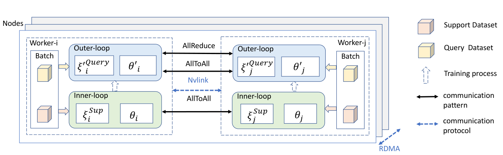
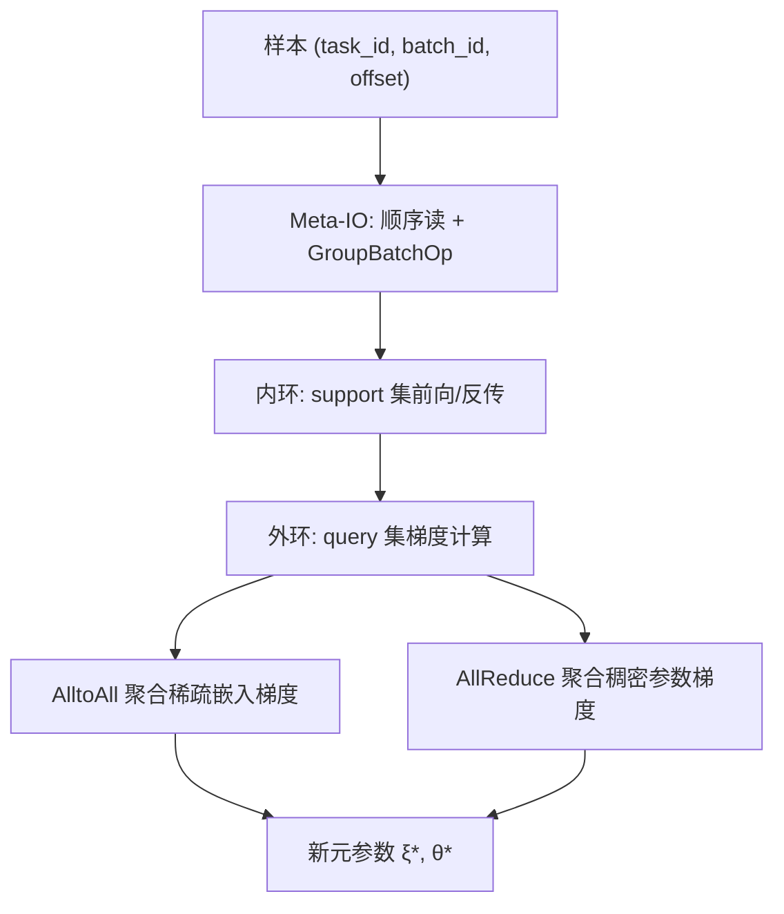
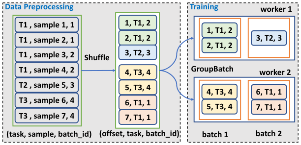

# G-Meta: Distributed Meta Learning in GPU Clusters for Large-Scale Recommender Systems (面向大规模推荐系统的 GPU 集群分布式元学习)

- **会议/期刊**: CIKM 2023 (Applied Track, 5 页短文)
- **作者与机构**: Youshao Xiao, Shangchun Zhao, Zhenglei Zhou, Zhaoxin Huan, Lin Ju, Xiaolu Zhang, Lin Wang, Jun Zhou（蚂蚁集团 Ant Group）
- **推荐链路定位**: 训练基础设施（服务于召回/精排全链路的 DLRM 训练与交付）
- **研究方向**: 去偏公平、可信隐私与工业架构 / 冷启动与长尾推荐
- **论文原文**: [https://arxiv.org/abs/2401.04338v1](https://arxiv.org/abs/2401.04338v1)
- **开源代码**: 暂未开源

## TL;DR (1分钟核心速览)

元学习（MAML 系）已被证明能显著缓解 DLRM 的冷启动，但现有分布式系统并不为"两套数据 + 两层更新循环"设计：Parameter Server 在 CPU 集群上算不动稠密层且嵌入层通信密集，AllReduce 又装不下十亿级嵌入表。G-Meta 提出 **AlltoAll 管稀疏嵌入 + AllReduce 管稠密参数的混合并行**，配合"梯度-求和算子交换"去中心化外环与 **Meta-IO** 流水线。在 Ali-CCP 上 2×4 张 A100 即达 169k samples/s，比 3760 核的 PS 基线快 22%、成本降 62.29%。

## Background & Motivation (背景与核心矛盾)

- **主流范式**: 工业界用 MAML/MeLU/CBML 等优化型元学习改造 DLRM——内环用 support set 学任务专属参数 $(\xi',\theta')$，外环用 query set 更新元参数$(\xi,\theta)$，以缓解新用户/新广告主的冷启动。
- **前人局限 1（架构错配）**: DMAML 沿用 Parameter Server，双循环把计算量翻倍，稠密层在 CPU 上极慢；同时 server 侧嵌入层是 I/O 与通信密集算子，GPU 算力被浪费。QMAML 用 AllReduce 并行，但单卡显存装不下 DLRM 的巨型嵌入表。
- **前人局限 2（数据管线错配）**: 元学习要求同一 batch 内样本同属一个 task，传统 sample-level shuffle 会混任务；QMAML 的 CV 版加载器面对 ASR 场景数十亿 KB 级小样本时，字符串反序列化成为新瓶颈。
- **核心洞察 (Key Insight)**: support 与 query 的两次嵌入查表可以合并预取；且外环中"先求和再求梯度"可换成"先求梯度再 AllReduce 求和"，从而彻底去掉中心节点。
- **本文切入点**: 用通信原语与数据流分层解耦稀疏/稠密参数，让 GPU 集群真正跑满元学习 DLRM。

## Method (核心方法设计)

### 1. 整体框架 (Overall Architecture)

G-Meta 分 Meta-Train 与 Meta-IO 两部分。Meta-Train 把嵌入参数 $\xi$按行分桶切分并均匀下发到各 worker，稠密参数$\theta$ 在各 worker 保留完整副本；内环各 worker 用本地 support 数据前向反传得到任务专属参数，外环用 query 数据算出梯度后，稀疏梯度走 AlltoAll 聚合、稠密梯度走 AllReduce 聚合，得到下一轮元参数；节点间用 RoCE/RDMA、节点内用 NVLink 承载这两类高连通通信。Meta-IO 在离线阶段完成 task 排序与 `batch_id`/`offset` 生成，在线阶段各 worker 按 offset 顺序读分片并用 `GroupBatchOp` 拼装同任务 batch，直接喂给训练循环。

<figure class="paper-figure" markdown="span">
  <figcaption>图1：G-Meta 的分布式训练架构</figcaption>
</figure>

### 2. 关键设计拆解 (Key Designs)

1. **双查询嵌入合并预取（降低通信频次）**: 内环只用 support、外环才用 query，若各查一次表则嵌入通信翻倍。G-Meta 改为一次 AlltoAll 同时预取 $\xi^{Sup}_i$与$\xi^{Query}_i$；随后外环对与 support 重叠的嵌入行用已算出的$\xi'^{Sup}_i$就地更新得到$\xi'^{Query}_i$，避免读到陈旧参数：
$$\xi'^{Sup}_i=\xi^{Sup}_i-\alpha\nabla_{\xi}\mathcal{L}^{Sup}_i,\qquad \theta'_i=\theta_i-\alpha\nabla_{\theta}\mathcal{L}^{Sup}_i$$
直觉：推荐场景 support/query 的 ID 重叠率高，一次拉全量远优于两次拉部分。

2. **外环更新规则的算子交换（去中心化）**: 原式 $\theta\leftarrow\theta-\beta\nabla_\theta\sum_{i=1}^{N}\mathcal{L}^{Query}_i$需要中心节点 Gather 全部$N$份任务专属参数，传输量$K(N-1)$、复杂度$O(KN)$。利用导数线性性交换求和与梯度：
$$\theta\leftarrow\theta-\beta\sum_{i=1}^{N}\nabla_\theta\mathcal{L}^{Query}_i$$
各 worker 本地算梯度后直接 AllReduce（Ring），传输量降至 $\frac{2K(N-1)}{N}$、复杂度降至$O(K)$，且天然无单点瓶颈。

3. **Meta-IO 与训练目标/开销**: 离线按 `task` 排序并写入 `batch_id`、`offset` 列，采用 TFRecords/WebDataset 二进制格式替代字符串解码；在线按 $(\text{offset}\cdot i,\ \text{offset}\cdot i+\text{total}/N)$顺序读，契合块存储；`GroupBatchOp` 按 `(task, batch_id)` 聚合同任务样本。总损失即各 worker query 损失的等权和$\mathcal{L}=\sum_i \mathcal{L}^{Query}_i$，CTR 二分类交叉熵，无负采样环节；推理时元参数即普通 DLRM，**推理零额外开销**。

<figure class="paper-figure" markdown="span">
  <figcaption>图2：Meta-IO 的数据流</figcaption>
</figure>

## Experimental Setup & Evaluation Protocol (实验设置与评估协议)

- **数据集与预处理**: Movielens 仅用于验证统计正确性，Ali-CCP 与内部 16 亿条数据集用于效率评测（原文未给出用户/物品维度与过滤细节）：

| 数据集 | #Users | #Items | #Interactions | 稀疏度/密度 | 特征/场景说明 |
| :--- | :---: | :---: | :---: | :---: | :--- |
| Movielens | 未报告 | 未报告 | 未报告 | 未报告 | 公开集，验证 MAML/MeLU/CBML 正确性 |
| Ali-CCP | 未报告 | 未报告 | 未报告 | 未报告 | 公开 CTR 集，吞吐对比 |
| In-house | 未报告 | 未报告 | 1.6B | 未报告 | 支付宝首页展示广告，真实 ASR 场景 |

- **数据划分与防穿越**: 元学习任务级划分（support/query 双集按 task 采样），效率实验侧重吞吐而非泛化，未报告时间戳切分细节。
- **排名评测协议**: 本文为系统论文，主指标是 **吞吐量 (samples/s) 与加速比 (Speedup Ratio)**，统计性能用 **AUC**（非全库排序/采样排序协议），三次实验取均值；未做显著性检验。
- **对比基线与超参设置**: 基线为 DMAML（Parameter Server 架构，CPU 集群 20→160 worker / 3760 核）+ 同等 Meta-IO 优化保证公平；CPU 侧 18 核/worker、22 核/server，GPU 侧最多 32×A100，NCCL 实现 AlltoAll/AllReduce。

## Key Experimental Results (实验关键数据)

### 1. 主实验对比 (Main Results)

| 配置 | 2×4 GPU / 20 CPU | 4×4 / 40 | 8×4 / 80 | 16×4 / 160 | 加速比区间 |
| :--- | :---: | :---: | :---: | :---: | :---: |
| DMAML-PS (public) | 29k / 1.00 | 51k / 0.88 | 91k / 0.78 | 138k / 0.59 | 0.88 → **0.59** |
| **G-Meta (public)** | **90k / 1.00** | **169k / 0.94** | **322k / 0.89** | **618k / 0.86** | 0.94 → **0.86** |
| DMAML-PS (in-house) | 27k / 1.00 | 48k / 0.88 | 79k / 0.73 | 126k / 0.58 | 0.88 → **0.58** |
| **G-Meta (in-house)** | **54k / 1.00** | **105k / 0.97** | **197k / 0.91** | **380k / 0.88** | 0.97 → **0.88** |

注：G-Meta 侧 2×4 为 8 卡、8×4 为 32 卡；G-Meta 用 8 卡 (169k) 即超过 PS 用 3760 核 (138k)，Improv. **+22%**，按阿里云报价成本节省 **62.29%**；规模扩展到 8×4 时吞吐达 **618k samples/s**。

### 2. 消融实验 (Ablation Study)

| 设置 (in-house) | 2×4 GPU 吞吐 | 相对基线加速 | 8×4 GPU 吞吐 | 相对基线加速 |
| :--- | :---: | :---: | :---: | :---: |
| Baseline (无 I/O、无网络优化) | 72k | 1.00 | — | 1.00 |
| \+ 仅 I/O 优化 | — | **+27%** | — | 收益收窄 |
| \+ 仅网络优化 (RoCE/NVLink) | — | **+12%** | — | — |
| **\+ 二者（完整 G-Meta）** | — | **+45%** | — | **+51%** |

### 3. 关键实验发现 (Key Findings)

1. **架构收益是量级性的而非线性的**：G-Meta 仅用 2×4 张 A100 的 169k samples/s，就超过 DMAML 在 160 worker + 40 server（3760 核）上的 138k，说明 PS 架构下增加 CPU 核数已进入收益极小区，瓶颈在稀疏嵌入的通信与稠密层的算力错配。
2. **扩展性曲线形状不同**：DMAML 从 20→160 worker 加速比由 0.88 崩到 0.59（in-house 更差，0.58），而 G-Meta 从 2×4→8×4 仅由 0.94 缓降到 0.86，证明"交换求和与梯度 + Ring-AllReduce"消除了中心节点导致的次线性劣化。
3. **两项优化对节点数敏感度相反**：2×4 时 I/O 与网络分别贡献 27%/12%（合计 45%）；到 8×4 合计提升至 51% 但 I/O 单项收益收窄，因为同步训练下任一节点的 I/O 停顿都会阻塞整个迭代——系统优化必须与并行度协同调参，而非简单叠加。
4. **加速不以精度为代价**：图 3 显示 MAML/MeLU/CBML 三种元模型在 Movielens 上 G-Meta 与 DMAML 的 AUC 曲线几乎重合，混合并行未引入统计性能损失。

## Highlights & Limitations (亮点、对比与审稿批判)

- **与代表作对比 (vs. Prior Work)**: 相比 DMAML（PS + CPU 集群）本工作把稀疏/稠密参数分而治之并迁到 GPU；相比 QMAML（纯 AllReduce + CV 数据加载）解决了显存装不下嵌入表与 ASR 小样本加载两个工业约束；相比 TSAML 等算法侧工作，本文不动算法语义，只重写执行层，因而可即插即用地承接 MAML/MeLU/CBML。
- **可迁移亮点**: ①"合并预取 support/query 嵌入"的双查询优化，可直接迁移到任何双阶段（训练/验证、粗排/精排）共享嵌入表的训练范式；②"排序 + batch_id + offset 顺序读"的 Meta-IO 思路，对需要 group-wise 组装的对比学习/列表级重排样本构造同样适用。
- **审稿级局限批判**: ① 论文仅 5 页且**完全缺失数据集规模统计、元学习任务构造细节与超参**，Movielens 上的 AUC 只以曲线呈现、无数值与显著性检验，"不损精度"的结论偏弱；② 系统收益强依赖 RoCE/NVLink 专用硬件与 32×A100 规模，中小企业难以复现；③ Meta-IO 在小节点数下收益显著、大规模下被同步屏障稀释，缺少异步/流水重叠方案的讨论。

## Rating (四维评分)

- **方法创新性 (Novelty)**: ⭐⭐⭐ （算子交换与混合并行在系统层面是扎实的工程创新，但算法侧沿用 MAML，理论新颖度有限）
- **评估协议与实验扎实度 (Protocol & Experiments)**: ⭐⭐⭐ （吞吐/加速比/成本/线上 A/B 四维覆盖完整，但缺数据集统计、显著性检验与细粒度精度数值）
- **写作与数学规范度 (Clarity & Rigor)**: ⭐⭐⭐⭐ （算法 1 与通信量/复杂度对比清晰，公式简洁；仅个别符号排版粗糙、系统图信息密度偏高）
- **工业落地与复现价值 (Industrial & Practical Value)**: ⭐⭐⭐⭐⭐ （自 2022 年起在支付宝核心广告与推荐全量部署，交付时长 3.7h→1.2h、CVR +6.48%、CPM +1.06%，落地价值已被线上验证）

