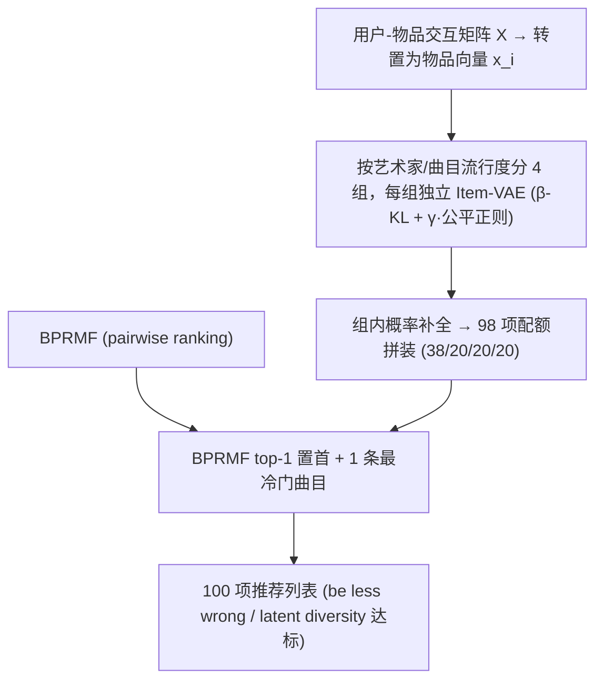
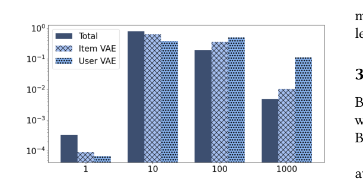

# Item-based Variational Auto-encoder for Fair Music Recommendation (基于物品变分自编码器的公平音乐推荐)

- **会议/期刊**: CIKM 2022 — EvalRS DataChallenge Workshop (CEUR Workshop Proceedings)
- **作者与机构**: Jinhyeok Park, Dain Kim, Dongwoo Kim (POSTECH)
- **推荐链路定位**: 召回 (全库矩阵补全) + 列表级配额重排 (top-100 列表构造)
- **研究方向**: 去偏公平 / 协同过滤
- **论文原文**: [论文原文链接](https://arxiv.org/abs/2211.01333v1)
- **开源代码**: [开源代码仓库链接](https://github.com/ParkJinHyeock/evalRS-submission)

## TL;DR (1分钟核心速览)

EvalRS DataChallenge 要求同时优化准确率、5 组 MRED 公平性与行为测试 (be less wrong / latent diversity), 而单一 user-based VAE 与 BPRMF 都会把曝光压向头部曲目。本文把 VAE-CF 的输入矩阵转置为物品视角, 按艺术家/曲目流行度分组各训一个 VAE, 叠加“组重建损失 vs 全局重建损失”的公平正则, 再用配额式列表拼装 + BPRMF top-1 兜底。LFM-1b 的 Leave-One-Out 四折上, Phase2 综合分 1.553 vs 官方 CBOW 基线 −1.212, 艺术家/曲目流行度 MRED 幅度分别下降 86%/79%, 但 HR 由 0.0363 降至 0.0161。

## Background & Motivation (背景与核心矛盾)

- **主流范式**: 音乐推荐以 VAE-CF (多项似然重建用户交互向量) 与 BPRMF (成对排序) 为主, 训练目标几乎只优化 HR/MRR。
- **前人局限**: ① 纯效用优化放大 Matthew effect: user-based VAE 把交互集中在头部曲目, 播放量 <10 的最冷门组几乎无法被推荐; ② 组间公平在评测侧按 MRED 计算 (性别/国家/用户活跃度/艺术家流行度/曲目流行度五组), 而 accuracy 与 MRED 常常此消彼长, 单一模型无法同时占优。
- **核心洞察 (Key Insight)**: 物品向量 $\mathbf{x}_i$ 跨全体用户共享, 其多项似然天然平滑了“少数用户才能触达长尾”的稀疏性; 同时把最冷门组单独建模并强制配额, 可在不改变模型表征的前提下直接改写曝光分布。
- **本文切入点**: 以 item-based VAE 为主干 + 分组独立训练 + 公平正则 + 列表级配额, 让公平性由“模型 + 组配额”共同保证。

## Method (核心方法设计)

### 1. 整体框架 (Overall Architecture)

把交互矩阵转置后用物品向量 $\mathbf{x}_i\in\{0,1\}^{U}$ 输入 VAE, 得到全库补全概率并据此对每用户排序; 同时按艺术家流行度 4 组、曲目流行度 4 组分别训练独立 VAE (最冷门组各多训 2 epoch, 隐维下调至 15), 并把四支模型的排序结果按 38/20/20/20 比例抽 98 项、以 5/5/5/5 交错排列前 20 项, 再补 1 条最冷门曲目, 最后把 BPRMF 的 top-1 放到首位构成 100 项列表。

### 2. 关键设计拆解 (Key Designs)

1. **Item-based VAE (把 CF-VAE 转置, 换取长尾曝光)**：user-based 输入下每行仅少数非零, 长尾物品难以获得梯度; 改用物品向量后 ELBO 变为
$\mathcal{L}_{\beta}(\mathbf{x}_i;\theta,\phi)=\mathbb{E}_{q_\phi(\mathbf{z}_i|\mathbf{x}_i)}[\log p_\theta(\mathbf{x}_i|\mathbf{z}_i)]-\beta\,\mathrm{KL}\!\left(q_\phi(\mathbf{z}_i|\mathbf{x}_i)\|p(\mathbf{z}_i)\right)$,
其中似然为多项分布, 且共享一份物品隐空间使头部/长尾物品的曝光概率被同一尺度校准, 从而推荐分布贴近全体曲目分布 (图 1)。

<figure class="paper-figure" markdown="span">
  <figcaption>图1：所有物品与通过模型推荐物品的流行度分布。x轴表示曲目流行度分组，y轴表示各分组比例。由于分布偏斜，y轴采用对数刻度。结果表明，item-VAE 推荐的物品与所有物品的总体流行度分布相似。</figcaption>
</figure>

2. **流行度分组独立训练 + 配额式列表拼装 (把公平写进候选集)**：单模型无法同时满足 4 个流行度组的 miss rate 均衡, 因此分组各自训练并从各组按固定条数取候选, 使组配额成为硬约束而非软激励; 最冷门组额外 2 epoch 解决欠拟合, 交错(5/5/5/5)而非集中排列可避免组内簇聚伤害 latent diversity。
3. **公平正则与训练/推理开销**：在组重建损失与全局重建损失间加绝对差惩罚
$F_\phi=\mathbb{E}\!\left[\left|\frac{1}{|G_j|}\sum_{c\in G_j}\mathbb{E}[\log p_\theta(\mathbf{x}_c|\mathbf{z}_c)]-\frac{1}{|\mathcal{I}|}\sum_{i\in\mathcal{I}}\mathbb{E}[\log p_\theta(\mathbf{x}_i|\mathbf{z}_i)]\right|\right]$,
最终目标 $\mathcal{L}^{R}_{\beta}=\mathcal{L}_{\beta}-\gamma F_\phi$($\gamma=0.003$,$\beta=10^{-4}$), 隐维 Phase1 为 500/隐层 300、Phase2 调至 17, batch 32, Adam$10^{-3}$ 训 2 epoch; BPRMF 隐维 200、batch 8192, 以免负采样 (全库补全) 推理, 总开销为 4+1 个 VAE 前向, 单机 CPU 可跑。

## Experimental Setup & Evaluation Protocol (实验设置与评估协议)

| 数据集 | #Users | #Items | #Interactions | 稀疏度/密度 | 特征/场景说明 |
| :--- | :---: | :---: | :---: | :---: | :--- |
| LFM-1b | 119,555 | 820,998 | 37,926,429 | ~3.8e-4 | 音乐收听日志; 含性别/国籍人口属性与艺术家、曲目元数据 |

- **数据划分与防穿越**: `Leave-One-Out` — 每用户历史随机遮蔽 1 条为测试正例, 评测侧公开 4 折 (Fold1–4)。
- **排名评测协议**: 官方 EvalRS 脚本对提交的 top-100 列表打分 (列表级全库排序, 不做负采样近似), 指标为 HR、MRR、5 组 MRED (性别/国家/用户活跃度/艺术家流行度/曲目流行度)、be less wrong (GT 与 top-1 表征距离)、latent diversity。
- **对比基线与超参**: 官方提供 `CBOWRecSysBaseline` + 自建 user-based VAE、BPRMF 骨干对照; Phase1 九指标简单平均, Phase2 按 Phase1 难度重加权; 未报告显著性检验。

## Key Experimental Results (实验关键数据)

### 1. 主实验对比 (Phase 1 骨干 / Phase 2 终版)

| 模型 (Phase 1, 九指标均值) | HR↑ | MRR↑ | User MRED↓ | TrackPop MRED↓ | ArtistPop MRED↓ | Be less wrong↓ | Latent Div.↑ | Score↑ |
| :--- | :---: | :---: | :---: | :---: | :---: | :---: | :---: | :---: |
| **VAE (item)** | **0.2121** | **0.0399** | −0.0287 | −0.0529 | −0.0216 | **0.3189** | **−0.3041** | **0.0138** |
| VAE (user) | 0.1593 | 0.0256 | −0.0323 | −0.0937 | −0.0430 | 0.3512 | −0.2726 | 0.0082 |
| BPRMF | 0.0372 | 0.0025 | **−0.0163** | **−0.0230** | **−0.0102** | 0.3721 | −0.2948 | 0.0056 |
| Improv. (item vs user) | +33.2% | +55.9% | — | 43.6%↓偏差 | 49.8%↓偏差 | 9.2%↓ | +11.6% | +68.3% |

| 模型 (Phase 2, 4 折均值) | HR↑ | MRR↑ | Country↓ | User↓ | TrackPop↓ | ArtistPop↓ | Gender↓ | Be less wrong↓ | Latent Div.↑ | Score↑ |
| :--- | :---: | :---: | :---: | :---: | :---: | :---: | :---: | :---: | :---: | :---: |
| **Ours (item-VAE 组集 + BPRMF)** | 0.0161 | 0.0017 | **−0.0037** | **−0.0029** | **−0.0023** | **−0.0010** | **−0.0007** | **0.3639** | **−0.2964** | **1.553** |
| CBOWRecSysBaseline | **0.0363** | **0.0037** | −0.0090 | −0.0224 | −0.0111 | −0.0072 | −0.0061 | 0.3758 | −0.3080 | −1.212 |
| Improv. | −55.6% | −54.1% | 59%↓ | 87%↓ | 79%↓ | 86%↓ | 89%↓ | 3.2%↓ | +3.8% | +2.765(绝对) |

### 2. 消融实验 (组件级替换对照, 原文 Table 2 / Table 4)

| 模型 | MR@轨流1↑ | MR@10↑ | MR@100↑ | MR@1000↑ | TrackPop MRED↓ | CV-HR↓ |
| :--- | :---: | :---: | :---: | :---: | :---: | :---: |
| VAE (item) | 0.8946 | 0.7865 | 0.7770 | 0.8803 | −0.0529 | 0.2559 |
| VAE (user) | 0.9398 | 0.8861 | 0.8063 | 0.6448 | −0.0937 | 0.7022 |
| BPRMF | 0.9965 | 0.9831 | 0.9387 | 0.9487 | −0.0230 | 0.6436 |
| **VAE (final)** | **0.9858** | **0.9851** | **0.9821** | **0.9867** | **−0.0023** | **0.0701** |

### 3. 关键实验发现 (Key Findings)

1. **“物品视角”本身就是最强去偏算子**: 同一 VAE 架构下, item 化把 HR 从 0.1593 拉到 0.2121 (+33.2%) 的同时将 TrackPop MRED 偏差收窄 43.6%, 即长尾准确率 (MR 0.8946 vs 0.9398) 与头部准确率 (0.8803 vs 0.6448 变差) 发生置换而不是整体退化, 说明公平收益来自 $p_\theta(\mathbf{x}_i|\mathbf{z}_i)$ 的跨用户共享先验, 而非牺牲全部效用。
2. **MRED 的巨额下降主要来自列表配额而非表征学习**: 最终模型 TrackPop/ArtistPop MRED 仅剩 −0.0023/−0.0010 (为纯 item-VAE 的 4%/5%), 但 HR 同步跌至 0.0161, 表明 38/20/20/20 的硬配额是把 miss rate“拉平”的主因, 属于评测对齐式的后处理收益。
3. **尺度无关度量会推翻模型排序**: 按作者提出的 CV-HR, VAE(final) 在艺术家组 MR 极均衡 (0.9831–0.9848) 却因 HR 过低取得 CV=0.1459, 反而差于 VAE(item) 的 0.1019 (HR 0.2121) — 证明 MRED 只惩罚绝对偏差会奖励“低准确率的均贫”模型, 必须用相对比值校正。

## Highlights & Limitations (亮点、对比与审稿批判)

- **与代表作对比**: vs. Liang et al. (Mult-VAE, 用户视角多项似然) 本文只做矩阵转置与分组重训, 改动极小却直接改变曝光分布; vs. F2VAE (只在用户侧加公平正则) 本文把正则作用到物品流行度组并与硬配额互补; vs. BPRMF 本文不追求其 pairwise 精度, 仅借其 top-1 的语义邻近性 (be less wrong) 做兜底集成。
- **可迁移亮点**: ① 分组独立建模 + 组配额交错的列表拼装, 可直接用于多场景/长尾扶持的候选融合; ② CV-HR 式“偏差/均值”归一化公平度量, 适用于任何量纲敏感的组公平对比。
- **审稿级局限批判**: ① **指标工程风险**: 综合分从 −1.212 跃至 1.553 依赖 Phase2 的难度重加权与固定 100 项列表的组配额, 而 HR 腰斩 (−55.6%), 缺少同预算、同列表长度的基线对照, 难以判定是“更公平”还是“更贴指标”; ② **消融与显著性缺失**: 公平正则 ($\gamma=0.003$)、分组数 4、隐维 17/15 均手搜, 从未拆开单独验证$F_\phi$的贡献, 也未报告 4 折方差或$p$ 值, 复现结论的置信度偏弱。

## Rating (四维评分)

- **方法创新性 (Novelty)**: ⭐⭐⭐ （组件均为已有模块的重新组合, 但“转置 + 分组 + 配额”的组合洞察扎实, 并额外提出 CV-HR 度量）
- **评估协议与实验扎实度 (Protocol & Experiments)**: ⭐⭐⭐ （官方 4 折 + 5 组 MRED + 行为测试较全面, 但仅对比 CBOW 基线, 无真消融与显著性检验）
- **写作与数学规范度 (Clarity & Rigor)**: ⭐⭐⭐ （ELBO 与正则式书写清晰, 但流行度分组标签 1/10/100/1000 语义含糊, 变量符号在正文与表格间不统一）
- **工业落地与复现价值 (Industrial & Practical Value)**: ⭐⭐⭐ （代码已开源、纯 CF 无额外特征易复现, 但 4+1 个 VAE 分组重训与配额规则使线上维护成本偏高）

